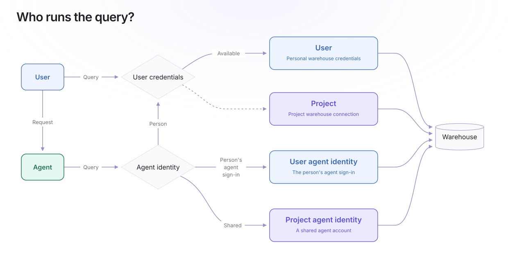
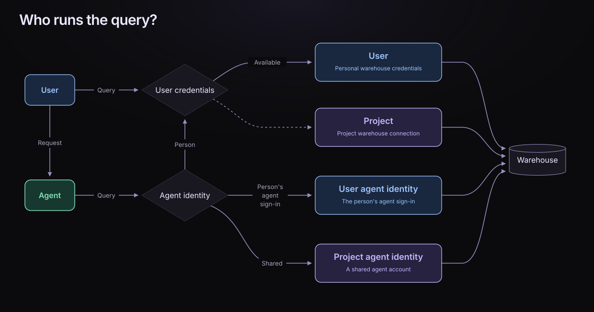
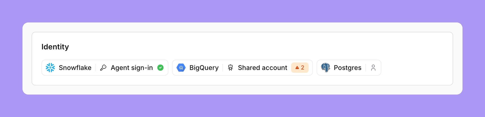
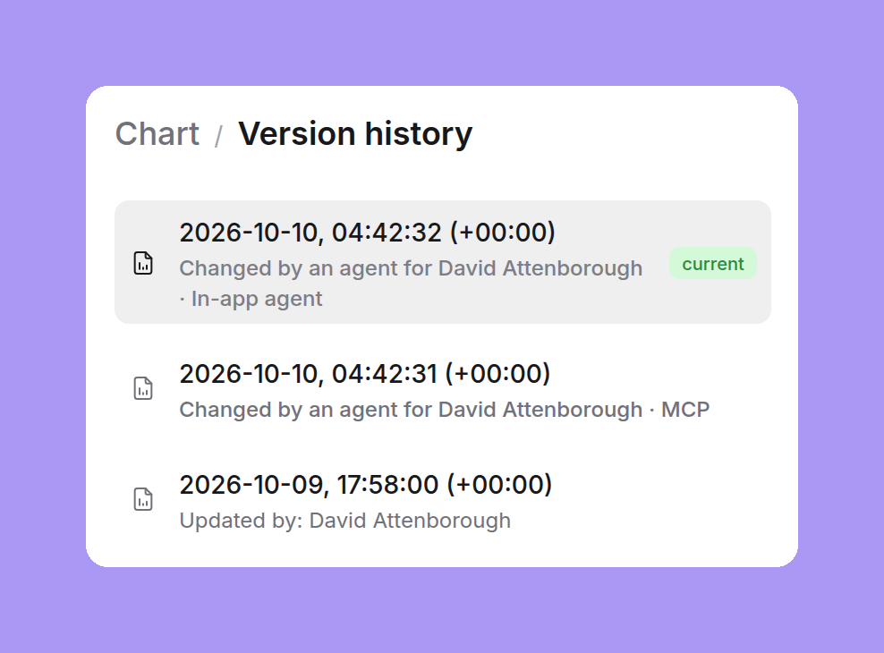
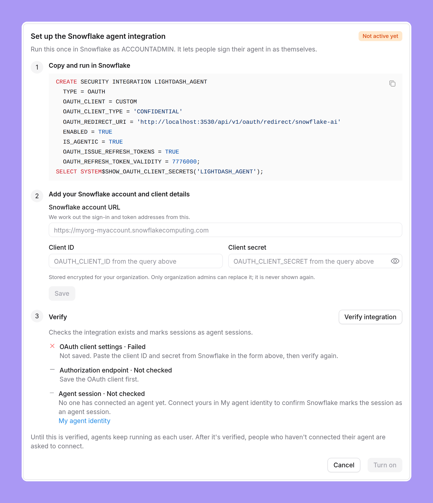
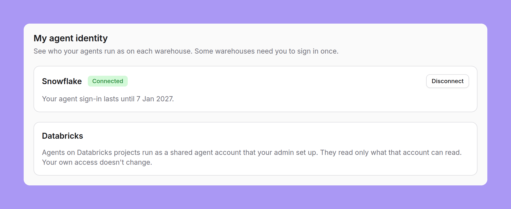
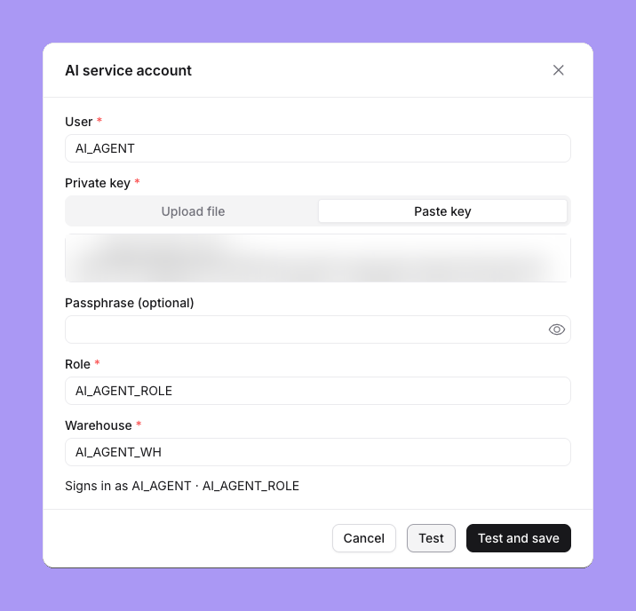
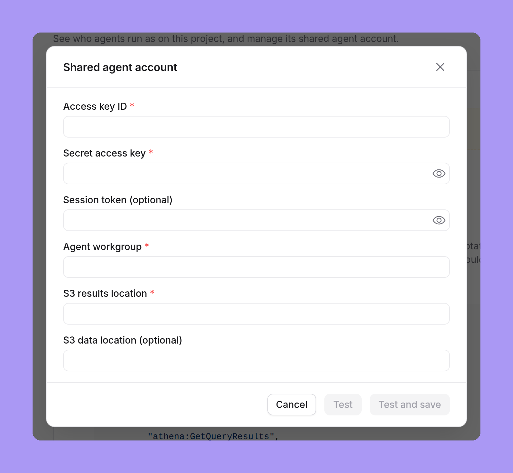

import { FeatureBadge } from '/snippets/feature-badge.jsx';

<div className="feature-badges"><FeatureBadge label="Beta" /> <FeatureBadge label="Enterprise" /></div>

<Info>
  Agent identity requires the `agent-identity` feature flag. On Lightdash Cloud, ask Lightdash support to enable it for your organization. On a self-hosted instance, [enable the flag](/self-host/enterprise-features/ai-agents#agent-identity).
</Info>

AI agents run SQL through your Lightdash project's warehouse connections. Agent identity lets you choose a separate identity for agent queries, with its own policies:

- **The person**. The default: agents use the same credentials as the person asking, either the project's shared credentials or that person's [personal warehouse credentials](/personal-settings/personal-warehouse-connections) when the project uses them.
- **The person's agent sign-in**. Each person connects their agent separately. The warehouse recognizes it as an agent session, so policies can restrict the agent while preserving the person's own access. For example, an agent can see redacted personally identifiable information (PII) while the person can query the unredacted values.
- **A shared agent account**. All agents on a project use the access granted to one dedicated warehouse account. Use it when every agent user may see the same data.

<Frame>
  
  
</Frame>

Lightdash's [data access controls](/agents/data-access) and [agent permissions](/agents/agent-permissions) still apply on top of agent identity configurations.

<div className="agent-identity-support">

| Warehouse | Person | Person's agent sign-in | Shared agent account |
| --- | --- | --- | --- |
| Snowflake | <Icon icon="check" /> | <Icon icon="check" /> | <Icon icon="check" /> |
| BigQuery | <Icon icon="check" /> | <Icon icon="x" className="matrix-no" /> | <Icon icon="check" /> |
| Databricks | <Icon icon="check" /> | <Icon icon="x" className="matrix-no" /> | <Icon icon="check" /> |
| Athena | <Icon icon="check" /> | <Icon icon="x" className="matrix-no" /> | <Icon icon="check" /> |
| Postgres | <Icon icon="check" /> | <Icon icon="x" className="matrix-no" /> | <Icon icon="check" /> |
| Redshift | <Icon icon="check" /> | <Icon icon="x" className="matrix-no" /> | <Icon icon="check" /> |
| Trino | <Icon icon="check" /> | <Icon icon="x" className="matrix-no" /> | <Icon icon="check" /> |
| ClickHouse | <Icon icon="check" /> | <Icon icon="x" className="matrix-no" /> | <Icon icon="check" /> |

</div>

## Choose who agents run as

In **Organization settings → Agents → Identity**, select your warehouse's chip and choose an identity. Only organization admins can change this rule, which applies to every connection of that warehouse type across the organization.

<Frame>
  
</Frame>

The chip's label shows the selected identity: **Shared account**, **Agent sign-in**, or an icon alone for **The person**. Its status shows whether setup needs attention:

| Status | What to do |
| --- | --- |
| Green tick | Setup is complete. For agent sign-in, each person still needs to connect their agent. |
| Orange number | Add a shared agent account to this many projects. Open the chip for links to their settings. |
| Orange warning | Open the chip to check the agent integration setup. |

Configure the shared agent accounts or agent integration before changing the rule. **Lightdash refuses agent queries when the required identity is unavailable; it never falls back to the person's or project's credentials.** For agent sign-in, the rule takes effect when you select **Turn on** after setup.

### Manage shared agent accounts

Project admins add credentials under **Project settings → Agent identity → Add shared agent account**. Set up an account on every connection that agents use, then enable **A shared agent account** in the organization rule. People using agents have nothing to connect.

**Every person's agent gets the shared account's warehouse access.** Grant it only data that every agent user may see. Its grants do not inherit each person's warehouse restrictions. Keep the tables and fields available to agents within that access; [agent tags](/agents/data-access#limiting-access-to-specific-explores-and-fields) can restrict which explores and fields they use.

Use **Test** to check the saved account and inspect **Signs in as**. A successful test proves the connection works, not that the account has the right data access. Verify both an allowed query and a query the account should be denied.

Use **Replace** to rotate credentials or change the account, and **Remove** to delete it. If the rule still requires a shared account, removing it blocks agent queries on that connection.

### Preview projects

Preview projects use their parent's shared agent account for the matching connection. Manage credentials on the parent; the preview's **Agent identity** page is read-only, with a link to the parent and a **Test** action.

The original connection matches the parent's original connection. Extra connections match by name and warehouse type within the same organization. Without a match, the preview has no shared agent account. A preview of a preview uses its direct parent's account.

Grant the parent's account access to the datasets or schemas used by previews. Anyone who can query a preview can ask agents to query it with that account.

### My agent identity

**Settings → My agent identity** shows your agent connections when your organization requires a separate identity. For **The person's agent sign-in**, connect your agent here and check its expiry date. For **A shared agent account**, the page identifies the account type your admin manages; you have nothing to set up.

If you disconnect your agent sign-in, or the warehouse revokes it, reconnect here before using agents again.

### Who can read a saved result

Lightdash checks access whenever someone reads a saved or cached result. The reader must still have access to the project, content, and fields, and their identity must match the identity that produced the result. A person's own queries cannot reuse results produced by an agent identity, and an agent can read only results produced by its own agent.

After an identity, user attribute, or field access change, run the query again if Lightdash reports incompatible access. Results saved before agent identity was enabled also require a fresh query.

These checks do not cover scheduled delivery attachments or signed download links.

### The Lightdash CLI

The CLI runs as the person, using their own warehouse access. Its queries are not marked as agent queries or limited by [agent permissions](/agents/agent-permissions). The [`lightdash agent status` and `lightdash agent connect`](/workflow/cli/reference#lightdash-agent-status) commands report this limitation; they do not issue an agent credential. On a project that uses a shared agent account, they report that no agent connection is needed.

### Troubleshooting

| Message or problem | Resolution |
| --- | --- |
| “Agents can't run on this project yet. It needs a shared agent account.” | A project admin adds the account in **Project settings → Agent identity**. On a preview, add it to the parent. |
| The shared agent account failed to sign in | A project admin tests the account and replaces invalid or expired credentials. |
| “Connect your agent to the warehouse once so it can run as you.” | Connect in **Settings → My agent identity**, then retry the request. |
| “Your agent connection expired. Connect again.” | Reconnect in **Settings → My agent identity**, then retry the request. |
| “The warehouse OAuth client was rejected.” | An organization admin checks the warehouse integration and saved OAuth client. Reconnecting your own agent will not fix it. |
| “These results are not compatible with your current access. Run the query again.” | Run the query again with your current identity and access. |
| Access denied on preview data | Grant the parent's shared agent account access to the preview's datasets or schemas. |

## Observe agent activity

Use warehouse query history to audit data access and query costs. Use Lightdash version history and application logs to trace content changes and denied actions. Each record identifies the person or Lightdash service account the agent acted for, along with the agent's surface and client.

### Warehouse query tags

Tags identify agent activity for auditing; they do not establish a warehouse identity or enforce access policies. Lightdash keeps agent attribution in its query history and sends it to the warehouse through its query-tagging mechanism.

| Tag | Meaning |
| --- | --- |
| `agent` | `true` for an agent query. |
| `user_uuid` | The Lightdash user the agent ran for. |
| `agent_surface` | Where the agent ran. |
| `agent_client` | The client that ran the agent. |
| `agent_uuid` | The Lightdash AI agent UUID for in-app chat and Slack; absent for MCP queries. |

| Surface | `agent_surface` | `agent_client` |
| --- | --- | --- |
| In-app chat | `in_app_agent` | `lightdash-chat` |
| MCP | `mcp` | OAuth client ID; `unknown` for personal access or service account tokens |
| Slack | `slack_agent` | Slack app ID |
| Data app sample queries | `data_app` | `lightdash-data-app` |
| Scheduled delivery AI summaries | `ai_summary` | `lightdash-ai-summary` |

Client IDs are lowercase. IDs containing unsupported label characters or longer than 60 characters become `h-` followed by a stable 32-character hash.

### Find agent queries in the warehouse

BigQuery records these tags as job labels; Snowflake records them in the JSON `query_tag`. Agent attribution takes priority over other tags when warehouse limits apply. For cost reporting, see [Attribute BigQuery cost with job labels](/workspace-admin/usage-analytics#attribute-bigquery-cost-with-job-labels).

These examples find MCP queries from the last day. Change `agent_surface` to audit another surface, or filter by `agent_client` for a particular client. On BigQuery, replace `region-us` with your dataset region and use an account that can list the project's jobs.

<CodeGroup>

```sql BigQuery
SELECT creation_time, user_email, job_id,
       (SELECT value FROM UNNEST(labels) WHERE key = 'user_uuid') AS lightdash_user_uuid,
       (SELECT value FROM UNNEST(labels) WHERE key = 'agent_surface') AS agent_surface,
       (SELECT value FROM UNNEST(labels) WHERE key = 'agent_client') AS agent_client,
       (SELECT value FROM UNNEST(labels) WHERE key = 'agent_uuid') AS agent_uuid
FROM `region-us`.INFORMATION_SCHEMA.JOBS
WHERE creation_time >= TIMESTAMP_SUB(CURRENT_TIMESTAMP(), INTERVAL 1 DAY)
  AND EXISTS (
    SELECT 1 FROM UNNEST(labels) AS label
    WHERE label.key = 'agent_surface' AND label.value = 'mcp'
  )
ORDER BY creation_time DESC;
```

```sql Snowflake
SELECT start_time, user_name, agent_type,
       TRY_PARSE_JSON(query_tag):user_uuid::STRING AS lightdash_user_uuid,
       TRY_PARSE_JSON(query_tag):agent_surface::STRING AS agent_surface,
       TRY_PARSE_JSON(query_tag):agent_client::STRING AS agent_client
FROM SNOWFLAKE.ACCOUNT_USAGE.QUERY_HISTORY
WHERE start_time >= DATEADD('day', -1, CURRENT_TIMESTAMP())
  AND TRY_PARSE_JSON(query_tag):agent_surface::STRING = 'mcp'
ORDER BY start_time DESC;
```

</CodeGroup>

The warehouse principal appears in `user_email` on BigQuery and `user_name` on Snowflake. For other query metadata, see [Query tags](/workspace-admin/usage-analytics#query-tags).

### Content version history

Versions of charts, dashboards, SQL charts, documents, and data apps record agent attribution. Chart and dashboard history show **Changed by an agent for**, followed by the person and surface. Attribution comes from the signed-in credential and agent runtime, so tool arguments and request headers cannot override it.

<Frame>
  
</Frame>

### Application audit logs

The agent action log records writes that do not create a version, such as space changes, scheduled deliveries, share links, and dbt write-back commits. It also records denied actions. Entries include the organization, project, time, agent, object, action, outcome, deciding policy, and reason code. They exclude data, tool arguments, SQL, recipients, URLs, and secrets.

Each entry also goes to the application audit log. Self-hosted administrators can use [Agent identity audit entries and logs](/self-host/enterprise-features/ai-agents#agent-identity-audit-entries-and-logs) to find them. Retention follows query history, controlled by `QUERY_HISTORY_RETENTION_DAYS`.

## Set up your warehouse

Choose your warehouse for credentials, grants, and policy examples.

<Columns cols={2}>
  <a href="#snowflake" className="not-prose"><Card title="Snowflake" icon="/images/icons/snowflake.svg" horizontal /></a>
  <a href="#bigquery" className="not-prose"><Card title="BigQuery" icon="/images/icons/bigquery.svg" horizontal /></a>
  <a href="#databricks" className="not-prose"><Card title="Databricks" icon="/images/icons/databricks.svg" horizontal /></a>
  <a href="#athena" className="not-prose"><Card title="Athena" icon="/images/icons/athena.svg" horizontal /></a>
  <a href="#postgres" className="not-prose"><Card title="Postgres" icon="/images/icons/postgres.svg" horizontal /></a>
  <a href="#redshift" className="not-prose"><Card title="Redshift" icon="/images/icons/redshift.svg" horizontal /></a>
  <a href="#trino" className="not-prose"><Card title="Trino" icon="/images/icons/trino.svg" horizontal /></a>
  <a href="#clickhouse" className="not-prose"><Card title="ClickHouse" icon="/images/icons/clickhouse.svg" horizontal /></a>
</Columns>

## Snowflake

Snowflake supports verified agent sessions for each person and a dedicated shared user. Both can use warehouse policies to restrict agent access.

- **One Snowflake account**. The organization has one agent integration; every project using per-person agent sign-in must use that Snowflake account.
- **Allowed default role**. Each person needs a default role outside `ACCOUNTADMIN`, `SECURITYADMIN`, `ORGADMIN`, and `GLOBALORGADMIN`, which Snowflake blocks in OAuth sessions.

### The person

Agents use the project's normal Snowflake credentials or the person's [personal warehouse credentials](/personal-settings/personal-warehouse-connections) when the project uses them.

<a id="snowflake-agent-sign-in-for-each-person" />

### The person's agent sign-in

Snowflake OAuth creates a verified agent session for each person. Policies can distinguish that session using `SYS_CONTEXT('SNOWFLAKE$CURRENT', 'IS_AGENT_ACTIVATED')`. Without policies, the agent retains the access of the person's role.

#### Set up the Snowflake agent integration

An organization admin configures the integration once:

1. In **Organization settings → Agents → Identity**, select the Snowflake chip and **The person's agent sign-in**.
2. Run the provided `CREATE SECURITY INTEGRATION` SQL in Snowflake as `ACCOUNTADMIN`. It includes your instance's redirect URL and a statement that returns the client ID and secret.
3. Enter the **Snowflake account URL**, **Client ID**, and **Client secret**, then **Save**. For example, the account URL is `https://myorg-myaccount.snowflakecomputing.com`.
4. Select **Verify integration**, then **Turn on** when the required checks pass. Tell people to connect their agents before they next use AI features.

<Frame>
  
</Frame>

Verification requires a saved OAuth client and a reachable Snowflake sign-in page. The agent-session check passes after the first person connects; it is not required to enable the rule. A reachable sign-in page does not prove the integration settings are correct.

Use **View setup** in the Snowflake chip to review the integration. Lightdash encrypts the client secret.

#### Connect your agent

In **Settings → My agent identity**, select **Connect agent** on the Snowflake card and approve the Snowflake sign-in. Lightdash saves the connection only after verifying that Snowflake marks it as an agent session.

<Frame>
  
</Frame>

#### Verify the agent session

Ask an agent to run the check through [SQL mode](/agents/use-ai-agents#sql-mode) or MCP's `run_sql`, then run it in a Snowflake worksheet as the same person:

```sql
SELECT SYS_CONTEXT('SNOWFLAKE$CURRENT', 'IS_AGENT_ACTIVATED') AS agent_activated,
       SYS_CONTEXT('SNOWFLAKE$SESSION', 'ACTIVE_RESTRICTED_SESSION_SCOPES') AS active_scopes;
```

`agent_activated` should be true only in the agent session. In `SNOWFLAKE.ACCOUNT_USAGE.QUERY_HISTORY`, `agent_type = 'EXTERNAL_AGENT'` confirms a verified agent session; a query tag alone does not. Account usage has an ingestion delay. See [QUERY_HISTORY](https://docs.snowflake.com/en/sql-reference/account-usage/query_history).

Query a protected table both ways to confirm the row, masking, and session policies produce the access you intended.

### Shared agent account

Use a dedicated Snowflake user with key-pair authentication. Set its user, private key, role, and warehouse in Lightdash.

#### Create the user and grants

Create an [RSA key pair](https://docs.snowflake.com/en/user-guide/key-pair-auth), a role, and a warehouse for agents, then create the user and grant access:

```sql
CREATE USER AI_AGENT
      TYPE = SERVICE_AGENT
      RSA_PUBLIC_KEY = '<public key without PEM headers>'
      DEFAULT_ROLE = AI_AGENT_ROLE
      DEFAULT_WAREHOUSE = AI_AGENT_WH;
    GRANT ROLE AI_AGENT_ROLE TO USER AI_AGENT;
```

```sql
GRANT USAGE ON WAREHOUSE AI_AGENT_WH TO ROLE AI_AGENT_ROLE;
    GRANT USAGE ON DATABASE <database> TO ROLE AI_AGENT_ROLE;
    GRANT USAGE ON SCHEMA <database>.<schema> TO ROLE AI_AGENT_ROLE;
    GRANT SELECT ON TABLE <database>.<schema>.<table> TO ROLE AI_AGENT_ROLE;
```

`TYPE = SERVICE_AGENT` marks every session as an agent session, allowing agent-session policies to apply. With another user type, only the role's grants restrict agents. See [SERVICE_AGENT users](https://docs.snowflake.com/en/sql-reference/sql/create-user).

#### Add and verify the account

In **Project settings → Agent identity → Add shared agent account**, enter **User**, **Private key**, **Role**, and **Warehouse**, plus **Passphrase** if needed. Paste the complete PEM key, including matching `BEGIN` and `END` lines for `PRIVATE KEY`, `RSA PRIVATE KEY`, or `ENCRYPTED PRIVATE KEY`. Testing stays disabled until the required fields and key format are valid. Select **Test and save** to check the key pair, role, and warehouse.

<Frame>
  
</Frame>

Ask an agent to run:

```sql
SELECT CURRENT_USER() AS principal,
       CURRENT_ROLE() AS role,
       SYS_CONTEXT('SNOWFLAKE$CURRENT', 'IS_AGENT_ACTIVATED') AS agent_activated;
```

Check the user and role; `agent_activated` is true for `SERVICE_AGENT` users.

### Snowflake details

- **Connection settings**. The shared user supplies the user, key, role, and warehouse. The account, database, and schema come from the project connection; its custom query tag does not carry over.
- **Integration changes**. Replacing the OAuth client invalidates existing agent sign-ins, so each person must reconnect. Switching to **The person** does not revoke tokens Snowflake already issued.
- **Connection lifetime**. Lightdash refreshes agent sign-ins until the grant expires, as set by `OAUTH_REFRESH_TOKEN_VALIDITY`. **My agent identity** shows the expiry date.
- **Role on reconnect**. Reconnecting uses the person's Snowflake default role. Change that role first if the agent has the wrong access.
- **Query cache**. Agent queries skip the Snowflake result cache.

#### Write Snowflake policies for agent sessions

Adapt these examples to your data and existing policies before attaching them, using a role with the required policy privileges. The agent-session signal is true only in a verified agent session.

##### Hide rows from agents

A row access policy can exclude sensitive rows from agent sessions:

```sql
CREATE ROW ACCESS POLICY agent_rows
  AS (is_sensitive BOOLEAN) RETURNS BOOLEAN ->
    NOT COALESCE(SYS_CONTEXT('SNOWFLAKE$CURRENT', 'IS_AGENT_ACTIVATED')::BOOLEAN, FALSE)
    OR NOT is_sensitive;
ALTER TABLE protected_records
  ADD ROW ACCESS POLICY agent_rows ON (is_sensitive);
```

##### Mask values from agents

A masking policy can hide a value from agent sessions:

```sql
CREATE MASKING POLICY agent_mask
  AS (value STRING) RETURNS STRING ->
    CASE WHEN SYS_CONTEXT('SNOWFLAKE$CURRENT', 'IS_AGENT_ACTIVATED')::BOOLEAN
      THEN 'REDACTED'
      ELSE value
    END;
ALTER TABLE protected_records MODIFY COLUMN email
  SET MASKING POLICY agent_mask;
```

##### Use a view on Snowflake Standard Edition

Row access and masking policies need Snowflake Enterprise Edition. On Standard Edition, a view gives the same result for the columns it covers:

```sql
CREATE OR REPLACE VIEW customers_v AS
SELECT customer_id, name,
       CASE WHEN SYS_CONTEXT('SNOWFLAKE$CURRENT', 'IS_AGENT_ACTIVATED')::BOOLEAN
            THEN 'REDACTED' ELSE phone END AS phone
FROM customers;
```

Point your dbt model at the view, not the table.

##### Limit what an agent session can do

A session policy can limit the privileges of an agent session:

```sql
CREATE SESSION POLICY agent_session_scope
  AGENT_RESTRICTED_SESSION_SCOPE = 'SNOWFLAKE$DATA_READ_WITH_AI';
ALTER USER example_user SET SESSION POLICY agent_session_scope;
```

The restricted scope limits the privileges the role already has. It does not grant new privileges. Review any existing session policy before you replace it.

For the full Snowflake reference, see [agent identity](https://docs.snowflake.com/en/user-guide/agent-identity) and [restricted session scopes](https://docs.snowflake.com/en/user-guide/restricted-session-scope).

#### Troubleshoot Snowflake agent sign-in

| Problem | Resolution |
| --- | --- |
| Sign-in window is blocked | Allow pop-ups for Lightdash, then connect again. |
| **Not available** on your sign-in card | Ask an organization admin to finish the Snowflake integration setup. |
| Authorization endpoint check returns HTTP 404 or 405 | Check the Snowflake account URL in the integration setup. |
| Snowflake returns `invalid_grant` | The grant expired or was revoked. Connect your agent again. |
| Temporary network error, timeout, rate limit, or server error | Retry the query. The saved connection stays in place. |

## BigQuery

BigQuery enforces access through IAM grants, row access policies, and column masks. For shared agent queries, target the service account rather than each person's Google identity.

### The person

Agents use the project's normal BigQuery credentials or the person's [personal warehouse credentials](/personal-settings/personal-warehouse-connections) when the project uses them.

<a id="bigquery-the-shared-agent-account" />

### Shared agent account

Use a dedicated Google Cloud service account with a JSON key.

#### Create and add the account

1. [Create a service account](https://cloud.google.com/iam/docs/service-accounts-create) for agents, separate from the project's normal connection account.
2. Grant `roles/bigquery.jobUser` on the project that runs the jobs, and read access to only the datasets or tables agents need. Avoid project-wide data roles unless agents should read every dataset.
3. [Create a JSON key](https://cloud.google.com/iam/docs/keys-create-delete) and upload it under **Project settings → Agent identity → Add shared agent account → Service account key file**.
4. Select **Test**, check that **Signs in as** identifies the dedicated service account, then **Save**.

The setup card provides `gcloud` and `bq` commands based on your connection.

#### Decide what agents can read

The examples use `lightdash-agents@my-project.iam.gserviceaccount.com` for agents and `lightdash@my-project.iam.gserviceaccount.com` for the normal connection. Replace them with your accounts.

##### Datasets

Grant `roles/bigquery.dataViewer` only on the datasets that agents may use:

```sql
GRANT `roles/bigquery.dataViewer`
ON SCHEMA `my-project`.jaffle_shop
TO "serviceAccount:lightdash-agents@my-project.iam.gserviceaccount.com";
```

The account can then query every table in that dataset, and no table in a dataset where it has no grant. See [GRANT statement](https://cloud.google.com/bigquery/docs/reference/standard-sql/data-control-language#grant_statement).

##### Tables

To give agents only some tables in a dataset, grant Data Viewer on each table instead of on the dataset:

```sql
GRANT `roles/bigquery.dataViewer`
ON TABLE `my-project`.jaffle_shop.orders
TO "serviceAccount:lightdash-agents@my-project.iam.gserviceaccount.com";
```

See [table-level access control](https://cloud.google.com/bigquery/docs/table-access-controls-intro).

##### Columns

Policy tags protect individual columns. You create a taxonomy with a policy tag, for example `pii`, and attach it to the sensitive columns. Then you choose what the shared agent account sees in those columns:

- **Masked values**. Add a data policy with a masking rule to the policy tag. Grant the shared agent account the Masked Reader role, `roles/bigquerydatapolicy.maskedReader`, on the data policy. The account then reads masked values: for example `NULL` with the Nullify rule, or an empty string for a `STRING` column with the Default masking value rule.
- **No access**. Do not grant the shared agent account the Fine-Grained Reader role, `roles/datacatalog.categoryFineGrainedReader`, or the Masked Reader role. A query that selects the column fails with an error. Agent questions that do not use the column still work.

For example, with the Nullify rule on the `email` column of `protected_records`:

| Account | Role | `SELECT email FROM protected_records` |
| --- | --- | --- |
| The connection's own account | Fine-Grained Reader on the policy tag | The real email addresses |
| The shared agent account | Masked Reader on the data policy | `NULL` in every row |
| The shared agent account | Neither role | An access denied error |

When a policy tag has a data policy, or its taxonomy enforces access control, every account that reads the column needs one of the two roles. Grant Fine-Grained Reader on the policy tag to the connection's own account, and to people who query with their own Google accounts. Otherwise their dashboards fail on that column too.

See [column-level access control](https://cloud.google.com/bigquery/docs/column-level-security-intro) and [dynamic data masking](https://cloud.google.com/bigquery/docs/column-data-masking-intro).

##### Rows

A row access policy limits the rows that the shared agent account can read. The account still needs Data Viewer on the table:

```sql
CREATE ROW ACCESS POLICY agent_rows
ON `my-project.jaffle_shop.protected_records`
GRANT TO ('serviceAccount:lightdash-agents@my-project.iam.gserviceaccount.com')
FILTER USING (is_sensitive = FALSE);
```

<Warning>
  When a table has a row access policy, accounts that no policy grants see no rows. This includes the connection's own account. Add a policy with the `TRUE` filter for that account, and for people who query with their own Google accounts.
</Warning>

```sql
CREATE ROW ACCESS POLICY connection_all_rows
ON `my-project.jaffle_shop.protected_records`
GRANT TO ('serviceAccount:lightdash@my-project.iam.gserviceaccount.com')
FILTER USING (TRUE);
```

See [row-level security](https://cloud.google.com/bigquery/docs/row-level-security-intro), [manage row access policies](https://cloud.google.com/bigquery/docs/managing-row-level-security) and [the `TRUE` filter](https://cloud.google.com/bigquery/docs/using-row-level-security-with-features#the_true_filter).

Column-level access control, dynamic data masking and row-level security need BigQuery Enterprise or Enterprise Plus edition, or on-demand pricing. See [BigQuery editions](https://cloud.google.com/bigquery/docs/editions-intro).

#### Verify access

Ask an agent to run:

```sql
SELECT SESSION_USER() AS principal;
```

Check that the result is the shared service account's email address. Then query an explore whose table the account cannot read and confirm that BigQuery denies access.

### BigQuery details

- **Connection settings**. The shared account replaces credentials; project, dataset, and location come from the project connection.
- **Query cost limit**. **AI agent maximum bytes billed** applies regardless of identity. Configure it in the [project connection](/integrations/connect-project#ai-agent-maximum-bytes-billed).
- **Key reuse**. If you switch away from **A shared agent account** and back without replacing the key, results previously produced by that key become available again. Replace the key if those results must stay inaccessible.
- **Query cache**. Agent jobs skip the BigQuery query cache.

## Databricks

The project connection must use a Databricks SQL warehouse. Unity Catalog applies grants, row filters, and column masks to the identity running each query.

### The person

Agents use the project's normal Databricks credentials or the person's [personal warehouse credentials](/personal-settings/personal-warehouse-connections) when the project uses them.

### Shared agent account

Use a service principal with OAuth machine-to-machine authentication.

#### Create the principal and grants

[Create a service principal](https://docs.databricks.com/aws/en/admin/users-groups/service-principals) and [OAuth secret](https://docs.databricks.com/aws/en/dev-tools/auth/oauth-m2m), add it to the workspace, and grant `CAN USE` on the connection's SQL warehouse. Grant access to the tables agents need:

```sql
GRANT USE CATALOG ON CATALOG `analytics` TO `<service-principal-application-id>`;
    GRANT USE SCHEMA ON SCHEMA `analytics`.`marts` TO `<service-principal-application-id>`;
    GRANT SELECT ON TABLE `analytics`.`marts`.`<table>` TO `<service-principal-application-id>`;
```

#### Add and verify the account

In **Project settings → Agent identity → Add shared agent account**, enter the principal's application ID as **Client ID**, enter **Client secret**, then **Test and save**.

Ask an agent to run:

```sql
SELECT current_user() AS principal;
```

The result should be the principal's application ID. Confirm that a query against a table outside its grants is denied.

### Databricks details

- **Connection settings**. Host, HTTP path, catalog, schema, and compute come from the project connection.
- **Secret expiry**. Databricks OAuth secrets expire. Use **Replace** to rotate the shared principal's secret before it expires.
- **Query cache**. Agent queries skip the Databricks result cache.

## Athena

Lake Formation grants and data filters on the query's AWS identity control which data agents can read.

### The person

Agents use the project's normal Athena credentials or the person's [personal warehouse credentials](/personal-settings/personal-warehouse-connections) when the project uses them.

### Shared agent account

Use a dedicated AWS identity, Athena workgroup, and S3 results location.

#### Create the identity and grants

1. Create the IAM user or role, agent workgroup, and S3 results location. Apply the **Permission policy** from the project's agent setup card. For a role, also apply the **Role trust policy** and allow the caller to assume it. KMS keys and cross-account catalogs need additional permissions. See [Athena workgroups](https://docs.aws.amazon.com/athena/latest/ug/workgroups-manage-queries-control-costs.html).
2. As a Lake Formation administrator, apply the **Lake Formation grant** for each allowed table. Target the user or role ARN, not a session ARN. Use a **Filtered table grant** to limit rows or columns, and check for broader grants that would override the restriction. See [Lake Formation data filters](https://docs.aws.amazon.com/lake-formation/latest/dg/data-filters-about.html).

#### Add and verify the account

In **Project settings → Agent identity → Add shared agent account**, enter **Access key ID**, **Secret access key**, **Agent workgroup**, and **S3 results location**. Include **Session token** for assumed-role keys and **S3 data location** if needed, then **Test and save**.

<Frame>
  
</Frame>

Testing calls `GetCallerIdentity` and runs a simple query through the agent workgroup. Check that **Signs in as** shows the intended ARN, then test allowed and denied table access. A successful connection test does not check Lake Formation table grants.

### Athena details

- **Connection settings**. Region, catalog, database, and query settings come from the project connection. The shared agent account supplies its own keys, workgroup, and S3 locations; the connection's role and credentials do not carry over.
- **Key lifetime**. Lightdash cannot renew access keys. A dedicated IAM user provides long-lived keys you can rotate; assumed-role keys expire within hours and need manual replacement.

## Postgres

Postgres applies grants and row-level security policies to the login role running the query.

### The person

Agents use the project's normal Postgres credentials or the person's [personal warehouse credentials](/personal-settings/personal-warehouse-connections) when the project uses them.

### Shared agent account

Use a dedicated login role with a user and password.

#### Create the role and grants

As a superuser or a role with `CREATEROLE`, create the agent role and grant the schemas it may read:

```sql
CREATE ROLE "ai_agents" LOGIN PASSWORD '<choose-a-strong-password>'
      NOSUPERUSER NOCREATEDB NOCREATEROLE NOBYPASSRLS;
    ALTER ROLE "ai_agents" SET default_transaction_read_only = on;
    GRANT CONNECT ON DATABASE "<database>" TO "ai_agents";
```

```sql
GRANT USAGE ON SCHEMA "<schema>" TO "ai_agents";
    GRANT SELECT ON ALL TABLES IN SCHEMA "<schema>" TO "ai_agents";
    ALTER DEFAULT PRIVILEGES IN SCHEMA "<schema>" GRANT SELECT ON TABLES TO "ai_agents";
```

#### Limit rows and columns

To limit the rows that agents read, add a row-level security policy for the role. Replace the table and condition placeholders:

```sql
ALTER TABLE "<schema>"."<table>" ENABLE ROW LEVEL SECURITY;
CREATE POLICY "ai_agents_rows" ON "<schema>"."<table>"
  FOR SELECT TO "ai_agents" USING (<condition>);
```

To hide sensitive columns, replace the table-wide `SELECT` grant with a column grant, for example `GRANT SELECT (col_a, col_b) ON "<schema>"."<table>" TO "ai_agents";`. A table-wide grant still allows every column.

#### Add and verify the account

In **Project settings → Agent identity → Add shared agent account**, enter **User** and **Password**, then **Test and save**. Testing checks that `current_user` and `session_user` both match the saved user.

Test allowed and denied table access after confirming the connection works.

### Postgres details

- **Connection settings**. Host, port, database, schema, SSL mode, root certificate, and SSH tunnel come from the project connection. Its client certificates and `role` setting do not apply to shared agent queries.
- **Future tables**. Run `ALTER DEFAULT PRIVILEGES` as each role that creates tables; it affects only that role's future tables.
- **Row security bypass**. Row-level security does not apply to superusers, to roles with `BYPASSRLS`, or to the table owner unless the table has `FORCE ROW LEVEL SECURITY`. See [Row security policies](https://www.postgresql.org/docs/current/ddl-rowsecurity.html).
- **Sign-in failures**. Check that the role has `LOGIN`, the database exists, `pg_hba.conf` permits the connection, and the role has `CONNECT` on the database.

## Redshift

Redshift supports grants, row-level security, and masking policies on the database user running the query.

### The person

Agents use the project's normal Redshift credentials or the person's [personal warehouse credentials](/personal-settings/personal-warehouse-connections) when the project uses them.

### Shared agent account

Use a dedicated database user with password authentication.

#### Create the user and grants

As a superuser or a user with `CREATE USER`, create the agent user and grant the schemas it may read. The password must contain 8–64 ASCII characters, including an uppercase letter, a lowercase letter, and a number, without spaces, quotes, backslashes, slashes, or `@`.

```sql
CREATE USER ai_agents
      PASSWORD '<choose-a-strong-password>'
      NOCREATEDB NOCREATEUSER
      SYSLOG ACCESS RESTRICTED;
```

```sql
GRANT USAGE ON SCHEMA "<schema>" TO ai_agents;
    GRANT SELECT ON ALL TABLES IN SCHEMA "<schema>" TO ai_agents;
    ALTER DEFAULT PRIVILEGES FOR USER "<table-owner>"
      IN SCHEMA "<schema>"
      GRANT SELECT ON TABLES TO ai_agents;
```

#### Limit rows and columns

The setup steps have templates for a row-level security policy and a masking policy. Replace the table, column, type and condition, and match the mask type to the column:

```sql
CREATE RLS POLICY ai_agents_rows
  WITH ("<column>" <type>)
  USING (<condition>);
ATTACH RLS POLICY ai_agents_rows ON "<schema>"."<table>" TO ai_agents;
ALTER TABLE "<schema>"."<table>" ROW LEVEL SECURITY ON;

CREATE MASKING POLICY ai_agents_mask
  WITH (value VARCHAR(256))
  USING ('[redacted]'::VARCHAR(256));
ATTACH MASKING POLICY ai_agents_mask ON "<schema>"."<table>" ("<column>") TO ai_agents;
```

Check the policy settings and limits for external and shared tables. See [Row-level security](https://docs.aws.amazon.com/redshift/latest/dg/t_rls.html) and [Dynamic data masking](https://docs.aws.amazon.com/redshift/latest/dg/t_ddm.html).

#### Add and verify the account

In **Project settings → Agent identity → Add shared agent account**, enter **User** and **Password**, then **Test and save**. Testing checks that `current_user` and `session_user` agree and match the saved user, allowing Redshift's lowercase form for unquoted names.

Test allowed and denied table access.

### Redshift details

- **Shared account authentication**. Shared agent accounts use a user and password even when the project connection uses IAM.
- **Connection settings**. Host, port, database, schema, SSL settings, and SSH tunnel come from the project connection.
- **Inherited privileges**. Do not grant the agent user superuser, `IGNORE RLS`, or `sys:secadmin` rights. Check inherited and `PUBLIC` grants as well as direct grants.
- **Future tables**. Repeat `ALTER DEFAULT PRIVILEGES` for each table owner whose future tables agents should read.
- **Query cache**. Agent queries skip the Redshift result cache.

## Trino

Trino uses its configured system or connector access control to restrict what the query's user can read.

### The person

Agents use the project's normal Trino credentials or the person's [personal warehouse credentials](/personal-settings/personal-warehouse-connections) when the project uses them.

### Shared agent account

Use a dedicated user with password authentication over HTTPS. Enable password authentication so Trino checks the password.

#### Create the login and restrict access

Trino has no `CREATE USER`. Ask a Trino admin to add a user to the password file or LDAP, or create a Starburst Galaxy service account with a restricted role.

**File-based access control.** Set `access-control.name=file`, and point `security.config-file` to a `rules.json` file. The setup steps have a template. It allows read-only access to one catalog, schema and table for the agent user, with an optional row filter and column mask, and denies everything else to that user:

```json
{
  "catalogs": [
    { "user": "<user>", "catalog": "<catalog>", "allow": "read-only" },
    { "user": "<user>", "allow": "none" }
  ],
  "schemas": [
    { "user": "<user>", "catalog": "<catalog>", "schema": "<schema>", "owner": false },
    { "user": "<user>", "owner": false }
  ],
  "tables": [
    {
      "user": "<user>",
      "catalog": "<catalog>",
      "schema": "<schema>",
      "table": "<table>",
      "privileges": ["SELECT"],
      "filter": "<row-filter-expression>",
      "columns": [{ "name": "<column>", "mask": "<mask-expression>" }]
    },
    { "user": "<user>", "privileges": [] }
  ]
}
```

Merge these rules above your broader rules. Rules match from top to bottom, and the first match wins. Names in rules are regular expressions, so escape regex characters in your values. The `filter` and `columns` fields are optional. If your authenticator maps the login to another user, use the user that Test shows. See [File-based access control](https://trino.io/docs/current/security/file-system-access-control.html).

**SQL roles and grants.** Use this only with a system access control that supports SQL roles and grants:

```sql
CREATE ROLE ai_agents_read;
GRANT SELECT ON TABLE "<catalog>"."<schema>"."<table>" TO ROLE ai_agents_read;
GRANT ai_agents_read TO USER "<user>";
```

Connector roles, such as Hive roles, need `IN "<catalog>"` on `CREATE ROLE` and on the role grant. Check inherited and public grants.

#### Add and verify the account

In **Project settings → Agent identity → Add shared agent account**, enter **User** and **Password**, then **Test and save**. Testing runs `SELECT current_user`; check the returned user, since Trino user mapping may change the login name.

Test allowed and denied table access.

### Trino details

- **Shared account authentication**. Starburst Galaxy service accounts work with their generated user name and password. Shared accounts do not support JWT, OAuth, Kerberos, or certificate authentication.
- **Connection settings**. Host, port, scheme, catalog, schema, and source come from the project connection.
- **User mapping**. Trino can map the login to another user. Base access rules on the user returned by **Test**.
- **Cached results**. Agent queries skip Lightdash's results cache and pre-aggregates. Trino has no result cache setting.

## ClickHouse

ClickHouse applies grants and row policies to the user running the query. Shared agent users must be read-only while allowing query tags and session timezone settings.

### The person

Agents use the project's normal ClickHouse credentials or the person's [personal warehouse credentials](/personal-settings/personal-warehouse-connections) when the project uses them.

### Shared agent account

Use a dedicated read-only user with password authentication.

#### Create the user and grants

As a user with `CREATE USER` permission, create the agent user and grant the database or specific tables it may read:

```sql
CREATE USER ai_agents
      IDENTIFIED WITH sha256_password
      BY '<choose-a-strong-password>'
      SETTINGS readonly = 2;
```

```sql
GRANT SELECT ON `<database>`.* TO ai_agents;
```

#### Limit rows

The setup steps have a row policy template. Replace the table and condition before you run it:

```sql
CREATE ROW POLICY ai_agents_rows
  ON `<database>`.`<table>`
  FOR SELECT USING <condition>
  TO ai_agents;
```

See [Row policies](https://clickhouse.com/docs/sql-reference/statements/create/row-policy).

#### Add and verify the account

In **Project settings → Agent identity → Add shared agent account**, enter **User** and **Password**, then **Test and save**.

Testing checks that `currentUser()` exactly matches the saved user, `readonly` is not `0`, the query cache is off, and the required query settings are allowed. If settings are blocked, check the user's read-only profile. Test allowed and denied table access separately.

### ClickHouse details

- **Connection settings**. Host, port, database, the `secure` setting, and timezone come from the project connection.
- **Read-only settings**. `readonly = 2` permits the query tags and session timezone that agent queries set. A `readonly = 1` user needs a profile that explicitly allows these settings.
