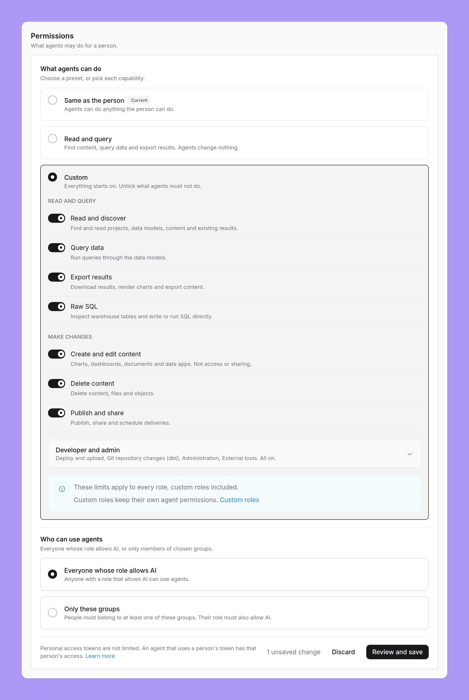
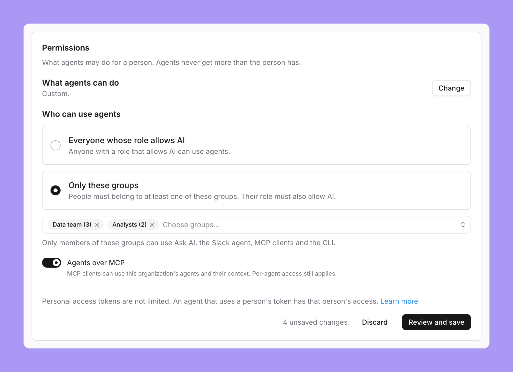
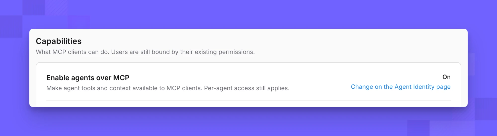
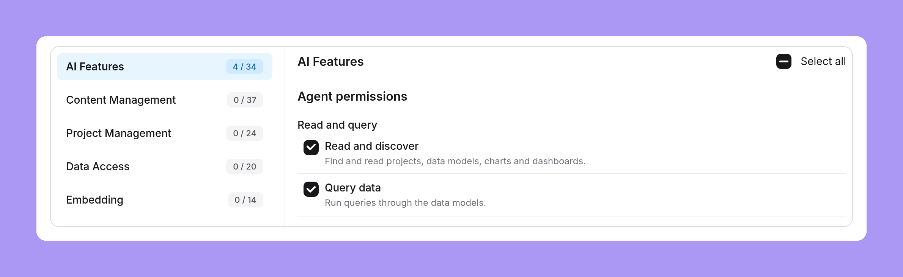

import { FeatureBadge } from '/snippets/feature-badge.jsx';

<FeatureBadge label="Beta" /> <FeatureBadge label="Enterprise" />

<Info>
  Agent permissions are behind the `agent-identity` feature flag. On Lightdash Cloud, ask Lightdash support to turn it on for your organization. On a self-hosted instance, [enable the flag](/self-host/enterprise-features/ai-agents#agent-identity).
</Info>

By default, an agent can do what the person who asks can do. With agent permissions, an organization admin limits which actions agents can take and who can use agents. Limits only remove access. They never give a person more access than their roles allow.

[Agent identity](/agents/agent-identity) decides who agents run as in the warehouse. Agent permissions decide what agents may do in Lightdash.

## Choose what agents can do

Agent permissions are in the **Permissions** section of **Organization settings → Agents**, below **Identity**. Under **What agents can do**, choose one option:

| Choice | What agents can do |
| --- | --- |
| **Same as the person** | Anything the person can do. Lightdash adds no limit. This is the default. |
| **Read and query** | Find content, query data and export results. Agents change nothing. It allows **Read and discover**, **Query data**, **Export results** and **Raw SQL**. |
| **Custom** | Only the capabilities that you leave on. Every capability starts on. Turn off what agents must not do. |

A **Current** badge marks the saved choice.

**Read and query** does not make SQL read-only. Raw SQL runs with the warehouse permissions of the identity that agents run as, so limit writes in the warehouse. See [Agent identity](/agents/agent-identity).

### Custom

**Custom** shows a switch for each capability, in three groups: **Read and query**, **Make changes**, and **Developer and admin**. **Developer and admin** stays collapsed until you select it.

<Frame>
  
</Frame>

- **Each switch applies to every role.** For a person with a built-in role, agents get every capability that is on, within the person's own permissions. A capability that is off is off for every agent, whatever the person's role, [custom roles](#custom-roles) included.
- **Turning off every switch turns agents off.** The page says "Agents are turned off for everyone." Agents stop working in Ask AI, the Slack agent, and MCP clients. People can still do the work themselves. Agent permissions do not apply to a personal CLI login, so the CLI keeps working. The login's OAuth scopes still apply. With **Read and query** or **Custom**, the CLI also cannot do some operations that are reserved for people. With **Same as the person**, the CLI still cannot change groups, SCIM users and groups, or the agent identity settings. Without the `agent-identity` feature flag, none of these checks apply.

When you choose **Custom**, the switches start from the saved Custom choice. If the saved choice is not **Custom**, every switch starts on.

## Capabilities

An agent can take an action only when the person's own permissions allow it and the capability is on. Each refusal names the capability.

| Group | Capability | What it allows |
| --- | --- | --- |
| Read and query | Read and discover | Find and read projects, data models, content, context and existing query results. |
| Read and query | Query data | Run queries through the data models and run saved content. |
| Read and query | Export results | Download results, render charts and export to supported destinations. |
| Read and query | Raw SQL | List warehouse tables and write or run SQL directly. |
| Make changes | Create and edit content | Create or edit charts, dashboards, documents and data apps. It does not change access, create spaces or share. |
| Make changes | Delete content | Delete content, files and objects. |
| Make changes | Publish and share | Publish, share or deliver content. |
| Developer and admin | Deploy and upload | Deploy project changes and upload files. |
| Developer and admin | Git repository changes (dbt) | Change any file in the project's Git repository, including files that are not dbt files, and open, update or close pull requests. |
| Developer and admin | Administration | Administrative actions that agents may take. Actions reserved for people stay with people. |
| Developer and admin | External tools | Call tools enabled on a connected external service. It does not grant what those tools do. |

### Operations that need several capabilities

Some operations need more than one capability. Lightdash refuses the operation unless every capability it needs is on:

| Operation | Needs |
| --- | --- |
| Create or edit a scheduled delivery | Create and edit content and Publish and share |
| Sync to Google Sheets as code | Create and edit content and Publish and share |
| Run a saved SQL chart | Query data and Raw SQL |
| Create a SQL chart, or edit a saved SQL chart in any way | Create and edit content and Raw SQL |
| Delete or rename a file in the Git repository | Git repository changes (dbt) and Delete content |
| Pull content from Git | Git repository changes (dbt) and Create and edit content |
| Set up a preview deploy | Deploy and upload and Administration |

An agent that changes the Git repository needs Delete content only when its change deletes or renames a file. Lightdash checks the change before it commits or pushes anything.

### Refusals

When agent permissions block an action, the refusal names the capability, for example: "Your organization's agent permissions do not allow Raw SQL. Ask an admin to change Permissions on the Agents page." The refusal is the same when the person's own roles do not allow the capability.

An action can fail more than one check. Lightdash stops at the first check that fails, and the first line of the refusal names it. In the in-app chat and in [MCP](/agents/lightdash-mcp) clients, the refusal then lists everything else that blocks the action:

- **Also needed** names the other blockers, for example: "Also needed: Publish and share". A blocker is a capability from the table above, or another limit, such as "access to agents".
- **See why** links to [My agent identity](/agents/agent-identity#my-agent-identity).

This lets a person ask an admin for every change in one request. When the action is in a project that the person cannot see, the refusal leaves out the blockers that belong to that project. Replies in Slack channels show only the first line, with a button that opens the settings to change. Embedded chat does not show the **See why** link.

### Turn off Raw SQL for agents

**Raw SQL** lets an agent list warehouse tables and run SQL outside the data models. An agent can use it when the person's own permissions allow raw SQL and the limits allow **Raw SQL**. A project needs no other setup.

To turn it off for every agent, choose **Custom**, turn off **Raw SQL**, then review and save. Agents then get the refusal "Your organization's agent permissions do not allow Raw SQL."

## Who can use agents

Under **Who can use agents**, choose:

- **Everyone whose role allows AI.** Anyone with a role that allows AI can use agents.
- **Only these groups.** People must belong to at least one of the groups you choose, and their role must also allow AI.

<Frame>
  
</Frame>

You choose people by [group](/workspace-admin/manage-groups) only. This limit applies with every option under **What agents can do**, including **Same as the person**. Like the capability limits, it does not apply to a personal CLI login.

- Choosing groups needs an Enterprise license. [Group management](/workspace-admin/manage-groups) itself is available to every organization. Without the license, the **Who can use agents** row is hidden. If a group limit was saved earlier, the row says "Groups are unavailable. The saved group restriction still applies.", and **Allow everyone** removes the limit.
- **Only these groups** needs at least one group.
- When every group you chose is deleted, the page warns "No one can use agents. All chosen groups are deleted." Choose other groups, or **Everyone whose role allows AI**.

This setting covers every agent in the organization. To limit who can use one agent, set **Who can use the agent** in that agent's settings. See [user and group access](/agents/set-up-agents#user-and-group-access-optional). Creating and managing agents needs the developer or admin role, or a [custom role](/workspace-admin/custom-roles) with the `manage:AiAgent` scope.

`manage:AiAgent` also lets a person use every agent in the project, including agents kept to admins and developers or to specific users and groups. With `view:AiAgent` instead, a person can use agents open to everyone in the project. Anyone named in an agent's user or group access can use that agent. Roles add up: a project-level custom role without `manage:AiAgent` doesn't take it away from someone whose organization role is Developer or Admin.

## Review and save

Lightdash saves the changes under **What agents can do** and **Who can use agents** together. The page counts the unsaved changes, for example "4 unsaved changes". **Discard** returns to the saved state.

<Steps>
  <Step title="Select Review and save">
    The **Review changes to agent permissions** dialog opens.
  </Step>
  <Step title="Read the review">
    **STOPS** lists what agents can no longer do, **ALLOWS** lists what they can do again, and **WHO** says who can use agents. When every capability is unticked, it says "Agents are turned off for everyone".
  </Step>
  <Step title="Save">
    Select **Save changes**. **Back** returns to the page and keeps your changes.
  </Step>
</Steps>

<Frame>
  
</Frame>

If another admin saves first, an "Agent permissions changed" warning appears. Your unsaved changes stay on the page. Select **Reload latest** to discard them and load the saved permissions.

## Agents over MCP

The **Agents over MCP** switch lets MCP clients use the organization's agents and their context. It affects [MCP](/agents/lightdash-mcp#using-ai-agent-context) only. Turning it off does not stop Ask AI or the Slack agent. To turn agents off everywhere, choose **Custom** and turn off every capability.

- The switch saves at once. It is not part of **Review and save**.
- It shows only to people who can change the setting.
- For these people, **Settings → MCP → General** shows **Enable agents over MCP** as **On** or **Off**, or **Disabled** when MCP access is off, with a **Change on the Agents page** link.
- **Allow content changes via MCP** stays on **Settings → MCP → General**.

<Frame>
  
</Frame>

## Custom roles

<FeatureBadge label="Enterprise" />

[Custom roles](/workspace-admin/custom-roles) have an **Agent permissions** group in the **AI Features** section of the role editor, with the 11 capabilities above under **Read and query** and **Changes**. The role editor labels **Git repository changes (dbt)** as **Write to dbt**. A new custom role starts with **Read and discover**, **Query data**, **Export results** and **Raw SQL** on.

Custom roles keep their own agent permissions. With **Read and query** or **Custom**, the organization's choice can only narrow them. For a person with a custom role, agents get what the role allows, minus the capabilities that the organization turned off. With **Same as the person**, Lightdash does not check a custom role's agent permissions.

<Frame>
  
</Frame>

## When you take agent access away

Lightdash reads agent access each time it checks a request, and does not copy the access into a token. A change applies at the next check. A request that has already passed its checks can finish.

This applies when:

- An admin deactivates a person.
- A person loses a role, or a custom role loses a capability. The capability stays when another role of the person still allows it.
- An admin turns off a capability, or turns off every capability.
- An admin removes a group from **Who can use agents**, or a person leaves every group that is allowed.

When an admin deactivates a person, Lightdash also deletes that person's Snowflake [agent sign-in](/agents/agent-identity#snowflake-agent-sign-in-for-each-person).

### Work that is queued or running

Some agent work runs after the person asks for it. This work checks the person again when it starts, and again before it delivers or publishes. When a check refuses, the later steps do not happen. What the work has already published stays. Some Slack and Autopilot delivery steps check again only when the last passing check is at least 30 seconds old, so a change made inside that window can miss the next post.

| Work | What the person sees when it is refused |
| --- | --- |
| A Slack agent answer | The answer stops and the remaining messages, charts and files are not posted. The thread gets the refusal message. |
| A scheduled delivery with an AI summary | The delivery goes out without the summary. |
| An [Autopilot](/agents/autopilot) run | The run stops and posts nothing more. It is recorded as failed, with "Run blocked". |
| [dbt writeback](/agents/ai-writeback) | Lightdash does not create the branch, the commit or the pull request that come after the check. The card in the thread shows an error. |
| A fix for a review finding | The fix is marked as failed. This check covers only whether the person is still active. It does not check capabilities or **Who can use agents** again. |

Lightdash checks only at these points. A step that has passed its check can finish, however long it takes.

### What a change does not cover

- **Personal access tokens and service account tokens.** Agent permissions do not limit them. See [Personal access tokens](#personal-access-tokens).
- **A person's ordinary role.** When the session cache is on (`EXPERIMENTAL_CACHE=true`), a change to a person's role can take up to 30 seconds to reach a browser session or a token. The agent permission check itself reads roles each time, with no delay.
- **Tokens that the warehouse has issued.** Lightdash does not ask the warehouse to revoke a token that the warehouse has already issued. The warehouse decides how long that token is valid. Work that already has a warehouse connection can finish.

## Reserved for people

With **Read and query** or **Custom**, agents can never do these operations, even with **Administration** on. The operations include:

- Change roles, groups, and project or space access.
- Create spaces.
- Remove organization members or change their membership.
- Manage custom roles, service accounts and OAuth clients.
- Create or rotate personal access tokens, and create invite links.
- Change the agent permissions, the agent identity rules, or shared agent accounts.
- Change a project's agent SQL scope.
- Change feature flag overrides.
- Rotate the SCIM access token.
- Get the Google Drive access token.
- Change the organization settings, including the AI settings.

With **Same as the person**, agents still cannot change groups, SCIM users and groups, or the agent identity settings.

## Personal access tokens

Agent permissions do not limit personal access tokens or service account tokens. An agent that uses a person's personal access token, for example through [MCP](/agents/lightdash-mcp), has that person's access.
