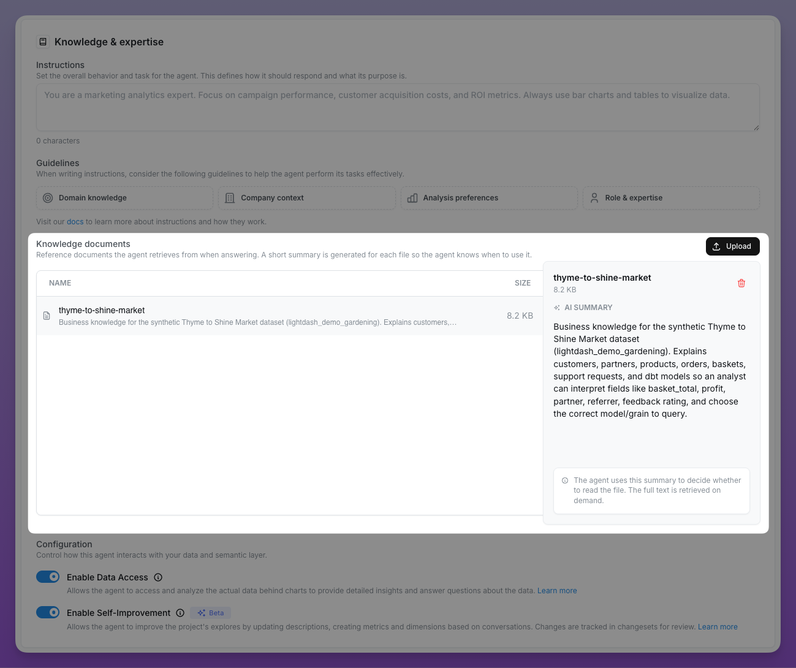
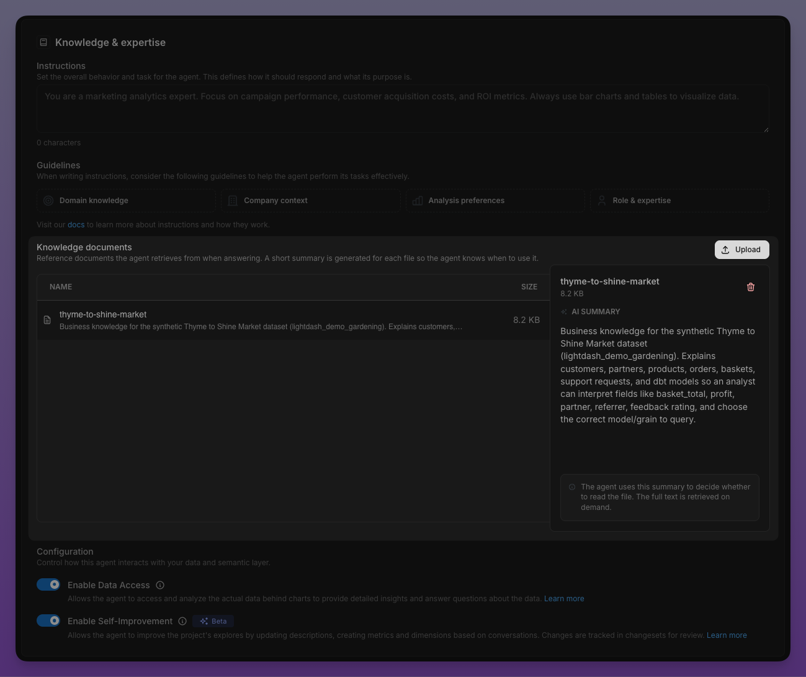

Knowledge documents let you upload longer reference material — glossaries, business policies, supporting context, and internal procedures — that your agent can consult while answering questions. Use them for material that doesn't belong on one semantic object or in the agent's always-on instructions.

Upload documents under **Reference documents** in the **Knowledge & data** section of the agent's settings. The upload appears once the agent is created, so save a new agent before adding documents.

<Frame>
  
  
</Frame>

## How they work

When you upload a document, Lightdash reads it and writes a short summary of what it's about — what it covers, which terms it defines, which explores it relates to, and when the agent should consult it. The agent always sees this summary, so it knows the document is available and what's in it. By default, it only reads the full content when a question actually calls for it (**on-demand retrieval**), which keeps conversations fast.

A few things worth knowing:

- **The agent decides when to open a document.** If your document is never being used, the summary probably isn't specific enough about what it's for. Renaming the document or making its purpose clearer in the content usually fixes it.
- **Each document gets a relevance rating against your project.** After uploading, check the relevance card. If a document is rated low or unrelated, the agent has been told not to rely on it for data questions — you'll want to revise it, or scope it to a different agent where it's more relevant.
- **Documents are listed per agent.** The documents table only shows the documents this agent can actually use — organization-level documents (available to every agent) plus any documents specifically granted to this agent. Uploading a document from an agent's settings scopes it to that agent by default.

## Always include in context

For documents the agent should apply to *every* question — not just the ones where the summary happens to match — flip the **Always include in context** toggle in the document's settings panel.

- **On demand (default).** The agent sees only the summary and reads the full document when the question calls for it. Best for large or occasionally-relevant references.
- **Always included.** The full document is embedded into the agent's system prompt on every request. Best for short, high-value context that shapes how *all* answers should be written — for example, a one-paragraph definition of "active customer" that every metric answer should honor.

The documents table shows an **Always included** or **On demand** status chip per document so you can see at a glance which documents will be in every prompt.

Always-included documents make every prompt larger, which uses more tokens and can slow responses. The toggle description surfaces this trade-off in the UI. Keep always-included content short and reserve the toggle for context that genuinely matters on every turn — leave everything else on on-demand retrieval.

Because "always include" changes every future response, switching a document *to* always-included asks for confirmation. Switching back to on-demand retrieval takes effect immediately. Deleting a document also asks for confirmation.

## View, edit, or download a document

### Open a document

In the agent's knowledge documents list, select the document and click the **View and edit document** (eye) icon to open the fullscreen viewer. Read the document there, or click **Download** to save a copy of the current file.

### Edit a document

From the document viewer, click **Edit** to change the document. You don't need to delete and re-upload it to fix a typo, refresh guidance, or update frontmatter.

You can edit the document's name and content. Markdown documents open in an editor with a live preview, while plain-text documents open in a monospace text area. YAML frontmatter remains in the raw Markdown source but isn't shown in the preview.

- **Unsaved changes.** Closing the editor with pending changes asks for confirmation. Use **Cancel** to discard changes and return to the viewer.
- **Quotas.** The 20KB per-document and 5MB organization limits also apply to edits. The editor shows the document's size and disables **Save** when the content is over the limit or the name is empty.
- **Summary and context.** When the content changes, Lightdash regenerates the document summary. Saved content is available to the agent on its next message, including for documents that are always included in context.

## Manage documents through the API

To keep documents in sync with a set you maintain elsewhere, for example from CI, use the agent documents endpoints under `/api/v1/projects/{projectUuid}/aiAgents/{agentUuid}/documents` with a [personal access token](/personal-settings/create-personal-tokens). They list, create, read, and delete documents, replace a document's name and content (`PATCH /{documentUuid}/content`), and set **Always include in context** (`PATCH /{documentUuid}` with `alwaysIncludeInContext`). Creating, editing, and deleting need the project **Developer** role or higher. The same size limits apply. See the [API reference](/api-reference/v1/introduction).

To keep an agent's own documents in Git alongside its configuration, use the CLI instead — see [knowledge documents in agents as code](/agents/agents-as-code#knowledge-documents).

To list documents across every agent, use `GET /api/v1/aiAgents/documents`. It lists every knowledge document in the organization, or pass `projectUuid` as a query parameter to filter to the agents in one project.

## What to upload

Good candidates are anything a new analyst on your team would need to read before answering questions, but that doesn't belong in the semantic layer itself:

- **Business glossaries** — definitions of terms like "active customer", "qualified lead", "churn", especially when your definition differs from the industry default
- **Metric provenance and caveats** — "Revenue excludes refunds processed after the period close", "MRR is calculated on the first of the month, not rolling"
- **Fiscal and calendar conventions** — fiscal year start, reporting cadence, holiday adjustments
- **Org-specific acronyms and product taxonomy** — what your internal product codes mean, team naming conventions
- **Known data quirks** — "The `eu_orders` table has a 6-hour ingestion lag", "Pre-2023 data uses the old pricing schema"
- **Policy and escalation context** — when to flag something to a human, which numbers are board-reported and must match a specific source

## What *not* to upload

- **Anything that belongs in the semantic layer.** If it describes a specific field or model, prefer an [AI hint](/semantic-layer/writing-descriptions#layer-ai-hints-on-top-of-descriptions) — those are tied to the field and survive refactors.
- **Sensitive data.** Documents are visible to anyone using the agent. Don't paste API keys, customer PII, or anything you wouldn't share with the whole agent's audience.
- **Raw data dumps.** Knowledge documents are for context and interpretation, not data. The agent has the semantic layer for that.
- **Generic marketing copy or off-topic notes.** These will be rated `low` or `none` relevance and the agent will be told to ignore them.

## Practical tips

- **Keep documents focused and short.** Each document is capped at 20KB and the org-wide quota is 5MB, but the practical limit is much lower: a focused one-page note is consulted more reliably than a sprawling wiki export. Split large references into one document per topic.
- **Use Markdown.** Only `.md` (or `.markdown`) and `.txt` files are supported, so you can't upload images or PDFs. Markdown headings and lists make summaries more accurate.
- **Name documents like a `use when` clue.** `Revenue recognition rules.md` is better than `notes.md` — the name is part of what the agent sees.
- **Scope documents per-agent.** A document uploaded for your Finance agent shouldn't pollute your Marketing agent's context. Use the per-agent access setting to keep documents relevant — an agent's documents table only lists the org-level documents plus the ones granted to that agent. For example, a `Refund policy.md` uploaded from the `Analytics Agent` settings is only listed and served to that agent, not to any other agents in the project.
- **Re-check after big changes.** When you add new explores or rename fields, revisit the relevance rating on existing documents — `relatedExploreNames` references exact explore names and can go stale.
- **Test with a real question.** After uploading, ask the agent a question that *should* hit the document and confirm it gets called. The tool calls are visible in the conversation thread.

