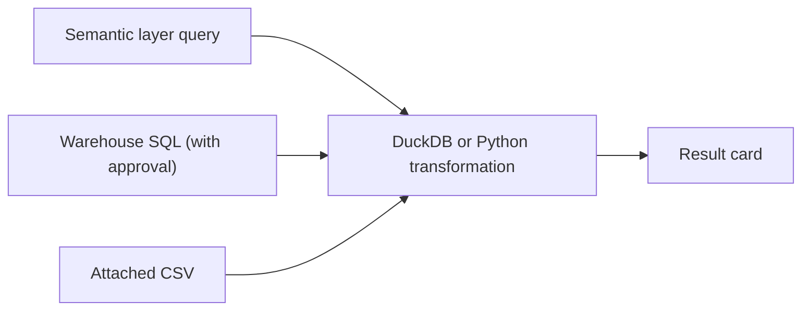

<Info>
  <Badge icon="flask" color="purple" size="sm" shape="pill">Beta</Badge> Query pipelines are **off by default**. On Lightdash Cloud, contact [Lightdash support](mailto:support@lightdash.com) to enable them for your organization. Self-hosted instances need the [setup described here](/self-host/enterprise-features/ai-agents#query-pipelines). [What Beta means](/support/feature-maturity-levels).
</Info>

A query pipeline lets an AI agent answer questions that one metric query can't. The agent runs one or more source queries, then transforms their results with DuckDB SQL or Python before showing you the answer. It can join two explores, compare actuals against an uploaded CSV of targets, rank or bucket results, or fit a forecast, all in one step.

Source queries still go through your semantic layer, so metric definitions, joins and access rules apply as usual. DuckDB and Python only ever see the rows those queries returned. They never connect to your warehouse.

## When to use query pipelines

Pipelines help when the answer needs a step after the metric query. Prompts that work well:

- *"Compare monthly revenue from Orders with ad spend from Marketing, and show return on ad spend by month."*
- *"Here are our quarterly targets (attached CSV). How is each region tracking against them?"*
- *"Forecast weekly signups for the next 8 weeks from the last year of data."*
- *"Which customers are in the top 10% by lifetime value, and what share of revenue do they drive?"*
- *"Run a linear regression of order volume on discount rate and tell me how strong the relationship is."*

You don't need to ask for a pipeline. When pipelines are on, the agent builds one whenever the question calls for it, and a single metric query is still a single step.

## How it works

The agent submits the whole pipeline at once. Each step has a short title, and the last step's rows become the answer. A pipeline can use these steps:

| Step | Shown as | What it runs | Where it runs |
| --- | --- | --- | --- |
| Semantic layer | **Semantic layer** | A metric query against an explore | Your warehouse, through the semantic layer |
| Warehouse SQL | **Warehouse SQL** | A read-only `SELECT` or `WITH` statement | Your warehouse. Needs [SQL mode](/agents/use-ai-agents#sql-mode) and approval |
| External data | **External data** | DuckDB SQL over CSVs attached to the thread | Lightdash's DuckDB engine |
| Transformation | Under **Transformations** | DuckDB SQL over the results of other steps | Lightdash's DuckDB engine |
| Python | **Python** | pandas code over the results of other steps | An isolated sandbox |

Python steps can use pandas, numpy, scipy, pyarrow, scikit-learn and polars. They have no network access and can't install packages.

Steps can be reused across a thread. In a follow-up, the agent can build on a step from an earlier answer without running it again, and results are served from the cache when possible.

## Turn it on

Two feature flags make query pipelines available: `multi-source-query` and `compose-sql-runner`. On Lightdash Cloud, Lightdash support enables them for your organization. On a self-hosted instance, see [query pipelines for self-hosted instances](/self-host/enterprise-features/ai-agents#query-pipelines).

Once the flags are on, each agent decides whether it uses pipelines:

<Steps>
  <Step title="Open the agent's settings">
    Go to **Ask AI**, open the agent, and edit its settings.
  </Step>
  <Step title="Allow the agent to read rows">
    Under **Capabilities**, turn on **Read the rows behind a chart**. Pipelines need it, because transformations work on result rows. See [data access](/agents/data-access).
  </Step>
  <Step title="Check Composer queries">
    In the same section, **Composer queries** is on by default. Turn it off to keep this agent on its standard query tools.
  </Step>
</Steps>

To let the agent run raw warehouse SQL inside a pipeline, also turn on SQL mode for the conversation. Warehouse SQL steps follow the same [permissions and approvals](/agents/use-ai-agents#how-approvals-work) as SQL mode.

Pipelines are not used in [deep research](/agents/deep-research) runs or in threads started from a data app. Those keep the standard query tools.

## Attach a CSV

When [external sources](/explore/external-sources) are also enabled, you can give the agent data that isn't in your warehouse. Select **+** in the message input, then **Attach a CSV**, or drop a CSV or TSV file on the input. The agent can then query the file in an **External data** step and join it to your semantic layer results.

You need permission to manage external sources and explores in the project to attach a CSV. Attaching CSVs isn't available in embedded agents or while deep research is on.

## Read the result card

The agent shows a pipeline's result as a card, the same way it shows a chart. A pipeline that the agent ran but didn't chart is listed under its message as a **queries** card you can open.

Below the result, the **Queries** bar shows how many steps the pipeline has. Expand it to see the pipeline:

- **List** and **Graph** switch between a list of steps grouped into **Sources**, **Transformations** and **Result**, and a diagram of how the steps connect.
- Each step shows its title, its type, and the steps it reads from.
- **View query** shows the SQL for a step. For a semantic layer step, it shows the compiled SQL. For a Python step, **View code** shows the code.
- While the pipeline runs, each step shows its status: **Queued**, **Awaiting approval**, **Running**, **Completed** or **Failed**. A failed step shows its error.
- Select a step to show its own result in the card. Select **Back to result** to return to the final result.

### Charts

The agent picks how to show the result: a table, big number, bar, line, area, scatter, pie or funnel chart, or one of your project's [custom chart types](/visualizations/custom-charts). To change it, ask in the thread, for example *"show that as a stacked bar by region"*. The agent redraws the same result without building a new pipeline.

## Security and governance

Pipelines add steps on top of your data, not new access to it:

- **The semantic layer stays in charge.** Semantic layer steps use your metric definitions, joins and the agent's [data access](/agents/data-access) rules, including user attributes.
- **DuckDB and Python never touch the warehouse.** They can only read the results of the steps they reference. DuckDB can't read other files, and Python runs in a sandbox with no credentials and no network.
- **Raw SQL still needs approval.** Warehouse SQL steps need SQL mode and the SQL Runner permission. Only `SELECT` and `WITH` statements run, and each one waits for your approval unless the agent is set to run SQL without approval.
- **Viewers see only what they can access.** Opening a result card runs the pipeline as the person viewing it, using cached results when they're available.

## Slack and embedded agents

Pipelines work in Slack. The agent posts the result as a table, a big number or a chart image. If your organization only allows links in Slack, it posts a link to the result in Lightdash instead.

In [embedded agents](/embed/embed-ai-agents), pipelines can't use warehouse SQL steps or attached CSVs.

## Limitations

- **Results can't be saved as charts.** A pipeline result lives in its thread. It can't be saved as a chart, added to a dashboard, or managed as code. A pipeline with a single semantic layer step and no transformations is shown as a regular chart instead, which you can save.
- **Row limits apply to every step.** Each step returns 500 rows by default, up to your instance's AI query limit. A transformation only sees the rows the step before it returned, so the agent aggregates early when a step would hit its limit.
- **Python has time and size limits.** A Python step can run for up to 5 minutes and return up to 64 MB of results.

## Frequently asked questions

**Does Python or DuckDB send my data anywhere?**

Both work only on result rows Lightdash already produced. DuckDB runs inside Lightdash. Python runs in an isolated sandbox with no network access: Lightdash copies in only the results the step references, reads the output back, and destroys the sandbox after each run.

**Can the agent change my data?**

No. Warehouse SQL steps are limited to `SELECT` and `WITH` statements, and DuckDB and Python only work on copies of result rows.

**Why does a pipeline have only one step?**

The question could be answered with one metric query. The agent only adds transformations when the question needs them.
