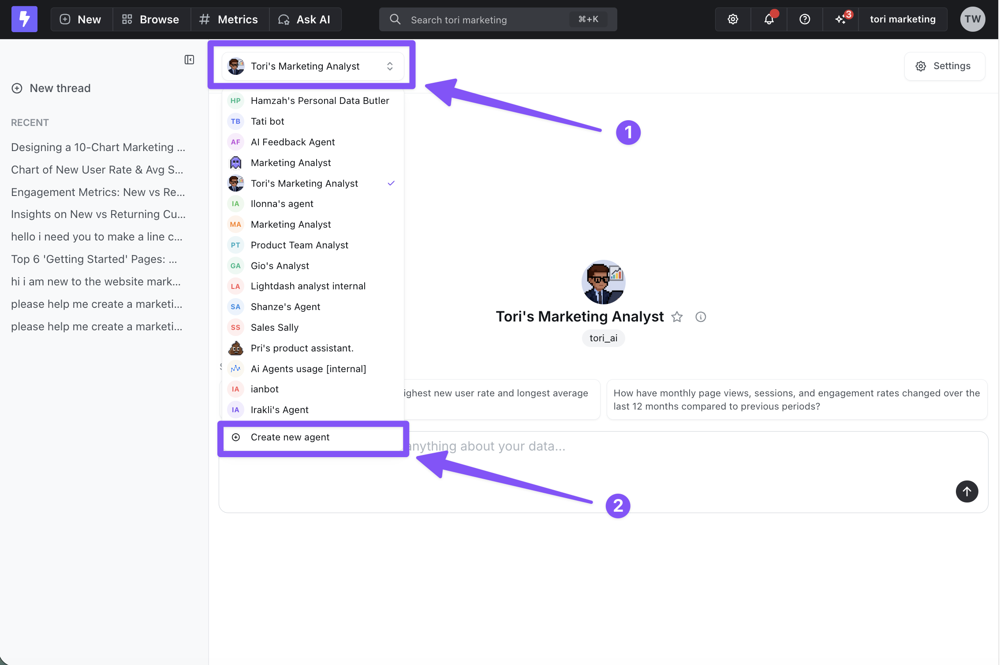
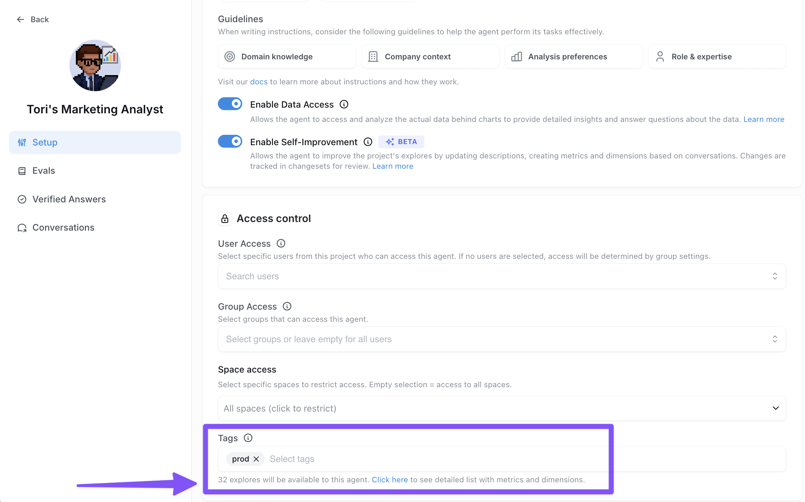

Create an agent for a team, business domain, or repeatable task. Configure its instructions and data scope, test it with representative questions, then share it with the people who need it.

If you want to use an existing agent, go to [Using AI agents](/agents/use-ai-agents).

## Before you begin

- An organization admin must [enable AI features](/workspace-admin/ai-settings#enable-ai-features).
- You need a Developer or Admin role, or a custom role with `manage:AiAgent`, to create and manage agents. See [Agent permissions](/agents/agent-permissions#who-can-use-agents).
- Choose the agent's audience, job, and data scope. [Effective analytics with agents](/agents/effective-analytics-with-agents#think-specialized-not-general) explains how to define a useful scope.

## Create an agent

1. Open **Ask AI** in the project where the agent will work.
2. Open the agent dropdown and select **Create new agent**.

<Frame>
  
</Frame>

3. Set the name, description, instructions, and access using the [configuration options below](#configure-your-agent). To keep the agent private while testing, choose **Admins & developers only** under **Access & privacy** → **Who can use the agent**.
4. Click **Create agent**. You can then add reference documents and return to the settings to refine the configuration.

## Configure your agent

### Name and image

Set **Name** and an avatar so your team can recognize the agent.

Add a **Description** too. It shows above the message input every time someone opens a new thread, before they type anything, so use it for a short welcome or a list of the topics the agent covers. Instructions can't do this reliably: the model reads them as guidance and decides for itself whether to open with a greeting.

### Instructions

Add the role, priorities, analysis defaults, constraints, and communication style that should apply to every conversation with this agent. Keep stable model and field definitions in the semantic layer, and use knowledge documents for longer reference material.

See [Writing effective instructions](/agents/effective-analytics-with-agents#writing-effective-instructions) for examples and authoring guidance.

Instructions belong to one agent, and there's no organization-wide instructions field. Use them to define names the agent could misread, for example "Acme Planner is our app. A question about Acme Planner is about the product, not a person." To give every agent in a project the same terminology, use [agent context](/agents/agent-context) instead.

Instructions don't widen the agent's access. Configure [data access](/agents/data-access) and [agent permissions](/agents/agent-permissions) separately.

### Default model (optional)

Choose the default model and reasoning setting used for new chats with this agent. Leave the model empty to inherit the organization default.

Lightdash resolves the model for a new chat in this order:

1. The user's per-chat selection
2. The agent's default model
3. The [organization default model](/workspace-admin/ai-settings#set-an-organization-default-ai-model)
4. The system default

Users can still change the model in each chat, and existing threads continue with the model they were started with. Slack has no model picker, so a new Slack thread starts on the agent's default model, or the organization default if the agent has none.

### Knowledge documents (optional)

After creating the agent, upload longer reference material under **Knowledge & data** → **Reference documents**. See [Knowledge documents](/agents/knowledge-documents) for upload, retrieval, and editing behavior.

### Skills (optional)

Attach a reusable workflow from your organization's skill library, or create one in the agent's **Skills** section. See [Custom agent skills](/agents/custom-agent-skills) for authoring and invocation.

### Data access

Choose whether the agent can read query results or work with metadata only. See [data access modes](/agents/data-access#data-access-modes) for the defaults and behavior. Use **Pass user information** to [tailor answers to who is asking](/agents/data-access#personalizing-answers-to-who-is-asking).

### User and group access (optional)

By default, your agent is available to everyone in the project. To change that, open the agent's settings and go to **Access & privacy** → **Who can use the agent**:

- **Everyone in the project** — every project member can see and use the agent. This is the default.
- **Admins & developers only** — hidden from everyone else, which is useful while you set up or test the agent.
- **Specific users & groups** — only the users and groups you pick.

Admins, developers and anyone else with the `manage:AiAgent` scope can always use every agent in the project, whatever you choose here. Someone who can't use any agent in a project doesn't see **Ask AI** in that project, so set this on each agent in the project.

This controls who can use the agent, which is separate from [data access control](/agents/data-access) (what data the agent can query).

Narrowing this list also changes which agent other people land on: someone who can use only one agent in the project opens it directly. See [Set your default agent](/agents/use-ai-agents#set-your-default-agent).

### Tags (optional)

Add **Tags** to limit the agent to part of your semantic layer. Configure matching tags on your models and fields first; see [limiting access to specific explores and fields](/agents/data-access#limiting-access-to-specific-explores-and-fields) for the YAML and filtering rules.

<Frame>
  
</Frame>

### Enable AI writeback (optional)

Allow your agent to edit dbt or native Lightdash YAML models from chat — renaming metrics, adding dimensions, or updating descriptions — and open a pull request for review. See [AI writeback](/agents/ai-writeback) for supported connections and setup.

## Test and share the agent

1. [Start a conversation](/agents/use-ai-agents#start-a-conversation) with the agent and ask a question your team regularly needs to answer.
2. Inspect the query, chart, and explanation. Check that the agent uses the intended metrics, filters, and comparison period.
3. Adjust its configuration and click **Save changes**. Start a fresh conversation to test the same question without the earlier conversation's context.
4. Set [who can use the agent](#user-and-group-access-optional) when it is ready for your team.

Use [evaluation suites](/agents/create-evaluation-suites) to check a repeatable set of questions as you change the agent or semantic layer. To make the agent available in team channels, follow [Set up agents in Slack](/agents/set-up-slack-agents).
