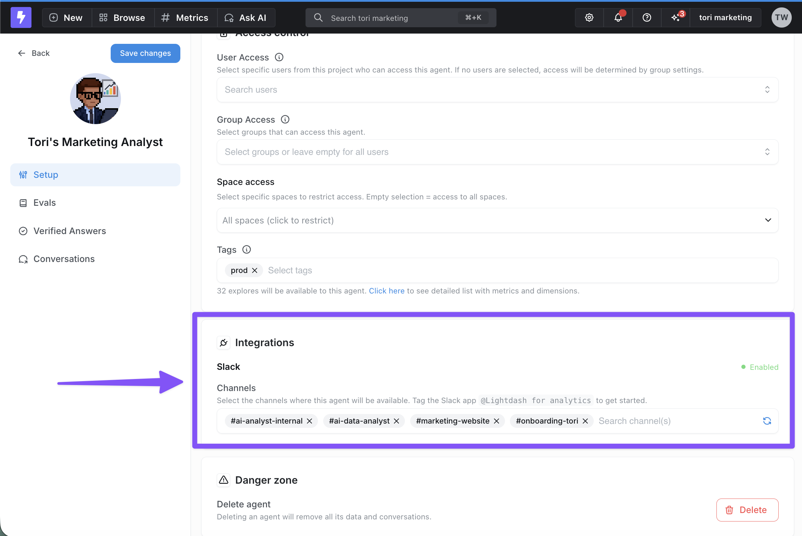
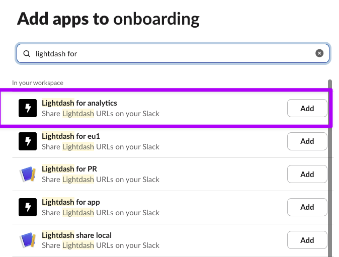
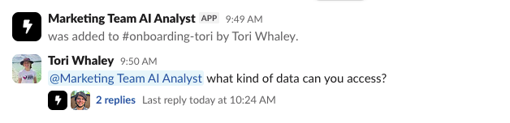
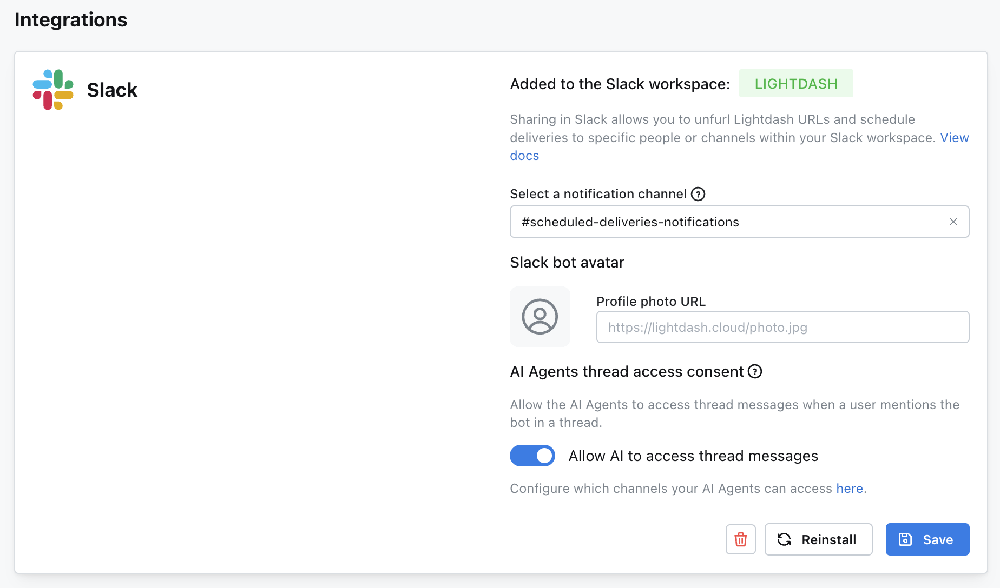

Connect an agent to a Slack channel so your team can investigate data and follow up in threads where they already work. Use a single-agent channel for a focused workflow, or a multi-agent channel to let the AI Router choose an agent.

## Before you begin

An organization admin must [connect Slack to Lightdash](/integrations/slack), and you need permission to manage the agent. If you haven't created one, follow [Set up AI agents](/agents/set-up-agents).

## Connect a single-agent channel

1. Open the agent's **Integrations** settings in Lightdash.
2. Enable **Slack** and select the channels where the agent should respond.

<Frame>
  
</Frame>

3. In each Slack channel, open **Edit settings** → **Integrations** and add **Lightdash for analytics**.

<Frame>
  
</Frame>

4. Mention the Lightdash app with a question, such as "Show me total order amount over time". The agent replies in a thread.

<Frame>
  
</Frame>

Mention the app in each follow-up message to continue the conversation. If someone mentions it without a question, it replies with a fixed welcome; the agent's description and instructions don't change that welcome.

To let the agent read earlier messages in that thread, an admin turns on **AI Agents thread access consent** in **Organization Settings** → **Integrations** → **Slack**. It reads only that thread, including messages that didn't mention it, rather than other channel messages.

<Frame>
  
</Frame>

## Slack channels: single-agent vs. multi-agent

The per-agent integration path assigns one agent to each Slack channel. For several agents in the same channel, configure a **multi-agent channel** at the organization level. The [AI Router](/agents/enable-ai-router) picks an agent for each question sent to the Lightdash Slack app.

How you interact with the app depends on where you're posting:

- **New message in the multi-agent channel** — no `@mention` needed. Lightdash picks up the message automatically and routes it to the best-fit agent.
- **Reply in an existing thread** — `@mention` the Lightdash Slack app. Without the mention, Lightdash will not respond in-thread.

### Setting up a multi-agent Slack channel

Multi-agent channels are configured at the **organization level**, not per-agent:

1. Go to **Organization Settings** → **Integrations** → **Slack**.
2. Find the **Multi-agent channel** setting in the AI Agents configuration panel.
3. Select the Slack channel you want to designate as the multi-agent channel.
4. Click **Save**.

Once a channel is designated as the multi-agent channel, all eligible agents in your organization are automatically available in that channel. You do **not** need to add each agent individually via its own **AI Agent → Integrations → Slack** settings.

**Scoping which agents appear:** by default, agents from every project in your organization are eligible. To restrict the channel to agents from specific projects, toggle off **Allow all project agents to appear** and pick the projects you want to include.

If you see the error **"This Slack channel is already assigned to another AI agent"** while trying to attach a second agent via the per-agent integration path, that path only supports single-agent channels. Switch to the org-level multi-agent channel setup described above instead.

## Linking an agent from Slack

You don't have to go to the Lightdash UI to connect an agent to a Slack channel. When someone `@mentions` the Lightdash app in a channel that has no agent configured, Lightdash offers to link one right in the thread:

- **One manageable agent** — Lightdash auto-links it to the channel, confirms the link in-thread, and then answers the original question in the same turn.
- **Multiple manageable agents** — Lightdash posts an in-thread picker showing every agent the user can manage (labeled by agent and project). Selecting one links it to the channel and processes the original question.
- **No manageable agents** — Lightdash posts an ephemeral message asking the user to contact an admin, with a deep link to the AI agents page.

Only users with `manage:AiAgent` on an agent can link it. If the Slack user lacks that permission on every agent or isn't linked to a Lightdash account, no channel binding is created.

If your organization needs the configured channel list to be a strict allowlist, an admin can turn off [automatic channel linking](/integrations/slack#automatic-channel-linking) in the Slack integration settings.
