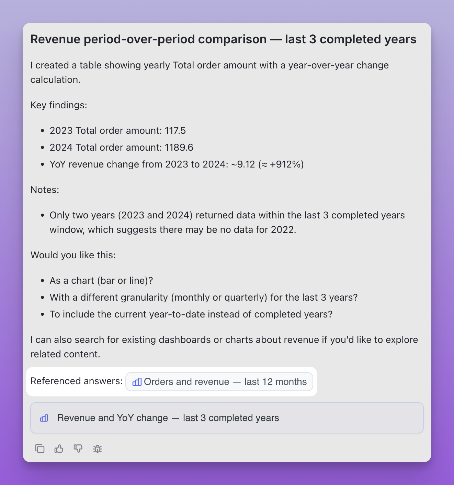
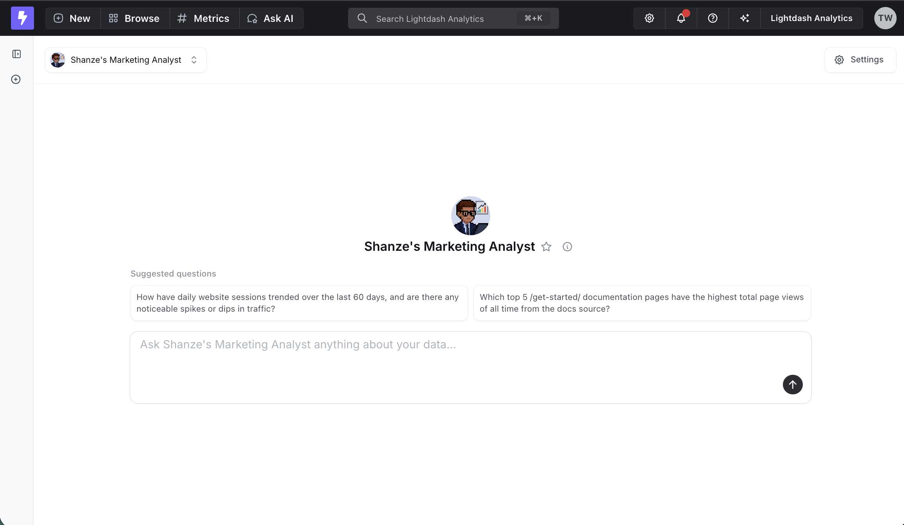
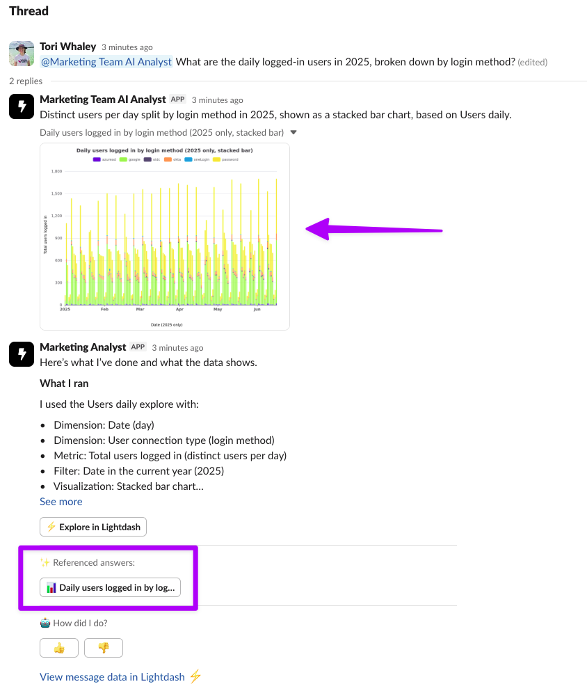
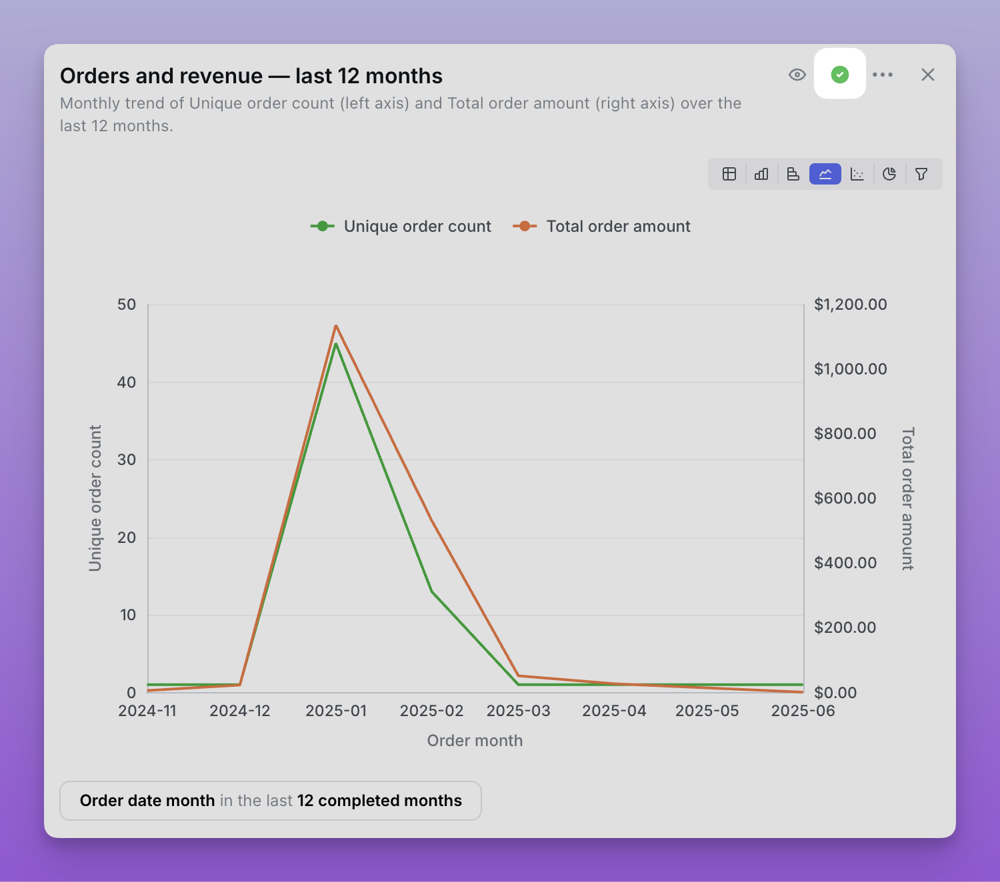
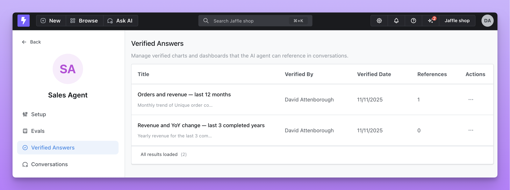

Mark an agent's charts and dashboards as verified answers to give it reference examples for similar questions. Review the query and result before verifying an answer; verification records your judgment rather than retraining the model.

## How verified answers work

The agent can reference a verified answer when it matches the question, reusing an example your team has checked.

<Frame>
  
</Frame>

When you have more than six verified questions, suggested questions based on them appear at the start of a conversation.

<Frame>
  
</Frame>

In [Slack](/agents/set-up-slack-agents), the agent can link to a matching verified answer in its response.

<Frame>
  
</Frame>

## Verified answers become verified content

If the answer has been **saved as a chart or dashboard**, verifying it also marks that saved chart or dashboard as [verified content](/explore/verified-content). The saved content appears in:

- The verified badge on the chart or dashboard, in listings, search, and space overviews
- The [`list_verified_content`](/agents/lightdash-mcp) MCP tool, so external agents can discover and build on it
- In-product AI retrieval, so agents prefer it when answering similar questions

Removing verification from the answer removes it from both places. A couple of things to keep in mind:

- **Save before you verify.** An answer that only exists inside the conversation stays an agent example — it won't get a badge or appear in MCP until it's saved as a chart or dashboard. Save it first, then verify.
- **The link is one-way.** Verifying an answer promotes its saved chart or dashboard to verified content. Verifying a chart or dashboard directly (for example, from project settings) doesn't reach back and mark the originating answer.

## Managing verified answers

### Verifying an answer

Only users with the **Admin** or **Developer** role can verify answers.

1. In an AI agent conversation, review the generated chart and its query.
2. Click the checkmark icon in the top right corner of the chart.

The answer is verified and available as a reference example.

<Frame>
  
</Frame>

### Viewing all verified answers

Navigate to your agent's settings page and select the **Verified answers** tab to see:

-   All verified charts and dashboards
-   Who verified each answer and when
-   How many times each answer has been referenced by the agent
-   Preview of the visualization

<Frame>
  
</Frame>

### Removing verification

If an answer is no longer a good example:

1. Go to the **Verified answers** tab in the agent's settings page
2. Find the answer you want to remove
3. Click the remove icon
4. Confirm removal - the answer will no longer be used as a reference

## Admin-verified charts and dashboards

Verified answers are one of two trust signals your agent uses. The other is [admin-verified charts and dashboards](/explore/verified-content) — content that organization or project admins have signed off on as canonical.

When an agent searches your project for existing content to reference, it ranks admin-verified charts and dashboards first and surfaces them to the user along with who verified them and when. You don't need to configure anything: any chart or dashboard verified in project settings is automatically preferred by every agent in that project.
