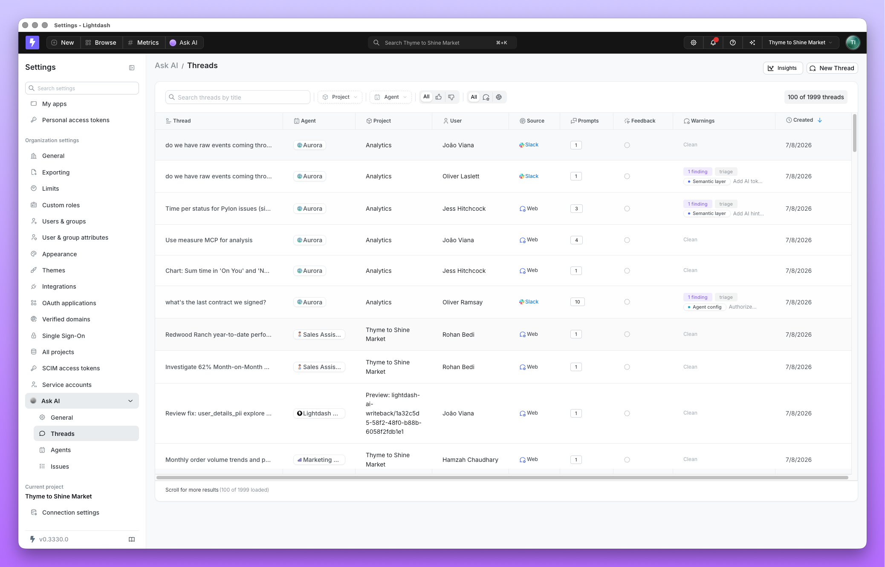
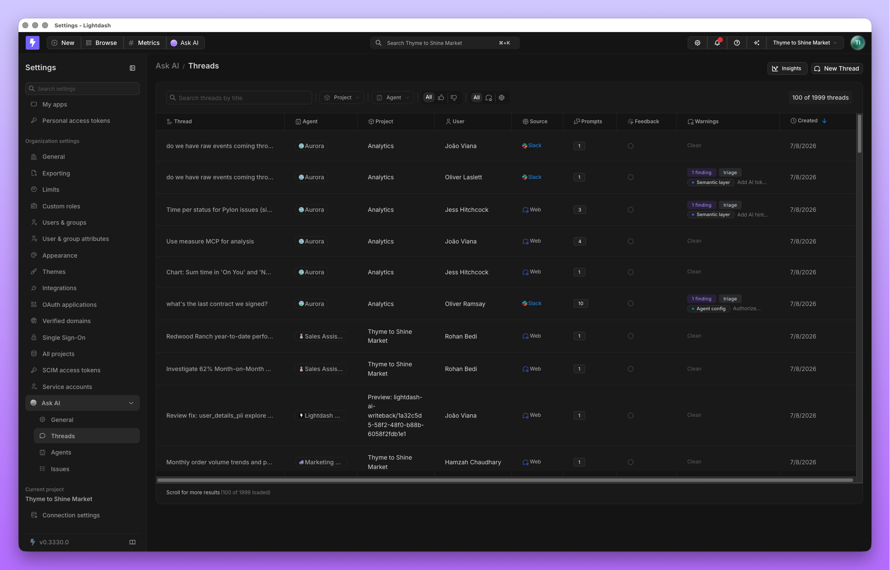
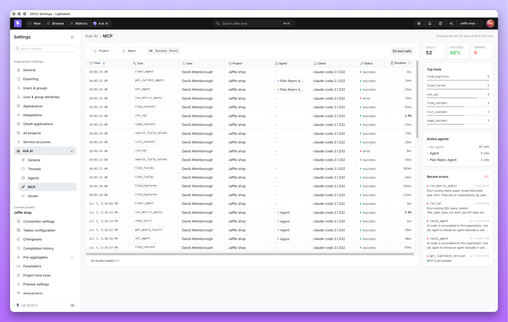
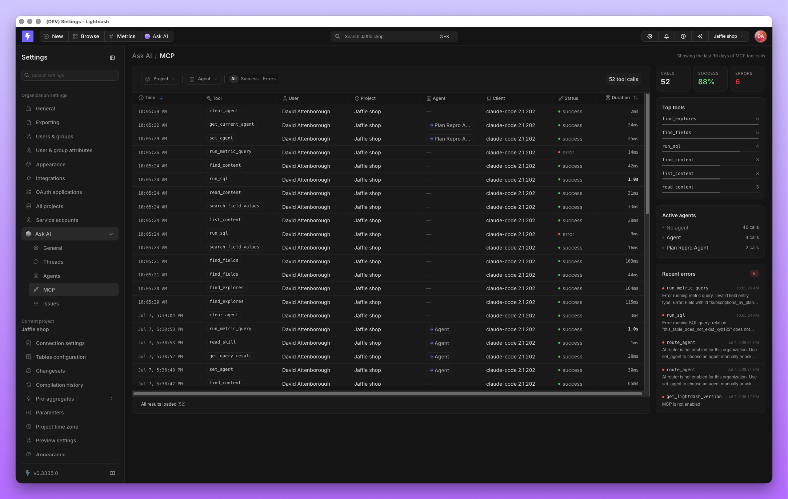

Review agent conversations and MCP tool calls to understand what ran, who requested it, and whether it succeeded. Admins manage thread history and Issues from **Settings** → **Ask AI**. MCP activity lives under **Settings** → **MCP** → **Analytics**. Each view is scoped to the projects the admin manages.

These views record activity. Configure what agents can do through [data access controls](/agents/data-access), [SQL mode approvals](/agents/use-ai-agents#how-approvals-work), and [MCP tool curation](/agents/connect-external-mcp-servers#choose-which-tools-are-exposed-to-the-agent).

## Thread activity

Every agent conversation, in the Lightdash app or Slack, is visible to admins under **Threads**. It's the same record the person who asked the question sees: their question, the agent's answer, and the query behind it. Admins use it to understand how agents are actually being used, and to pull real conversations into [Evaluations](/agents/create-evaluation-suites) as test cases.

<Frame>
  
  
</Frame>

To see usage across the whole organization, select **Insights** on the **Threads** page. It opens the **AI Agents Insights** dashboard, which summarizes AI agent usage for your organization. Only organization admins can open Insights. Admins who see **Threads** for the projects they manage can't open it.

### Pull thread data with the API

To load agent conversations into your warehouse or another tool, call the [Lightdash API](/api-reference/v1/introduction) with a [personal access token](/personal-settings/create-personal-tokens):

- `GET /api/v1/aiAgents/admin/threads` lists threads across the projects you manage, with the same scope as **Threads**. Filter with `projectUuids`, `agentUuids`, `userUuids`, `createdFrom`, `humanScore`, `dateFrom`, `dateTo` and `search`. It returns 50 threads per page by default; use `page` and `pageSize` to page through.
- `GET /api/v1/projects/{projectUuid}/aiAgents/{agentUuid}/threads/{threadUuid}` returns a thread's messages. Each answer carries its feedback (`humanScore`, `humanFeedback`), its token usage (`tokenUsage`) and its artifacts, whose `savedQueryUuid` and `savedDashboardUuid` identify charts and dashboards saved from the thread.
- `GET /api/v1/projects/{projectUuid}/aiAgents/{agentUuid}/threads` lists only your own threads with that agent. Add `allUsers=true` to list everyone's, which needs permission to manage the agent.

## MCP activity

The **MCP → Analytics** page covers both directions of MCP activity: external assistants calling tools on the [Lightdash MCP server](/agents/lightdash-mcp), and Lightdash agents calling tools on [connected external MCP servers](/agents/connect-external-mcp-servers). Admins can see what was called, by whom, and whether it succeeded.

<Frame>
  
  
</Frame>

Activity is retained for 90 days, and the page has no export. To monitor MCP tool calls over a longer period or export them, use the [Lightdash analytics project](/workspace-admin/usage-analytics-project) (**Settings** → **Lightdash analytics**). Its **Tool activity** Explore and the **Tools & operations** dashboard cover tool calls, clients, errors and latency. You can [download results as CSV or Excel and use them in scheduled deliveries](/workspace-admin/usage-analytics-project#downloads-and-scheduled-deliveries), subject to the usual permissions. Organization admins have access automatically; other users need the `view:SystemAnalytics` permission, described in [Grant access](/workspace-admin/usage-analytics-project#grant-access).

Which tools an agent is *allowed* to call is decided separately, per MCP server, in project settings. See [choosing which tools are exposed](/agents/connect-external-mcp-servers#choose-which-tools-are-exposed-to-the-agent).

## Review findings and test fixes

When a conversation reveals a recurring error, use [Issues](/agents/issues) to review findings and proposed fixes. Add representative questions from the thread to an [evaluation suite](/agents/create-evaluation-suites) to check whether a change fixes the problem and to catch regressions.

Scheduled maintenance has its own record: see [Autopilot activity](/agents/autopilot#reviewing-activity).
