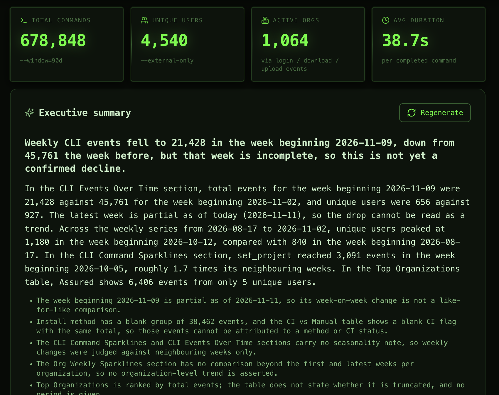
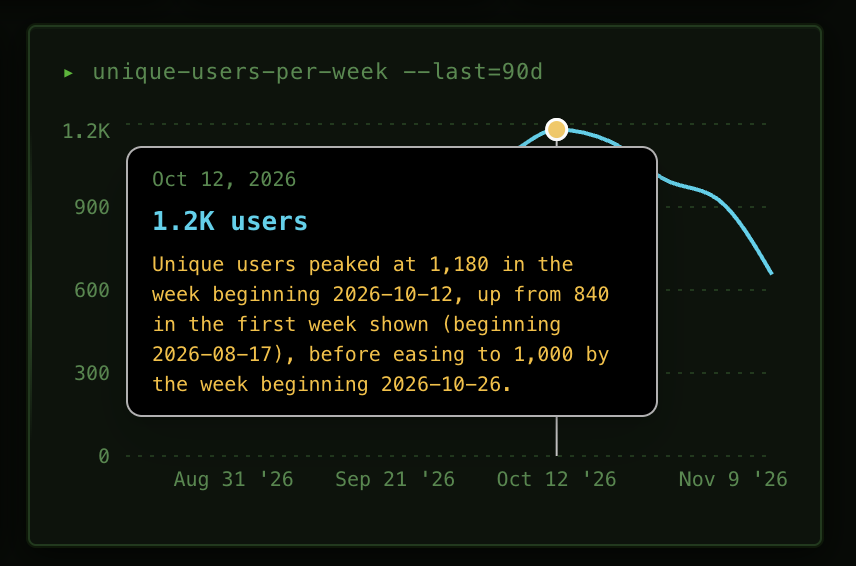

import { FeatureBadge } from '/snippets/feature-badge.jsx';
import { RecipePrompt } from '/snippets/recipe-prompt.jsx';

<div className="feature-badges"><FeatureBadge label="Experimental" /></div>

## What you'll build

An executive summary at the top of your app that writes itself when the page loads, markers on the unusual data points of every chart, and an **Investigate with AI** action that explains why a point stands out.

<Frame>
  
</Frame>

## Before you start

- **Data apps** on your Lightdash instance. See [Data apps](/data-apps).
- **AI analysis** turned on by an organization admin under **Settings** → **Ask AI** → **AI analysis**. See [Turn it on](/data-apps/ai-analysis#turn-it-on).
- **An AI agent** with access to the app's data, if you want to investigate findings. The summary and markers work without one.
- **A data app with charts** that you can edit. To start from scratch, create an app with the **Dashboard** template and attach an existing dashboard as context. See [Creating a new app](/data-apps#creating-a-new-app).

## Copy the prompt

Open your app, copy this prompt, and send it as your next prompt to the app agent.

<RecipePrompt
  pasteInto="the prompt box of your app, then send it"
  prompt={`Add AI analysis to this app:

- An executive summary block at the top of the page that analyses as soon as it loads.
- Markers on the flagged data points of every chart, with the finding shown in the chart tooltip.
- "Investigate with AI" in every data point's menu, with the investigation card under the chart.

Write the summaries in plain English for an executive audience, and lead with the biggest change compared with the previous period.`}
/>

The agent builds a new version of the app. The prompt asks for the full set of [in-app analysis](/data-apps/ai-analysis#show-the-analysis-inside-the-app), turns on [analyse on load](/data-apps/ai-analysis#show-the-analysis-inside-the-app), and stores the last line as the app's [analysis instructions](/data-apps/ai-analysis#steer-the-summaries).

## Try it

<Steps>
  <Step title="Open the new version">
    When the build finishes, the preview reloads. An **Executive summary** block appears at the top of the page and starts analyzing once the charts load. After a few seconds it shows a headline, a short summary, and the limitations of the data.
  </Step>
  <Step title="Hover a marked data point">
    Charts with notable points show markers, colored by severity. Hover one to see the finding under the value in the tooltip.

    <Frame>
      
    </Frame>
  </Step>
  <Step title="Investigate a finding">
    Click the marked point to open its menu, then click **Investigate with AI**. An investigation card appears under the chart and fills in with possible drivers, the evidence the agent checked, and a confidence line.
  </Step>
  <Step title="Change the view">
    Change a filter or move to another tab. The summary runs again for the new view. If someone already analyzed the same results, the stored analysis appears immediately.
  </Step>
  <Step title="Continue in Ask AI">
    On a finished investigation, click **Continue in Ask AI** to keep asking questions in a thread. The button only appears when your organization allows it.
  </Step>
</Steps>

## Make it yours

Send any of these as a follow-up prompt.

Keep only the summary and drop the chart markers:

```text
Just an executive summary. Remove the markers and the investigate actions from the charts.
```

Teach the analysis your domain vocabulary and formats:

```text
Amounts are in EUR. "Stage" labels are covenant stages, not sales stages.
```

Add a written takeaway under a single chart:

```text
Under the revenue chart, add a one-sentence AI takeaway about the trend in the selected period.
```

## How it works

- [AI analysis](/data-apps/ai-analysis) covers what is analyzed, the organization limits, and what is sent to the model.
- [Investigate a finding](/data-apps/ai-analysis#investigate-a-finding) explains which tools the agent can use and how long an investigation can run.
- [Reuse](/data-apps/ai-analysis#reuse) explains when a stored analysis is shown instead of a new one.
- [Where it works](/data-apps/ai-analysis#where-it-works) lists the places AI analysis doesn't run, such as scheduled deliveries and embedded apps.
