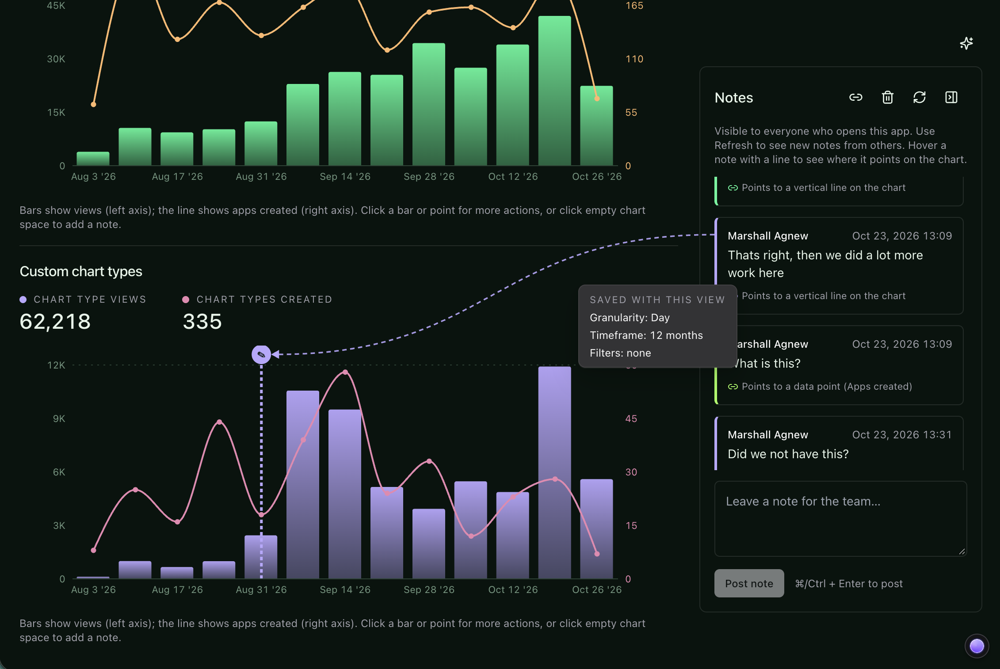

import { FeatureBadge } from '/snippets/feature-badge.jsx';
import { RecipePrompt } from '/snippets/recipe-prompt.jsx';

<div className="feature-badges"><FeatureBadge label="Experimental" /></div>

## What you'll build

A comments panel next to each chart where your team posts notes that everyone who opens the app can read, with each comment's author and time, and a **Refresh** button to pull in new replies.

<Frame>
  
</Frame>

## Before you start

- **Data apps** on your Lightdash instance. See [Data apps](/data-apps).
- **Saved app state** turned on for your organization. See [Saved app state](/data-apps/saved-app-state).
- **A data app with charts** that you can edit. To start from scratch, create an app with the **Dashboard** template and attach an existing dashboard as context. See [Creating a new app](/data-apps#creating-a-new-app).
- **A teammate who can open the app**, to try the comments together. A new app is personal, so [move it into a space](/data-apps#sharing-an-app) they can access.

## Copy the prompt

Open your app, copy this prompt, and send it as your next prompt to the app agent.

<RecipePrompt
  pasteInto="the prompt box of your app, then send it"
  prompt={`Let the team leave comments on this app, visible to everyone who opens it:

- A comments panel next to each chart. Anyone can post a comment, and each comment shows who wrote it and when.
- Let people edit or delete their own comments.
- Keep what someone typed visible until the comment is saved, and say so if a save fails.
- Preserve both comments when two people post at once; keep my draft if a conflict can't be resolved.
- Add a Refresh button to the comments panel.`}
/>

The agent builds a new version of the app that keeps the comments in [shared storage](/data-apps/saved-app-state#shared-storage). Lightdash records every change with its author and time.

Anyone who can open the app can change shared values, so "only edit your own comments" is a rule the app's buttons follow, not a permission Lightdash enforces. Viewers of an [embedded app](/data-apps/saved-app-state#embedded-apps) can read the comments but can't post.

## Try it

<Steps>
  <Step title="Post a comment">
    Write a comment on one of the charts and post it. It appears with your name and the time, and the text box clears once the comment is saved.
  </Step>
  <Step title="Watch the save">
    Open **View network** in the preview header and select the **Requests** tab. With the panel open, post another comment. A row with an **app state** badge appears for a `set-shared` call, with the value size and duration. A save that fails shows an error code instead of **ok**. See [Network inspector](/data-apps#network-inspector).
  </Step>
  <Step title="Post from another account">
    Ask your teammate to open the app from its space and post another comment. Comments don't update live: click **Refresh** in the comments panel, or come back to the app's browser tab, to see their comment.
  </Step>
  <Step title="Post at the same time">
    Ask your teammate to post a comment while you post one too. Both comments land. If a save can't be merged, the **Requests** tab shows a `conflict` error, and the app keeps your draft so you can post it again.
  </Step>
  <Step title="Edit and delete a comment">
    Edit one of your comments and save it. Ask your teammate to click **Refresh**: they see the new text. Then delete the comment and ask them to refresh again: it's gone for them too.

    Deleting removes the comment from the app, but earlier versions of the comments key still contain its text. People who can manage the app can read those versions in the **App state** panel.
  </Step>
  <Step title="Review the history (optional)">
    This step needs permission to manage the app. Open the app's **⋯** menu and select **App state**, then select the comments key. Each version shows who changed it, when, and the full list of comments at that point. See [See what an app has saved](/data-apps/saved-app-state#see-what-an-app-has-saved).
  </Step>
</Steps>

## Make it yours

Send any of these as a follow-up prompt.

Let people close out discussions:

```text
Let people mark a comment as resolved, and hide resolved comments behind a "Show resolved" toggle.
```

Pin comments to a specific data point instead of a whole chart:

```text
Let people attach a comment to a specific month on the revenue chart, and show a marker on months that have comments.
```

Save AI commentary once per selection and let the team edit it. This needs [AI analysis](/data-apps/ai-analysis) turned on. For a full walkthrough, see [Save and edit AI commentary](/data-apps/save-and-edit-ai-commentary).

<Warning>
  Shared commentary is content every viewer of the app can read, including viewers with different data permissions. A viewer may read commentary generated from data they couldn't query themselves. See [For app code](/data-apps/ai-analysis#for-app-code) before you use it with row-level access.
</Warning>

```text
Add AI commentary under the main chart that is saved and shared between viewers, and let anyone edit the text.
```

## How it works

- [Shared storage](/data-apps/saved-app-state#shared-storage) explains what shared values are for and when other people's changes appear.
- [See what an app has saved](/data-apps/saved-app-state#see-what-an-app-has-saved) covers the **App state** panel, version history, and clearing a key.
- [Limits](/data-apps/saved-app-state#limits) lists how large a saved value can be and how many versions Lightdash keeps.
- [Network inspector](/data-apps#network-inspector) explains the **Requests** tab and its app state rows.
