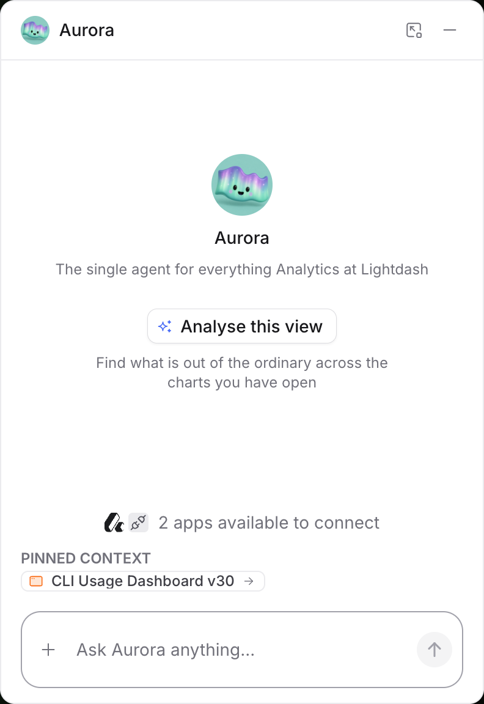
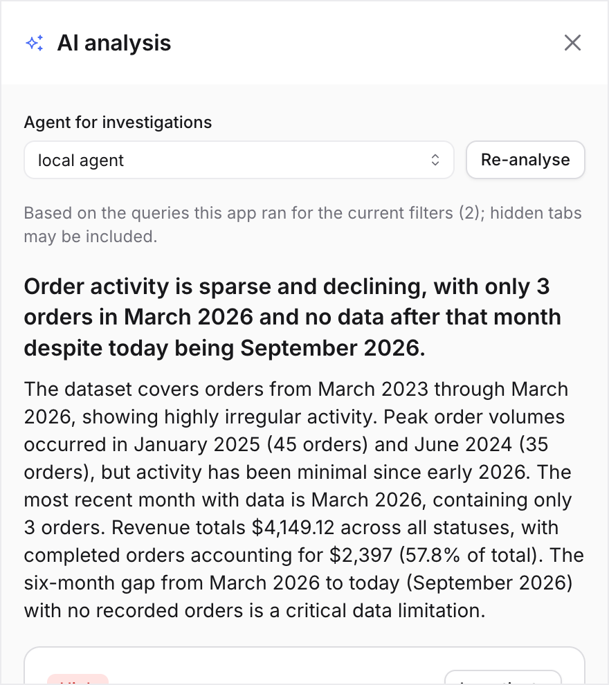

import { FeatureBadge } from '/snippets/feature-badge.jsx';

<FeatureBadge label="Experimental" />

<Info>
  AI analysis is off by default. It's available to every organization with [AI agents](/workspace-admin/ai-settings#enable-ai-features) enabled, and an organization admin [turns it on](#turn-it-on).
</Info>

AI analysis reads the results a data app has loaded for the viewer's current filters and tells them what stands out: a headline, a short summary, a list of notable data points, and what the data could not show. For any notable point, an AI agent can then investigate the likely causes using data beyond the page.

Nothing about this is written into the app. Lightdash runs the analysis over the queries the app already executed, so every result respects the viewer's permissions and user attributes, and an app can pick the analysis up and render it in place without any AI code of its own.

The same analysis also works on [classic dashboards](#on-classic-dashboards) — no data app required.

<Tip>
  **Try it:** [Add AI analysis to your app](/data-apps/add-ai-analysis-to-an-app) or [save and edit AI commentary](/data-apps/save-and-edit-ai-commentary), each with one copy-and-paste prompt.
</Tip>

## Turn it on

An organization admin enables AI analysis under **Settings** → **Ask AI** → **AI analysis**. The same page covers data apps and [classic dashboards](#on-classic-dashboards), and both **Ask AI** → **General** and **Data apps** → **General** link to it.

- **AI analysis** turns it on for every data app and every [dashboard](#on-classic-dashboards) in the organization. It sends query results the viewer can already see to your configured AI provider. If you have [brought your own provider keys](/workspace-admin/ai-settings#bring-your-own-ai-providers-and-models), the calls go through your account; otherwise they run on Lightdash's key.
- **Continue investigations in Ask AI** lets viewers continue an investigation as an Ask AI thread. Turn it off to limit viewers to the written explanation.
- **Summary instructions** set organization-wide guidance every analysis summary follows — a language ("write in British English"), formats ("amounts in ZAR"), or a line of domain vocabulary. An app's own [analysis instructions](#steer-the-summaries) are applied on top of these. Changing the instructions invalidates stored analyses, so the next view runs fresh.

AI analysis doesn't depend on Ask AI being shown elsewhere in Lightdash. To run it in data apps while hiding the Ask AI homepage card, navbar action, and agent chat, turn off **Lightdash UI** under **Settings → Ask AI → General → Visibility**.

### Limits

The same page sets caps on how much analysis the organization can run. Each is a number; the daily caps can also be left empty for no cap.

| Setting | Default | What it bounds |
| --- | --- | --- |
| Analyses per day | 300 | Runs of the model over a view, organization-wide, per UTC day. Reused analyses don't count. |
| Investigations per day | 100 | Agent investigations, organization-wide, per UTC day. |
| Prompts per day | 500 | Questions apps ask through `useAiPrompt`, organization-wide, per UTC day. |
| Maximum steps per investigation | 12 | Model steps the agent may take before it must answer. |
| Maximum warehouse queries per investigation | 15 | Queries the agent may run; when the budget runs out the explanation is marked partial. |

On Lightdash's key, the daily caps can't be raised above the defaults. On your own key, they apply as you set them. Once a daily cap is reached, the panel says so and analysis resumes the next day.

Analyses and prompts run on a fast model Lightdash picks: with your own Anthropic key, the fastest Claude model the key can reach (Haiku, falling back to another Claude model the key serves); on Lightdash's key, the instance's default fast model. The Data Apps **Opus**/**Sonnet**/**Haiku** tiers under [Settings → Ask AI → AI providers & models](/workspace-admin/ai-settings#control-which-models-users-can-pick) only control which models build apps. You can't pin the model per app or per prompt. Extended reasoning is off for these calls and not configurable; adaptive models may still think briefly before answering. Each prompt answer has a fixed output allowance, set by Lightdash and not an admin setting, that includes any thinking the model does before answering.

Independently of those caps, each viewer is limited per app to 6 analyses, 3 investigations, and 20 prompts a minute. An analysis served from storage doesn't count. When the limit is hit, an analysis a viewer asked for says when to retry; an automatic one on load shows no error and tries again on the next view change. Investigations are also capped at three minutes each.

## Analyze a view

Open a data app, then open the AI launcher, the orb in the corner of the page. On the new chat screen, click **Analyse this view**. Lightdash runs the analysis immediately and opens the **Analysis** panel in the launcher. If the organization has analysis off, the panel says so, and organization admins get a **Turn it on in settings** link.

<Frame>
  
</Frame>

If an analysis of the same view already exists, the launcher shows an **Insights on this view** card instead, with the headline and top findings. Click **Open analysis** to see the full result, or **Re-run** to analyze again.

The analysis reads every query the app ran for the current filters. Queries on tabs you aren't looking at count too, as long as the app has loaded them. Apps built on a current SDK report exactly which queries are on screen, so the analysis covers what you see.

To investigate findings later, pick an agent under **Agent for investigations** at the bottom of the panel. The analysis itself needs no agent, and any agent with access to the app's data works. Your choice is remembered per app.

When it finishes you get:

- A **headline** with the main finding and a **summary** an executive can read without the charts.
- **Findings**, each with a severity of High, Medium, Positive, or Info. High and Medium point at something worth investigating, Positive at a good surprise, and Info at context the summary relies on. A finding that refers to one row names the row; a finding about a whole table names only the table. Hovering a finding highlights the chart it came from when the app supports [data lineage](/data-apps#network-inspector).
- **Limitations**, such as a missing comparison period or truncated results. Read them before acting on the headline.

<Frame>
  
</Frame>

An analysis with no findings is a normal outcome. The panel says **Nothing notable found in the current view**.

If you change a filter or move to a different tab after analyzing, the panel flags that the view changed and offers **Re-analyse**. The earlier result stays visible until you do.

If the results behind the view have expired since the app loaded them, Lightdash reloads the app once so its queries run again, then analyzes the fresh view. If that also fails, the panel asks you to refresh the app yourself.

### Reuse

Lightdash stores every analysis with the app version and a fingerprint of the results it read. Opening a view whose results match an analysis someone already ran shows that analysis immediately instead of running the model again, and the same applies when you return to the app later. Findings are shared this way; investigations are personal and are never copied between viewers. **Re-analyse** always runs a new analysis.

Stored analyses and investigations are deleted after 30 days. A view opened after that is analyzed again.

## Investigate a finding

Click **Investigate** on a finding. The agent you picked runs in the background with read-only tools: it can search the semantic layer, run queries, read saved charts and dashboards, and read the agent's knowledge documents. It can't save content, change anything, or reach external systems. A run is bounded by the organization's [limits](#limits); if the query budget runs out, the explanation says the answer is partial.

The explanation arrives as Markdown with a summary, a **Possible drivers** list with evidence for each, an **Evidence** list of what was checked, and a confidence line. It stays attached to the finding for you and is restored when you reopen the app.

Viewers without access to any agent in the project still get the analysis. The panel explains that findings can't be investigated, and apps hide their Investigate actions for them.

### Continue in Ask AI

When the organization allows it, a finished investigation has a **Continue in Ask AI** button. It opens the investigation as a thread in Ask AI with the agent's reasoning already in place, so you can keep asking questions. The thread stays read-only permanently: every later prompt keeps the investigation's tool set, so it can't save charts, write back, or start a [deep research](/agents/deep-research) run, whatever the agent is otherwise allowed to do.

## Show the analysis inside the app

Viewers don't have to open the panel. Ask the app agent to add AI analysis and the app renders the same analysis in place:

- **"Add AI analysis"** gives the full set: a summary block at the top of the page, markers on the flagged data points of every chart, **Investigate with AI** in every data point's menu, and the investigation card under the chart.
- **"Just an executive summary"** gives the summary block alone.
- **"Mark anomalies on the charts"** gives the markers, the menu entry, and the card.

If the app shouldn't wait for a click, ask for that too — "analyse as soon as it loads". The agent builds **analyse on load** into the app, and the analysis then runs whenever a viewer opens it or changes the view. A stored analysis of the same results is shown instead of re-running the model (see [Reuse](#reuse)), and the organization's [limits](#limits) still apply to automatic runs. Analyse on load is set while building the app — there's no organization or per-app setting for it — so it's also turned off with a prompt: "stop analysing on load".

The summary block has an **Analyse** button of its own and shows a **Regenerate** button once a result exists. Markers appear on High, Medium, and Positive findings only, colored by severity, and one metric's finding never marks another series of the same chart. Hovering a marked point shows the finding under the value, and the point's menu opens the investigation, or reopens it once one exists.

### Steer the summaries

When the summaries should be written a certain way, ask the agent for it — "write the summaries in British English", "amounts are in EUR", or a line of domain vocabulary such as "stage labels are covenant stages, not sales stages". The agent stores the guidance in the app as **analysis instructions**, and every analysis of that app follows it, including analyses run from the panel. Instructions guide wording and interpretation only: they can't grant data access or change which results are analyzed, and they're capped at 2,000 characters.

Guidance that should apply to every app — house style, language, currency — belongs in the organization-wide **Summary instructions** under **Settings** → **Ask AI** → [**AI analysis**](#turn-it-on) instead. The organization default applies first and an app's own instructions are added after it, so an app adds its domain vocabulary on top of the house style rather than replacing it.

All of this renders nothing when AI analysis is off, so an app built with it works unchanged for organizations that haven't turned it on. While you build, the app builder shows an **AI analysis off** chip next to the prompt when the app renders analysis but the organization has it off; admins can click it to turn analysis on.

<Note>
  Apps built before AI analysis existed don't pick it up on their own. Ask the agent to add it, which creates a new version of the app. If an app was wired to a model provider through an [external connection](/data-apps/external-connections) as a stopgap, ask the agent to replace that with AI analysis: it removes the author's key from the app, so the organization's consent setting and the viewer's permissions apply again.
</Note>

### For app code

If you [edit app code locally](/workflow/local-data-app-development), two hooks from `@lightdash/query-sdk` expose the analysis:

- `useInsights()` returns the view's analysis, and `useInsights(result)` narrows it to the findings on one `useLightdash` query, with a `matches(row, fieldId)` helper for marking data points. The template ships ready-made components under `src/components/insights/` for the summary block, markers, menu entry, and investigation card.
- `useInsights({ instructions })` — or the `instructions` prop on the shipped `InsightsSummary` component — sets the app's [analysis instructions](#steer-the-summaries). One string per app.
- `useInsights({ analyseOnLoad: true })` — or the `analyseOnLoad` prop on `InsightsSummary` — declares [analyse on load](#show-the-analysis-inside-the-app) in app code. One value per app.
- `useAiPrompt()` lets the app ask its own short question about results it has already loaded, for an author-written takeaway under a chart or an explanation of a clicked row. Answers are plain text. Prompts are capped at 2,000 characters and count against the prompt limits above, and run on the same model as analysis, with a fixed output cap set by Lightdash — see [Limits](#limits).
- `useSharedAiCommentary()` combines `useAiPrompt` with [shared storage](/data-apps/saved-app-state#shared-storage) to save commentary per selection: the first viewer generates it, later viewers of the same selection read the saved text instead of generating it again, and anyone can edit it — the edited text wins and is labeled as edited. It needs both this feature and [saved app state](/data-apps/saved-app-state) turned on. Because the saved text is shared by selection, a viewer may read commentary generated from data they couldn't query themselves — keep selections coarse when row-level access matters.

Neither hook sends rows anywhere: the app names the query, and Lightdash reads the results from the viewer's own query history. Both report the feature as unavailable, and render nothing, outside a Lightdash host that has analysis on. The app template's `references/ai-analysis.md` documents both in full.

## On classic dashboards

The same analysis runs on any dashboard, without building a data app or having data apps enabled. The same organization toggle under **Settings** → **Ask AI** → [**AI analysis**](#turn-it-on) applies, and so do the same [limits](#limits), [reuse](#reuse), and 30-day retention.

Open a dashboard in view mode and pick **Analyse this view** from the AI launcher in the corner. The analysis covers the queries the dashboard ran for the current filters, and **charts on the active tab only** — unlike apps, where hidden tabs may be included. A different tab, filter, or parameter value is a different view, analyzed (or served from storage) separately. Hovering a finding scrolls the chart it came from into view, and once an analysis exists, the launcher shows the next viewer of that view an **Insights on this view** card — the headline and top findings — instead of waiting for a click.

[Investigations](#investigate-a-finding) and [Continue in Ask AI](#continue-in-ask-ai) work exactly as they do for apps. Dashboards have no app code to carry [analysis instructions](#steer-the-summaries), so the organization-wide **Summary instructions** are the way to steer dashboard summaries.

Dashboard analysis is for signed-in viewers: it isn't offered in edit mode, on embedded dashboards, or in scheduled deliveries.

## Where it works

AI analysis is for people viewing a data app in Lightdash while signed in. It isn't available, and apps built with it show nothing extra, in:

- **Scheduled deliveries** and Google Sheets syncs, which render the app under the creator's account.
- **Embedded apps**, which run under an embed token.
- **Local preview** with `lightdash apps preview`, where there is no Lightdash host to run the analysis.

## What is sent to the model

- **Analysis** sends the query results the app loaded for the viewer, with their field names and any [analysis instructions](#steer-the-summaries) — the organization default and the app's own — to the AI provider configured for your organization.
- **Investigation** runs the agent you picked, with the same data access that agent has anywhere else.
- **App prompts** send the results the app named, and the author's question.

Results a viewer can't see never reach the model, because the analysis only ever reads queries that viewer ran. Analyses are stored in your Lightdash database alongside the app for 30 days. Every run is recorded against the app, the viewer, the operation, and the model, so usage can be attributed.
