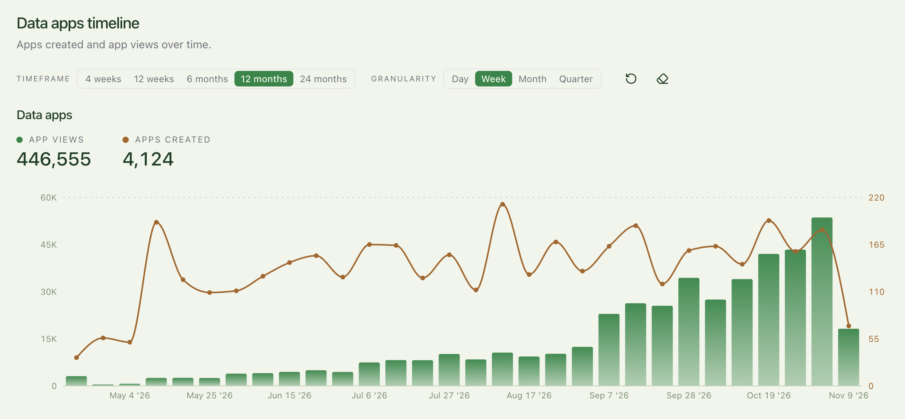

import { FeatureBadge } from '/snippets/feature-badge.jsx';
import { RecipePrompt } from '/snippets/recipe-prompt.jsx';

<div className="feature-badges"><FeatureBadge label="Experimental" /></div>

## What you'll build

An app that opens the way each viewer left it, with their filters, active tab, and sort order restored on any device, plus a **Reset** button that brings back the defaults.

<Frame>
  
</Frame>

## Before you start

- **Data apps** on your Lightdash instance. See [Data apps](/data-apps).
- **Saved app state** turned on for your organization. See [Saved app state](/data-apps/saved-app-state).
- **A data app with filters or other controls** that you can edit. To start from scratch, create an app with the **Dashboard** template and attach an existing dashboard as context. See [Creating a new app](/data-apps#creating-a-new-app).

## Copy the prompt

Open your app, copy this prompt, and send it as your next prompt to the app agent.

<RecipePrompt
  pasteInto="the prompt box of your app, then send it"
  prompt={`Remember each viewer's own choices in this app:

- Save my filter selections, the active tab, and the sort order, so the app opens the way I left it, on any device.
- Keep these choices private to each viewer.
- Add a Reset button next to the filters that restores the defaults.
- Show a small "not saved" hint when saving isn't available.`}
/>

The agent builds a new version of the app that saves these choices in [user storage](/data-apps/saved-app-state#user-storage). Choices save as you make them, so there's no save button.

## Try it

<Steps>
  <Step title="Change the view">
    Pick filter values that differ from the defaults, switch to another tab, and change a sort order.
  </Step>
  <Step title="Watch a save">
    Open **View network** in the preview header and select the **Requests** tab. With the panel open, change a filter again. A row with an **app state** badge appears for each call: a `set-user` row for your change, with the value size and duration. A save that fails shows an error code instead of **ok**. See [Network inspector](/data-apps#network-inspector).
  </Step>
  <Step title="Reopen the app from the app list">
    Close the app, then open it again from its space or from **Settings** → **My apps**. Don't use a copied link or your browser history: the page address carries [view state](/data-apps#sharing-a-link-to-the-current-view), which can restore your selections even if saving failed. The app opens with the filters, tab, and sort order you left it with. Open it the same way on another device while signed in as you, and you get the same view.
  </Step>
  <Step title="Check that it's private">
    A personal app is only visible to you, so first [move it into a space](/data-apps#sharing-an-app) your teammate can access. Ask them to open the app from that space, not from a link to your current view. They see the defaults, or the choices they saved themselves, never yours.

    Your saved choices stay private, but selections in a link you share travel with the link. When someone opens a link with view state, those values take priority over their own saved choices.
  </Step>
  <Step title="Reset">
    Click **Reset**. The defaults return, and the app saves them as your new choices. Close the app and reopen it from the app list to confirm it opens with the defaults.
  </Step>
</Steps>

## Make it yours

Send any of these as a follow-up prompt.

Put the view in the page link, so a colleague who opens your link sees the same view:

```text
Also put the selected period and region in the page link, so anyone who opens my link sees the same view.
```

Add comments the whole team can see, saved in [shared storage](/data-apps/saved-app-state#shared-storage). For a full walkthrough, see [Add shared team comments](/data-apps/add-shared-comments-to-an-app).

```text
Let the team leave comments on each region, visible to everyone who opens the app. Show who last changed the comments and when, and add a Refresh button to the comments panel.
```

Save AI commentary once per selection and share it with every viewer. This needs [AI analysis](/data-apps/ai-analysis) turned on. For a full walkthrough, see [Save and edit AI commentary](/data-apps/save-and-edit-ai-commentary).

<Warning>
  Unlike your saved filters, shared commentary is content every viewer of the app can read, including viewers with different data permissions. A viewer may read commentary generated from data they couldn't query themselves. See [For app code](/data-apps/ai-analysis#for-app-code) before you use it with row-level access.
</Warning>

```text
Add AI commentary under the main chart that is saved and shared between viewers, and let anyone edit the text.
```

## How it works

- [Saved app state](/data-apps/saved-app-state) explains user and shared storage, what embedded viewers can do, and the storage limits.
- [See what an app has saved](/data-apps/saved-app-state#see-what-an-app-has-saved) covers the **App state** panel, where people who can manage the app review shared keys and their history.
- [Network inspector](/data-apps#network-inspector) explains the **Requests** tab and its app state rows.
