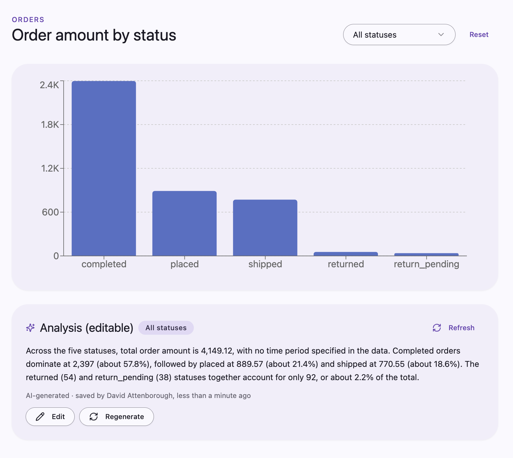
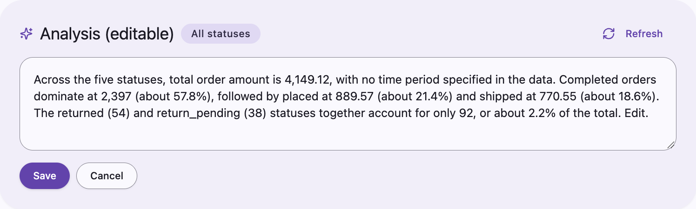
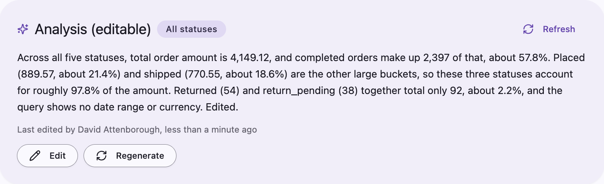

import { FeatureBadge } from '/snippets/feature-badge.jsx';
import { RecipePrompt } from '/snippets/recipe-prompt.jsx';

<div className="feature-badges"><FeatureBadge label="Experimental" /></div>

## What you'll build

A short AI-written takeaway under a chart that the first viewer generates with one click. Lightdash saves it for everyone who picks the same selection, and anyone can edit it. The commentary is labeled **AI-generated** until someone edits it, and then it shows who edited it.

<Frame>
  
</Frame>

This recipe combines [AI analysis](/data-apps/ai-analysis), which writes the text, with [saved app state](/data-apps/saved-app-state), which stores it.

## Before you start

- **Data apps** on your Lightdash instance. See [Data apps](/data-apps).
- **AI analysis** turned on by an organization admin under **Settings** → **Ask AI** → **AI analysis**. See [Turn it on](/data-apps/ai-analysis#turn-it-on).
- **Saved app state** turned on for your organization. See [Saved app state](/data-apps/saved-app-state).
- **A data app with a chart and a few filters** that you can edit, such as a region or period picker. To start from scratch, create an app with the **Dashboard** template and attach an existing dashboard as context. See [Creating a new app](/data-apps#creating-a-new-app).
- **A teammate who can open the app**, to see the saved text from another account. A new app is personal, so [move it into a space](/data-apps#sharing-an-app) they can access.

<Warning>
  Saved commentary is content every viewer of the app can read, including viewers with different data permissions. A viewer may read commentary generated from data they couldn't query themselves. Don't build it over data some viewers must not see described in words. See [For app code](/data-apps/ai-analysis#for-app-code).
</Warning>

## Copy the prompt

Open your app, copy this prompt, and send it as your next prompt to the app agent.

<RecipePrompt
  pasteInto="the prompt box of your app, then send it"
  prompt={`Add AI commentary under the main chart that is saved and shared between viewers:

- A "Generate commentary" button that writes three sentences about what stands out for the current selection. Only generate when someone clicks it, never on load.
- Save the commentary separately for every filter, tab, or selected data point that changes the chart's data, so everyone who picks the same selection sees the same text and no selection shows another's commentary.
- Let anyone edit the text. Label it "AI-generated" until someone edits it, then show who edited it.
- Show when the commentary was generated.
- Keep generated text and edits visible until saving is confirmed; show save failures and let me retry.
- A Regenerate button that replaces the saved text, and asks for confirmation first if someone edited it.`}
/>

The agent builds a new version of the app that generates the text with an [app prompt](/data-apps/ai-analysis#for-app-code) and saves it in [shared storage](/data-apps/saved-app-state#shared-storage), one key per selection. Each generation counts toward your organization's [prompt limits](/data-apps/ai-analysis#limits). Reading saved commentary doesn't.

Saved commentary doesn't update when the data does. It's keyed to the selection, not to the results, so when fresh warehouse data arrives for the same selection, viewers still see the text generated earlier. The generation time tells viewers how old it is, and **Regenerate** writes it again from the current data.

## Try it

<Steps>
  <Step title="Generate commentary">
    Pick a selection in the app's filters and click **Generate commentary**. A few seconds later, three sentences appear under the chart, labeled **AI-generated**, with the time they were generated. If the save fails, the text stays visible with an error and a way to retry, so you don't mistake unsaved text for saved text.
  </Step>
  <Step title="Watch the save">
    Open the app actions menu (**⋯**) in the header, choose **View network**, then select **Requests**. With the panel open, change the selection and generate again. A row with an **app state** badge appears for a `set-shared` call on a key that starts with `ai-commentary:`. See [Network inspector](/data-apps#network-inspector).
  </Step>
  <Step title="Switch selections">
    Change the filters to a selection nobody has generated commentary for. The **Generate commentary** button appears instead of text. Switch back, and the saved text returns without generating again.

    Then change each other control that affects the chart one at a time, such as a tab or a selected data point. Each change should show that context's own commentary or the **Generate commentary** button, never commentary from a different selection. If one doesn't, ask the agent to include that control in how the commentary is saved.
  </Step>
  <Step title="Open it from another account">
    Ask your teammate to open the app from its space and pick the same selection. They see the saved text immediately, without clicking **Generate commentary**.
  </Step>
  <Step title="Edit the text">
    Click **Edit**, change the text, and click **Save**.

    <Frame>
      
    </Frame>

    The label changes from **AI-generated** to show that you edited it. Ask your teammate to refresh the app: they see your edited text.

    <Frame>
      
    </Frame>
  </Step>
  <Step title="Regenerate">
    Click **Regenerate**. Because the text was edited, the app asks you to confirm. Confirm, and new AI-generated text replaces the edited version for every viewer of that selection.
  </Step>
  <Step title="Review the history (optional)">
    This step needs permission to manage the app. Open the app's **⋯** menu and select **App state**, then select a key that starts with `ai-commentary:`. Each version shows who changed it and when, with the text, whether it was edited, and the prompt that generated it. Regenerated and edited versions stay in the history. See [See what an app has saved](/data-apps/saved-app-state#see-what-an-app-has-saved).
  </Step>
</Steps>

## Make it yours

Send any of these as a follow-up prompt.

Write for a specific audience:

```text
Write the commentary for an operations lead. Mention which statuses stand out and any concentration.
```

Generate commentary about a single data point:

```text
When someone clicks a bar on the main chart, offer to generate commentary about that bar, and save it for that bar.
```

Let people remove commentary that's no longer useful:

```text
Add a Clear button that removes the saved commentary for the current selection.
```

## How it works

- [For app code](/data-apps/ai-analysis#for-app-code) describes app prompts and saved commentary, including who can read the saved text.
- [Limits](/data-apps/ai-analysis#limits) lists the prompt caps that generation counts toward.
- [Shared storage](/data-apps/saved-app-state#shared-storage) explains how shared values are stored and when other people's changes appear.
- [See what an app has saved](/data-apps/saved-app-state#see-what-an-app-has-saved) covers the **App state** panel and version history.
- [Storage limits](/data-apps/saved-app-state#limits) list how many shared keys an app can hold: 200, shared with the app's other shared values. Each saved selection uses one key, so count the combinations, not the controls. Twenty regions across twelve periods is already 240 possible selections. Key commentary on fewer controls, or on ones with few choices, and never on free-text search.
