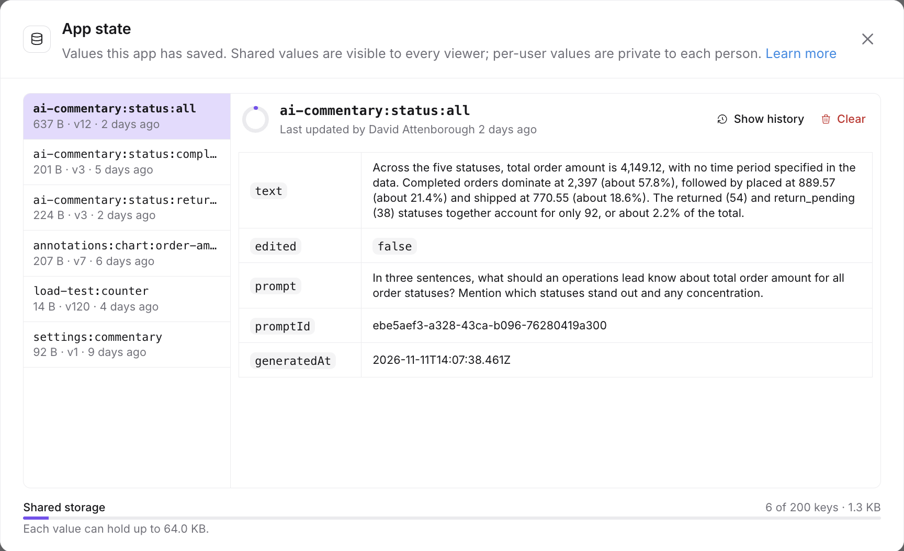
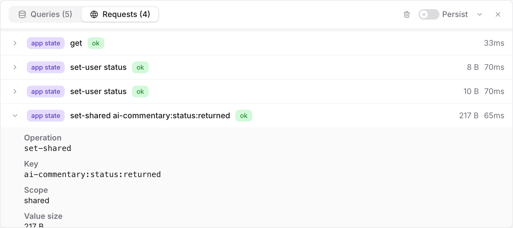

import { FeatureBadge } from '/snippets/feature-badge.jsx';

<FeatureBadge label="Experimental" />

<Info>
  Saved app state is off by default. It needs the `enable-data-app-state` feature flag, which Lightdash support turns on for Cloud organizations on request.
</Info>

Every data app can save values through Lightdash so they come back the next time someone opens it, on any device. Each app has two kinds of storage: user storage and shared storage.

Apps run in a sandboxed frame with no access to browser storage such as `localStorage`, so values an app keeps only in memory reset when the page reloads. Saved app state is how an app remembers them.

<Tip>
  **Try it:** [Remember my filters](/data-apps/remember-filters-in-an-app) or [add shared team comments](/data-apps/add-shared-comments-to-an-app), each with one copy-and-paste prompt.
</Tip>

## User storage

User storage keeps values for each person separately. It suits anything a viewer sets up for themselves, like filter selections, the active tab, or display settings. Set the app up the way you want it, and it opens in that state when you come back. Other viewers don't see your choices.

There is no setting to turn user storage on for an app. The agent uses it by default for inputs that make sense to remember, such as filters and settings. If you don't want something remembered, tell the agent when you build or iterate on the app.

## Shared storage

Shared storage holds values that everyone using the app can see and edit. It suits things people collaborate on, like comment threads, annotations, targets, or a simple ticket tracker. Lightdash keeps a history of who changed each shared value.

The agent doesn't use shared storage by default. Ask for it in your prompt and say what should be shared, for example "let the team leave comments on each region, visible to everyone".

Shared storage also powers saved [AI commentary](/data-apps/ai-analysis#for-app-code): ask for "AI commentary that is saved and shared between viewers" and the app generates a takeaway once per selection, saves it for every later viewer, and lets anyone edit the text. This needs [AI analysis](/data-apps/ai-analysis) turned on as well.

Shared values don't update live. Other people's edits appear when the app loads, when you come back to its browser tab, or when you click a refresh control the app provides.

## See what an app has saved

People who can manage an app can open its **⋯** menu and select **App state**. The panel lists every shared key with its size, version, and who last changed it, and when. Select a key to see its version history, with the author, time, and value of each version.

<Frame>
  
</Frame>

To remove a shared value, select its key and click **Clear**, then confirm. Every viewer loses the value. Its history is kept, so the version number keeps counting if the app saves the key again.

User values stay private. The panel only shows how many per-user values exist and across how many people, never the values themselves.

To watch an app read and write state while you use it, open the [network inspector](/data-apps#network-inspector). Each call appears on the **Requests** tab.

<Frame>
  
</Frame>

## Limits

- Values are JSON, up to 64 KB per key.
- Each app holds up to 200 shared keys, and up to 200 user keys for each person.
- Lightdash keeps the last 1,000 versions of each shared key.

## Embedded apps

In an [embedded app](/embed/embed-data-apps), viewers can read shared values, but they can't read user values, and the app can't save any state. To save values from embedded viewers, or to keep values in your own database, have the app send them to your own API through an [external connection](/data-apps/external-connections), keyed by the viewer (see [Forwarding viewer identity](/data-apps/external-connections#forwarding-viewer-identity)) or by the record people share.
