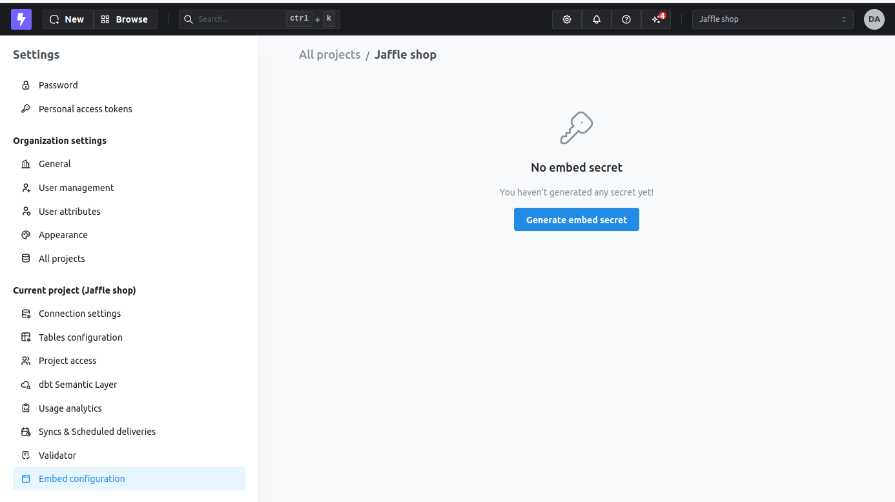
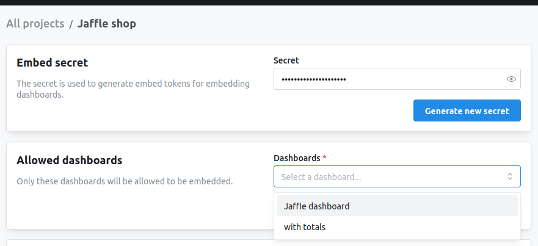
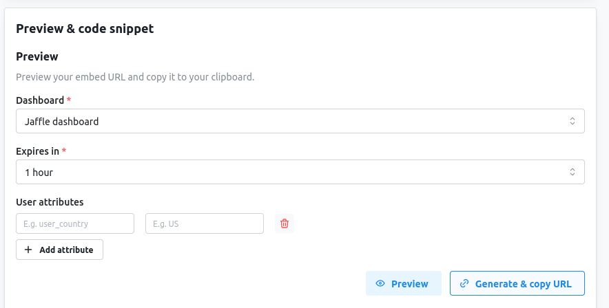

import EmbedAvailability from '/snippets/embedding-availability.mdx';

<EmbedAvailability />

Embed a Lightdash dashboard in your application using an iframe. You'll allow the dashboard, preview it, and generate an expiring URL from your backend.

For other content types or a React integration, see [embedding methods](/embed/reference#embedding-methods).

## Prerequisites

- A saved dashboard and access to your project's **Settings** → **Embed configuration**.
- A project that doesn't require [personal warehouse credentials](/personal-settings/personal-warehouse-connections). Embedded viewers can't provide their own warehouse credentials.
- Node.js and a backend where you can store the embed secret and generate tokens.
- A web page where you can add an iframe.

If you're testing in a separate development project, use that project's embed secret, allowed dashboard, and project UUID throughout this tutorial.

## Embed your dashboard

<Steps>
  <Step title="Create an embed secret">
    In your project's **Settings** → **Embed configuration**, click **Generate embed secret**. If the project already has a secret, use that secret.

    <Frame>
      
    </Frame>

    Store the secret in your backend's `LIGHTDASH_EMBED_SECRET` environment variable. Keep it out of browser code and source control. See [embed secret management](/embed/reference#embed-secret) before regenerating an existing secret.
  </Step>

  <Step title="Allow your dashboard">
    Under **Allowed content**, select the dashboard in **Dashboards**, then click **Save changes**.

    <Frame>
      
    </Frame>
  </Step>

  <Step title="Preview the dashboard">
    Under **Preview & embed code**, select your dashboard and set **Expires in**. If the dashboard uses [user attributes for data access](/embed/reference#user-attributes), enter the values for your test viewer.

    <Frame>
      
    </Frame>

    Click **Preview** and confirm the dashboard loads with the data your viewer should see. Click **Generate & copy URL** to get a URL for testing in a browser tab.
  </Step>

  <Step title="Generate an embed URL on your backend">
    Install `jsonwebtoken` in your Node.js backend:

    ```bash
    aube add jsonwebtoken
    ```

    Alongside `LIGHTDASH_EMBED_SECRET`, set these backend environment variables:

    | Variable | Value |
    | --- | --- |
    | `LIGHTDASH_INSTANCE_URL` | Your Lightdash origin, such as `https://app.lightdash.cloud`, without a trailing slash |
    | `LIGHTDASH_PROJECT_UUID` | The project UUID from the generated URL: `/embed/<project-uuid>#...` |
    | `LIGHTDASH_DASHBOARD_UUID` | The `dashboardUuid` value in **Backend: generate JWT and embed URL** |

    Save this as `generate-embed-url.cjs`:

    ```javascript generate-embed-url.cjs
    const jwt = require('jsonwebtoken');

    const {
      LIGHTDASH_EMBED_SECRET,
      LIGHTDASH_INSTANCE_URL,
      LIGHTDASH_PROJECT_UUID,
      LIGHTDASH_DASHBOARD_UUID,
    } = process.env;

    const token = jwt.sign(
      {
        content: {
          type: 'dashboard',
          projectUuid: LIGHTDASH_PROJECT_UUID,
          dashboardUuid: LIGHTDASH_DASHBOARD_UUID,
        },
      },
      LIGHTDASH_EMBED_SECRET,
      { expiresIn: '1h' },
    );

    const embedUrl = `${LIGHTDASH_INSTANCE_URL}/embed/${LIGHTDASH_PROJECT_UUID}#${token}`;
    console.log(embedUrl);
    ```

    If you supplied user attributes in the preview, include the same `userAttributes` in the [token payload](/embed/reference#user-attributes) before running the script.

    Run it with your backend environment variables loaded:

    ```bash
    node generate-embed-url.cjs
    ```

    The script prints an embed URL that expires in one hour. For other languages or your selected interactivity options, copy the generated example under **Backend: generate JWT and embed URL**. See the [dashboard token reference](/embed/reference#dashboard-token) for the full payload.
  </Step>

  <Step title="Display the dashboard in your application">
    Add this iframe to your web page, replacing `PASTE_GENERATED_EMBED_URL_HERE` with the URL printed by your backend script:

    ```html
    <iframe
      title="Analytics dashboard"
      src="PASTE_GENERATED_EMBED_URL_HERE"
      width="100%"
      height="800"
      style="border: 0;"
    ></iframe>
    ```

    Open the page and confirm the dashboard loads without asking for a Lightdash login. If it doesn't load, check the [iframe troubleshooting steps](/embed/iframe#troubleshooting).

    In your application, authenticate the viewer and check their access on your backend before generating each URL. Pass any user attributes from trusted server-side data. Return the URL to your frontend and set it as the iframe's `src`; generate another URL when the token expires. Anyone with a URL can use it until it expires.
  </Step>
</Steps>

## Configure viewer access

Use the [dashboard embedding options](/embed/embed-dashboards#configure-what-viewers-can-do) to enable filters, exports, and Explore. For tenant-specific data, configure [user attributes](/embed/reference#user-attributes). To let viewers save or edit content, configure [write actions](/embed/reference#write-actions).
