import DashboardControlsFlag from '/snippets/dashboard-controls-flag.mdx';

<DashboardControlsFlag />

Date zoom lets viewers change the date granularity of time-based charts on a [dashboard](/explore/dashboards) without editing them. Zoom in to see daily patterns, or zoom out to spot long-term trends.

Every dashboard has a **Default zoom**, on the right of the controls bar. Editors can also add named date zooms, which are controls on the bar like [filters](/explore/dashboards/filter) and [parameter controls](/explore/dashboards/parameter-controls): each one sets a granularity for the tiles you choose.

<Frame>
  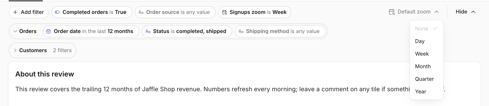
  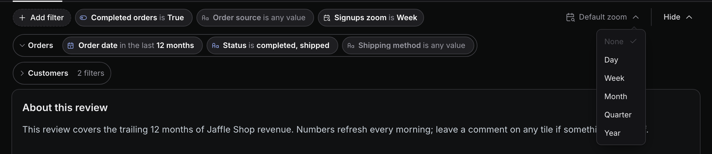
</Frame>

## How date zoom works

To change the granularity, click **Default zoom** or a named date zoom and pick a granularity, such as Day, Week, Month, Quarter, Year, or a custom granularity. Every chart that the zoom governs updates. In **Default zoom**, pick **None** to restore the charts' own granularity. In a named date zoom, pick **Reset to default** to return to its saved granularity.

- A zoom only affects charts that have a date dimension in their results.
- **Default zoom** governs every zoomable chart that isn't in a named date zoom. It's hidden from viewers when every chart is in a named date zoom.
- A named date zoom governs only the tiles you choose, using one date field per tile.
- A tile can be in one named date zoom at a time.
- Changes made by viewers are temporary. Refreshing the dashboard restores the saved granularities.

## Set up date zoom

Make these changes in edit mode, then click **Save changes**.

### Choose the available granularities

The granularities you choose apply to every date zoom on the dashboard.

1. Open the **...** menu next to **Add** and hover **Date zoom grains**.
2. Check the granularities viewers can pick, and uncheck the rest.

A granularity used by a named date zoom can't be unchecked, and at least one stays checked. Unchecking the default granularity clears the default.

<Frame>
  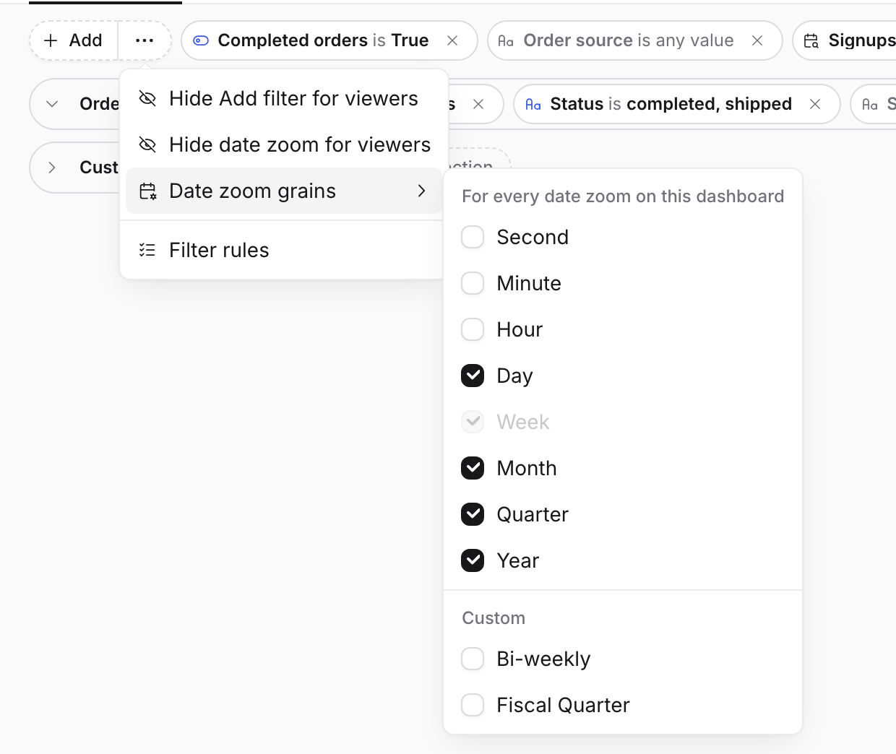
  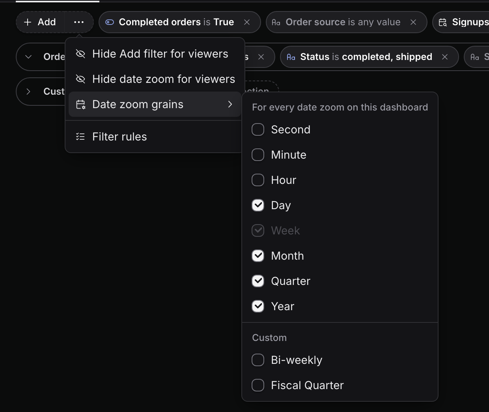
</Frame>

### Set the default granularity

1. Click **Default zoom** on the right of the controls bar.
2. Pick a granularity, or clear it so tiles keep their own.
3. Click **Apply**.

<Frame>
  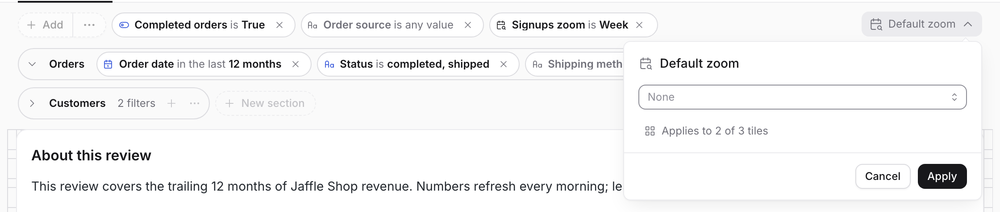
  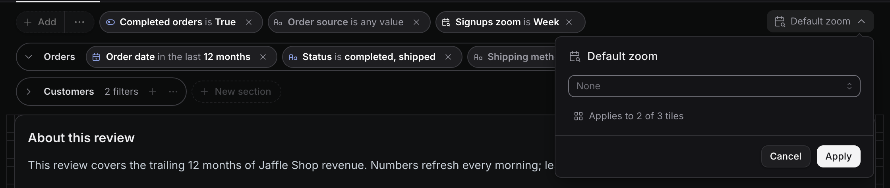
</Frame>

The default applies on load, unless the URL already specifies a granularity.

### Add a named date zoom

A named date zoom points a chosen set of tiles at its own granularity, including tiles on other tabs.

1. Click **Add** → **Date zoom**. To add it straight into a [section](/explore/dashboards/filter#group-filters-into-sections), click the section's **+** → **Date zoom**.
2. Type a name for the zoom and pick its granularity.
3. Click **Choose tiles**. On each tile the zoom should govern, pick the **Date field** it zooms, then click **Apply**.
4. Click **Apply** in the zoom's editor.

A zoom needs at least one tile. Only tiles with a date or timestamp dimension in their results can be zoomed. Picking a tile that's already in another named date zoom moves it.

<Frame>
  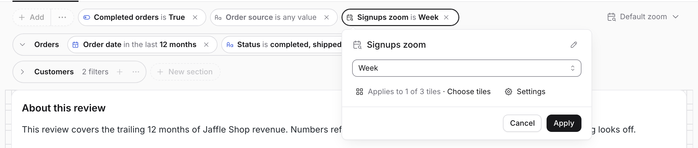
  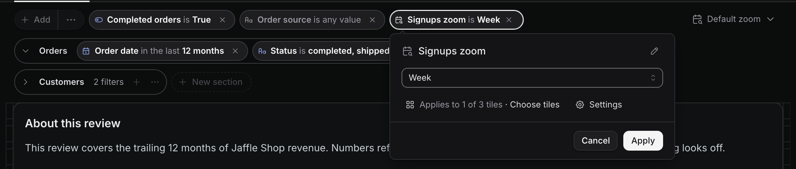
</Frame>

<Frame>
  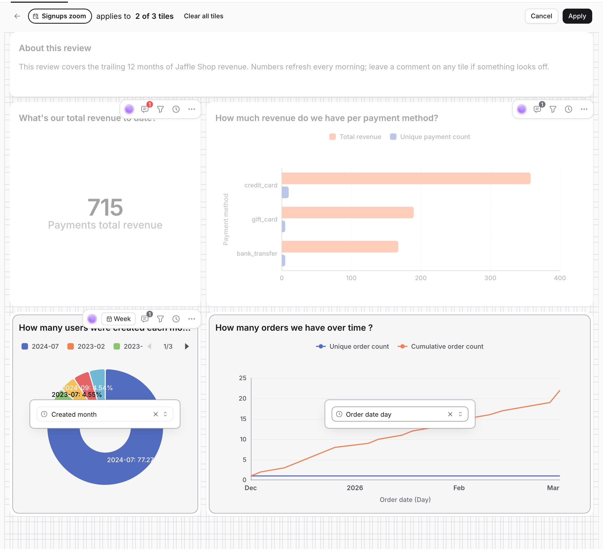
  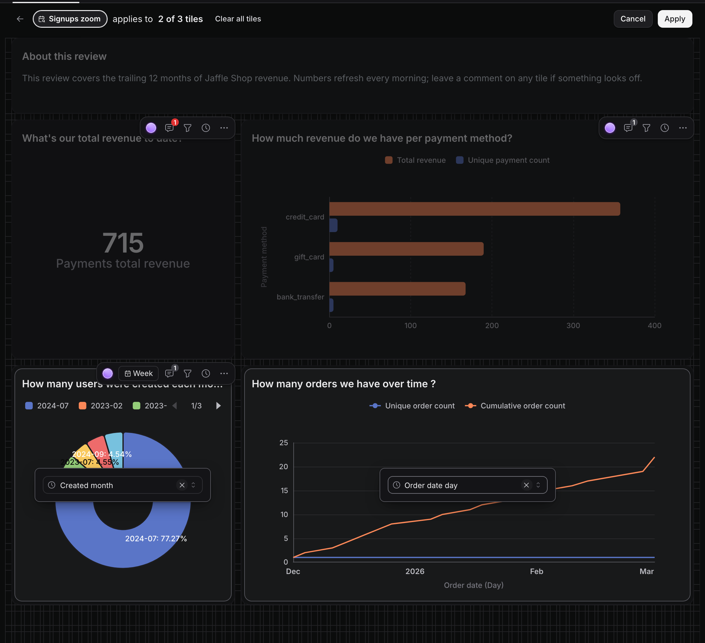
</Frame>

Click a zoom's pill to edit it, or its **X** to delete it. Like filters, named date zooms can go in [sections and anywhere in the bar's order](/explore/dashboards/filter#arrange-the-filter-bar).

### Hide date zoom from viewers

- **One named date zoom:** in its **Settings**, turn off **Show to viewers**. Its granularity still applies to its tiles.
- **All of date zoom:** in the **...** menu next to **Add**, click **Hide date zoom for viewers**.

Hiding all of date zoom also stops the default granularity from applying on load, so charts that aren't in a named date zoom render at the granularity they were saved with. Named date zooms keep applying their granularity to their tiles, and a `dateZoom` parameter in the dashboard URL still overrides the saved granularity of charts outside them. Share the dashboard link without that parameter if every chart should keep its own granularity.

In [dashboards as code](/workflow/content-as-code), hiding all of date zoom is `isDateZoomDisabled: true` in the dashboard's `config`. For named date zooms in a dashboard file, see [Control order in dashboards-as-code](/explore/dashboards/filter#control-order-in-dashboards-as-code).

## Using custom granularities

Custom granularities defined in your `lightdash.config.yml` appear after the standard granularities wherever you pick one. Use them for business-specific periods such as fiscal quarters or custom week definitions.

See the [dimensions reference](/semantic-layer/dimensions#using-custom-granularities) for how to create and configure custom granularities.

## Referencing the date zoom in custom SQL

The currently selected date zoom granularity is exposed as a built-in [reserved parameter](/semantic-layer/parameters#reserved-parameters) called `date_zoom`. You can reference it in custom SQL anywhere parameters are supported:

```sql
${ld.parameters.date_zoom}
```

It resolves to the granularity name in lowercase (for example `day`, `week`, `month`, `quarter`, `year`, or a [custom granularity](/semantic-layer/lightdash-config-yml#custom-granularities-configuration) name). When no date zoom is selected, the value is an empty string.

<Frame>
  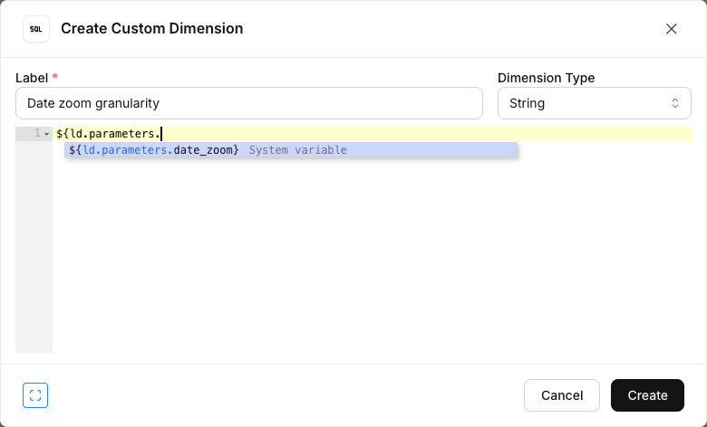
  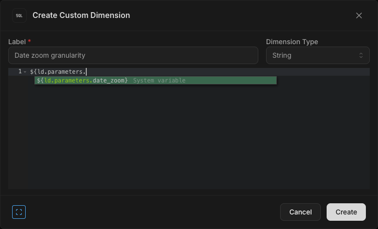
</Frame>

This is useful for adapting your SQL to the granularity the viewer picked on the dashboard, without defining a user parameter:

```sql
CASE
  WHEN ${ld.parameters.date_zoom} = 'week'  THEN 'Weekly'
  WHEN ${ld.parameters.date_zoom} = 'month' THEN 'Monthly'
  WHEN ${ld.parameters.date_zoom} = ''      THEN 'No date zoom applied'
  ELSE 'Other'
END
```

See [Reserved parameters](/semantic-layer/parameters#reserved-parameters) for the full list and behavior.

## Referencing the granularity in chart labels

You can also reference the active granularity directly in chart labels — useful for axis names, series names and slice labels that should update when a viewer changes the date zoom (or when a chart is saved at a fixed granularity).

Use the following placeholder in any supported label, where `table_field` is the base date dimension on the chart (for example `orders_order_date`):

```text
${table_field.granularity}
```

At render time the placeholder is replaced with the granularity actually used to compile the query, lowercased — for example `day`, `week`, `month`, `quarter`, `year`, or a [custom granularity](/semantic-layer/lightdash-config-yml#custom-granularities-configuration) label.

For example, a y-axis label of `Orders per ${orders_order_date.granularity}` renders as `Orders per week` when the dashboard is zoomed to a weekly granularity.

When you type `$` in an axis name, big-value label, or gauge label, autocomplete lists every base date dimension on the chart so you can insert the placeholder without remembering the exact field id.

You don't need to remember the exact field id — Lightdash will insert the placeholder for you:

- **Cartesian axis names, big-value labels, and gauge labels** — type `$` in the label field and autocomplete lists every base date dimension on the chart.
- **Pie group labels and funnel step labels** — click the **insert date granularity** icon inside the editable label field to insert the placeholder for the matching date dimension.

**Supported labels:**

- [**Big value**](/visualizations/big-value) — label and comparison label
- [**Bar, line, area, scatter, and mixed charts**](/explore/configure-charts) — x-axis name, y-axis name, and series names
- [**Pie chart**](/visualizations/pie-chart) — group labels
- [**Gauge**](/visualizations/gauge) — custom value label and custom percentage label
- [**Funnel chart**](/visualizations/funnel-chart) — step labels

If the referenced dimension isn't on the chart, the placeholder is left untouched so you can see what's missing.

<Warning>
  Pie group labels and funnel step labels are per-category overrides — each custom label is keyed to a specific slice or step value. Because date zoom re-buckets dates (for example, the monthly `2024-07` slice becomes a weekly `2024-07-15` slice), an override set at one granularity stops matching after a viewer zooms to another and the custom label silently falls back to the raw value. If you need a label that survives date zoom, prefer the cartesian, big-value, or gauge labels above.
</Warning>

## Date zoom in embedded dashboards

Date zoom can be enabled or disabled in embedded dashboards using the `canDateZoom` option in your JWT token:

```javascript
{
  content: {
    type: 'dashboard',
    dashboardUuid: 'your-dashboard-uuid',
    canDateZoom: true,  // Enable date zoom in embed
  }
}
```

When `canDateZoom` is enabled, embedded dashboards render the dashboard's configured date zoom controls (the Default zoom plus any named controls), not just a single global control. This applies to both JWT embeds and the React SDK, which share the same embedded dashboard rendering.

See the [embedding reference](/embed/reference#date-zoom) for complete details.
