import DashboardControlsFlag from '/snippets/dashboard-controls-flag.mdx';

<DashboardControlsFlag />

A dashboard filter sits at the top of the dashboard and changes the data in the tiles below it. One filter can drive every chart on the dashboard, or just the tiles you choose, and viewers can adjust it without editing anything.

Filters share the controls bar with [parameter controls](/explore/dashboards/parameter-controls) and [date zoom](/explore/dashboards/date-zoom). Two kinds of filter exist: [temporary filters](#temporary-filters), which only you see, and [saved filters](#saved-filters), which everyone who opens the dashboard sees.

For filter types and operators, see the [filters reference](/explore/filters-reference). For filtering a single chart as you build it, see [filtering in the Explore view](/explore/explore-view/filter).

A dashboard filter restricts a field's values. To change the SQL logic behind tiles instead, such as the currency amounts are shown in, use a [parameter](/semantic-layer/parameters#parameters-vs-dashboard-filters).

## Temporary filters

A temporary filter applies only to your session: you won't change the dashboard for anyone else who comes to look at it. To make a filter stick for everyone, use a [saved filter](#saved-filters).

1. Open your dashboard.
2. Click **Add filter** and pick the field to filter on.
3. Pick an operator and a value, then click **Apply**.

<Frame>
  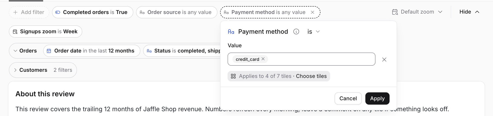
  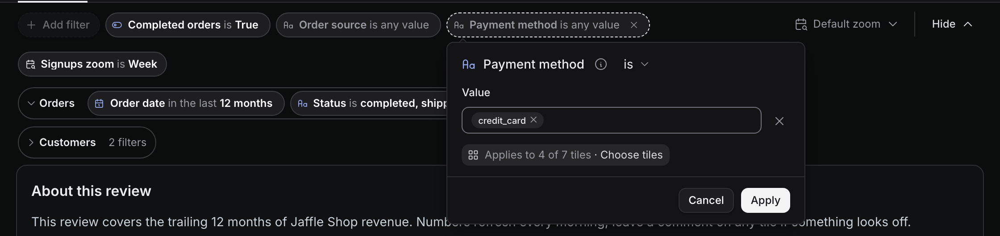
</Frame>

The filter appears at the top of the dashboard with a dashed border, which marks a filter only you see. To change which tiles it filters, click it and [choose tiles](#choose-tiles).

Values for temporary and overridden saved filters are reverted when entering dashboard edit mode.

You can also create a temporary filter by clicking a value in a chart tile, which is called [cross-filtering](/explore/dashboards/interact#cross-filtering-from-a-chart).

To stop viewers adding temporary filters, open the **...** menu next to **Add** in edit mode and click **Hide Add filter for viewers**. Viewers are then restricted to the filters saved with the dashboard.

## Saved filters

A saved filter is part of the dashboard: anyone who opens it sees the filter applied. To add saved filters to a dashboard, you must be an `editor` or an `admin` for your project.

1. Open your dashboard and click **Edit dashboard**.
2. Click **Add** → **Filter** and pick the dimension or metric to filter on.
3. Pick an operator and a value. Leave the value empty to give viewers a control to fill in (see [Empty default dashboard filters](#empty-default-dashboard-filters)).
4. Click **Apply**, then **Save changes**.

<Frame>
  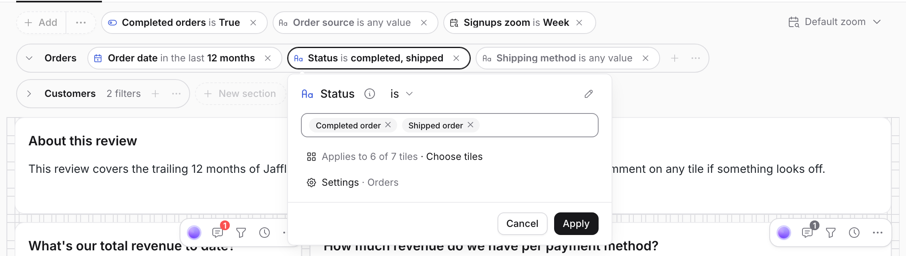
  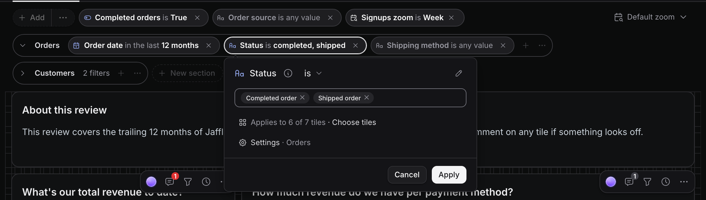
</Frame>

Viewers can still change the value by clicking the filter, which lets them cut the data their own way without changing the dashboard.

While editing a filter you can also:

- **Rename it:** click **Rename**, the pencil next to the filter's name. The name stays the same when a viewer picks a different value, so name what the filter is, like "Order date", rather than its default value, like "Last 28 days". Without a name, the field's name is shown.
- **Limit viewers to one value:** open the operator menu and uncheck **Allow multiple values**. String and number filters using **is**, **is not**, **starts with**, **ends with**, **includes** or **does not include** have this option. Date and boolean filters don't.
- **Change which tiles it filters:** see [Choose tiles](#choose-tiles).
- **Open Settings** to put it in a [section](#group-filters-into-sections), make it [required](#required-filters-and-filter-requirement-groups), or [lock](#locking-dashboard-filters) it.

### Choose tiles

A filter starts out applied to every tile that has the same field (the same table and field name). Click a filter to see how many tiles it reaches, for example **Applies to 4 of 6 tiles**. To change that:

1. Click the filter, then **Choose tiles**. Each tile the filter can apply to shows a card.
2. On a tile marked **Not filtered**, click **Filter this tile**. To filter it through a different field, for example `event_date` for a filter on `order_date`, pick the field on the card. Only fields of the same type are listed.
3. To take the filter off a tile, click the **x** on its card's field.
4. Click **Apply**.

<Frame>
  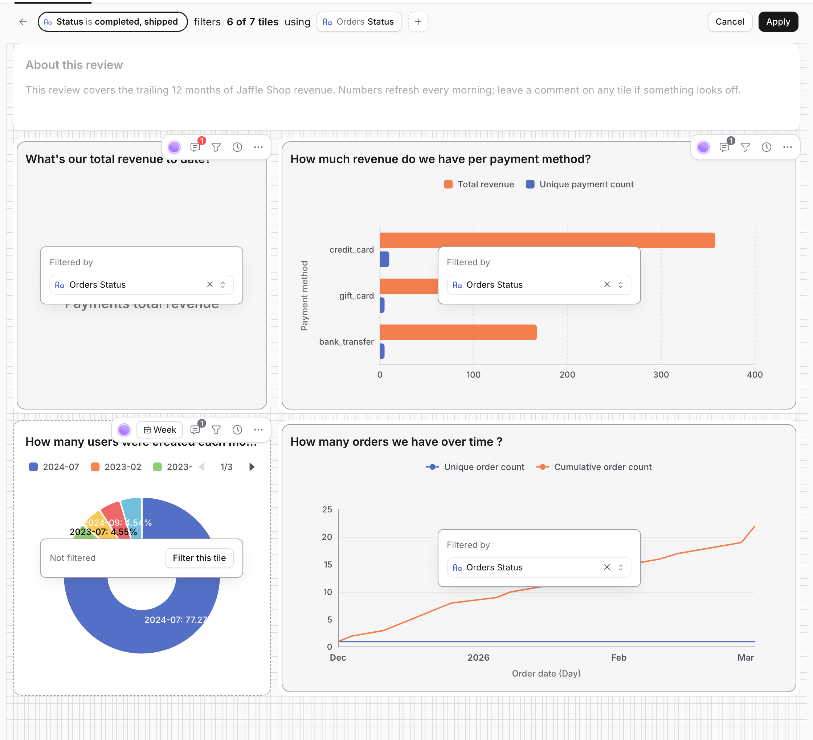
  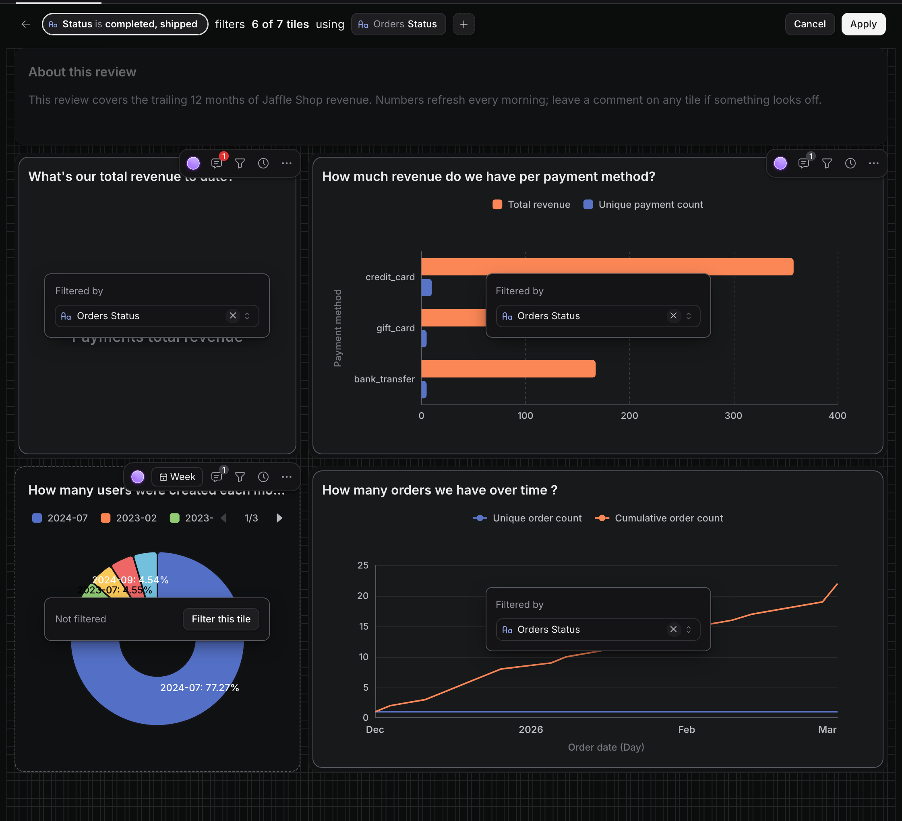
</Frame>

To filter many tiles through another field at once, click **+** (**Add a field**) next to the filter's field and pick it: every unfiltered tile that has the field gets the filter. Tiles with no field of the filter's type are dimmed.

Viewers can choose tiles for their own temporary filters, but not for saved filters. Parameter controls choose their tiles the same way; see [Dashboard parameter controls](/explore/dashboards/parameter-controls).

On a dashboard with [tabs](/explore/dashboards#add-tabs), a filter only shows on the tabs that have a tile it applies to. To give each tab its own value for the same field, add one filter per tab on that field, give each its own default value, and in each filter's **Choose tiles** keep only that tab's tiles.

Whether a filter applies to a tile depends on the fields in that tile's explore, so a model change, such as a new join in a [preview project](/workflow/preview-projects), can make a filter show on more tabs. A filter that applies to no tiles at all shows on every tab, greyed out with a tooltip saying so, so you can fix or remove it.

In [dashboard YAML](/workflow/content-as-code#dashboards), the same scoping lives in each filter's `tileTargets`: map a tile's slug to `false` to leave that tile out. Tiles that aren't listed get the filter whenever they have its field, and slugs that don't match a tile on the dashboard are ignored on upload, so copy the slugs from `lightdash download`.

```yaml
filters:
  dimensions:
    - target:
        fieldId: orders_region
        tableName: orders
      tileTargets:
        revenue-by-month: false
        top-customers: false
```

## Filtering charts created in the SQL runner

Dashboard filters apply to [SQL runner](/explore/sql-runner) charts as well as charts from the Explore view. How you create them depends on what's on the dashboard.

On a dashboard with both Explore and SQL runner charts, create filters as above. Then [choose tiles](#choose-tiles), and on a SQL chart tile pick the column the filter should apply to.

On a dashboard with **only** SQL runner tiles, filters work from columns rather than semantic fields:

1. Choose a column from the list of all columns available across all charts.
2. Name the filter so viewers recognize it.
3. Choose the filter operator and values as you would for any other filter.

The filter is applied to every column on the dashboard with the same name as the filtered column. To pick exactly which tiles and columns it applies to instead, [choose tiles](#choose-tiles). As with Explore-chart filters, filters only apply to dimensions — in this case, non-aggregated columns.

## How dashboard filters interact with chart filters

Dashboard filters override filters applied in a saved chart on the same field.

For example, a chart for Sales in Asia is filtered to `country` **is** `China`, `India`, `Japan`. On the dashboard you add a filter `country` **is** `India`. The saved chart's filter is removed and the dashboard filter applies instead, so the tile is filtered to `country` **is** `India`.

Dates work the same way. If the saved chart includes only orders completed on or after April 3rd 2024, and you add a dashboard filter for orders completed on or after August 1st 2024, the dashboard filter wins and the tile shows orders completed on or after August 1st 2024. A dashboard filter on a date also overrides chart filters on other time intervals of the same date dimension, so a dashboard filter on `order_date_day` replaces a chart filter on `order_date_month`.

There's no per-chart setting to keep a chart's own condition on the same field alongside the dashboard filter. Chart filters on other fields are always combined with dashboard filters, so to keep an extra condition, put it on a different field. For example, filter the chart on a [custom SQL dimension](/explore/create-custom-fields#custom-sql) or a [table calculation](/explore/table-calculations) that flags the rows to exclude, instead of on the date itself. To stop the dashboard filter changing a chart at all, take the filter off that tile in [Choose tiles](#choose-tiles).

This carries into exploring:

- **Explore from here** on a dashboard tile keeps the filters you saw on the dashboard. Filters overridden in the dashboard stay overridden; filters the dashboard didn't touch are the same as in the original chart.
- **Edit** on the chart instead shows the original chart filters.

## Required filters and filter requirement groups

Dashboard filters can be marked as **required**, so the dashboard won't load any data until a viewer picks a value. You can also combine several filters into a **requirement group**: viewers must set *at least one* of them, but any will do.

Take a Sales overview dashboard that queries all historic orders, where loading it unfiltered is slow and expensive. We want viewers to always pick a **Payment method**, plus at least one of **Order status** or **Order date**, before any queries run.

### Marking a single filter as required

While editing the dashboard, click the `Payment method` filter, click **Settings** and switch on **Required**.

<Frame>
  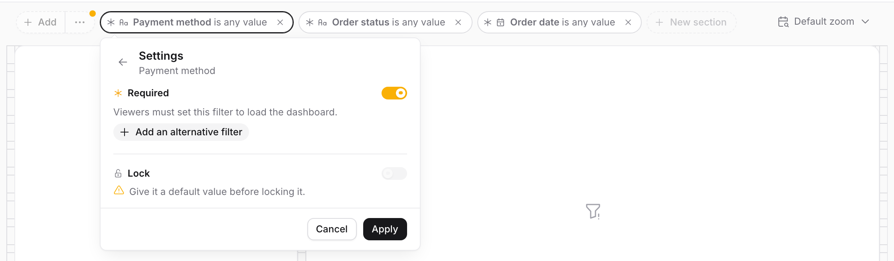
  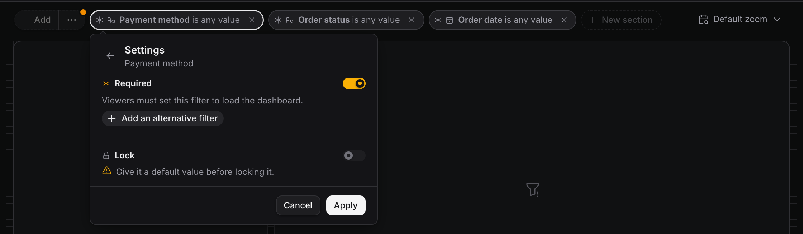
</Frame>

### Combining filters into a requirement group

The "Order status *or* Order date" half of the example needs a requirement group. Open the **...** menu next to **Add** and click **Filter rules**, where every rule is managed in one place:

1. Click **Add another rule**, pick `Order status`, then add `Order date` to the same rule. One filter makes a plain required filter; more make an "at least one of" group. Filters with a default value, or already in another rule, can't be picked.
2. Optionally, write a **Note for viewers** explaining why the filters are required. Ours says: "Pick a payment method, plus an order status or date range, to keep this dashboard fast."
3. Click **Save** in the popover, then save the dashboard.

<Frame>
  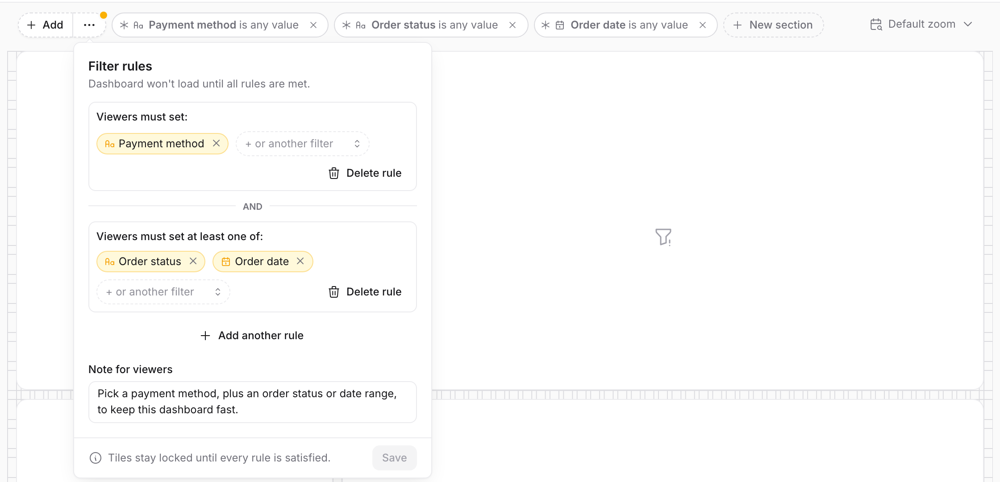
  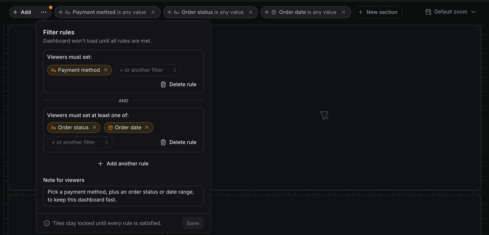
</Frame>

A filter in a rule shows an asterisk in the filter bar until it has a value.

### What viewers see

While any rule is unmet, chart tiles stay locked. The dashboard shows a **guided setup card** with a picker for each filter and your note as its subtitle. On the example dashboard, viewers get one picker for `Payment method`, an "at least one of" section for `Order status` and `Order date`, and a progress indicator showing how many rules are still unmet:

<Frame>
  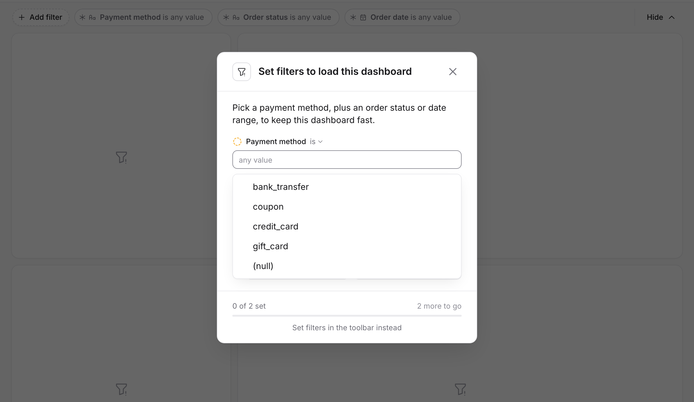
  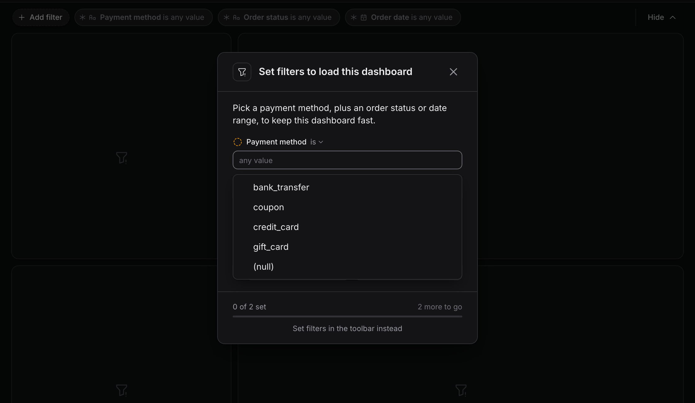
</Frame>

Everything loads the moment the rules are met, and locks again if a viewer clears a value a rule needed. Viewers can also dismiss the card and use the filter bar instead.

A rule counts as met when one of its filters has a value or uses an operator that needs none (`is null`, `is not null`, `in the current`, `not in the current`, `in all periods to date`). On dashboards with [tabs](/explore/dashboards#add-tabs), a rule only locks the tabs its filters apply to.

### Required filters in dashboards-as-code

Here's the same example in dashboard YAML: a required filter has `required: true`, filters sharing a `requiredGroupId` form an "at least one of" group, and the viewer note lives on the dashboard config as `requiredFiltersNote`.

```yaml
config:
  requiredFiltersNote: "Pick a payment method, plus an order status or date range, to keep this dashboard fast."
filters:
  dimensions:
    - id: payment-method-filter
      label: Payment method
      required: true
      # ...
    - id: order-status-filter
      label: Order status
      requiredGroupId: status-or-date
      # ...
    - id: order-date-filter
      label: Order date
      requiredGroupId: status-or-date
      # ...
```

## Locking dashboard filters

Lock a saved dashboard filter to guarantee that the dashboard always runs with a specific value — a region, a tenant, or a date range that every viewer should stay inside. A locked filter behaves the same way for everyone: viewers see what's filtered, but they can't change the value, and [URL](#filtering-a-dashboard-from-the-url) or [embed](/embed/reference#dashboard-filters-interactivity) overrides targeting the same field are ignored.

Use a locked filter when you want to:

- Ship a dashboard that is permanently scoped (for example, "EMEA Sales") and stop viewers from accidentally changing the scope.
- Prevent someone from sharing a link with an override that hides or changes a filter you rely on.
- Enforce a filter value on an embedded dashboard regardless of what the embedding application passes in `externalFilters`.

### How to lock a filter

You need to be an `editor` or `admin` to lock a filter.

1. Open the dashboard and click **Edit dashboard**.
2. Click the filter you want to lock, click **Settings** and switch on **Lock**.
3. Click **Apply**. The filter shows a closed padlock.
4. Click **Save changes** on the dashboard to persist the change.

To unlock a filter, click its padlock in edit mode, or switch off **Lock** in **Settings**.

On a dashboard with [tabs](/explore/dashboards#add-tabs), **Lock** applies to the tab you're viewing. To lock the filter on other tabs, pick **This tab**, **All tabs** or **Some tabs** under it.

### What viewers see

In view mode, a locked filter chip shows a closed-lock indicator on the right. Clicking the chip does nothing, and a tooltip explains that the filter is locked. The locked value still applies to every tile that uses the filter's field, exactly like a normal saved filter.

### How locking interacts with overrides

Locked filters take precedence over every override mechanism:

- **URL overrides.** When a link contains `?filters=` or `?tempFilters=` targeting a locked field, Lightdash drops the override on load, cleans up the URL, and shows the viewer a one-time toast explaining that the override was ignored.
- **Embed `externalFilters`.** When an [embed JWT](/embed/reference#dashboard-filters-interactivity) passes `externalFilters` targeting a locked field, Lightdash uses the dashboard's saved locked value and ignores the override.
- **Required and locked together.** A filter that is both `Required` and `locked` must have a value in edit mode. Clearing the value disables **Apply** with the message "A locked, required filter must have a value".

### Locked filters on hidden fields

A filter chip can also show locked without anyone locking it. This happens when the field a saved filter uses is later set to `hidden: true` ([dimensions](/semantic-layer/dimensions#dimension-configuration), [metrics](/semantic-layer/metrics#metric-configuration)) and no tile on the dashboard offers that field in its filter picker any more. Lightdash can't show a picker for a field nothing exposes, so it locks the chip instead, with the same closed-padlock icon and a tooltip reading "This filter applies to your charts. You cannot change it here."

The filter still applies to every tile that used it — hiding the field doesn't remove the filter, it only stops anyone changing its value from the dashboard. Viewers can't edit or remove it, even though no one set it as a deliberate lock.

To replace it with a filter on the new field:

1. Open the dashboard and click **Edit dashboard**.
2. Hover over the locked chip and click its **x** to remove it.
3. Click **Add** → **Filter** and pick the field that replaced the hidden one.
4. Click **Save changes**.

## Group filters into sections

Group related dashboard controls under named sections, such as **Orders** and **Customers**, so viewers can find the controls they need and collapse the rest.

<Frame caption="An open Orders section, a collapsed Customers section, and three controls outside any section">
  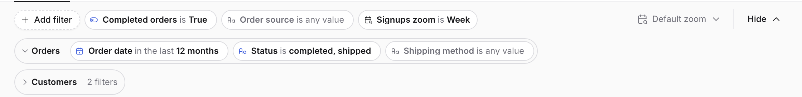
  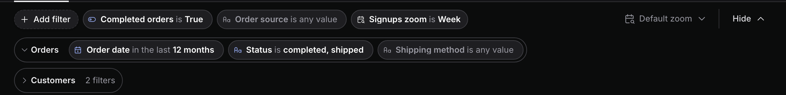
</Frame>

Each section belongs to one dashboard and can hold [saved filters](#saved-filters), [parameter controls](/explore/dashboards/parameter-controls#group-controls-and-hide-a-control-from-viewers) and [named date zooms](/explore/dashboards/date-zoom#add-a-named-date-zoom).

### Create a section

1. Open the dashboard and click **Edit dashboard**.
2. Click **New section**, the dashed button at the end of the filter bar. It shows once the bar has a control.
3. Type a name and press Enter, or click the check. Press Escape or click the **X** to cancel.

You can also drag a filter onto **New section**. Once you name the section, the filter moves into it.

<Frame>
  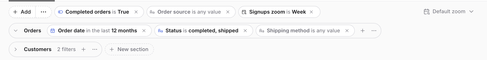
  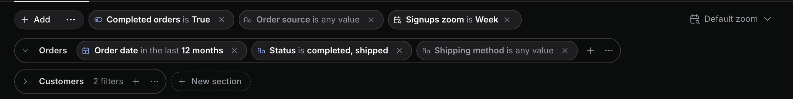
</Frame>

To rename a section, click its name in edit mode.

### Arrange the filter bar

In edit mode you can put filters, [parameter controls](/explore/dashboards/parameter-controls), named [date zooms](/explore/dashboards/date-zoom) and sections in any order, and start a new line anywhere. **Default zoom** isn't part of the order: it stays on the right of the bar.

- **Drag** a control, or a section by its name. A blue line shows where it will land. Drop it between two lines to start a new line.
- **Use the keyboard:** Tab to a control and press Alt+Left or Alt+Right (Option on Mac) to move it one place. Alt+Up and Alt+Down move it to the line above or below.

Click **Save changes** to keep the order. Viewers and [embedded dashboards](/embed) see the same bar. A named date zoom with no saved place goes at the end, outside sections.

### Put filters in a section

In edit mode, use whichever fits:

- **Add a filter straight into a section:** click the section's **+**.
- **Drag a filter:** drag its chip onto a section. A blue line shows where it lands. To take a filter out of its section, drop it on **Add** or on an empty part of the bar.
- **From the filter:** click the filter, click **Settings**, then pick a section in **Section**. Pick **No section** to take it out.

Parameter controls and named date zooms move the same ways.

<Frame>
  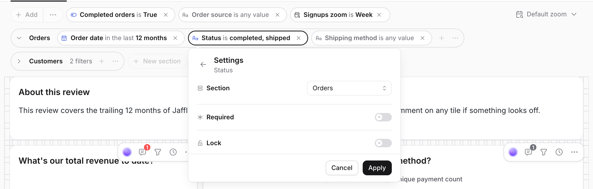
  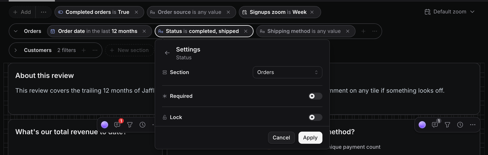
</Frame>

### Move or remove several filters at once

1. In edit mode, ⌘ click each filter you want (Ctrl click on Windows and Linux). Shift click selects a range.
2. In the bar that appears, click **Move to new section** to group them under a new name, or **Move to** to pick an existing section or **No section**.
3. To delete the selected filters instead, click **Remove**. The button then shows how many filters it removes; click it again to confirm.

Press Escape or click the **X** to clear the selection. Dragging one selected filter moves the whole selection.

<Frame>
  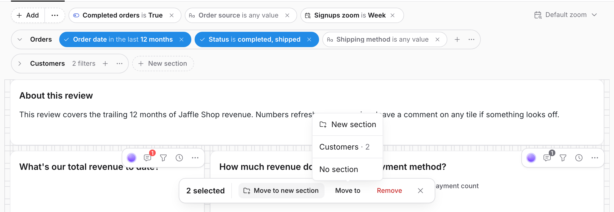
  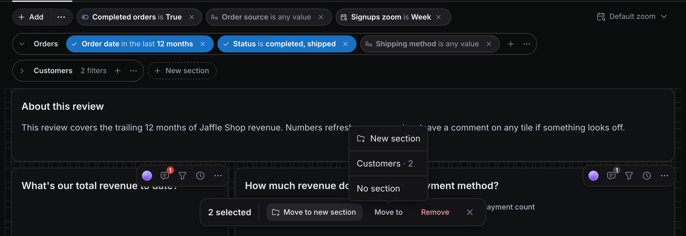
</Frame>

### Collapse or remove a section

In edit mode, a section's chevron sets how it opens for viewers: collapsed or expanded. The choice is saved with the dashboard. Until you set it, a section with more than 6 filters starts collapsed.

To remove a section, open its **...** menu and click **Ungroup**. The section's controls stay on the dashboard, outside any section. An empty section shows **Remove section** instead. Click **Cancel** on the dashboard to undo a removal you haven't saved.

<Frame>
  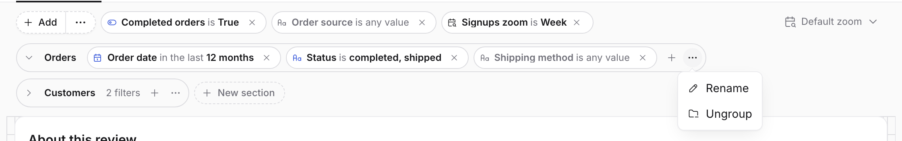
  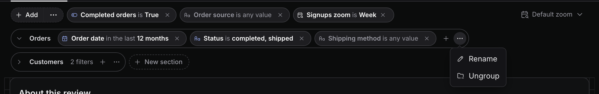
</Frame>

### What viewers see

Viewers see the sections and can collapse or expand them with the chevron. Their choice isn't saved: each visit starts from the section's default. A collapsed section shows how many filters it holds, or how many the viewer changed. Sections with no filters on the current tab are hidden.

[Embedded dashboards](/embed) show the same sections.

### Sections in dashboards-as-code

Define sections in `config.controlSections`, each with a unique `slug`. Set the `sectionSlug` of a filter, a parameter control or a named date zoom (in `config.dateZoomConfig.controls`) to place it in that section, or omit it to keep the control outside sections. Set `collapsed: true` to save a section collapsed.

```yaml
config:
  controlSections:
    - slug: orders
      name: Orders
    - slug: customers
      name: Customers
      collapsed: true
filters:
  dimensions:
    - id: order-date-filter
      label: Order date
      sectionSlug: orders
      # ...
    - id: first-name-filter
      label: First name
      sectionSlug: customers
      # ...
```

### Control order in dashboards-as-code

Once you've rearranged the bar and saved, the dashboard file has a `controlOrder` list under `config`. It lists the bar from left to right: each filter, parameter control, named date zoom and section, by its `kind` (`filter`, `parameter`, `dateZoom` or `section`) and `slug`. To move something, move its entry in the list.

If you remove `controlOrder`, the bar goes back to its default order.

#### Put a parameter control between two filters

Filters, parameter controls and sections can go in any order. Here **Primary currency** sits between two filters:

```yaml
config:
  controlOrder:
    - kind: filter
      slug: orders-order-date
    - kind: parameter
      slug: primary-currency
    - kind: filter
      slug: orders-status
```

#### Place a date zoom in the order

A named date zoom keeps its required `uuid`; `controlOrder` refers to its optional `slug`. Here **Revenue zoom** sits between two filters:

```yaml
config:
  dateZoomConfig:
    controls:
      - uuid: 1f0a8c2e-7b3d-4a9f-bf21-2c6e9d4a1b00
        slug: revenue-zoom
        name: Revenue zoom
        granularity: Week
    tileTargets:
      # ...
  controlOrder:
    - kind: filter
      slug: orders-order-date
    - kind: dateZoom
      slug: revenue-zoom
    - kind: filter
      slug: orders-status
```

#### Start a new line

Everything stays on one line until an entry has `newLine: true`. Here the **Customers** section starts a second line:

```yaml
config:
  controlOrder:
    - kind: filter
      slug: orders-order-date
    - kind: section
      slug: orders
    - kind: section
      slug: customers
      newLine: true
```

#### Order the controls inside a section

`sectionSlug` decides which section a control is in. `controlOrder` decides where it sits inside that section. Here **First name** comes before **Signup date** in **Customers**:

```yaml
config:
  controlOrder:
    - kind: section
      slug: customers
    - kind: filter
      slug: customers-first-name
    - kind: filter
      slug: customers-signup-date
```

## Empty default dashboard filters

You can save a dashboard filter that is active but has no value picked yet — for example a `country` **is** filter with no country selected. This is an "unset default": a filter control that appears in the dashboard filter bar so viewers can fill it in, without pre-committing to a value.

Empty non-required filters behave like this:

* They render in the filter bar as `is any value`.
* They do **not** override chart-level filters on the same field. If a saved chart is filtered to `country` **is** `India` and the dashboard has an empty `country` filter, tiles keep the `India` filter until a viewer picks a value in the dashboard. As soon as a viewer selects a value, normal [dashboard-overrides-chart behavior](#how-dashboard-filters-interact-with-chart-filters) resumes.
* They survive `lightdash upload` and are not flagged by `lightdash lint` — an empty active filter in dashboard YAML is a valid configuration.

Value-less relative-date operators (`in the current`, `not in the current`) are **not** treated as empty, because they get their period from a unit-of-time setting rather than a value. They apply to tiles like any other configured filter.

To strip a chart-level filter from a tile, mark the dashboard filter as required, give it an explicit default value, or remove the filter from the saved chart. An empty dashboard filter won't do it.

## Sharing a dashboard with filter overrides

To share a dashboard with custom filters applied, you have to be in *view mode*. From there, either apply temporary filters and share the link with those filters applied, or save the filter changes for everybody and share the link with the new defaults.

The rules for sharing dashboards with filters applied:

* When adding a temporary filter in view mode, you can change the filter's values — field, value, operator, and which tiles it applies to — but not the filter type, so a temporary filter can't become a saved filter.
* When overriding a saved filter in view mode, you can only change the value and operator; the field and tile configuration stay as they are.
* In edit mode, when you change a saved filter to override its default value, the 'override' status is removed once you click **Apply**.

The same behavior applies when exporting dashboards or sending them to email or Slack in [scheduled deliveries](/explore/create-scheduled-deliveries).

## Seeing which tiles have filters applied

A tile with filters shows a filter icon in its header. Click it to see the dashboard filters applied to that tile and the chart's own filters; a chart filter the dashboard overrides is struck through.

**Edit chart** opens the chart without dashboard filters, so its numbers can differ from the tile's. Check this list to see which dashboard filters account for the difference.

<Frame>
  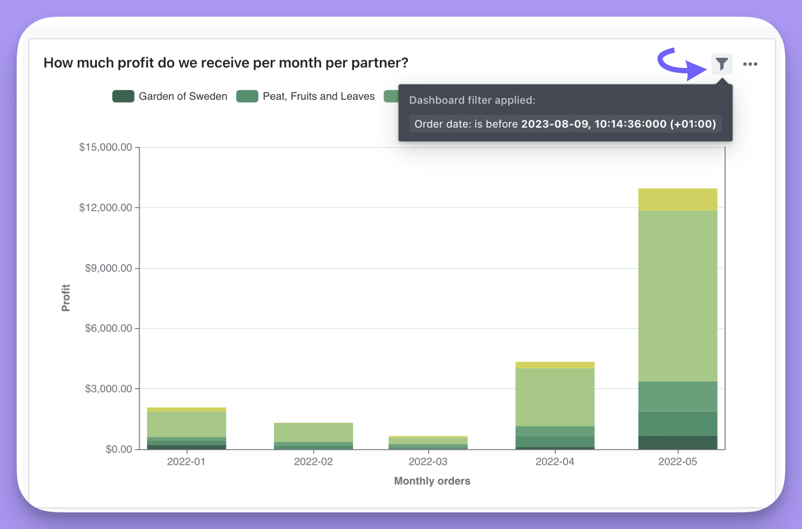
</Frame>

## Filter value autocomplete

When determining possible values for a dashboard filter, Lightdash takes into account all relevant filters, including those applied to fields from joined tables.

Take these payments, orders, and customers models:

<CodeGroup>

```yaml dbt v1.10+
- name: customers
---
- name: orders
  config:
    meta:
      joins:
        - join: customers
          sql_on: ${customers.customer_id} = ${orders.customer_id}
---
- name: payments
  config:
    meta:
      joins:
        - join: orders
          sql_on: ${orders.order_id} = ${payments.order_id}
        - join: customers
          sql_on: ${customers.customer_id} = ${orders.customer_id}
```

```yaml dbt v1.9 and earlier
- name: customers
---
- name: orders
  meta:
    joins:
      - join: customers
        sql_on: ${customers.customer_id} = ${orders.customer_id}
---
- name: payments
  meta:
    joins:
      - join: orders
        sql_on: ${orders.order_id} = ${payments.order_id}
      - join: customers
        sql_on: ${customers.customer_id} = ${orders.customer_id}
```

```yaml Lightdash YAML
# customers.yml
type: model
name: customers
---
# orders.yml
type: model
name: orders

joins:
  - join: customers
    sql_on: ${customers.customer_id} = ${orders.customer_id}
---
# payments.yml
type: model
name: payments

joins:
  - join: orders
    sql_on: ${orders.order_id} = ${payments.order_id}
  - join: customers
    sql_on: ${customers.customer_id} = ${orders.customer_id}
```

</CodeGroup>

Following this example:

* Filtering on a field from the `payments` model considers filters applied to fields from the `payments`, `orders`, and `customers` models.
* Filtering on a field from the `orders` model considers filters applied to fields from the `orders` and `customers` models.
* Filtering on a field from the `customers` model considers filters applied to fields from the `customers` model.

## Filtering a dashboard from the URL

A dashboard URL can carry values for its saved filters, so a link opens the dashboard already filtered. You can set up a dimension so that clicking a value sends the reader to a dashboard filtered by what they clicked — a sales dashboard listing your most profitable partners, for instance, where clicking a partner name opens a second dashboard showing that partner's KPIs.

Here's what it looks like once it's set up:

<Frame>
<iframe src="https://cdn.loom.com/sessions/thumbnails/2afb9990e3d7407dadcf53d8db2719c8-644f09eaf407adac.mp4" frameborder="0" webkitallowfullscreen mozallowfullscreen allowfullscreen style={{ width: '100%', height: '400px' }} ></iframe>
</Frame>

And here's the setup:

<Frame>
<iframe src="https://cdn.loom.com/sessions/thumbnails/aa6b7aa3001d4b1fa86a2c98a7fe044c-1341cb311f5a956d.mp4" frameborder="0" webkitallowfullscreen mozallowfullscreen allowfullscreen style={{ width: '100%', height: '400px' }} ></iframe>
</Frame>

1. Open the dashboard you want to filter dynamically.
2. Add a value to the filter you want to drive from the URL.
3. Copy the URL shown after applying the filter. It looks like this:

<Frame>
  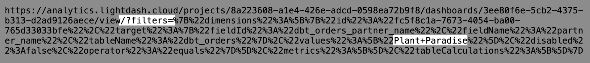
</Frame>

The `?filters=` key in the URL is followed by a URL-encoded JSON object. To read it, run it through a URL decoder.

4. Replace the filter value you chose in step 2 with `${ value.formatted | url_encode }` to make it dynamic. In the example, the value is `Plant+Paradise` (highlighted in the image).
5. Paste that URL into the YAML file for the model you're working in. See an [example in our demo project](https://github.com/lightdash/lightdash-demo-data-gardening/blob/5632406cb5b43fdf066a2086142dc3e86a41e947/dbt/models/dbt%5Forders.yml#L31-L32).

If the target dashboard has a [locked filter](#locking-dashboard-filters) on the field you're driving from the URL, Lightdash drops the override on load and the dashboard's saved locked value is used instead.
