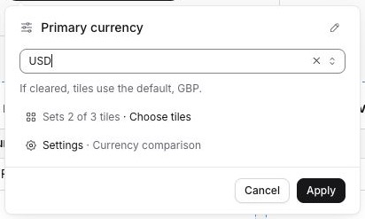
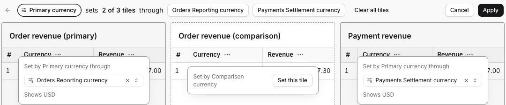
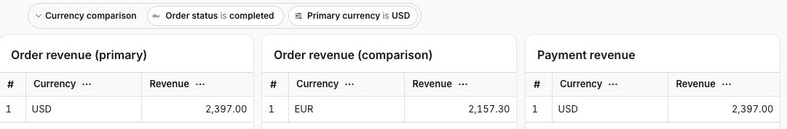

import { FeatureBadge } from '/snippets/feature-badge.jsx';

<div className="feature-badges"><FeatureBadge label="Experimental" /></div>

<Info>
Requires the `dashboard-controls` feature flag. For Cloud, contact [support](/support). For self-hosted instances, add `dashboard-controls` to [`LIGHTDASH_ENABLE_FEATURE_FLAGS`](/self-host/customize-deployment/environment-variables#feature-flags).
</Info>

Dashboard controls are the filters and parameter controls at the top of a dashboard. [Filters](/explore/dashboards/filter) narrow the data. Parameter controls set values used by your [chart queries](/semantic-layer/parameters).

This guide uses **Revenue comparison**, with two copies of **Order revenue** and a **Payment revenue** tile. Their parameters, `orders.reporting_currency` and `payments.settlement_currency`, accept `USD`, `EUR`, and `GBP`. Both default to `GBP`, and **Order revenue** saves `EUR`.

Add an **Order status** [saved filter](/explore/dashboards/filter#saved-filters) set to **completed**.

## Set different values on two copies of a chart

<Steps>
  <Step title="Add the first control">
    Open **Edit dashboard** → **Add** → **Parameter** and choose **Reporting currency**. Set **USD** and use **Rename** to name it **Primary currency**.
  </Step>
  <Step title="Choose its tiles">
    Click **Choose tiles**. On the comparison **Order revenue** tile, clear the selected parameter, then click **Apply**.
  </Step>
  <Step title="Add the comparison control">
    Add another **Reporting currency** control, set **EUR**, and name it **Comparison currency**. In **Choose tiles**, click **Set this tile** on the comparison tile, then select **Orders Reporting currency**. Click **Apply** → **Save changes**.
  </Step>
</Steps>

The first control includes relevant tiles added later, even after you exclude all current tiles. Additional controls start with no tiles assigned.

## Clear a value or exclude a tile

Open the control in edit mode.

- To clear its value, click the input's clear button. Tile assignments stay in place.
- To exclude a tile, open **Choose tiles** and clear that tile's selected parameter. **Clear all tiles** excludes all current tiles.

Click **Apply** → **Save changes**.

| Action | Value used by Order revenue |
| --- | --- |
| Clear the control value | `GBP` — the parameter default, then the chart-saved value if there is no default |
| Exclude the tile | `EUR` — the chart-saved value, then the parameter default if the chart has no saved value |

<Frame>
  
</Frame>

## Set parameters across models

Parameters can share a control when their type, single or multiple selection, and allowed values match.

<Steps>
  <Step title="Choose the payment parameter">
    Open **Primary currency** → **Choose tiles**. On **Payment revenue**, click **Set this tile** and select **Payments Settlement currency**.
  </Step>
  <Step title="Save the assignment">
    Click **Apply** → **Save changes**. **Primary currency** now sets both models' parameters. **Comparison currency** still sets only the second order tile.
  </Step>
</Steps>

<Frame>
  
</Frame>

## Group controls and hide a control from viewers

<Steps>
  <Step title="Group the controls">
    [Create a section](/explore/dashboards/filter#group-filters-into-sections) called **Currency comparison**. For each control, open **Settings** → **Section**, choose the section, and click **Apply**.
  </Step>
  <Step title="Hide the comparison input">
    In **Comparison currency** → **Settings**, turn off **Show to viewers**. Click **Apply** → **Save changes**. Its `EUR` value still applies to the comparison tile.
  </Step>
</Steps>

<Frame>
  
</Frame>

## Save the dashboard as code

Save the example below as `lightdash/dashboards/revenue-comparison.yml`, using your project's chart and space slugs. Use the standard [download](/workflow/content-as-code#lightdash-download) and [upload](/workflow/content-as-code#lightdash-upload) commands.

Each section has a `slug`. Controls reference it with `sectionSlug`. Parameter targets use `tileSlug` to distinguish copies of the same chart.

```yaml Revenue comparison [expandable]
contentType: dashboard
version: 1
name: Revenue comparison
slug: revenue-comparison
spaceSlug: jaffle-shop
tabs: []
tiles:
  - tileSlug: order-revenue-primary
    type: saved_chart
    x: 0
    y: 0
    w: 12
    h: 4
    properties:
      chartSlug: order-revenue
      title: Order revenue (primary)
      hideTitle: false
  - tileSlug: order-revenue-comparison
    type: saved_chart
    x: 12
    y: 0
    w: 12
    h: 4
    properties:
      chartSlug: order-revenue
      title: Order revenue (comparison)
      hideTitle: false
  - tileSlug: payment-revenue
    type: saved_chart
    x: 24
    y: 0
    w: 12
    h: 4
    properties:
      chartSlug: payment-revenue
      title: Payment revenue
      hideTitle: false
filters:
  dimensions:
    - label: Order status
      sectionSlug: currency-comparison
      target:
        fieldId: orders_status
        fieldName: status
        tableName: orders
      operator: equals
      values: [completed]
      disabled: false
      tileTargets: {}
config:
  isDateZoomDisabled: false
  controlSections:
    - slug: currency-comparison
      name: Currency comparison
      collapsed: false
  parameterControls:
    - slug: primary-currency
      label: Primary currency
      sectionSlug: currency-comparison
      value: USD
      valueType:
        type: string
        multiple: false
      parameters:
        orders.reporting_currency:
          except: [order-revenue-comparison]
        payments.settlement_currency: all
    - slug: comparison-currency
      label: Comparison currency
      sectionSlug: currency-comparison
      hidden: true
      value: EUR
      valueType:
        type: string
        multiple: false
      parameters:
        orders.reporting_currency:
          only: [order-revenue-comparison]
```

Use `all` for every matching tile, `except` to exclude named tiles, or `only` for an exact list. `only: []` assigns no tiles.
