import { FeatureBadge } from '/snippets/feature-badge.jsx';

<FeatureBadge label="Experimental" />

<Info>
  External sources are available to design partners behind the `external-sources` feature flag, and the flow, limits and wording on this page may change between releases. Contact [Lightdash support](mailto:support@lightdash.com) to enable it for your organization. Self-hosted instances also need an Enterprise license and the [setup below](#self-hosted-setup).
</Info>

An external source brings data that lives outside your warehouse into a project: an uploaded CSV, or a tab of a Google Sheet. Lightdash reads it once, stores a typed copy, and turns it into a table you can explore, chart and put on dashboards. Nothing changes in your dbt project.

Use it for small, hand-maintained data that never made it into the warehouse, such as monthly targets, a mapping of regions to owners, or a list of accounts to watch.

<Frame caption="A Google Sheet of monthly targets, explored like any other table">
  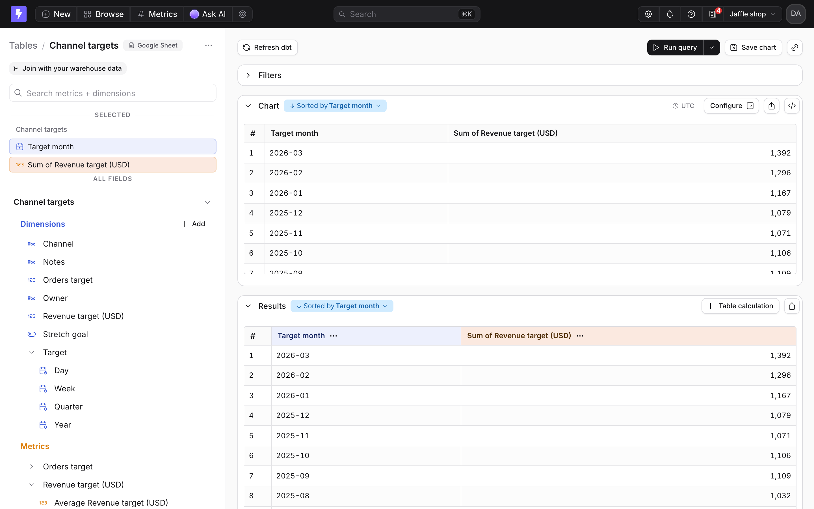
  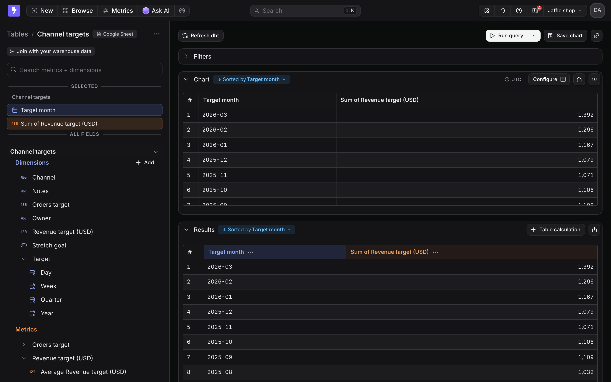
</Frame>

## Before you start

- **Editor role or above.** Editors, developers and admins can add, refresh, rename and delete external sources. Everyone else in the project sees the tables, and the charts built on them follow normal [space permissions](/explore/spaces).
- **A header row.** The first row names the columns. Every following row is data.
- **For Google Sheets, access to the sheet.** The first time you connect a sheet, Lightdash asks your Google account for access to Google Sheets and to the Drive files you pick.
- **Size limits.** Up to 100 MB per file, 1,000,000 rows per table and 5 GB per organization.

<Warning>
  Everyone in the project can see an imported table, whatever the Google Sheet's own sharing settings. Lightdash reads the sheet with the Google access of the person who connected it and stores a copy. User attributes and row-level filters don't apply to external sources, so only import data that every project member may see.
</Warning>

## Upload a CSV

<Steps>
  <Step title="Open the Semantic Layer page">
    On the nav bar, click **Browse** → **Semantic Layer**.
  </Step>
  <Step title="Add an external source">
    Next to the search box, select **Add**, then **External source**. If an external source is the only thing you can add, **Add** opens the upload dialog directly.

    <Frame>
      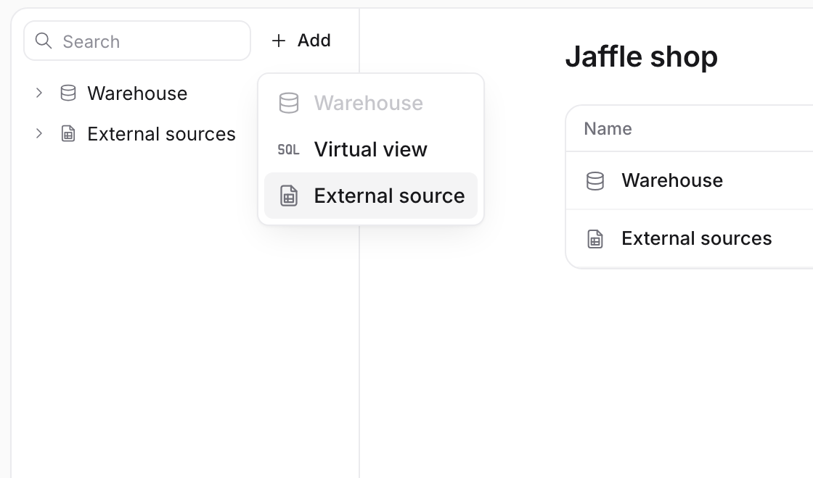
      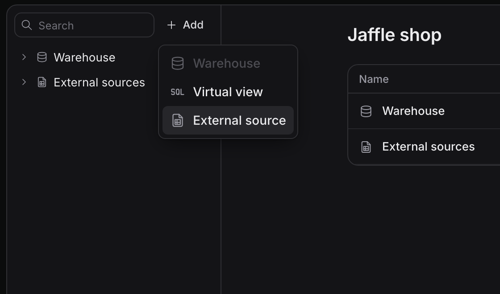
    </Frame>
  </Step>
  <Step title="Drop your file">
    Drop a CSV on the upload area, or click it to pick a file.

    <Frame>
      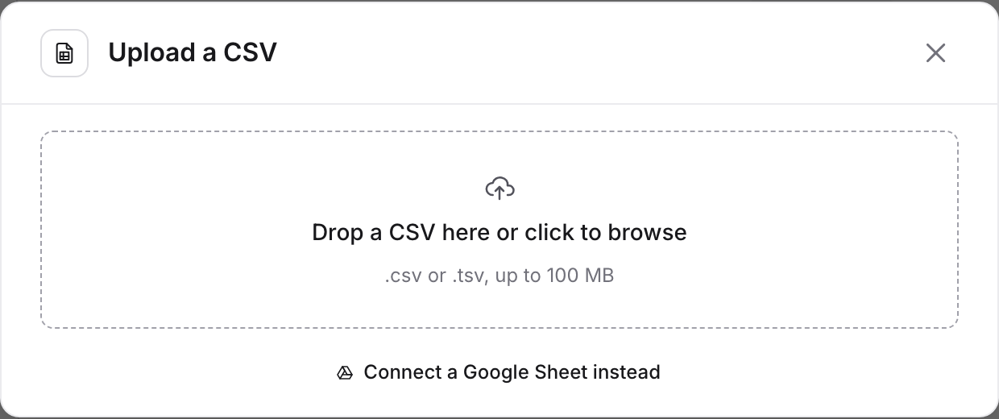
      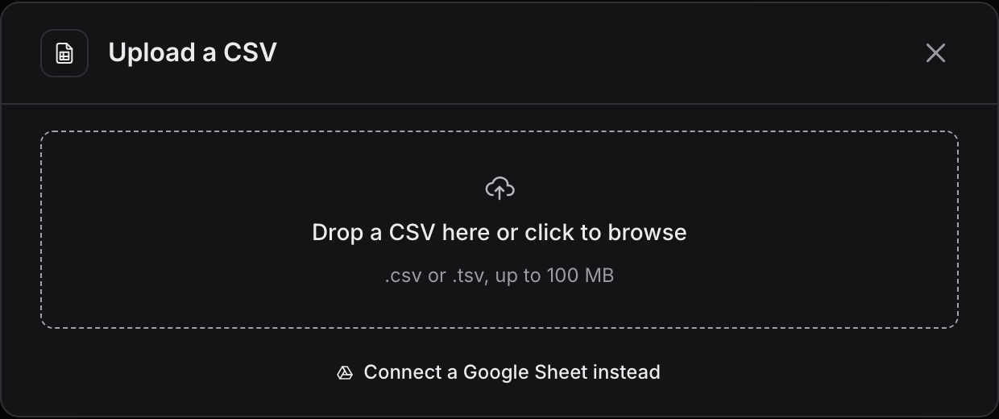
    </Frame>
  </Step>
  <Step title="Name the table and its columns">
    Give the table a name and check the type detected for each column. Rename any column whose name reads oddly, then select **Create table**. Lightdash opens the new table as soon as it's ready.

    <Frame>
      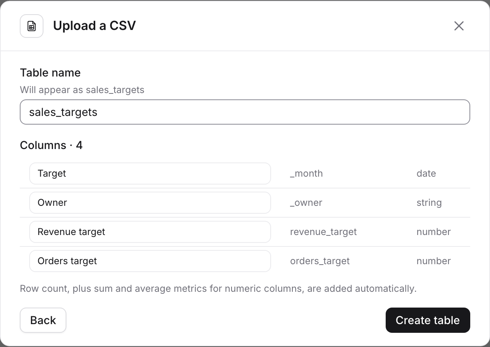
      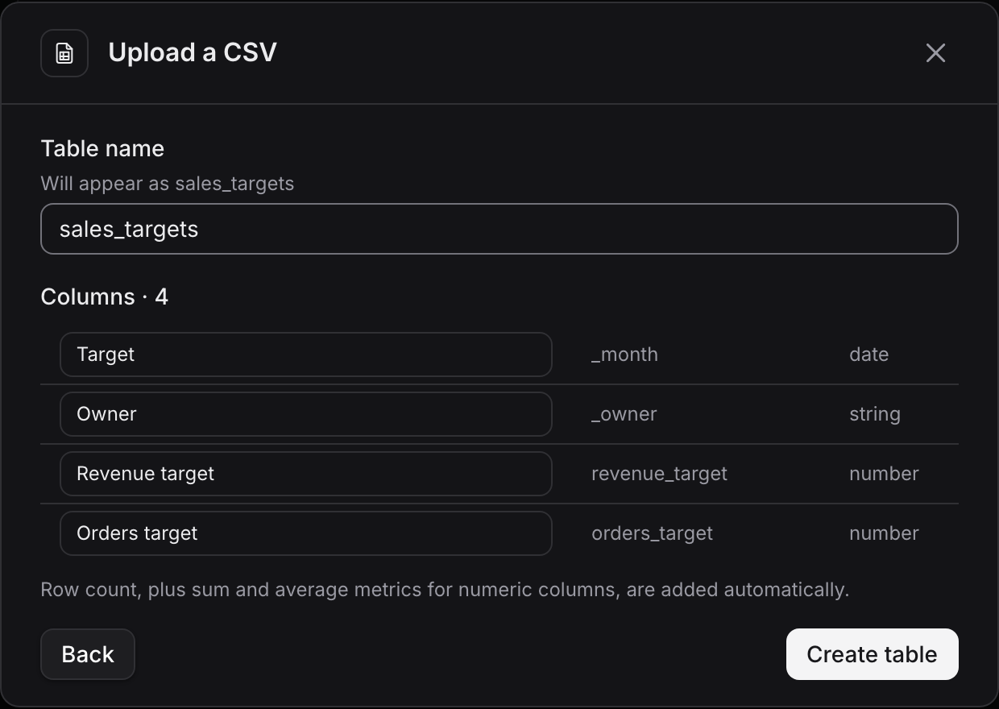
    </Frame>
  </Step>
</Steps>

## Connect a Google Sheet

<Steps>
  <Step title="Paste the sheet link">
    Open the upload dialog as described in [Upload a CSV](#upload-a-csv), then select **Connect a Google Sheet instead**. Paste the sheet's URL from your browser and name the table.

    Lightdash reads the tab the link points to. Open the tab you want before copying the URL, so the link ends in `#gid=…`. A link without a tab reads the first tab.

    To bring in several tabs of one sheet, add each tab as its own Google Sheet source with its own table name: open a tab, copy its link, connect it, then repeat for each other tab. Each tab then appears as its own table in Explore and Data Apps. There's no tab picker in this dialog, so copy the link while you're on the tab you want.

    <Frame>
      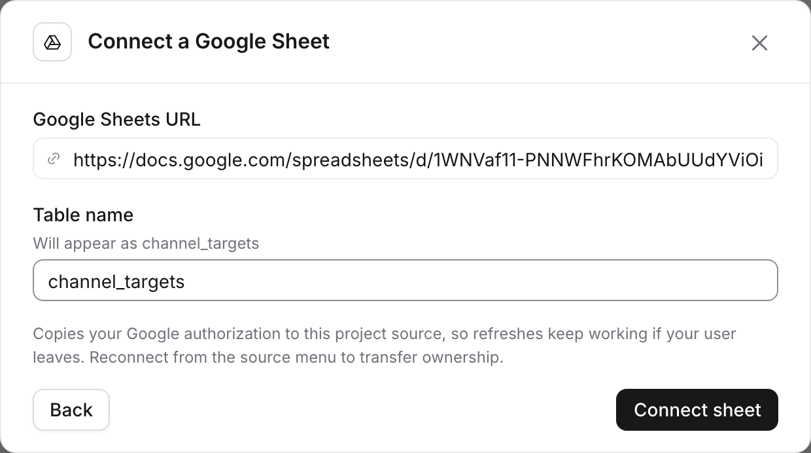
      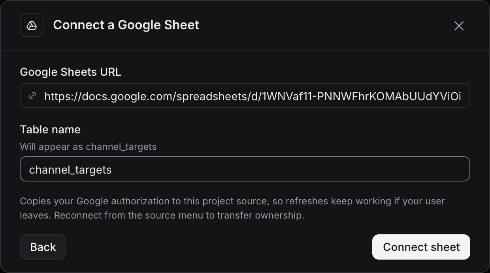
    </Frame>
  </Step>
  <Step title="Connect your Google account">
    Select **Connect sheet**. If you haven't connected Google before, select **Connect Google account**, approve access in the pop-up, then select **Connect sheet** again.

    If it fails with `Failed to refresh token: invalid_grant: Token has been expired or revoked`, your stored Google authorization expired or was revoked, and the dialog doesn't show a **Connect Google account** button for this error. Sign in to Lightdash, open `<your Lightdash URL>/api/v1/login/gdrive`, and approve access to Sheets and Drive with the Google account that can open the sheet. Then select **Connect sheet** again.
  </Step>
  <Step title="Review the table">
    Once the import finishes, rename the table or any column, then select **Open table**.

    <Frame>
      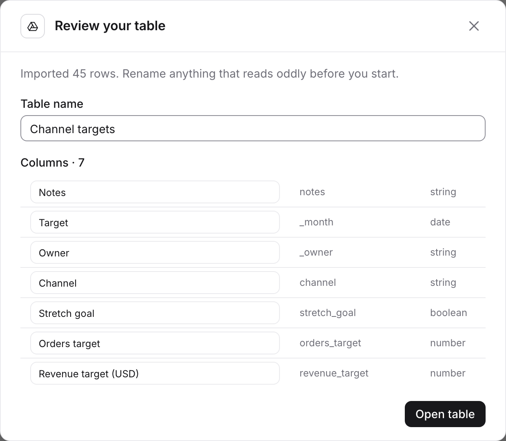
      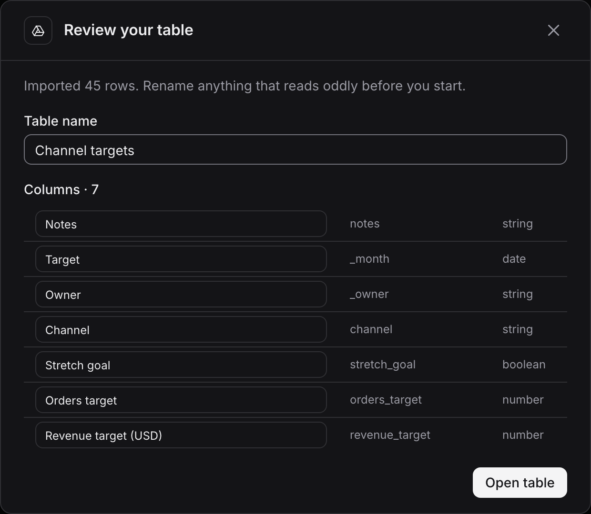
    </Frame>
  </Step>
</Steps>

## What the table contains

Each column becomes a dimension with a detected type: string, number, date, timestamp or boolean. Date columns also get day, week, month, quarter and year breakdowns. Lightdash adds a **Total rows** metric, plus a sum and an average for every number column.

Column names are tidied into SQL-safe names, so `Região` becomes `regiao` and a column called `month` becomes `_month`. The name you see in the sidebar is the one you gave it while importing, or a readable version of the SQL name.

## Use with warehouse data

You query an external source table on its own. It isn't listed in the table picker of a [merge query](/explore/merge-queries), so one chart can't join it to a warehouse table. To see both together, add a chart from each to the same [dashboard](/explore/dashboards).

A saved merge chart that includes an external source table still runs.

## Keep the table up to date

An external source is a copy taken when you import it, and edits to the sheet or file don't show up until you refresh it. In Explore, the menu next to the table name holds the source actions:

- **Refresh from Google Sheets** reads the sheet again. Column names you set are kept.
- **Replace file** uploads a new version of a CSV.
- **Reconnect Google account** makes your Google access the one used for future refreshes, for example when the person who connected the sheet leaves.
- **Rename table** changes the table and column names. Saved charts keep working.
- **View source details** previews the columns and the first rows.
- **Delete** removes the table. Charts built on it stop working.

<Note>
  If a refresh fails with `invalid_grant`, re-authorize Google as described in [Connect a Google Sheet](#connect-a-google-sheet), then select **Reconnect Google account** so the source uses the new grant. **Reconnect Google account** on its own doesn't open a Google prompt.

  A source remembers the tab you connected by its name. If you rename that tab in Google Sheets, **Refresh from Google Sheets** fails, because the name it's looking for no longer exists. Add the source again using the renamed tab's link.
</Note>

<Frame caption="The source menu for a table from a CSV. A Google Sheet table lists the refresh and reconnect actions in place of Replace file">
  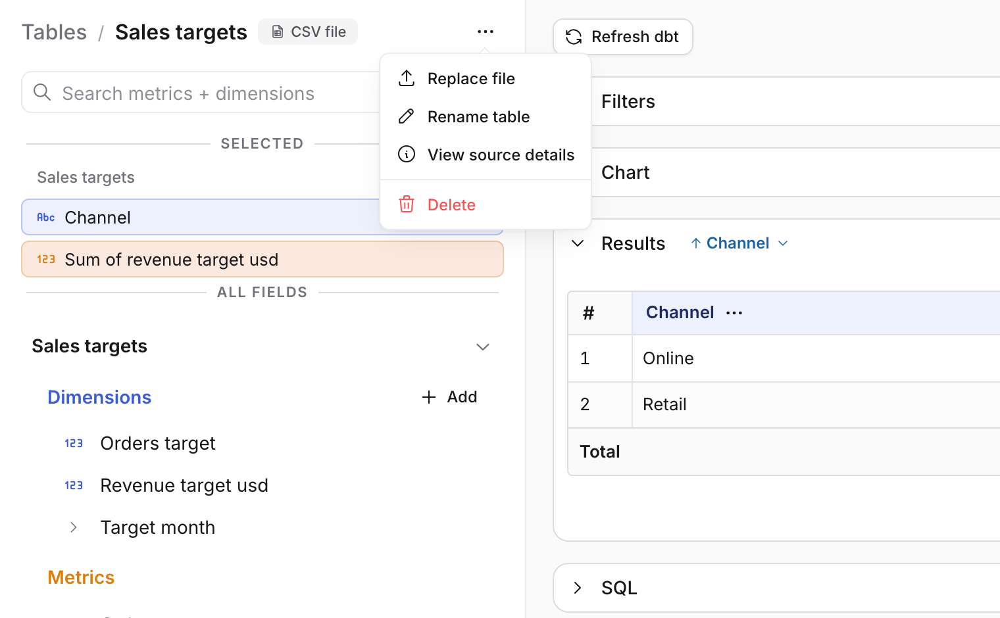
  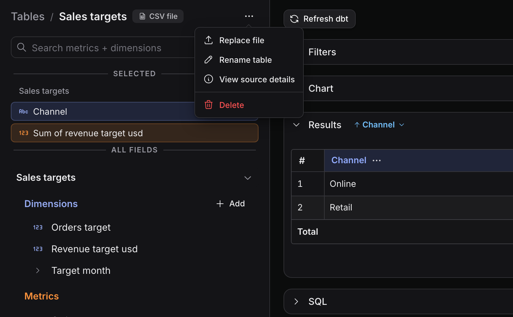
</Frame>

The Semantic Layer page lists every source under **External sources** with its row count, last refresh and status, and each row has a menu to preview, refresh, reconnect, replace, rename or delete it.

<Frame caption="Renaming a column from Rename table">
  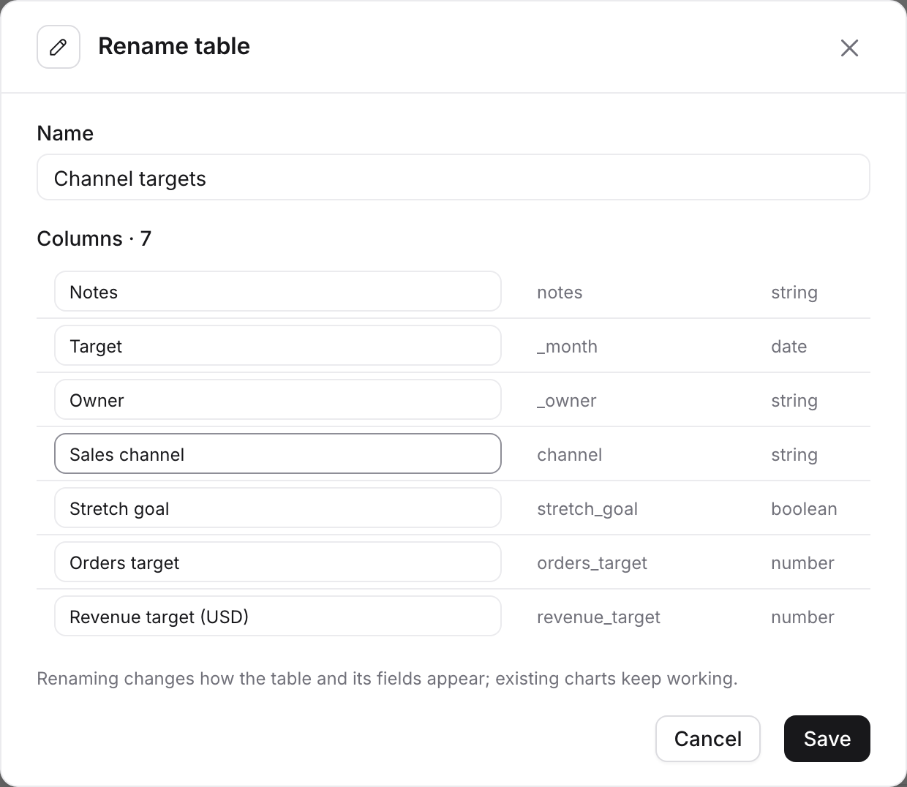
  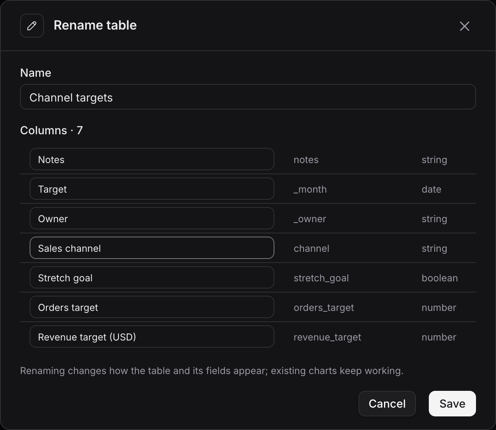
</Frame>

## Self-hosted setup

External sources run on the same DuckDB engine and object storage as pre-aggregates, but they don't need pre-aggregate workers or NATS. You need:

- **An Enterprise license.** Set `LIGHTDASH_LICENSE_KEY`. See [enterprise features](/self-host/enterprise-features).
- **A bucket for the imported data.** Set the `PRE_AGGREGATE_RESULTS_S3_*` variables listed under [pre-aggregates](/self-host/customize-deployment/environment-variables#pre-aggregates). Lightdash stores each table under `external-sources/` in that bucket. Without them, adding a source fails with `External sources need the pre-aggregates DuckDB configuration (PRE_AGGREGATE_RESULTS_S3_*)`.
- **The feature flag.** Add `external-sources` to `LIGHTDASH_ENABLE_FEATURE_FLAGS`. See [feature flags](/self-host/customize-deployment/environment-variables#feature-flags).
- **For Google Sheets, a Google OAuth client.** Follow [configure a Google Sheets integration](/self-host/customize-deployment/configure-google-sheets-integration). Enable the Google Sheets API and the Google Drive API on the same Google Cloud project, and add `<SITE_URL>/api/v1/oauth/redirect/google` to the client's authorized redirect URIs.

To change the size limits, set `EXTERNAL_SOURCES_MAX_FILE_SIZE_BYTES`, `EXTERNAL_SOURCES_MAX_ROWS` or `EXTERNAL_SOURCES_MAX_ORGANIZATION_BYTES`.
