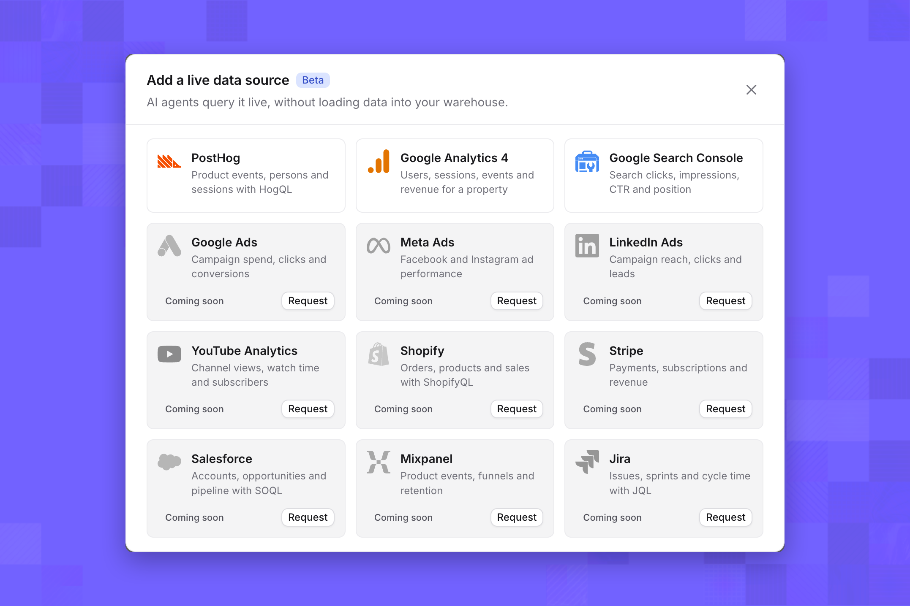
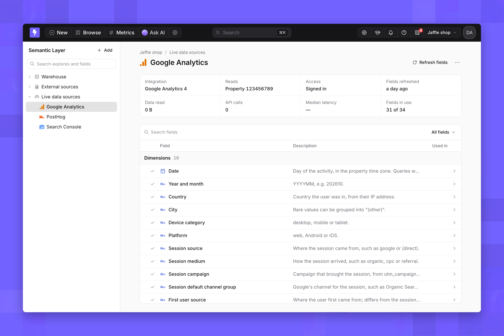
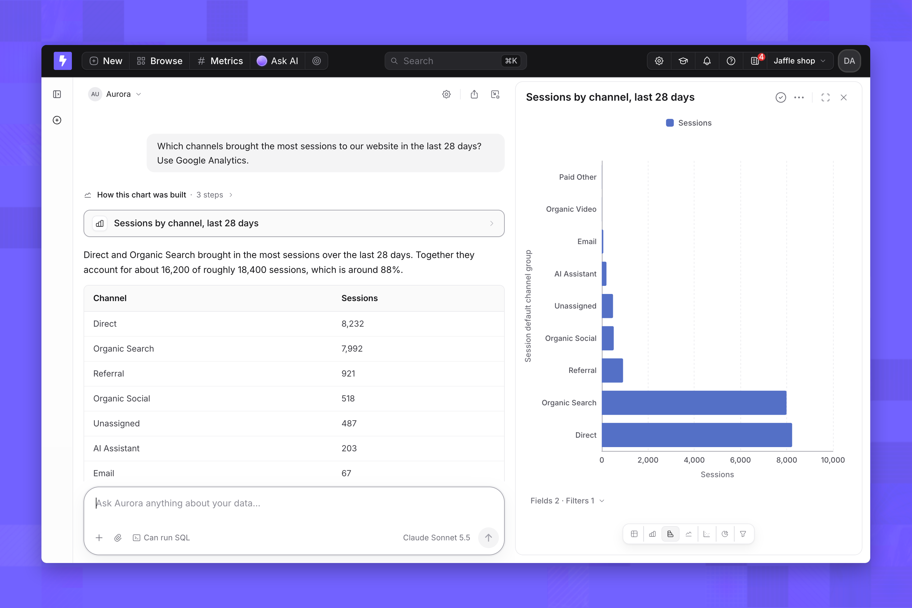
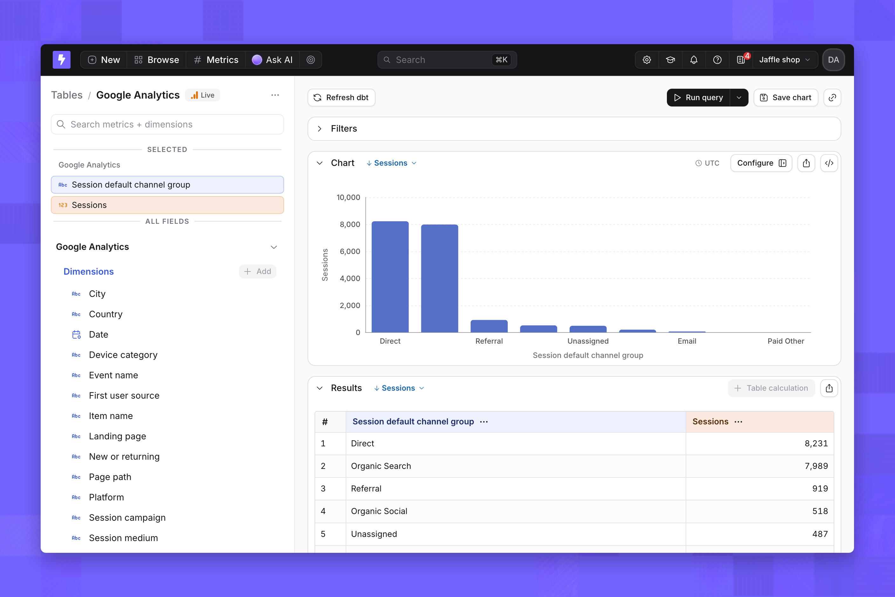

import { FeatureBadge } from '/snippets/feature-badge.jsx';

<FeatureBadge label="Beta" />

<Info>
  Live data sources must be turned on for your organization. See [Availability](/integrations/live-data-sources#availability) for who has them and how to enable them.
</Info>

In this tutorial you connect Google Analytics 4 as a [live data source](/integrations/live-data-sources), ask an AI agent which channels bring the most traffic, and build the same answer as a chart in Explore. Nothing is loaded into your warehouse: Lightdash queries Google Analytics each time you ask.

PostHog and Google Search Console follow the same steps with a different sign-in. Their details are in the [live data sources reference](/integrations/live-data-sources#integrations).

## What you need

- The **Admin** role in a Lightdash project.
- A Google account that can read a Google Analytics 4 property.

## 1. Add the source

1. On the nav bar, click **Browse** → **Semantic Layer**.
2. In the sidebar, select **Live data sources**, then click **Add**.
3. Select **Google Analytics 4**.

   <Frame>
     
   </Frame>

4. Enter a name, such as `Google Analytics`. People and agents see this name, so keep it short and recognizable.
5. Click **Continue to Google**, sign in, and allow read-only access to Google Analytics.
6. Back in Lightdash, pick the property you want to query.

Lightdash reads the property's fields and opens the source's page.

## 2. Check the fields

The source's page lists every field Google Analytics offers, such as **Session default channel group**, **Country**, **Sessions** and **Active users**, plus your property's key events. Fields marked **In use** are the ones people can query in Explore and that agents can see.

<Frame>
  
</Frame>

You don't need to change anything to continue. Later, click a field to rename it, improve its description or add an **AI hint** that tells agents when to use it. See [Fields](/integrations/live-data-sources#fields).

## 3. Ask an AI agent

1. On the nav bar, click **Ask AI** and open an agent in the project.
2. Ask: *"Which channels brought the most sessions to our website in the last 28 days? Use Google Analytics."*

The agent queries Google Analytics live, then answers with a summary, a table and a chart.

<Frame>
  
</Frame>

Try a follow-up, such as *"Split that by device category"* or *"Show it by week instead"*. Agents can answer metrics broken down by dimensions over a period. They tell you when a question needs something a live source can't do, such as a funnel or retention curve.

## 4. Build a chart in Explore

1. On the nav bar, click **New** → **Chart**, and pick the **Google Analytics** table. In Explore, it has a **Live** badge.
2. Under **Dimensions**, select **Session default channel group**.
3. Under **Metrics**, select **Sessions**.
4. Click **Run query**, then open **Chart** and choose a bar chart.

<Frame>
  
</Frame>

Without a date filter, the query reads the last 28 days. Add a filter on **Date** to read a different period. Table calculations, custom fields and pivots aren't available on live data sources; the [limits](/integrations/live-data-sources#limits) list what is.

## Next steps

- Connect [PostHog or Google Search Console](/integrations/live-data-sources#integrations) the same way.
- Read [security and access](/integrations/live-data-sources#security-and-access) to see whose access queries use and what agents see.
- Missing a tool? Click **Request** on it in the **Add a live data source** dialog.
