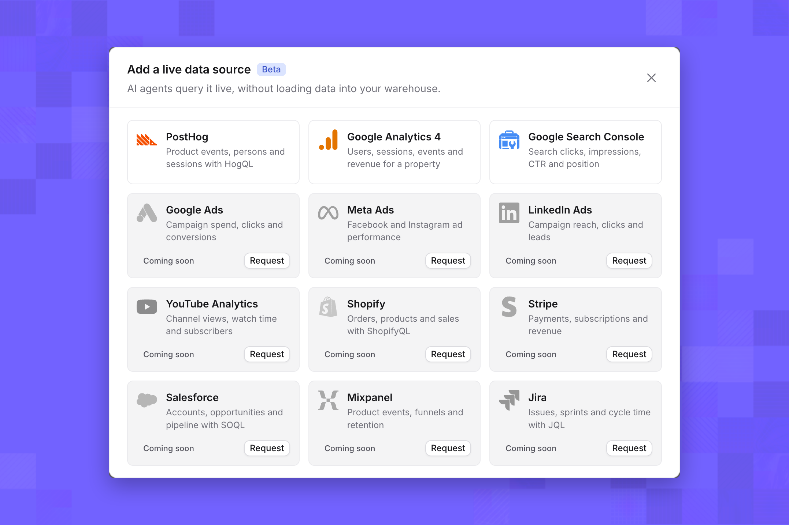
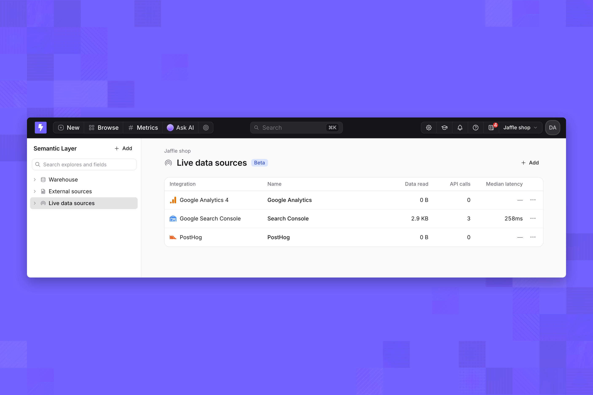
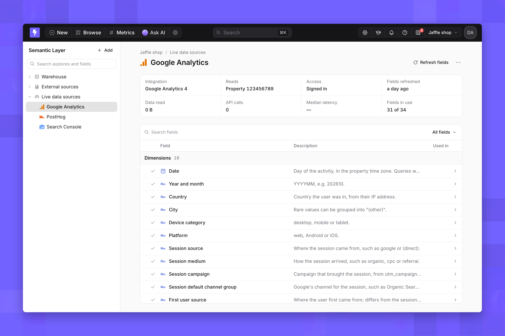
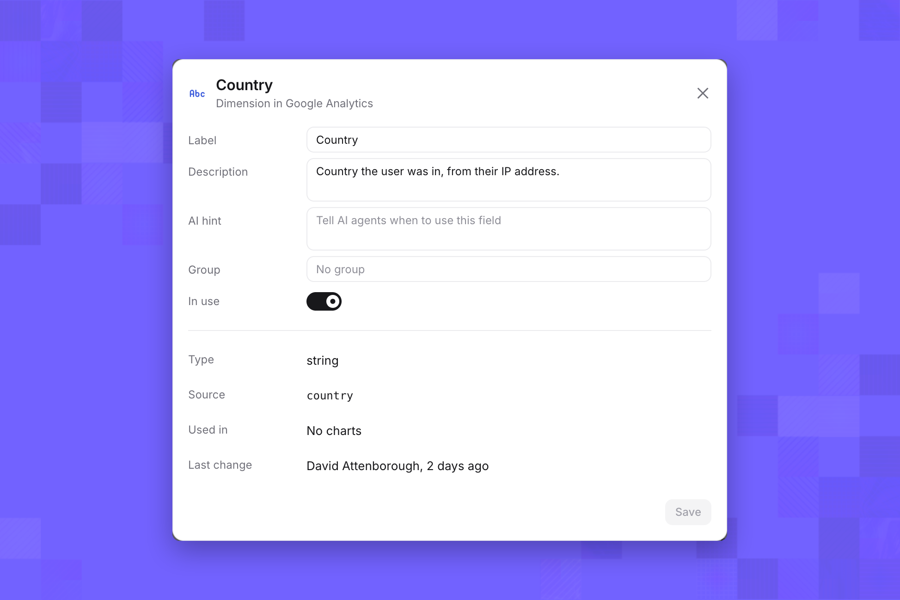
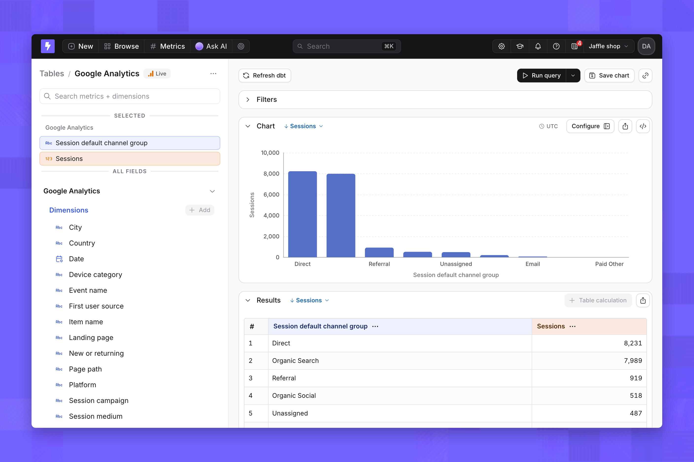
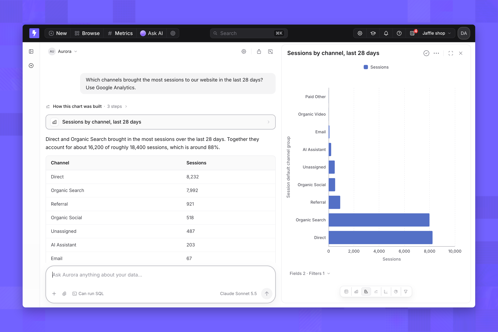
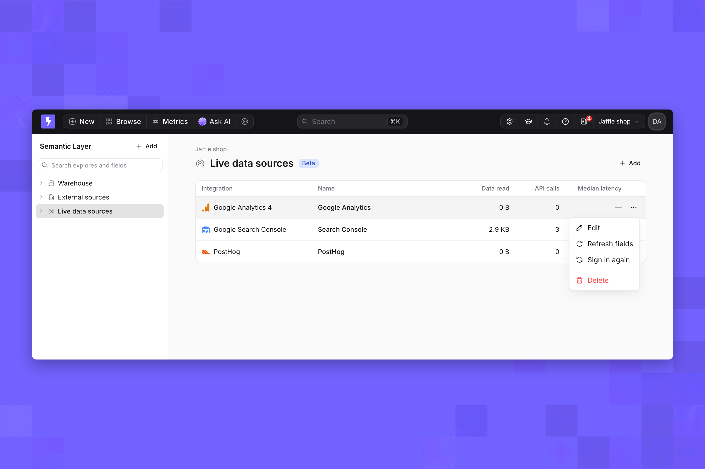

import { FeatureBadge } from '/snippets/feature-badge.jsx';

<FeatureBadge label="Beta" />

<Info>
  Live data sources are turned on for organizations that signed up through the current onboarding. For any other organization, contact [Lightdash support](mailto:support@lightdash.com) to enable them. Self-hosted instances also need an Enterprise license and the [setup below](#self-hosted-setup).
</Info>

A live data source is a connection to a third-party analytics tool that Lightdash queries at the moment you ask. Its data shows up as a table you can explore and that [AI agents](/agents/use-ai-agents) can answer questions from. Lightdash doesn't sync or store the tool's data; each query is one request to the tool's API.

<CardGroup cols={3}>
  <Card title="PostHog" href="/integrations/live-data-sources-options/option-2/posthog">
    Product events, persons and sessions through HogQL
  </Card>
  <Card title="Google Analytics 4" href="/integrations/live-data-sources-options/option-2/google-analytics">
    Users, sessions, events and revenue for a property
  </Card>
  <Card title="Google Search Console" href="/integrations/live-data-sources-options/option-2/google-search-console">
    Search clicks, impressions, click-through rate and position
  </Card>
</CardGroup>

## Live data sources, warehouses and ingestion tools

Lightdash usually queries your warehouse, where data arrives through your own pipelines or an ingestion tool that copies a SaaS tool's data on a schedule. A live data source skips the copy:

- **No pipeline.** You sign in from Lightdash, and the source is ready to query. There's no sync to schedule, no destination schema and no dbt model to write.
- **Fresh by default.** Every query reads the tool's API, so results are as current as the tool itself.
- **Bounded by the API.** You can ask what the tool's reporting API answers: metrics broken down by dimensions over a period. You can't join a live source to warehouse tables, and each query counts toward the tool's rate limits.

Use a live data source for questions about a tool's own data. Load data into your warehouse when you need to join it with other data, model it, or keep history the tool doesn't.

## Connect a live data source

Project admins can add live data sources. You also need access to the tool itself; each integration page lists what it needs.

1. On the nav bar, click **Browse** → **Semantic Layer**.
2. In the sidebar, select **Live data sources**, then click **Add**.
3. In the **Add a live data source** dialog, pick an integration and follow its sign-in.

<Frame>
  
</Frame>

When the source is added, Lightdash reads its fields, and the source appears under **Live data sources** and as a table in Explore with a **Live** badge.

<Frame>
  
</Frame>

## Fields

Each source starts with the fields its integration offers, plus fields Lightdash reads from your account, such as PostHog properties or Google Analytics key events. Select a source to open its Fields page. Only fields marked **In use** appear in Explore and to AI agents.

<Frame>
  
</Frame>

Click a field to change its **Label**, **Description**, **AI hint** and **Group**, or turn **In use** off. Click **Save** to apply. Use **Refresh fields** to read the integration's fields again after you add properties or events in the tool.

<Frame>
  
</Frame>

## Query a live data source

Live data sources work in two places:

- **Explore.** Open the source's table, pick metrics and dimensions, and run the query. Each run is one call to the integration.
- **AI agents.** Every agent in the project can query live data sources, whatever tags it's limited to. Ask in plain language; the agent picks the fields, adds a date filter for the period you mention and builds a chart.

<Frame>
  
</Frame>

<Frame>
  
</Frame>

Live data sources answer metrics by dimensions. Funnels, retention and user paths aren't available, and agents say so instead of approximating them.

## Limits

### Features that don't run on live data sources

| Feature | What happens |
| --- | --- |
| Table calculations and their filters | The **Table calculation** button is disabled; queries that include one are refused |
| Custom metrics, custom dimensions and period-over-period comparisons | Not available in Explore; queries that include one are refused |
| Pivots and date zoom | Refused, with a message to remove them |
| View underlying data | Not available; integrations only return aggregated rows |
| SQL runner and compiled SQL | Not available; queries run on the integration's API, not as SQL |
| Embedded dashboards and charts | Refused |
| OR filters and nested filter groups | Refused on integrations that only combine filters with AND |

### Rate limits

Each source has a cap on queries at once, calls per minute and calls per hour, set to stay inside its integration's API limits. The caps are per source and shared by Explore and every agent. When every slot is busy, a query waits up to 15 seconds, then fails with a message to retry. When a minute or hour cap is reached, queries fail with the number of seconds to wait. Each integration page lists its caps.

### Freshness and result reuse

A query reads the integration's API at run time. Running the same query again within 60 seconds reuses the first result instead of calling the integration again. Integrations also have their own processing delays, listed on each integration page.

### Date ranges and rows

Queries without a filter on the source's date field read a default range, 28 or 30 days depending on the integration. Each integration also caps the rows a query returns and how long it waits for an answer.

## Security and access

| Topic | How it works |
| --- | --- |
| Who can manage sources | Project admins add, edit, sign in again and delete live data sources |
| Who can query | People with the Interactive viewer role or above, in Explore and through AI agents |
| Whose access queries use | The account that signed in, or the API key. Everyone who queries the source sees what that account can read, within the fields in use |
| Scope requested | Read-only: Google Analytics and Search Console read scopes, and PostHog query access |
| Credential storage | Sign-in tokens and API keys are stored encrypted and never shown again |
| What AI agents see | The source names, the fields in use with their labels, descriptions and AI hints, and the rows their queries return |
| Usage | Each source shows data read, API calls and median latency |

## Manage a live data source

Open a source's menu from the **Live data sources** list or its page. **Edit** renames it, **Refresh fields** reads its fields again, **Sign in again** reconnects it with your account, and **Delete** removes it and its table.

<Frame>
  
</Frame>

## Request an integration

The **Add a live data source** dialog lists more integrations than PostHog, Google Analytics 4 and Search Console, including Google Ads, Meta Ads, LinkedIn Ads, YouTube Analytics, Shopify, Stripe, Salesforce, Mixpanel and Jira. Click **Request** on any of them to register your interest. For a tool that isn't listed, contact [Lightdash support](mailto:support@lightdash.com).

## Self-hosted setup

Live data sources need an [Enterprise license](/self-host/enterprise-features). Google Analytics 4 and Search Console sign in through the Google OAuth client used for [Google sign-in](/self-host/customize-deployment/use-sso-login-for-self-hosted-lightdash), set with `AUTH_GOOGLE_OAUTH2_CLIENT_ID` and `AUTH_GOOGLE_OAUTH2_CLIENT_SECRET`; enable the Google Analytics Data API and Search Console API in its Google Cloud project. PostHog sign-in needs `POSTHOG_OAUTH_CLIENT_ID` and `POSTHOG_OAUTH_CLIENT_SECRET`; without them, people connect PostHog with a personal API key.
