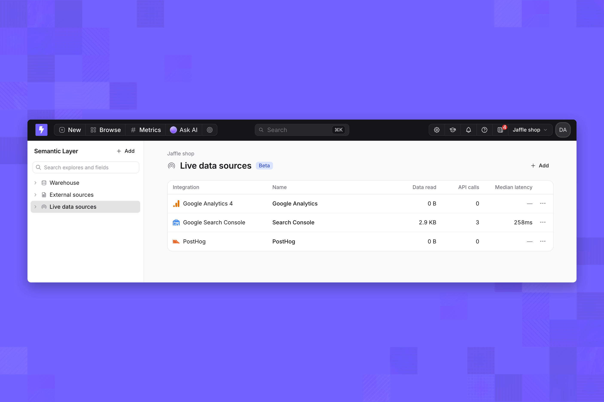
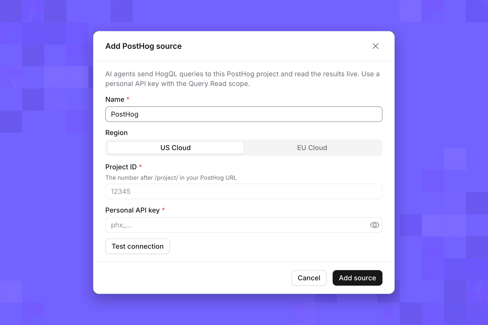
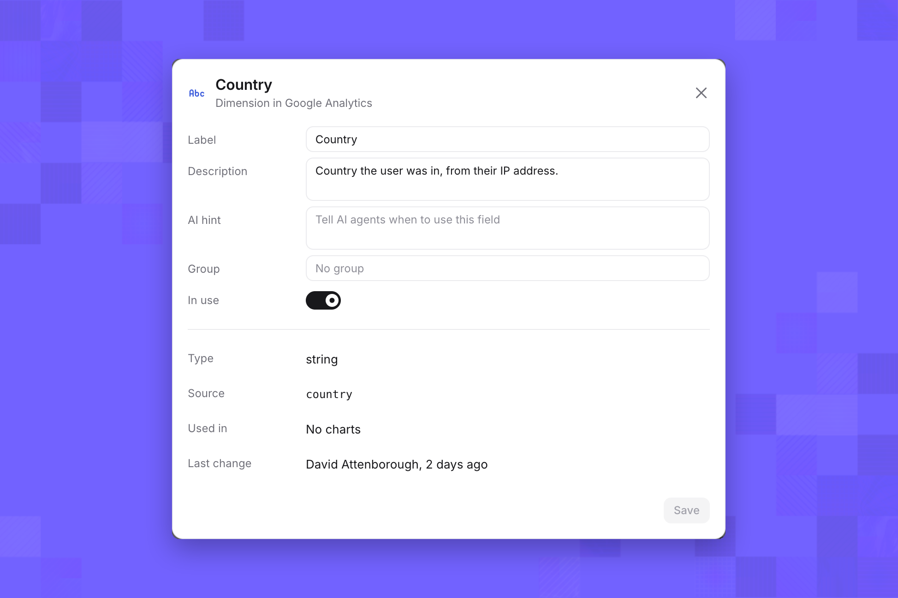
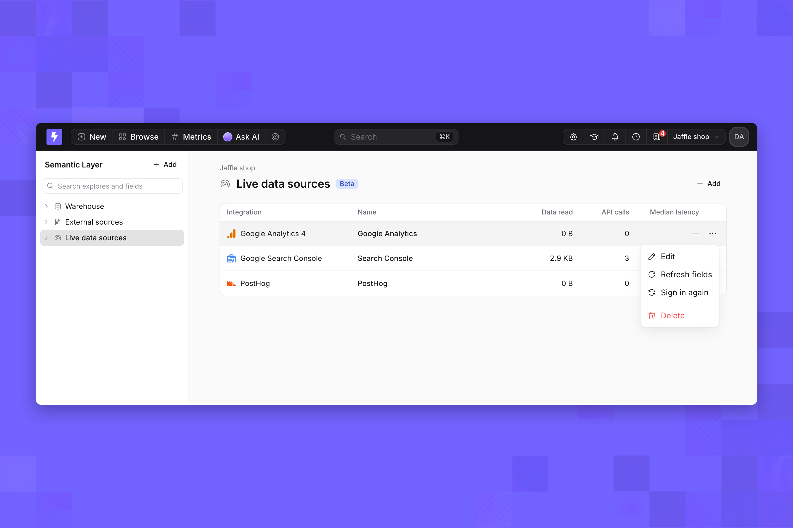

import { FeatureBadge } from '/snippets/feature-badge.jsx';

<FeatureBadge label="Beta" />

A live data source connects Lightdash to a third-party analytics tool and queries its API each time someone asks, from Explore or an [AI agent](/agents/use-ai-agents). Lightdash doesn't sync or store the tool's data, and you don't need a warehouse table or dbt model for it. To connect one step by step, follow [Connect a live data source](/integrations/live-data-sources-options/option-3/connect-a-live-data-source).

<Frame>
  
</Frame>

## Compared with warehouses and ingestion tools

| | Warehouse | Ingestion tool | Live data source |
| --- | --- | --- | --- |
| Where the data lives | Your warehouse | Copied into your warehouse on a schedule | Stays in the tool |
| Freshness | As fresh as your models | As fresh as the last sync | As fresh as the tool's API |
| Setup | Project connection and dbt models | Pipeline, destination schema and models | Sign in from Lightdash |
| Joins with other data | Yes | Yes, once loaded | No |
| What you can ask | Anything your models support | Anything, once modeled | Metrics by dimensions that the tool's API reports |

## Availability

| | |
| --- | --- |
| Maturity | Beta: fields, limits and supported features can change between releases |
| Lightdash Cloud | On for organizations that signed up through the current onboarding, and for organizations that already have a live data source. Others can ask [Lightdash support](mailto:support@lightdash.com) to enable it |
| Self-hosted | Needs an [Enterprise license](/self-host/enterprise-features). Set up sign-in as described in [Self-hosted setup](#self-hosted-setup) |
| Where to manage | **Browse** → **Semantic Layer** → **Live data sources** |

## Integrations

| Integration | Reads | Sign-in | Access requested | Explore table |
| --- | --- | --- | --- | --- |
| PostHog | One project, US Cloud or EU Cloud | **Sign in with PostHog**, or a personal API key and project ID | Query Read | Events |
| Google Analytics 4 | One property | Google account that can read the property | Read-only Google Analytics | Report |
| Google Search Console | One site | Google account with access to the site | Read-only Search Console | Search performance |

**Sign in with PostHog** appears only when your Lightdash instance has a PostHog sign-in app configured. With an API key, the key needs the **Query Read** scope, and the project ID is the number after `/project/` in your PostHog URL. Match the region to your project; a key from an EU project is rejected by US Cloud.

<Frame>
  
</Frame>

To request an integration that isn't available, click **Request** on it in the **Add a live data source** dialog. The dialog lists Google Ads, Meta Ads, LinkedIn Ads, YouTube Analytics, Shopify, Stripe, Salesforce, Mixpanel and Jira. For anything else, contact [Lightdash support](mailto:support@lightdash.com).

## Fields

| Integration | Built-in dimensions | Built-in metrics | Added from your account |
| --- | --- | --- | --- |
| PostHog | Event date, week, month and time; event name; distinct ID; person ID; current URL, pathname, referring domain, UTM source, browser, OS, device type, country | Events, Unique users, Unique sessions | Event and person properties, up to 2,000 |
| Google Analytics 4 | Date, year and month, country, city, device category, platform, session source, medium, campaign and default channel group, first user source, landing page, page path, event name, new or returning, item name | Active, total and new users; sessions, engaged sessions, engagement rate, average session duration; views, event count, key events; total revenue, ecommerce purchases; item revenue, items purchased, items viewed | Key events and custom metrics |
| Google Search Console | Date, query, page, country, device, search appearance | Clicks, impressions, click-through rate, average position | None |

Each source has a Fields page: select the source under **Live data sources**. Only fields marked **In use** appear in Explore and to AI agents. Click a field to edit:

| Setting | Effect |
| --- | --- |
| **Label** | The name people and agents see |
| **Description** | Shown in Explore and to agents |
| **AI hint** | Tells agents when to use the field |
| **Group** | Groups the field in the Explore sidebar |
| **In use** | Shows or hides the field everywhere |

<Frame>
  
</Frame>

**Refresh fields** reads the integration's fields again, for example after you add a property in PostHog or a key event in Google Analytics.

## Integration rules

| Integration | Rule |
| --- | --- |
| Google Analytics 4 | At most 9 dimensions and 10 metrics per query |
| Google Analytics 4 | **Item name** only works with item revenue, items purchased and items viewed |
| Google Analytics 4 | Dates are in the property's time zone. **Page path** is event-scoped, so splitting sessions by page counts a session once per page |
| Google Search Console | Dates are in Pacific Time, and the last two or three days are incomplete in Search Console |
| Google Search Console | Google hides rare queries, so totals split by **Query** are lower than site totals |
| All | Some integrations can't combine filters with OR or nest filter groups |

Lightdash checks these rules before calling the integration and names the field or filter to change.

## Where you can query

| Surface | Supported |
| --- | --- |
| Explore | Yes. Each run is one call to the integration |
| AI agents | Yes. Every agent in the project sees every live data source, whatever its tags |
| Embedded dashboards and charts | No |
| SQL runner | No. Queries run on the integration's API, not as SQL |

Agents answer metrics by dimensions over a period. Funnels, retention and user paths aren't available.

## Limits

### Unsupported features

| Feature | Behavior |
| --- | --- |
| Table calculations and table calculation filters | Refused |
| Custom metrics, custom dimensions, period-over-period comparisons | Refused |
| Pivots | Refused |
| Date zoom | Refused |
| View underlying data | Refused: integrations return aggregated rows only |
| Compiled SQL | Not available |

### Per-query limits

| Integration | Default date range | Most rows | Timeout |
| --- | --- | --- | --- |
| PostHog | Last 30 days | 49,999 | 10 seconds |
| Google Analytics 4 | Last 28 days | 24,999 | 30 seconds |
| Google Search Console | Last 28 days | 24,999 | 30 seconds |

The default date range applies when a query has no filter on the source's date field.

### Rate limits

| Integration | Queries at once | Calls per minute | Calls per hour |
| --- | --- | --- | --- |
| PostHog | 3 | 240 | 2,400 |
| Google Analytics 4 | 5 | 60 | 1,000 |
| Google Search Console | 5 | 600 | 20,000 |

Limits are per source and shared by everyone who queries it, in Explore and through agents. A query waits up to 15 seconds for a free slot, then fails with a message to retry. A query over a minute or hour limit fails with the number of seconds to wait.

### Freshness and result reuse

Queries read the integration's API at run time. The same query run again within 60 seconds reuses the first result and doesn't call the integration.

## Security and access

| Topic | Detail |
| --- | --- |
| Manage sources | Project admins |
| Query sources | Interactive viewer role and above, in Explore and through AI agents |
| Credentials used | The account that signed in, or the API key, for everyone who queries the source |
| What people can see | Whatever that account can read in the tool, within the fields in use |
| Scopes | Read-only: Google Analytics and Search Console read scopes, PostHog query access |
| Storage | Tokens and API keys are stored encrypted and never shown again |
| What AI agents see | Source names, fields in use with labels, descriptions and AI hints, and the rows their queries return |
| Usage | Data read, API calls and median latency per source |

## Source actions

| Action | Effect |
| --- | --- |
| **Edit** | Rename the source; for PostHog with an API key, change the region or key |
| **Refresh fields** | Read the integration's fields again |
| **Sign in again** | Reconnect with your account, for example when the person who connected it leaves |
| **Delete** | Remove the source and its table |

<Frame>
  
</Frame>

## Self-hosted setup

| Integration | Configuration |
| --- | --- |
| Google Analytics 4, Google Search Console | The Google OAuth client from [Google sign-in](/self-host/customize-deployment/use-sso-login-for-self-hosted-lightdash): `AUTH_GOOGLE_OAUTH2_CLIENT_ID` and `AUTH_GOOGLE_OAUTH2_CLIENT_SECRET`. Enable the Google Analytics Data API and Search Console API in its Google Cloud project |
| PostHog | `POSTHOG_OAUTH_CLIENT_ID` and `POSTHOG_OAUTH_CLIENT_SECRET` for **Sign in with PostHog**. Without them, connect with a personal API key |
