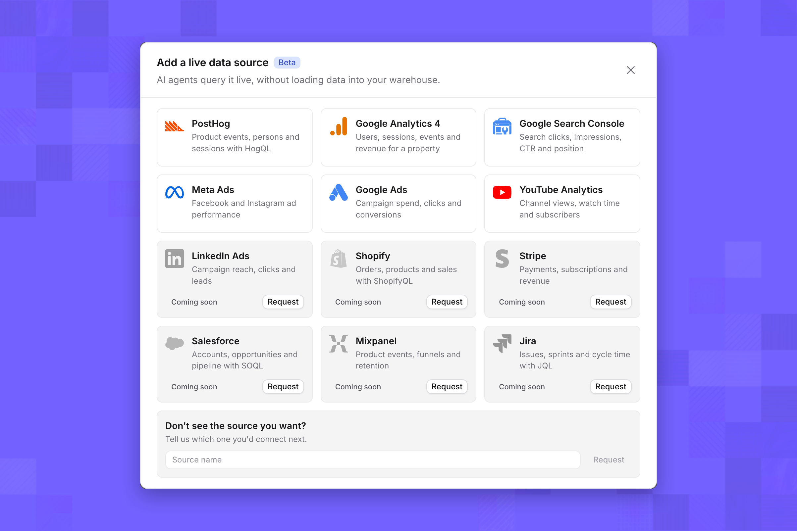
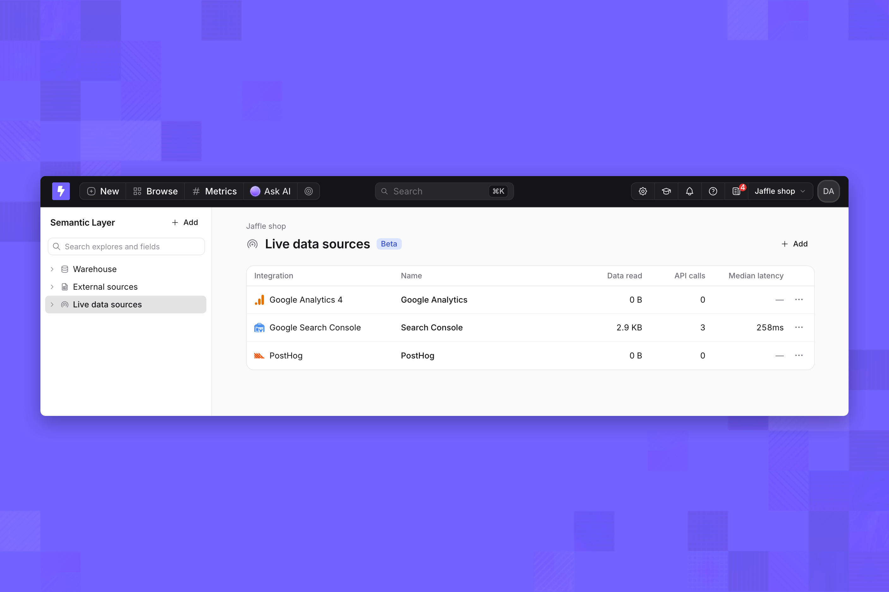
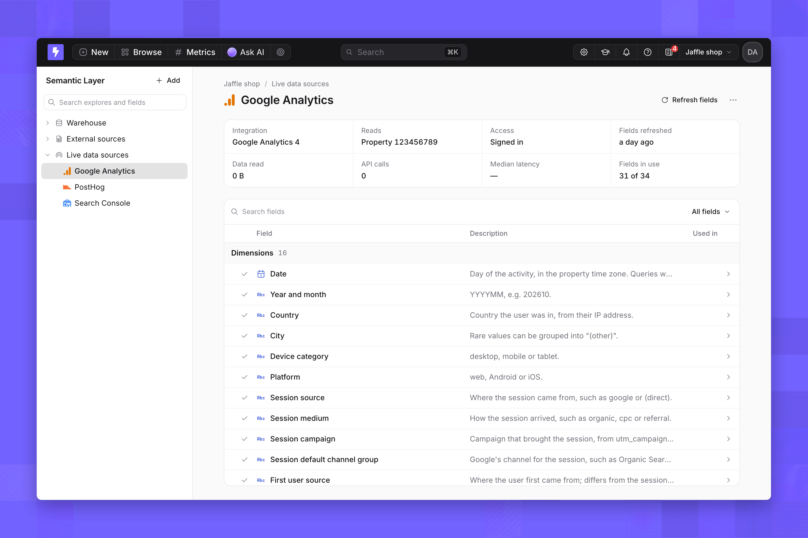
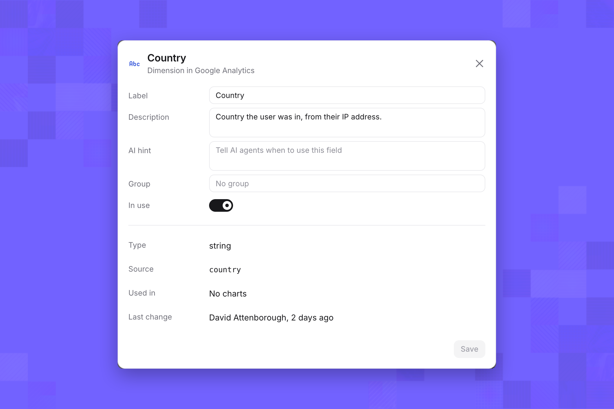
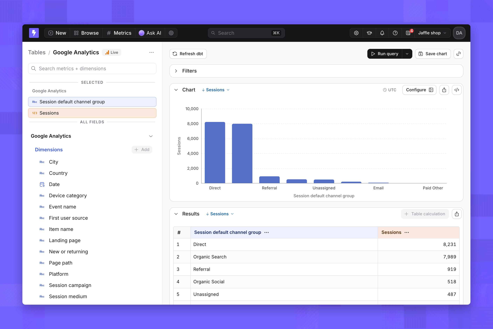
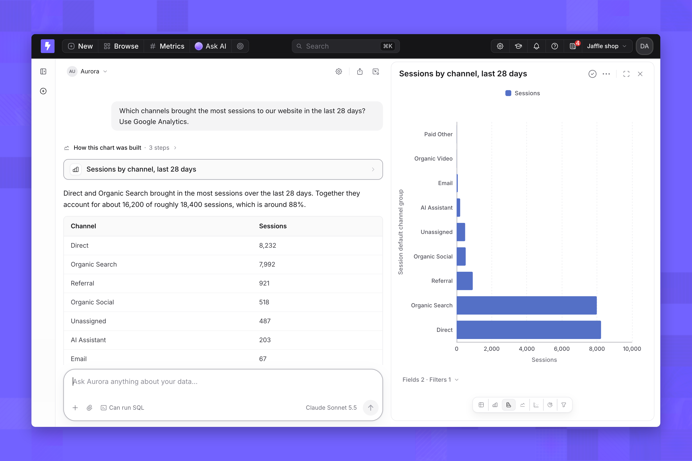
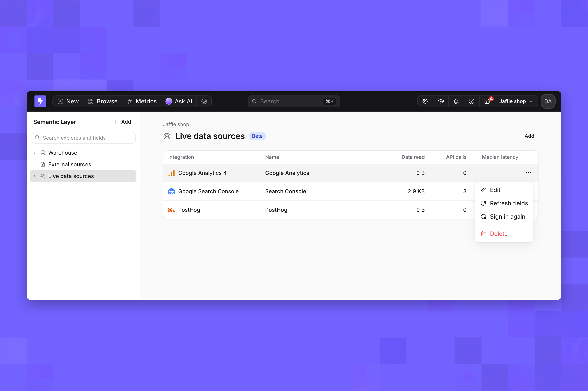

import { FeatureBadge } from '/snippets/feature-badge.jsx';

<FeatureBadge label="Beta" />

<Info>
  Live data sources are behind a feature flag. [Contact Lightdash support](mailto:support@lightdash.com) to enable them. On a self-hosted Enterprise instance, [enable the flag](/self-host/enterprise-features#live-data-sources).
</Info>

A live data source is a connection to a third-party analytics tool that Lightdash calls each time you run a query. Its data appears as a table you can explore and [AI agents](/agents/use-ai-agents) can query. Lightdash doesn't sync or store the tool's data; each query is one request to the tool's API.

<CardGroup cols={3}>
  <Card title="PostHog" href="/integrations/live-data-sources/posthog">
    Product events, persons and sessions through HogQL
  </Card>
  <Card title="Google Analytics 4" href="/integrations/live-data-sources/google-analytics">
    Users, sessions, events and revenue for a property
  </Card>
  <Card title="Google Search Console" href="/integrations/live-data-sources/google-search-console">
    Search clicks, impressions, click-through rate and position
  </Card>
</CardGroup>

## Live data sources, warehouses and ingestion tools

Lightdash usually queries your warehouse, where data arrives through your own pipelines or an ingestion tool that copies a SaaS tool's data on a schedule. A live data source skips the copy:

- **No pipeline.** You sign in from Lightdash, and the source is ready to query. There's no sync to schedule, no destination schema and no dbt model to write.
- **Read at query time.** Every query reads the tool's API, so there's no sync delay.
- **Bounded by the API.** You can ask what the tool's reporting API answers: metrics broken down by dimensions over a period. You can't join a live data source to warehouse tables, and each query counts toward the tool's rate limits.

Use a live data source for questions about a tool's own data. Load data into your warehouse when you need to join it with other data, model it, or keep history the tool doesn't.

## Integration levels

An integration's level describes how much its API can do when Lightdash queries it live. The higher the level, the more questions work. Each integration page states its level and the features it supports.

| Level | What the API does | What you can ask |
| --- | --- | --- |
| 5 | Runs SQL | Almost any question about the tool's data |
| 4 | Runs its own query language, including totals | Totals and breakdowns that query language supports |
| 3 | Runs reports from a fixed menu of dimensions and metrics | Any combination the menu allows |
| 2 | Filters records, without totals | Small, filtered sets of records |
| 1 | Lists records, without filtering | Very little works live |

## Connect a live data source

Project admins can add live data sources. You also need access to the tool itself; each integration page lists what it needs.

1. On the nav bar, click **Browse** → **Semantic Layer**.
2. In the sidebar, select **Live data sources**, then click **Add**.
3. In the **Add a live data source** dialog, select an integration, then follow the steps on its integration page.

<Frame>
  
</Frame>

When the source is added, Lightdash reads its dimensions and metrics, and the source appears under **Live data sources** and as a table in Explore with a **Live** badge.

<Frame>
  
</Frame>

## Dimensions and metrics

Each source starts with the dimensions and metrics its integration offers, plus the ones Lightdash reads from your account, such as custom properties or events. Each integration page lists them. Select a source under **Live data sources** to see them. Only dimensions and metrics marked **In use** appear in Explore and to AI agents.

<Frame>
  
</Frame>

Click a dimension or metric to change its **Label**, **Description**, **AI hint** and **Group**, or turn **In use** off. Click **Save** to apply. Click **Refresh fields** to read them from the integration again after you add properties or events in the tool.

<Frame>
  
</Frame>

## Query a live data source

Live data sources work in two places:

- **Explore.** Open the source's table, pick metrics and dimensions, and run the query. Each run is one call to the integration.
- **AI agents.** Every agent in the project can query live data sources, whatever tags it's limited to. Ask in plain language; the agent picks the dimensions and metrics, adds a date filter for the period you mention and builds a chart.

<Frame>
  
</Frame>

<Frame>
  
</Frame>

Live data sources return metrics broken down by dimensions. Funnels, retention and user paths aren't available, and agents say so instead of approximating them.

## Limits

### Features

The Lightdash features a query can use depend on the integration. Each integration page lists the ones it supports.

These features aren't available on any live data source:

- View underlying data, because integrations only return aggregated rows
- SQL runner and compiled SQL, because queries run on the tool's API, not as SQL
- Embedded dashboards and charts

A query that uses a feature its integration doesn't support fails with a message saying what to remove.

### Rate limits

Each source has a cap on queries at once, calls per minute and calls per hour. The caps are per source and shared by Explore and every agent. When the queries-at-once cap is reached, a query waits up to 15 seconds, then fails with a message to retry. When a minute or hour cap is reached, queries fail with the number of seconds to wait. Each integration page lists its caps.

### Freshness and result reuse

A query reads the tool's API at run time. Running the same query again within 60 seconds reuses the first result instead of calling the integration again. Integrations also have their own processing delays, listed on each integration page.

### Date ranges and rows

Queries without a filter on the source's date dimension read a default range, listed on each integration page. Each integration also caps the rows a query returns and how long it waits for an answer.

## Security and access

| Topic | How it works |
| --- | --- |
| Who can manage sources | Project admins add, edit, sign in again and delete live data sources |
| Who can query | People with the Interactive viewer role or above, in Explore and through AI agents |
| Whose access queries use | The account that signed in, or the API key. Everyone who queries the source sees what that account can read, within the dimensions and metrics in use |
| Scope requested | Read-only. Each integration page lists the access it needs |
| Credential storage | Sign-in tokens and API keys are stored encrypted and never shown again |
| What AI agents see | The source names, the dimensions and metrics in use with their labels, descriptions and AI hints, and the rows their queries return |
| Usage | Each source shows data read, API calls and median latency |

## Manage a live data source

Open a source's menu from the **Live data sources** list or its page. **Edit** renames it, **Refresh fields** reads its dimensions and metrics again, **Sign in again** reconnects it with your account, and **Delete** removes it and its table.

<Frame>
  
</Frame>

## Request an integration

The **Add a live data source** dialog also lists integrations you can't connect yet. Click **Request** on any of them to register your interest. For a tool that isn't listed, contact [Lightdash support](mailto:support@lightdash.com).
