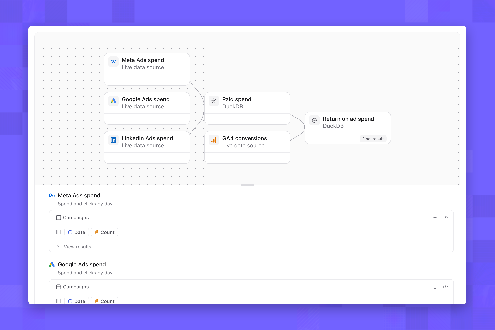

import { FeatureBadge } from '/snippets/feature-badge.jsx';

<FeatureBadge label="Beta" />

<Info>
  Self-hosted instances need an Enterprise license for live data sources. See [live data sources setup](/self-host/enterprise-features#live-data-sources).
</Info>

Live data sources let you analyze the live data in your tools, with or without a warehouse. Sign in to a tool and you get a ready-made set of dimensions and metrics to explore, chart and ask AI agents about.

Each query goes to the tool's API when it runs, so results are as current as the tool and its data isn't loaded into your warehouse. Speed, history and rate limits depend on each tool. A project can use live data sources on their own, with no warehouse connected.

## How it works

When someone runs a query on a live data source, Lightdash:

1. Checks that they can query the source.
2. Returns a cached result if the same query ran within the source's [freshness window](#caching).
3. Otherwise turns the query into a call to the tool's API, within the source's [rate limits](#rate-limits), and returns the rows.

## Connect your tools

People with the **Developer or Admin role** [add a source](/integrations/live-data-sources/set-up-and-manage#connect-a-live-data-source) by signing in to the tool or entering an API key. There's no sync to schedule or dbt model to write. Each integration page lists its dimensions, metrics, supported features and limits.

<CardGroup cols={3}>
  <Card title="PostHog" href="/integrations/live-data-sources/posthog">
    Product events, persons and sessions through HogQL
  </Card>
  <Card title="Amplitude" href="/integrations/live-data-sources/amplitude">
    Events, active users, funnels and retention for a project
  </Card>
  <Card title="Mixpanel" href="/integrations/live-data-sources/mixpanel">
    Events, saved funnels and retention for a project
  </Card>
  <Card title="Google Analytics 4" href="/integrations/live-data-sources/google-analytics">
    Users, sessions, events and revenue for a property
  </Card>
  <Card title="Google Search Console" href="/integrations/live-data-sources/google-search-console">
    Search clicks, impressions, click-through rate and position
  </Card>
  <Card title="Meta Ads" href="/integrations/live-data-sources/meta-ads">
    Facebook and Instagram ad performance for an ad account
  </Card>
  <Card title="Google Ads" href="/integrations/live-data-sources/google-ads">
    Campaign and ad group cost, clicks and conversions
  </Card>
  <Card title="YouTube Analytics" href="/integrations/live-data-sources/youtube-analytics">
    Channel views, watch time and subscribers
  </Card>
  <Card title="LinkedIn Ads" href="/integrations/live-data-sources/linkedin-ads">
    Campaign spend, clicks, leads and conversions
  </Card>
  <Card title="GitHub" href="/integrations/live-data-sources/github">
    Pull requests, issues and contributors of a repository
  </Card>
  <Card title="Pylon" href="/integrations/live-data-sources/pylon">
    Support issues, customer accounts and contacts
  </Card>
  <Card title="Attio" href="/integrations/live-data-sources/attio">
    Companies, people, deals, users and workspaces from your CRM
  </Card>
  <Card title="HubSpot" href="/integrations/live-data-sources/hubspot">
    Deals, contacts, companies, tickets and leads from your CRM
  </Card>
  <Card title="Salesforce" href="/integrations/live-data-sources/salesforce">
    Opportunities, accounts, leads and contacts, totalled by Salesforce
  </Card>
  <Card title="Sentry" href="/integrations/live-data-sources/sentry">
    Errors, issues and crash-free release health from your Sentry projects
  </Card>
  <Card title="Supabase" href="/integrations/live-data-sources/supabase">
    Rows of one table or view in a Supabase project
  </Card>
</CardGroup>

To ask for another tool, with or without the Developer or Admin role, click **Request a live data source** in the **Add a live data source** dialog and enter its name. See [Request an integration](/integrations/live-data-sources/set-up-and-manage#request-an-integration).

## Integration levels

An integration's level describes how much its API can do when Lightdash queries it live. The higher the level, the more questions work. Each integration page states its level and the features it supports.

| Level | What the API does | What you can ask |
| --- | --- | --- |
| 5 | Runs SQL | The widest range of metrics and breakdowns |
| 4 | Runs its own query language, including totals | Totals and breakdowns that query language supports |
| 3 | Runs reports from a fixed menu of dimensions and metrics | Any combination the menu allows |
| 2 | Filters records, without totals | Small, filtered sets of records |
| 1 | Lists records, without filtering | Very little works live |

## Access and security

A source uses one shared connection, so everyone who can query it sees the same data.

| Topic | How it works |
| --- | --- |
| Who can manage sources | The **Developer or Admin role** adds, lists, edits and deletes sources. In a custom role, this is the `manage:LiveSource` scope, separate from data app connections: a custom role with only `manage:ExternalConnection` can't manage sources. Without it, people still see the source's explores |
| Who can query | People with the Interactive viewer role or above, unless the source has an access rule. Viewers can open saved charts and dashboards |
| Whose access queries use | The account that signed in, or the API key, within the dimensions and metrics in use |
| Access requested | Read-only. Each integration page lists what it needs |
| Credentials | Sign-in tokens and API keys are stored encrypted and never shown again |
| What AI agents see | Source names, the integration and account each reads, the explores, dimensions and metrics in use with their labels, descriptions and AI hints, and the rows their queries return |
| Usage | Each source shows the charts that use it, data read, API calls and median latency over the query history retention window, 32 days by default |

### Limit who can query a source

To limit who can query a source, give it an access rule made of [user attributes](/workspace-admin/user-attributes). On the **Semantic Layer** page, open the source, click **Edit** on its **Access** card, set **Query access** to **Restricted**, and choose how the conditions combine:

- **Must match all**: each attribute must have one of the listed values.
- **Must match any**: at least one attribute must have one of the listed values.

A rule like "team is marketing" also covers groups, because groups can hold attribute values. With **Query access** set to **Everyone**, everyone in the project can query the source.

People who don't match the rule don't see the source's explores, and can't query them from the explorer, charts, dashboards, AI agents, MCP or the API. On a shared chart or dashboard, they see its title, and its tiles say they don't have access. Scheduled deliveries run as the person who created them. Admins aren't exempt, and a lock icon marks a source that has a rule.

If you would lose access yourself, Lightdash asks before saving. You can still change the rule afterwards.

The rule applies to the whole source. User attributes can't limit single rows or columns of a live data source.

To keep sensitive data, such as properties that hold email addresses, away from people and agents, [turn off **In use**](/integrations/live-data-sources/set-up-and-manage#dimensions-and-metrics) for that dimension or metric.

## Limits

### Rate limits

Each source caps concurrent requests and calls per time window, such as per second, minute, hour or day. Each integration page lists its caps. Everyone who queries a source shares them, and cached results don't count toward them. Scheduled deliveries send results to people without each of them querying the source.

A query over a cap waits its turn, then fails with a message saying when to retry. How long it waits depends on where it runs:

| Where the query runs | Waits up to |
| --- | --- |
| Explore, charts, dashboards and the API | 60 seconds |
| AI agents and MCP | 30 seconds |
| Scheduled deliveries and alerts | 120 seconds |

When the tool itself asks Lightdash to slow down, the source pauses its calls until the time the tool gives. Calls also count toward your API quota with the tool.

To leave more of the tool's API quota for other clients that use the same account, lower a source's limits. On the source's page, click **Edit** on the **Rate limits** card and enter lower numbers for **Concurrent requests**, each time window and **Per day**. You can't raise a limit above the integration's cap, shown as **Max** under each field. **Per day** has no limit until you set one, unless the integration has its own. The card also shows how much of each limit is in use and when it resets.

### Date ranges and rows

A query with no filter on the source's date dimension reads a default range, such as the last 28 days. Each integration also caps the rows a query returns and how long it waits for an answer.

### Unavailable features

These aren't available on any live data source:

- View underlying data
- SQL runner and compiled SQL
- Embedded dashboards and charts
- Funnels, retention and user paths, except the **Funnel** and **Retention** tables of [Amplitude](/integrations/live-data-sources/amplitude) and [Mixpanel](/integrations/live-data-sources/mixpanel)
- Pivot tables and charts grouped by a dimension
- Date zoom
- Data app connections

Other features, such as table calculations and custom metrics, vary by integration. A query that uses an unsupported feature fails with a message saying what to remove, even when the control for it still appears.

Filters work differently. Filter menus only offer the fields, operators and filter groups the source supports, listed on each integration page. A saved filter the source can't run shows a warning in the filters panel. Remove it to run the chart.

## Caching

Live data sources reuse results only while [results caching](/semantic-layer/caching) is on for the project. While it's on, each source reuses results for its own freshness window, up to the project's cache duration. While it's off, every query calls the integration, and the source's **Caching** card says caching is off for the project. Integrations have their own processing delays, listed on each integration page.

- **Repeat queries.** When anyone runs the same query on a source within its freshness window, they get the earlier result. It doesn't call the integration or count toward its rate limits, and it counts toward the hit rate on the source's **Caching** card. The default window is 1 hour for every integration. On the **Caching** card, change it per source, from **No caching** up to 24 hours, or click **Clear** to drop the source's cached results. Signing in again or changing the source's token or key also clears them.
- **Scheduled deliveries.** Deliveries fetch new results unless **Use cached results when available** is on.
- **Clearing the cache.** Clearing cached results for a project, chart, dashboard or explore, on demand or on a schedule, also clears live data source results.

## Choose a data source

| Use | When you want to |
| --- | --- |
| [A live data source](/integrations/live-data-sources/set-up-and-manage#connect-a-live-data-source) | Answer questions about one tool's own data, without building a pipeline |
| [Your warehouse](/get-started/build-your-semantic-layer) | Join a tool's data with other data, model it, or keep history the tool doesn't |
| [External sources](/explore/external-sources) | Upload a CSV or connect a Google Sheet and explore it as a table in your project |

You can't join a live data source to other tables in Explore or combine it in a [merge query](/explore/merge-queries). AI agents with [composer queries](/agents/use-ai-agents#post-process-results-with-duckdb-and-python) turned on, and the MCP `query` tool, can join its results with a warehouse explore or another live data source. Each live data source's row limit in the join must be within its integration's most rows per query.

<Frame>
  
</Frame>
