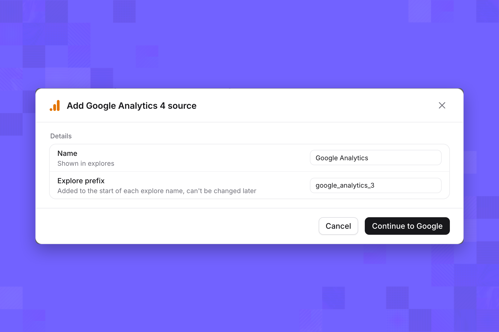

The Google Analytics 4 [live data source](/integrations/live-data-sources) reads one GA4 property through the Google Analytics Data API. Each query is one report request, and Lightdash shows the results as they come back from Google. It's a [level 3](/integrations/live-data-sources#integration-levels) integration: its API runs reports from a fixed menu of dimensions and metrics.

## Before you start

- **Developer or Admin role** in the Lightdash project.
- **A Google account that can read the property**, with at least the Viewer role in Google Analytics.

## Connect Google Analytics 4

1. On the nav bar, click **Browse** → **Semantic Layer**.
2. Click **Add** → **Live data source**.
3. Select **Google Analytics 4**.
4. Under **Details**, check the **Name**. People see the name in Explore and agents use it to refer to the source.
5. Click **Continue to Google**.
6. Sign in with your Google account and allow read-only access to Google Analytics.
7. Back in Lightdash, pick the property the source reads, then click **Connect**.

<Frame>
  
</Frame>

Lightdash reads the property's key events, custom dimensions and custom metrics, and adds a **Report** table to Explore. Queries run with the Google account that signed in. To change it, click **Edit** on the source's **Authentication** card, then **Sign in again**.

## Dimensions

| Dimension | Notes |
| --- | --- |
| Date, Date week, Date month, Date year | In the property's time zone. Weeks are ISO weeks, starting on Monday |
| Country, City | From the user's IP address; rare cities can be grouped into `(other)` |
| Device category, Platform | `desktop`, `mobile`, `tablet`; web, Android or iOS |
| Session source, Session medium, Session campaign, Session default channel group | Where the session came from |
| First user source | Where the user first came from |
| Landing page, Page path | Page path is event-scoped |
| Event name | Such as `page_view`, `purchase` or a custom event |
| New or returning | `new` for a first visit, `returning` otherwise |
| Item name | Item-scoped; only works with item metrics |

## Metrics

| Metric | Notes |
| --- | --- |
| Active users, Total users, New users | Daily values don't add up to a weekly total |
| Sessions, Engaged sessions, Engagement rate, Average session duration (s) | |
| Views, Event count, Key events | Key events counts every event marked as a key event |
| Total revenue, Ecommerce purchases | |
| Item revenue, Items purchased, Items viewed | Item metrics |

The property's custom dimensions and custom metrics, and a metric for each key event, are added too. They start out of use: pick the ones people need in the Semantic Layer. Click **Refresh** at the top of the source's page after you add a key event or custom metric in Google Analytics. See [Dimensions and metrics](/integrations/live-data-sources/set-up-and-manage#dimensions-and-metrics).

## Combination rules

Google Analytics only answers some combinations of dimensions and metrics:

- A query can use at most **9 dimensions** and **10 metrics**.
- **Item name** only works with item metrics: Item revenue, Items purchased and Items viewed. It can't be combined with Sessions, Engaged sessions, Engagement rate, Average session duration, Views, Event count or Key events.
- **Page path** is event-scoped. Splitting sessions or users by page counts a session once for each page it visited.

Lightdash checks these rules before calling Google and tells you which dimension or metric to remove.

## Supported features

| Feature | Available |
| --- | --- |
| Table calculations | No |
| Custom metrics and custom dimensions | No |
| Period-over-period comparisons | No |
| OR filters and nested filter groups | Yes |
| Filters on metrics | Yes |
| Pivots and date zoom | No |

## Limits

| Limit | Value |
| --- | --- |
| Default date range | Last 28 days, when the query has no filter on Date |
| Most rows per query | 24,999 |
| Timeout | 30 seconds |
| Concurrent requests | 5 per source |
| Calls per minute | 60 per source |
| Calls per hour | 1,000 per source |

Google Analytics also applies its own quotas per property.

## Example questions

- *"Which channels brought the most sessions in the last 28 days?"*
- *"Weekly active users by device category since the start of the quarter."*
- *"Top landing pages by engaged sessions last month."*
- *"Which campaigns sent more than 500 sessions last month but no key events?"*

## Troubleshooting

**Google denied access to the property.** Check that the Google account that signed in can still read the property in Google Analytics, or click **Edit** on the source's **Authentication** card, then **Sign in again**.

**Google Analytics could not find the property.** Check that the property still exists in Google Analytics.

**Google Analytics quota exceeded.** The property has used its Google Analytics quota for now. Wait a minute and run the query again.
