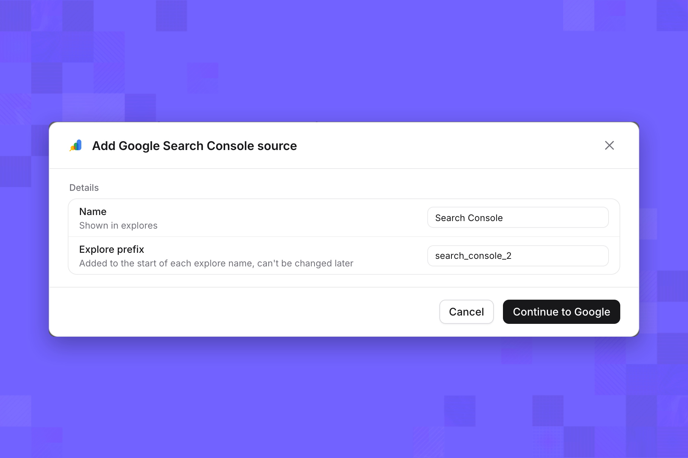

The Google Search Console [live data source](/integrations/live-data-sources) reads Google Search performance for one Search Console site. Each query is one request to the Search Console API. It's a [level 3](/integrations/live-data-sources#integration-levels) integration: its API runs reports from a fixed menu of dimensions and metrics.

## Before you start

- **Developer or Admin role** in the Lightdash project.
- **A Google account with access to the site** in Search Console, as an owner or user.

## Connect Google Search Console

1. On the nav bar, click **Browse** → **Semantic Layer**.
2. Click **Add** → **Live data source**.
3. Select **Google Search Console**.
4. Under **Details**, check the **Name**. People see the name in Explore and agents use it to refer to the source.
5. Click **Continue to Google**.
6. Sign in with your Google account and allow read-only access to Search Console.
7. Back in Lightdash, if the account can read more than one site, pick the site the source reads, then click **Connect**.

<Frame>
  
</Frame>

Lightdash adds a **Search performance** table to Explore. Queries run with the Google account that signed in. To change it, click **Edit** on the source's **Authentication** card, then **Sign in again**.

## Dimensions

| Dimension | Notes |
| --- | --- |
| Date | In Pacific Time |
| Query | What people searched for. Google hides rare queries, so totals split by query are lower than site totals |
| Page | Splitting or filtering by page counts impressions per page, so a result showing two of your pages counts twice |
| Country | Three-letter country code |
| Device | `DESKTOP`, `MOBILE` or `TABLET` |
| Search appearance | The result feature the site appeared with, such as `PRODUCT_SNIPPETS` or `VIDEO`. Google splits by it only on its own, with no other dimension; filters on other dimensions still work |
| Search type | Which Google results the numbers come from: `web`, `image`, `video` or `news`. Filter it with **is** and one value to read that type. Without a filter, queries read `web` |

## Metrics

| Metric | Notes |
| --- | --- |
| Clicks | Clicks from Google Search |
| Impressions | Times a link to the site appeared in results |
| Click-through rate | Clicks divided by impressions |
| Average position | Average top position in results, weighted by impressions |

See [Dimensions and metrics](/integrations/live-data-sources/set-up-and-manage#dimensions-and-metrics) to rename dimensions and metrics, add AI hints or hide them.

## Data freshness

Search Console dates are in Pacific Time, and the last two or three days are incomplete in Search Console itself. Leave them out of comparisons, or expect them to change.

## Supported features

| Feature | Available |
| --- | --- |
| Filters on dimensions: **is**, **is not**, **includes**, **does not include**, **starts with**, **ends with** | Yes, with several values each |
| Sorting | Yes |
| Table calculations | No |
| Custom metrics and custom dimensions | No |
| Period-over-period comparisons | No |
| OR filters and nested filter groups | No |
| Filters on metrics | No |
| Date filter operators | **in the last**, **is between**, **is**, **is after**, **is on or after**, **is before** and **is on or before** only |
| Pivots and date zoom | No |

## Limits

| Limit | Value |
| --- | --- |
| Default date range | Last 28 days, when the query has no filter on Date |
| Oldest data | 16 months back. **is before** filters start from that day, and **is after** filters end today |
| Most rows per query | 24,999 |
| Sorting while grouping by Date | Reads every row, up to 24,999. Above that the query is refused: narrow the date range or filters, remove Date, or get the top pages first and then query those pages by day |
| Timeout | 30 seconds |
| Concurrent requests | 5 per source |
| Calls per minute | 600 per source |
| Calls per hour | 20,000 per source |

## Example questions

- *"Top 20 search queries by clicks last month, with click-through rate."*
- *"Daily clicks and impressions over the last 4 weeks."*
- *"Average position and clicks by device for the blog pages this month."*
