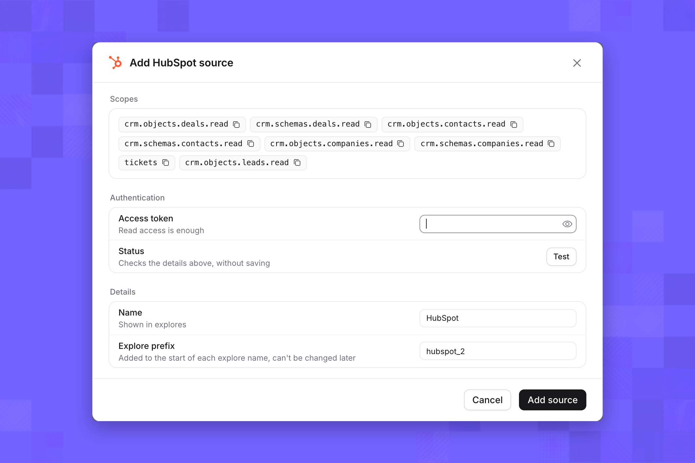

The HubSpot [live data source](/integrations/live-data-sources) reads your HubSpot CRM deals, contacts, companies, tickets and leads, each as its own table. Lightdash turns each query into a HubSpot CRM search and shows the records HubSpot returns. CRM data stays in HubSpot. It's a [level 2](/integrations/live-data-sources#integration-levels) integration: its API filters records and reports a total, but doesn't group.

## Before you start

- **Developer or Admin role** in the Lightdash project.
- **A HubSpot access token** with the read scopes for each object you want to query. In HubSpot, create one of these and copy its token:
  - A private app, under **Settings** → **Integrations** → **Private Apps**.
  - A service key, under **Development** → **Keys**, on accounts that don't offer private apps.

  Give it these scopes:

  | Table | Scopes |
  | --- | --- |
  | Deals | `crm.objects.deals.read`, `crm.schemas.deals.read` |
  | Contacts | `crm.objects.contacts.read`, `crm.schemas.contacts.read` |
  | Companies | `crm.objects.companies.read`, `crm.schemas.companies.read` |
  | Tickets | `tickets` |
  | Leads | `crm.objects.leads.read`. The Leads object needs Sales Hub Professional or Enterprise |

  To add tickets or leads to an existing source, add their scopes to the private app or service key, then click **Refresh** at the top of the source's page.

## Connect HubSpot

1. On the nav bar, click **Browse** → **Semantic Layer**.
2. Click **Add** → **Live data source**.
3. Select **HubSpot**.
4. Enter the **Access token**, then click **Test**. The **Scopes** card lists what the token needs, and you can copy each scope.
5. Under **Details**, check the **Name**. People see the name in Explore and agents use it to refer to the source.
6. Click **Add source**.

<Frame>
  
</Frame>

Lightdash adds **Deals**, **Contacts**, **Companies**, **Tickets**, **Leads** and **Pipeline stages** tables to Explore, grouped under the source's name. A table whose object the token can't read keeps only its built-in fields, and querying it names the missing scope.

## Dimensions and metrics

Each table has these fields:

| Field | Notes |
| --- | --- |
| Record ID | The record's ID in HubSpot |
| Create Date, Last Modified Date | When the record was created and last changed, in UTC |
| One for each property of the object | Read from HubSpot when you add the source, up to 400 per table. Hidden properties and property types Lightdash can't read are skipped. Properties start out of use: pick the ones people need on each table in the Semantic Layer |
| Count (metric) | How many records match the filters, from the total HubSpot reports. It can't be split by a dimension |

To read the properties again after you add one in HubSpot, click **Refresh** at the top of the source's page. A property's field is named after its internal name, so renaming its label in HubSpot doesn't change it.

A dropdown, radio or checkbox property whose option labels differ from its values has two fields: one with HubSpot's name, such as **Deal Stage**, that shows labels like `Closed Won`, and one named **Deal Stage (internal value)** that shows the value HubSpot stores, such as `closedwon`. Filter the label field with labels; Lightdash sends HubSpot the matching values. Labels come from the last field scan, so click **Refresh** after renaming an option in HubSpot.

### Pipeline stages

The **Pipeline stages** table lists every deal and ticket pipeline with its stages, one row per stage, read from HubSpot's pipelines API with the same scopes as deals and tickets. It has the object (Deals or Tickets), the pipeline's ID and label, the stage's ID and label, their order in HubSpot, the deal probability, and whether the stage is closed. Stage IDs match **Deal Stage (internal value)** and **Ticket status (internal value)**, so you can merge stages with deal and ticket rows. You can filter it by **Object** only.

Text properties can be filtered with equals and contains, which matches whole words or part of one word. Number, date, checkbox and dropdown properties can be filtered too.

Date filters work on whole days in UTC and can look ahead, which suits fields like a deal's close date: **in the next 90 days** runs from today, and **in the current month** covers the whole month, including days still to come.

## Supported features

| Feature | Available |
| --- | --- |
| Filters on dimensions, with several values each | Yes |
| OR filters and nested filter groups | No |
| Sorting | One field at a time |
| Filters on metrics | No |
| Table calculations, custom metrics and custom dimensions | No |
| Period-over-period comparisons, pivots and date zoom | No |

## Limits

| Limit | Value |
| --- | --- |
| Most rows per query | 1,000 |
| Filter conditions per query | 6, with a date range counting as two |
| Timeout | 30 seconds per request |
| Concurrent requests | 5 per source |
| Calls per second | 4 per source |
| Calls per hour | 10,000 per source |

When more records match than a query reads, Lightdash shows the first ones in the sort order you picked. Add a filter, or use **Count** to see how many match.

## Example questions

- *"How many deals in the closed won stage closed this quarter?"*
- *"Contacts created in the last 7 days, with their email and lifecycle stage."*
- *"The 50 largest open deals, by amount."*
- *"How many tickets were created this week with high priority?"*
- *"Open deals closing in the next 90 days, by close date."*
- *"List our deal pipelines and their stages, with each stage's probability."*

## Troubleshooting

**HubSpot rejected the access token.** Copy the token from the private app or service key again, or rotate it, and update the source.

**The private app is missing a scope.** Give the private app or service key the read scopes for the table you queried, listed in [Before you start](#before-you-start). Tables whose scopes are granted keep working.

**HubSpot rate limit reached.** HubSpot allows a few searches a second per account. Wait a few seconds and run the query again.

**Count can't be split by a field.** Filter by the field instead, or list records without **Count**.
