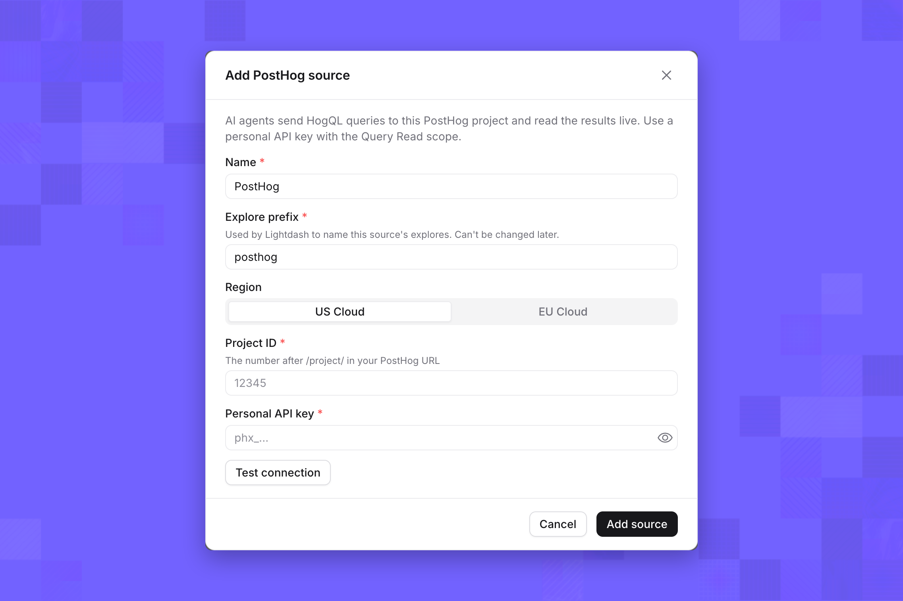

The PostHog [live data source](/integrations/live-data-sources) reads one PostHog project. Lightdash turns each query into a HogQL query, sends it to PostHog, and shows the aggregated results. Event data stays in PostHog. It's a [level 5](/integrations/live-data-sources#integration-levels) integration: its API runs SQL.

## Before you start

- **Live data sources enabled** for your organization. See [Live data sources](/integrations/live-data-sources).
- **Admin role** in the Lightdash project.
- **Your PostHog region**, US Cloud or EU Cloud. Check the address you use for PostHog: `us.posthog.com` or `eu.posthog.com`.
- **One of these PostHog credentials:**
  - An account on the PostHog project, to use **Sign in with PostHog**. This option appears only when your Lightdash instance has a PostHog sign-in app configured.
  - A [personal API key](https://posthog.com/docs/api#private-endpoint-authentication) with the **Query Read** scope, and the project ID: the number after `/project/` in your PostHog URL.

## Connect PostHog

1. On the nav bar, click **Browse** → **Semantic Layer**.
2. In the sidebar, select **Live data sources**, then click **Add**.
3. Select **PostHog**.
4. Enter a **Name**, such as `PostHog`. People see this name in Explore and agents use it to refer to the source.
5. Keep the suggested **Explore prefix**, or enter your own if you connect several PostHog sources. See [Explore prefix](/integrations/live-data-sources#explore-prefix).
6. Choose your **Region**.
7. Connect with one of:
   - **Sign in with PostHog**: sign in, then pick the project. Lightdash asks for query access only.
   - **Personal API key**: enter the **Project ID** and **Personal API key**, then click **Test connection**.
8. Click **Add source**.

<Frame>
  
</Frame>

Lightdash reads the project's event and person properties, and adds an **Events** table to Explore.

## Dimensions

| Dimension | Notes |
| --- | --- |
| Event date, Event week, Event month | Weeks start on Monday |
| Event time | The exact time of the event |
| Event name | Such as `$pageview` or a custom event |
| Distinct ID | The ID the event was captured with |
| Person ID | The person after identify and merges |
| Current URL, Pathname, Referring domain, UTM source, Browser, OS, Device type, Country | Common event properties |

## Metrics

| Metric | Notes |
| --- | --- |
| Events | Events captured |
| Unique users | Distinct people, after identify and merges |
| Unique sessions | Distinct sessions |

Lightdash also adds the event properties and person properties defined in your project as dimensions, up to 2,000. Internal PostHog properties are left out. Use **Refresh fields** on the source's page after you add properties in PostHog, and turn **In use** off for anything people or agents shouldn't query. See [Dimensions and metrics](/integrations/live-data-sources/set-up-and-manage#dimensions-and-metrics).

## Supported features

| Feature | Available |
| --- | --- |
| Table calculations | Yes |
| Custom metrics and custom dimensions | Yes |
| Period-over-period comparisons | Yes |
| OR filters and nested filter groups | Yes |
| Filters on metrics | Yes |
| Pivots and date zoom | No |

## Limits

| Limit | Value |
| --- | --- |
| Default date range | Last 30 days, when the query has no filter on Event date |
| Most rows per query | 49,999 |
| Timeout | 10 seconds |
| Queries at once | 3 per source |
| Calls per minute | 240 per source |
| Calls per hour | 2,400 per source |

Funnels, retention and user paths aren't available from the PostHog source. Ask for events or unique users by event, date or property instead.

## Example questions

- *"Daily unique users who triggered `signed_up` over the last two weeks."*
- *"Top 10 pathnames by pageviews this month."*
- *"Unique sessions by country and device type last week."*

## Troubleshooting

**PostHog rejected the API key.** Check that the region matches your PostHog project: a key from an EU project is rejected by US Cloud, and a key from a US project is rejected by EU Cloud. Then check that the key has the **Query Read** scope and access to the project ID you entered.

**A property is missing.** Click **Refresh fields** on the source's page, then check that the property's dimension is **In use**. Property names must start with a letter, `_` or `$`, and contain only letters, numbers, `_` and `$`.
