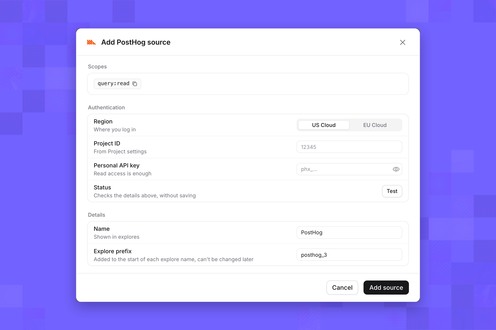

The PostHog [live data source](/integrations/live-data-sources) reads one PostHog project. Lightdash turns each query into a HogQL query, sends it to PostHog, and shows the aggregated results. Event data stays in PostHog. It's a [level 5](/integrations/live-data-sources#integration-levels) integration: its API runs SQL.

## Before you start

- **Developer or Admin role** in the Lightdash project.
- **Your PostHog region**, US Cloud or EU Cloud. Check the address you use for PostHog: `us.posthog.com` or `eu.posthog.com`.
- **One of these PostHog credentials:**
  - An account on the PostHog project, to use **Sign in with PostHog**. This option appears only when your Lightdash instance has a PostHog sign-in app configured.
  - A [personal API key](https://posthog.com/docs/api#private-endpoint-authentication) with the **Query Read** scope, and the project ID: the number after `/project/` in your PostHog URL.

## Connect PostHog

1. On the nav bar, click **Browse** → **Semantic Layer**.
2. Click **Add** → **Live data source**.
3. Select **PostHog**.
4. Under **Connect with**, choose **Sign in** or **API key**, then choose your **Region**.
5. If you chose **API key**, enter the **Project ID** and **Personal API key**, then click **Test**. The **Scopes** card lists the scope the key needs.
6. Under **Details**, check the **Name**. People see the name in Explore and agents use it to refer to the source.
7. Click **Continue to PostHog** and pick the project, or click **Add source** if you used a key.

<Frame>
  
</Frame>

Lightdash reads the project's event and person properties, and adds an **Events** table to Explore.

## Dimensions

| Dimension | Notes |
| --- | --- |
| Event date, Event week, Event month | Weeks start on Monday |
| Event time | The exact time of the event |
| Event name | Such as `$pageview` or a custom event |
| Distinct ID | The ID the event was captured with |
| Person ID | The person after identify and merges |
| Current URL, Path, Referring domain, UTM source, Browser, Operating system, Device type, Country code | Common event properties. Country code is the two-letter code from the IP address |

## Metrics

| Metric | Notes |
| --- | --- |
| Events | Events captured |
| Unique users | Distinct people, after identify and merges |
| Unique sessions | Distinct sessions. Events without a session ID aren't counted |

Lightdash also adds the event properties and person properties defined in your project as dimensions, up to 2,000 of each. Person property dimensions start with **Person**, such as **Person email**. PostHog's own properties, whose names start with `$`, and ad click IDs such as `gclid` are left out. Properties start out of use: pick the ones people need in the Semantic Layer. Click **Refresh** at the top of the source's page after you add properties in PostHog. See [Dimensions and metrics](/integrations/live-data-sources/set-up-and-manage#dimensions-and-metrics).

## Supported features

| Feature | Available |
| --- | --- |
| Table calculations | Yes |
| Custom metrics and custom dimensions | Yes |
| Period-over-period comparisons | Yes |
| OR filters and nested filter groups | Yes |
| Filters on metrics | Yes |
| Pivots and date zoom | No |

## Limits

| Limit | Value |
| --- | --- |
| Default date range | Last 30 days, when the query has no filter on Event date |
| Most rows per query | 49,999 |
| Timeout | 10 seconds of running time in PostHog, after up to 30 seconds in its queue |
| Concurrent requests | 3 per source |
| Calls per minute | 240 per source |
| Calls per hour | 2,400 per source |

## Example questions

- *"Daily unique users who triggered `signed_up` over the last two weeks."*
- *"Top 10 pathnames by pageviews this month."*
- *"Unique sessions by country code and device type last week."*
- *"How many unique users triggered `export_clicked` between 3 March and 19 April?"*

## Troubleshooting

**PostHog rejected the API key.** Check that the region matches your PostHog project: a key from an EU project is rejected by US Cloud, and a key from a US project is rejected by EU Cloud. Then check that the key has the **Query Read** scope and access to the project ID you entered.

**PostHog project was not found in the connection's region.** Check the **Project ID** and the **Region**.

**PostHog query budget exceeded.** The source made too many calls to PostHog. Wait for the time the message gives, or a minute, and run the query again.

**PostHog stopped the query after 10 seconds.** Narrow the date range, or group by fewer or coarser dimensions.

**A property is missing.** Click **Refresh** at the top of the source's page, then check that the property's dimension is **In use**. Property names must start with a letter, `_` or `$`, contain only letters, numbers, `_` and `$`, and be at most 100 characters long.
