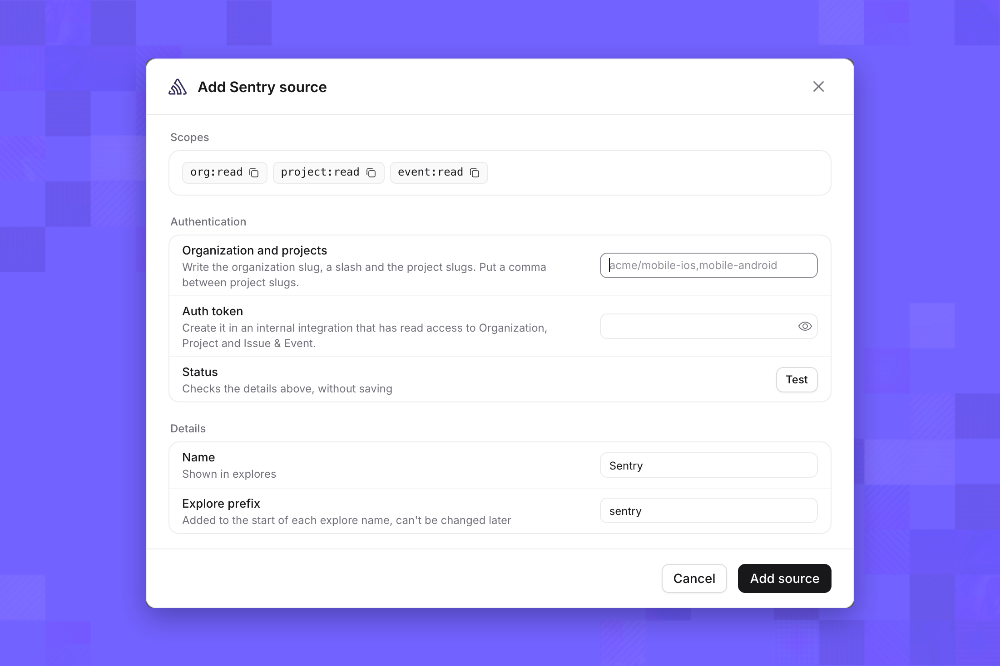

The Sentry [live data source](/integrations/live-data-sources) reads the errors, issues and release health of up to 20 projects in one Sentry organization. Lightdash turns each query into a call to Sentry's events, issues or sessions API, and Sentry groups and counts the results itself. Error data stays in Sentry. It's a [level 3](/integrations/live-data-sources#integration-levels) integration: its API runs reports from a fixed menu of dimensions and metrics.

## Before you start

- **Developer or Admin role** in the Lightdash project.
- **A Sentry auth token** from an internal integration. In Sentry, create an internal integration under **Settings** → **Developer Settings**, give it **Read** access to **Organization**, **Project** and **Issue & Event**, and copy its token. The **Scopes** card in Lightdash lists the matching scopes: `org:read`, `project:read` and `event:read`.
- **The slugs** of the organization and of each project you want to query, as they appear in Sentry URLs, such as `acme` and `mobile-ios`.

## Connect Sentry

1. On the nav bar, click **Browse** → **Semantic Layer**.
2. Click **Add** → **Live data source**.
3. Select **Sentry**.
4. In **Organization and projects**, enter the organization slug, a slash and the project slugs, separated by commas, such as `acme/mobile-ios,mobile-android`. You can name up to 20 projects.
5. Enter the **Auth token**, then click **Test**. The test shows the projects and how many error events they had in the last 24 hours.
6. Under **Details**, check the **Name**. People see the name in Explore and agents use it to refer to the source.
7. Click **Add source**.

<Frame>
  
</Frame>

Lightdash adds **Errors**, **Issues** and **Sessions** tables to Explore, grouped under the source's name. The auth token can read every project in the organization, but the source reads only the projects you named, and a query that filters on another project is refused.

## Dimensions and metrics

All dates are whole days in UTC. Sentry keeps events and sessions for 90 days, so queries can't look back further.

### Errors

Error and crash events, grouped and counted by Sentry. Without a **Date** filter, a query reads the last 30 days.

| Field | Notes |
| --- | --- |
| Date | The day of the events |
| Project | The project's slug. Filter it with **is** only |
| Release | The release that sent the events, often the app version |
| Environment | Such as `production`. Filter it with **is** only |
| Level | `fatal`, `error`, `warning`, `info` or `debug` |
| Issue | The issue's short ID, such as `MOBILE-1A` |
| Title | Usually the error type and message. Filter it with **includes** or **does not include** |
| Error type | The type of the error or exception, such as `EXC_BAD_ACCESS` |
| Unhandled | Whether the app failed to handle the error. A crash is an unhandled error |
| Platform | Such as `cocoa`, `java` or `javascript` |
| Operating system, Device family | Such as `iOS` and `Android`, or `iOS` and `Pixel` |
| Events (metric) | The number of error events |
| Issues (metric) | Distinct issues the events belong to |
| Users affected (metric) | Distinct users who had one or more of the events |

**Issues** and **Users affected** are distinct counts, so they don't add up across rows. No field holds a user's identity.

### Issues

One row per issue with events in the last 90 days. The table has no metrics: to count issues by release, project or day, use **Errors**.

| Field | Notes |
| --- | --- |
| Issue | The issue's short ID |
| Title | Filter it with **includes** or **does not include**, one value per filter |
| Level | `fatal`, `error`, `warning`, `info` or `debug` |
| Status | `unresolved`, `resolved` or `ignored`. Sentry shows an ignored issue as archived |
| Substatus | Why the issue has its status, such as `new`, `ongoing`, `escalating` or `regressed`. Not filterable |
| Priority | `high`, `medium` or `low` |
| Project | The project's slug. Filter it with **is** only |
| Environment, Release | Filters only: they keep the issues with events in that environment or release, and are empty when selected |
| Platform | Not filterable |
| Category | Such as `error`, `performance` or `feedback` |
| Unhandled | Whether the issue has an error the app failed to handle |
| First seen, Last seen | The days of the issue's first and latest events. Filter each one once, as a single range |
| Events, Users | Totals for the last 90 days. Not filterable |
| URL | The link to the issue in Sentry |

The assignee, the people who saw or commented on an issue, and the culprit aren't read.

### Sessions

Release health, totaled by Sentry. Without a **Date** filter, a query reads the last 30 days. Only projects whose apps report sessions have data, and a day or group with no sessions has no row.

| Field | Notes |
| --- | --- |
| Date | The day of the sessions |
| Project | The project's slug. Filter it with **is** only |
| Release | The release the sessions ran on |
| Environment | Filter it with **is** only |
| Session status | How the sessions ended: `healthy`, `errored`, `crashed` or `abnormal`. Not filterable |
| Sessions (metric) | The number of sessions |
| Users (metric) | Distinct users with one or more sessions |
| Crash-free sessions (metric) | The share of sessions that didn't end in a crash |
| Crash-free users (metric) | The share of users who had no crash |

**Users** and the crash-free rates don't add up across rows, so select them at the grain you need, such as by **Release**. **Session status** can't be selected with a crash-free rate, or with **Release**, **Project** or **Environment**: filter those fields instead.

Date filters support **in the last**, **in the current**, **is between**, **is**, **is before**, **is after**, **is on or before** and **is on or after**. A filter open at one end runs to today or to the first day Sentry keeps.

## Supported features

| Feature | Available |
| --- | --- |
| Filters on dimensions, with several values each | Yes, except **Title** on **Issues** |
| OR filters and nested filter groups | No |
| Sorting | Yes. Sentry sorts **Errors** by one field, other than **Issue** and **Error type**, and **Issues** by **Last seen**, **First seen**, **Events** or **Users**, descending. Lightdash sorts other queries after reading the rows |
| Filters on metrics | No |
| Table calculations, custom metrics and custom dimensions | No |
| Period-over-period comparisons, pivots and date zoom | No |

## Limits

| Limit | Value |
| --- | --- |
| Projects per source | 20 |
| Most rows per query | 999 |
| Lookback | 90 days |
| Calls per query | 30, up to 10 pages of 100 rows plus one per project when **Sessions** is split by project |
| Timeout | 30 seconds per request |
| Concurrent requests | 3 per source |
| Calls per minute | 100 per source |
| Calls per hour | 2,000 per source |

A query that would return more than 999 rows is refused rather than cut short. Narrow the date range, add a filter or remove a dimension. A query with a smaller row limit shows the first rows in the sort order.

## Example questions

- *"How many issues and error events did each release of our mobile app have in the last 30 days?"*
- *"What's the crash-free session rate and crash-free user rate of each release?"*
- *"How have error events changed day by day over the last two weeks, by project and level?"*
- *"Which unresolved issues affected the most users this month, and when was each first seen?"*
- *"Which new issues were first seen in the latest release?"*
- *"How many sessions and users did each release have each day?"*
- *"Which operating systems and device families have the most crashes?"*

## Troubleshooting

**Sentry rejected the auth token.** Create a new token in the internal integration and update the source.

**The Sentry auth token can't read this.** Check the project slugs, and give the internal integration **Read** access to **Organization**, **Project** and **Issue & Event**.

**Sentry can't find the organization or one of its projects.** Check the slugs, and that the token belongs to that organization.

**This Sentry source reads only these projects.** The query filtered on a project the source doesn't name. Filter on one of the projects the message lists, or use a source that names the project.

**Sentry refused the call because of its rate limit.** Sentry limits each endpoint for each caller. Wait the time the message gives and run the query again.

**Sentry can't read sessions over this many days.** Narrow the date range on **Sessions**.
