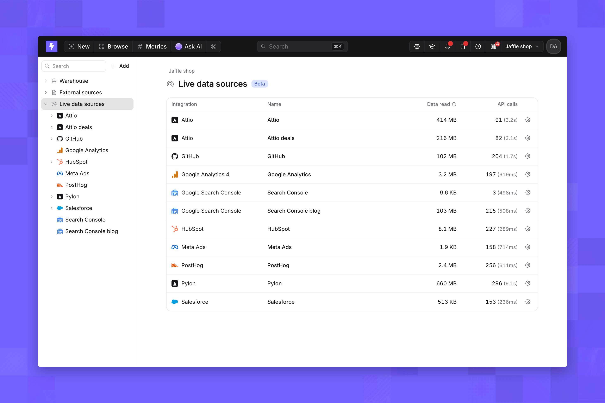
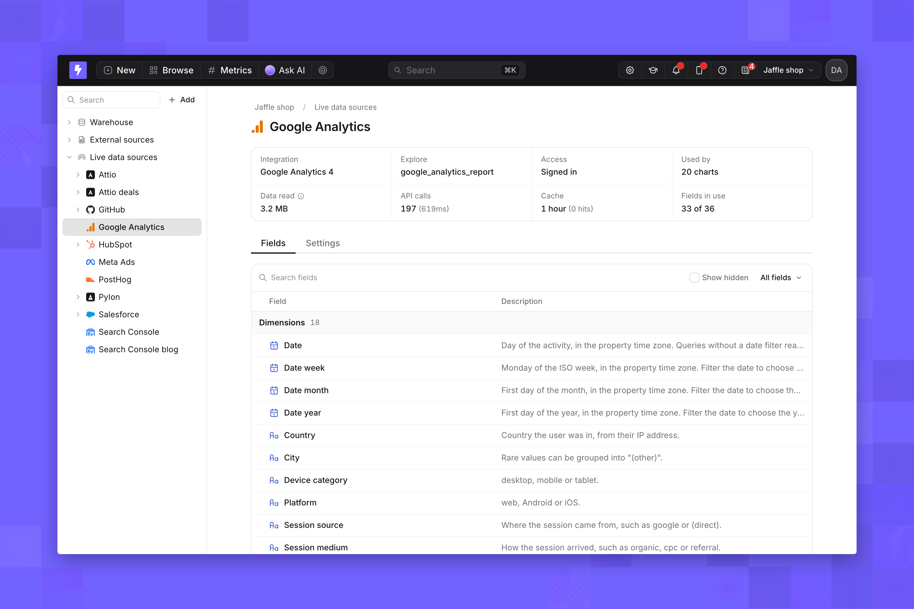
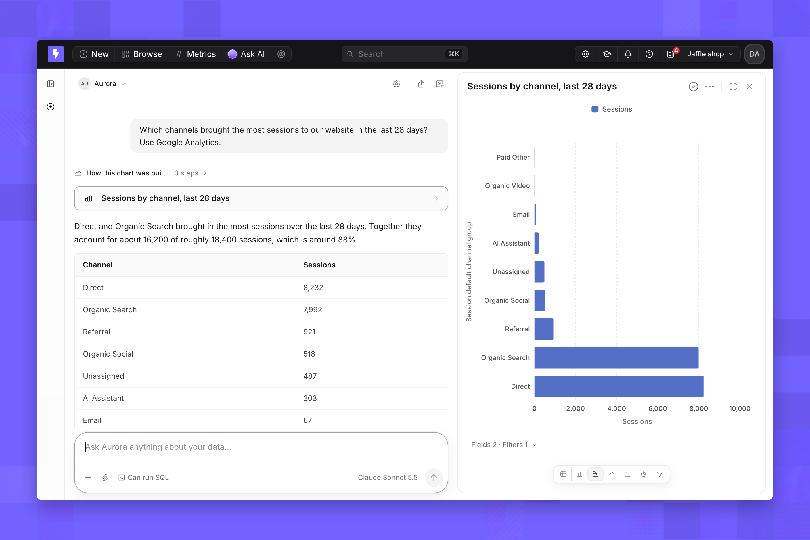
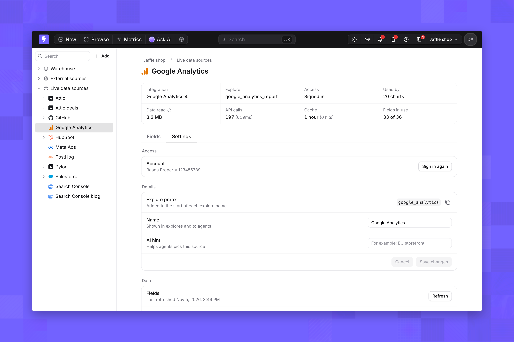

These steps are the same for every integration; each integration's page has its own sign-in details, dimensions, metrics and limits.

## Connect a live data source

Project admins can add live data sources. You also need access to the tool itself; each integration page lists what it needs.

1. On the nav bar, click **Browse** → **Semantic Layer**.
2. In the sidebar, select **Live data sources**, then click **Add**.
3. In the **Add a live data source** dialog, select an integration, then follow the steps on its integration page.
4. Under **Details**, check the **Name** and **Explore prefix**. The prefix is filled in from the name and can't be changed after the source is added.

<Frame>
  
</Frame>

When the source is added, Lightdash reads its dimensions and metrics, and the source appears under **Live data sources** and as a table in Explore with a **Live** badge.

<Frame>
  
</Frame>

You can connect several sources from the same integration, such as one for each account. Give each a clear name, because people and agents use the name to choose a source. Give each its own [explore prefix](/integrations/live-data-sources#explore-prefix) too, because charts refer to the source by it.

## Dimensions and metrics

Each source starts with the dimensions and metrics its integration offers, plus the ones Lightdash reads from your account, such as custom properties or events. Each integration page lists them. Select a source under **Live data sources** and open the **Fields** tab to see them. Turn on **Show hidden** to include the ones that aren't in use. Only dimensions and metrics marked **In use** appear in Explore and to AI agents.

<Frame>
  
</Frame>

Click a dimension or metric to change its **Label**, **Description**, **AI hint** and **Group**, or turn **In use** off. Click **Save** to apply. To read them from the integration again after you add properties or events in the tool, click **Refresh** next to **Fields** on the **Settings** tab. You can't add dimensions or metrics of your own, or manage them as code.

<Frame>
  
</Frame>

## Explore a live data source

In Explore, open the source's table, which has a **Live** badge. Pick metrics and dimensions, and run the query. Each run is one call to the integration.

<Frame>
  
</Frame>

Save the result as a chart to add it to a dashboard or a scheduled delivery.

## Ask an AI agent about a live data source

Every agent in the project can query live data sources, whatever tags it's limited to. Ask in plain language; the agent picks the dimensions and metrics, adds a date filter for the period you mention and builds a chart. Name the tool in your question when the project has more than one source that could answer it.

<Frame>
  
</Frame>

If a question needs something a source can't do, such as a funnel, the agent says so instead of approximating it.

## Manage a live data source

Select a source under **Live data sources**, or click its settings icon in the list, and open the **Settings** tab.

- **Access** shows the account the source reads. Click **Sign in again** to reconnect it with your account, or replace its token or key.
- **Details** shows the **Explore prefix**, which can't be changed. Edit the **Name** and **AI hint**, which helps agents pick this source, then click **Save changes**.
- **AI agents** has **Tags**. An [AI agent limited to tags](/agents/data-access#limiting-which-integrations-an-agent-can-use) can use the source only when they share a tag.
- **Data** has **Refresh**, which reads the source's dimensions and metrics again. **Cache** sets how long the source reuses a result for the same query from anyone, from **Always fetch** to 24 hours. **Clear cache** makes the next query, from anyone, call the integration for fresh data. A warning shows when the project's results caching is off, because the source then doesn't cache at all.
- **Danger zone** has **Delete**, which removes the source and its table. Charts that use it stop working.

<Frame>
  
</Frame>
