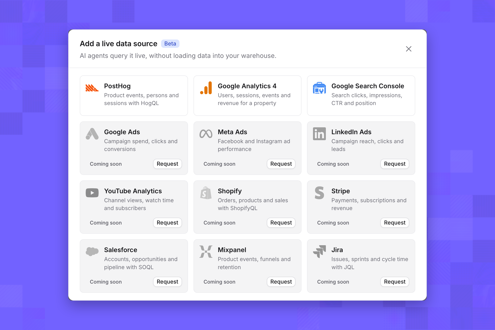
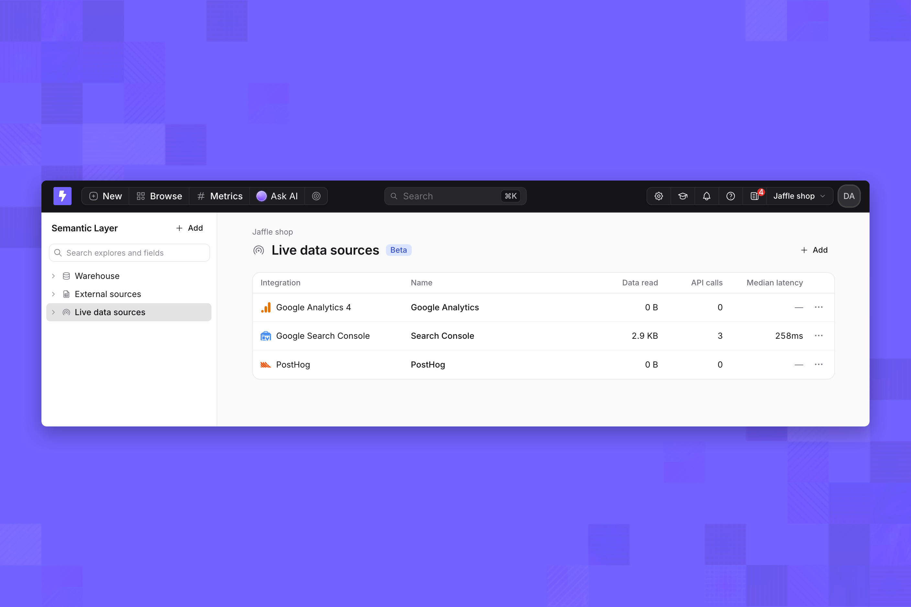
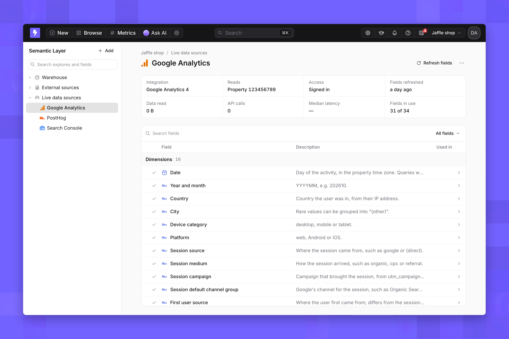
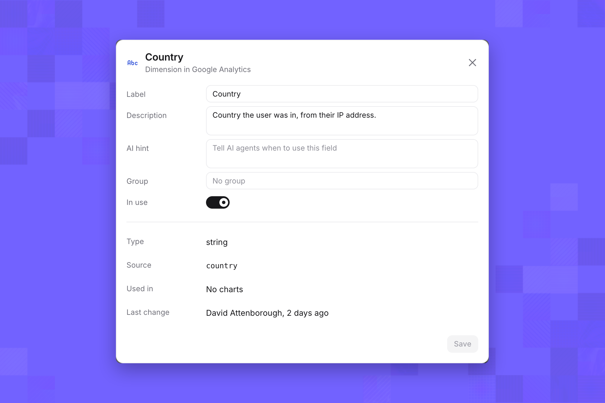
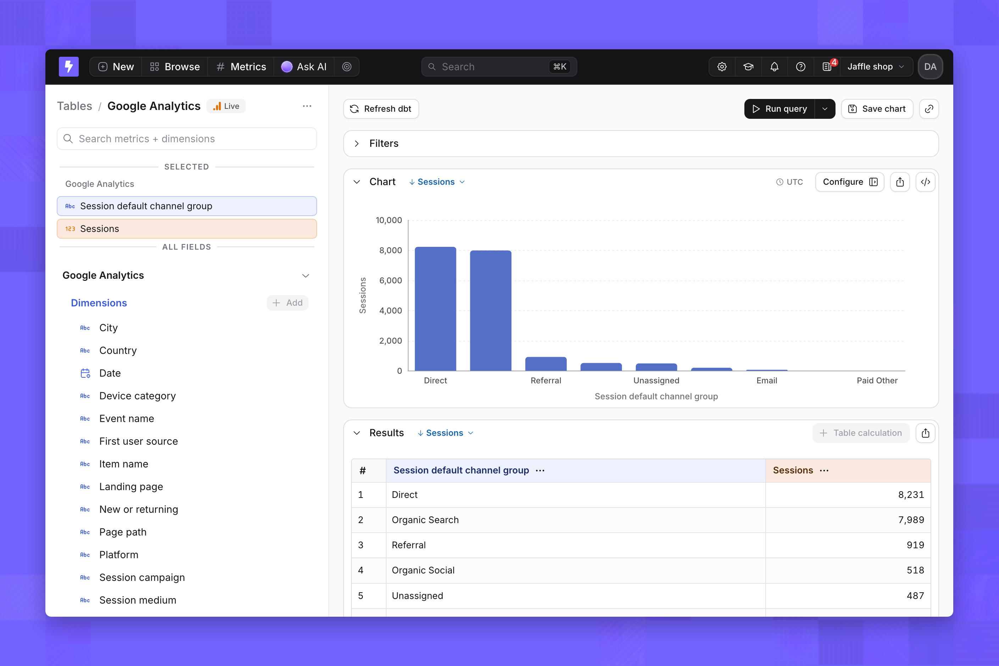
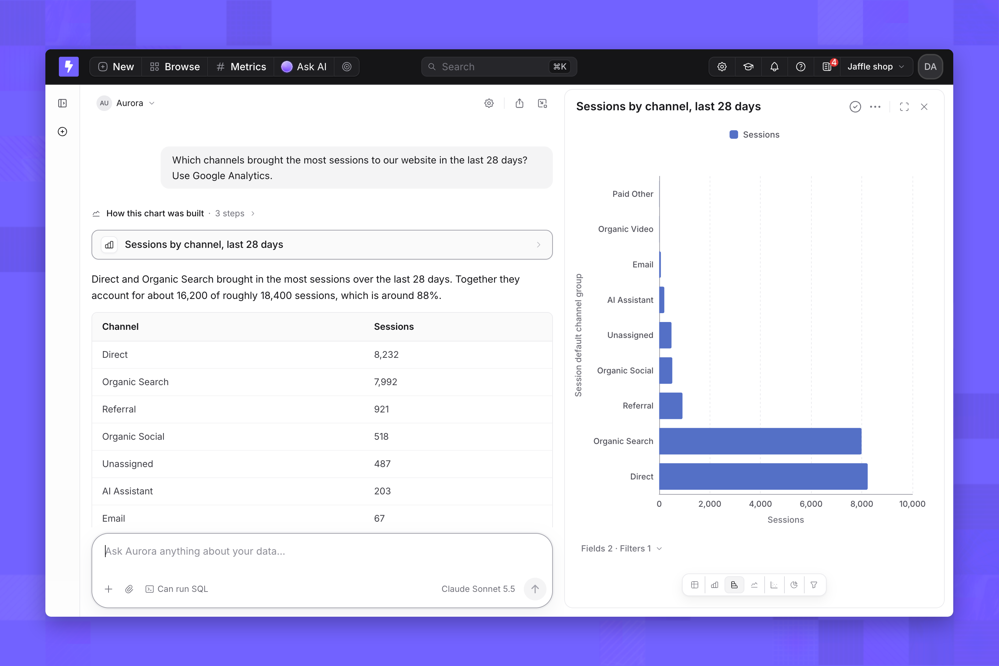
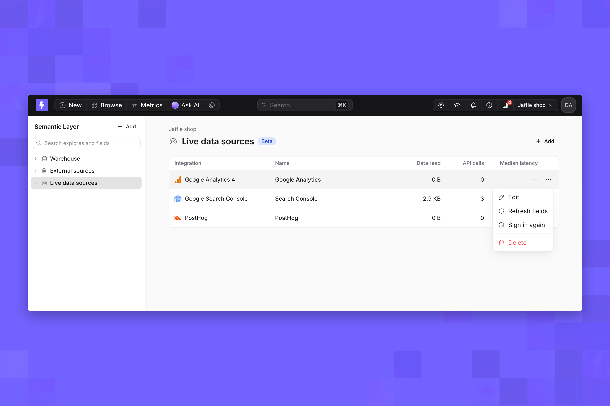

Live data sources must be [enabled for your organization](/integrations/live-data-sources). These steps are the same for every integration; each integration's page has its own sign-in details, dimensions, metrics and limits.

## Connect a live data source

Project admins can add live data sources. You also need access to the tool itself; each integration page lists what it needs.

1. On the nav bar, click **Browse** → **Semantic Layer**.
2. In the sidebar, select **Live data sources**, then click **Add**.
3. In the **Add a live data source** dialog, select an integration, then follow the steps on its integration page.

<Frame>
  
</Frame>

When the source is added, Lightdash reads its dimensions and metrics, and the source appears under **Live data sources** and as a table in Explore with a **Live** badge.

<Frame>
  
</Frame>

You can connect several sources from the same integration, such as one for each account. Give each a clear name, because people and agents use the name to choose a source.

## Dimensions and metrics

Each source starts with the dimensions and metrics its integration offers, plus the ones Lightdash reads from your account, such as custom properties or events. Each integration page lists them. Select a source under **Live data sources** to see them. Only dimensions and metrics marked **In use** appear in Explore and to AI agents.

<Frame>
  
</Frame>

Click a dimension or metric to change its **Label**, **Description**, **AI hint** and **Group**, or turn **In use** off. Click **Save** to apply. Click **Refresh fields** to read them from the integration again after you add properties or events in the tool. You can't add dimensions or metrics of your own, or manage them as code.

<Frame>
  
</Frame>

## Explore a live data source

In Explore, open the source's table, which has a **Live** badge. Pick metrics and dimensions, and run the query. Each run is one call to the integration.

<Frame>
  
</Frame>

Save the result as a chart to add it to a dashboard or a scheduled delivery.

## Ask an AI agent about a live data source

Every agent in the project can query live data sources, whatever tags it's limited to. Ask in plain language; the agent picks the dimensions and metrics, adds a date filter for the period you mention and builds a chart. Name the tool in your question when the project has more than one source that could answer it.

<Frame>
  
</Frame>

If a question needs something a source can't do, such as a funnel, the agent says so instead of approximating it.

## Manage a live data source

Open a source's menu from the **Live data sources** list or its page. **Edit** renames it, **Refresh fields** reads its dimensions and metrics again, **Sign in again** reconnects it with your account, and **Delete** removes it and its table.

<Frame>
  
</Frame>
