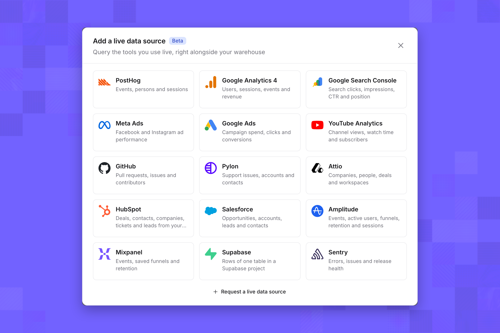
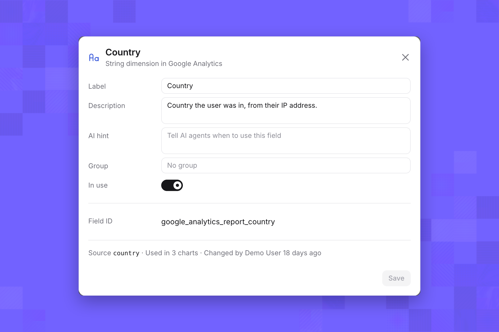
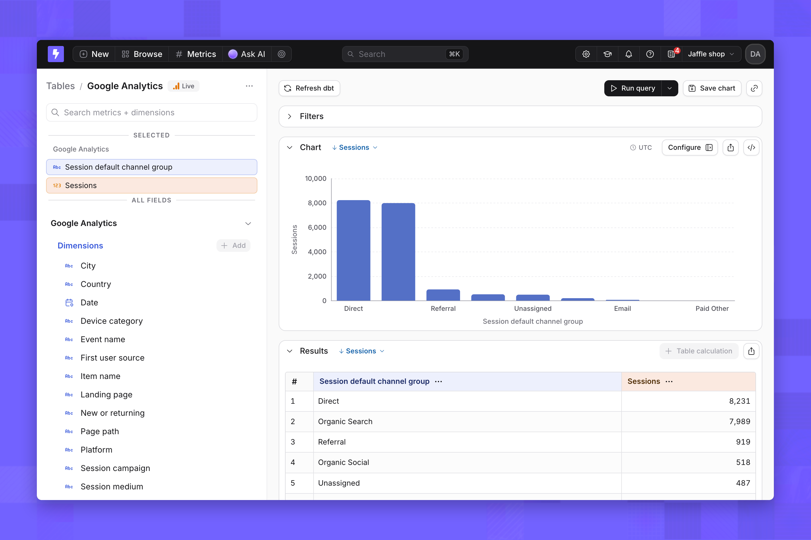

These steps are the same for every integration; each integration's page has its own sign-in details, dimensions, metrics and limits.

## Connect a live data source

Adding, editing and listing live data sources needs the **Developer or Admin role** in the project. In a custom role, that's the `manage:LiveSource` scope. You also need access to the tool itself; each integration page lists what it needs.

1. On the nav bar, click **Browse** → **Semantic Layer**.
2. Click **Add** → **Live data source**.
3. In the **Add a live data source** dialog, select an integration, then follow the steps on its integration page.
4. Under **Details**, check the **Name**. People see it in Explore, and agents use it to pick a source.

<Frame>
  
</Frame>

The dialog lists the integrations turned on for your organization. When the source is added, Lightdash reads its dimensions and metrics and opens the source's page. Its explores appear in Explore with a **Live** badge, in a folder named after the source.

<Frame>
  
</Frame>

You can connect several sources from the same integration, such as one for each account. Give each a clear name, because people and agents use the name to choose a source.

### Without the Developer or Admin role

Anyone who can open the **Semantic Layer** page can still click **Add** → **Live data source**. The dialog shows the integrations greyed out, with the notice **You can't add live data sources in this project** and "Ask a project admin to add one for you".

### Request an integration

To ask for a tool that isn't listed, click **Request a live data source** at the bottom of the **Add a live data source** dialog, enter the tool's name and click **Request**. You don't need the Developer or Admin role to request one.

## Dimensions and metrics

Each source starts with the dimensions and metrics its integration offers, plus the ones Lightdash reads from your account, such as custom properties or events. Each integration page lists them. To see them, open the source's page and select an explore on its **Explores** card. Only dimensions and metrics marked **In use** appear in Explore and to AI agents; the others show dimmed to people who manage the source.

Click a dimension or metric to change its label, description, **AI hint** and **Group**, or turn **In use** off. Click **Save** to apply. If charts use a field you turn off, Lightdash lists them and asks first. To read the fields from the integration again after you add properties or events in the tool, click **Refresh** at the top of the source's page. You can't add dimensions or metrics of your own, or manage them as code.

<Frame>
  
</Frame>

### Switch explores on and off

An integration with several explores, such as GitHub's **Pull requests**, **Issues** and **Contributors**, lets you choose which ones people and agents can use. On the source's **Explores** card, click **Edit**, switch explores on or off, and click **Save**. To rename one, or change its description or AI hint, open the explore and click **Edit**.

Switching off an explore that charts use lists those charts and their dashboards first. Until you switch it back on, those charts say the explore is switched off instead of showing results, and agents stop using it.

## Explore a live data source

In Explore, open the source's explore, which has a **Live** badge. Pick metrics and dimensions, and run the query. Each run is one call to the integration.

<Frame>
  
</Frame>

Save the result as a chart to add it to a dashboard or a scheduled delivery.

## Ask an AI agent about a live data source

Ask in plain language; the agent picks the dimensions and metrics, adds a date filter for the period you mention and builds a chart. Name the tool in your question when the project has more than one source that could answer it. An agent [limited to tags](/agents/data-access#limiting-which-integrations-an-agent-can-use) uses a source only when they share a tag.

<Frame>
  
</Frame>

If a question needs something a source can't do, the agent says so instead of approximating it.

## Manage a live data source

On the **Semantic Layer** page, select the source under **Live data sources**. Its page shows a summary, then one card per setting. Click **Edit** on a card to change it.

| Card | What it holds |
| --- | --- |
| **Explores** | The source's explores and whether each is in use. See [Switch explores on and off](#switch-explores-on-and-off) |
| **Details** | The **Name**, an **AI hint** that helps agents pick this source, and **Tags** for [agents limited to tags](/agents/data-access#limiting-which-integrations-an-agent-can-use) |
| **Usage** | Charts that use the source, data read, API calls and median latency over the query history retention window, 32 days by default |
| **Caching** | How long the source reuses results, its hit rate, and **Clear**. See [Caching](/integrations/live-data-sources#caching) |
| **Rate limits** | Each limit's use and reset time. **Edit** lowers them. See [Rate limits](/integrations/live-data-sources#rate-limits) |
| **Access** | Who can query the source. See [Limit who can query a source](/integrations/live-data-sources#limit-who-can-query-a-source) |
| **Authentication** | The account or key the source reads. **Test** checks it; in edit mode, **Sign in again** or enter a new token or key |
| **Danger zone** | **Delete**, which removes the source and its explores. Charts that use it stop working |

Click **Refresh** at the top of the page to read the source's dimensions and metrics again.

<Frame>
  
</Frame>

### Reattach a deleted source

When you add a source and a deleted source of the same integration had a name or saved charts, Lightdash offers to bring it back. In the **Bring back a deleted source?** dialog, pick the **Deleted source** and click **Reattach**. Its charts work again, and its field and explore edits come back. Its AI hint, access rule and tags come back where the new source has none. If the deleted source read a different account, its charts show the new source's data.

Reattach before you save charts on the new source; a source that already has charts can't take a deleted one's place.
