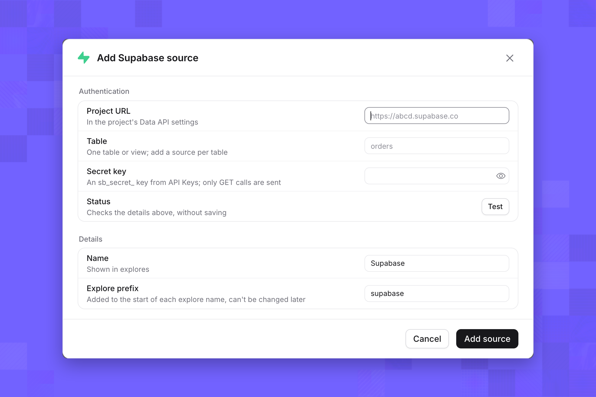

The Supabase [live data source](/integrations/live-data-sources) reads one table or view in a Supabase project. Lightdash turns each query into a read through the project's Data API, and Supabase applies the filters, sorts and row limit. Data stays in Supabase. It's a [level 2](/integrations/live-data-sources#integration-levels) integration: its API filters records, without totals.

## Before you start

- **Developer or Admin role** in the Lightdash project.
- **The project URL**, such as `https://abcd.supabase.co`, from the project's Data API settings. Custom domains and self-hosted Supabase work too, over HTTPS.
- **A secret key** that starts with `sb_secret_`, from the project's **API Keys** settings. Publishable keys can't read the table's columns, and legacy JWT keys return no rows. A secret key bypasses row level security, so the source reads every row of the table.
- **The table or view's name**, in a schema the project's Data API settings expose. Each source reads one table: add a source for each table you want to query.

## Connect Supabase

1. On the nav bar, click **Browse** → **Semantic Layer**.
2. Click **Add** → **Live data source**.
3. Select **Supabase**.
4. Enter the **Project URL**. You can also paste the URL ending in `/rest/v1` or the bare project ref.
5. Enter the **Table** and the **Secret key**, then click **Test**. The test reads one row of the table.
6. Under **Details**, check the **Name**. People see the name in Explore and agents use it to refer to the source.
7. Click **Add source**.

<Frame>
  
</Frame>

Lightdash adds a **Table** table to Explore, grouped under the source's name. Lightdash only sends `GET` requests, so the source can't change data in Supabase.

## Dimensions and metrics

The table has one dimension for each column, read from the Data API when you add the source, up to 200 columns. A column's label comes from its name, so `created_at` reads as **Created at**, and its description comes from the column's comment. A new source starts with every column in use. To read the columns again after you change the table, click **Refresh** at the top of the source's page.

The table has no metrics. Questions that count, sum or average rows, such as signups per day or revenue by month, don't work live.

Which filters a column takes depends on its type. Text matching is case-insensitive, and dates and timestamps are compared in UTC.

| Column type | Filters |
| --- | --- |
| Text | **is**, **is not**, **includes**, **does not include**, **starts with**, **ends with**, **is null**, **is not null** |
| Number | **is**, **is not**, **is greater than**, **is less than** (or equal), **is null**, **is not null** |
| Boolean | **is**, **is null**, **is not null** |
| Date | **is**, **is not**, **is before**, **is after** (or on), **is between**, **is null**, **is not null** |
| Timestamp | **is before**, **is after** (or on), **is between**, **is null**, **is not null** |
| JSON and arrays | **is null**, **is not null**. Values show as text |

## Supported features

| Feature | Available |
| --- | --- |
| Filters on dimensions, with several values each | Yes |
| OR filters and nested filter groups | No |
| Sorting | Yes, by several fields |
| Metrics and filters on metrics | No |
| Table calculations, custom metrics and custom dimensions | No |
| Period-over-period comparisons, pivots and date zoom | No |

## Limits

| Limit | Value |
| --- | --- |
| Columns per table | 200 |
| Most rows per query | 4,999, read 1,000 at a time |
| Timeout | 30 seconds per request |
| Concurrent requests | 3 per source |
| Calls per minute | 120 per source |

Supabase publishes no Data API rate limit, but each read uses the project's database compute. When more rows match than a query reads, Lightdash shows the first ones in the sort order you picked, so filter large tables.

## Example questions

- *"Which records were created in the last 7 days, newest first?"*
- *"Show the 50 most recent orders with their status and amount."*
- *"Which customers have a status of churned or paused?"*
- *"Which users have never logged in?"*
- *"Show orders over 1,000 placed between two dates."*
- *"Which subscriptions renew in the next 14 days?"*

## Troubleshooting

**Supabase rejected the API key.** Use a secret key that starts with `sb_secret_`, from the project's **API Keys** settings, and update the source.

**Supabase has no table or view with this name in the exposed schema.** Check the table name, and that its schema is exposed in the project's Data API settings. The message lists tables the key can see.

**Supabase couldn't read the table.** Check the filter values, such as a date or number filter on text.

**Supabase is limiting requests.** Wait the time the message gives and run the query again.
