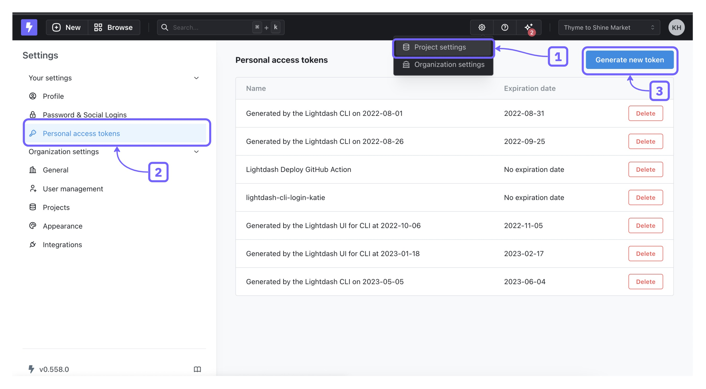

You can create a personal access token (PAT) to authenticate in the [CLI](/workflow/cli/authenticate) or with the API.

## Creating a personal access token

To create a personal access token, head to the project settings, then to `personal access tokens`, then click `generate token`.

<Frame>
  
</Frame>

## Token ownership

A personal access token uses its creator's permissions and stops working if that user is removed from the organization. You can only create tokens for yourself: the API creates them for the signed-in user (`POST /api/v1/user/me/personal-access-tokens`), and no endpoint creates a token for another user. For CI/CD, use a dedicated identity; see [Set up secrets and credentials](/workflow/set-up-ci-cd#set-up-secrets-and-credentials).

## Token policies

Self-hosted admins can disable personal access tokens, limit which organization roles can use them, and cap their lifetime with the [personal access token environment variables](/self-host/customize-deployment/environment-variables#personal-access-tokens). For token lifetime on Cloud, the lack of an organization-wide token list, and tracing token queries in your warehouse, see [Access governance](/workspace-admin/instance-health#access-governance).

The `manage:PersonalAccessToken` scope in a [custom role](/workspace-admin/custom-roles) is an organization-level scope: add it to an organization custom role, because adding it to a project role doesn't grant it. On self-hosted, `DISABLE_PAT=true`, or an organization role that isn't in `PAT_ALLOWED_ORG_ROLES` (default: all roles), turns token access off, and the scope can't override either. A user whose role has the scope still can't create a token when the deployment policy excludes them.
