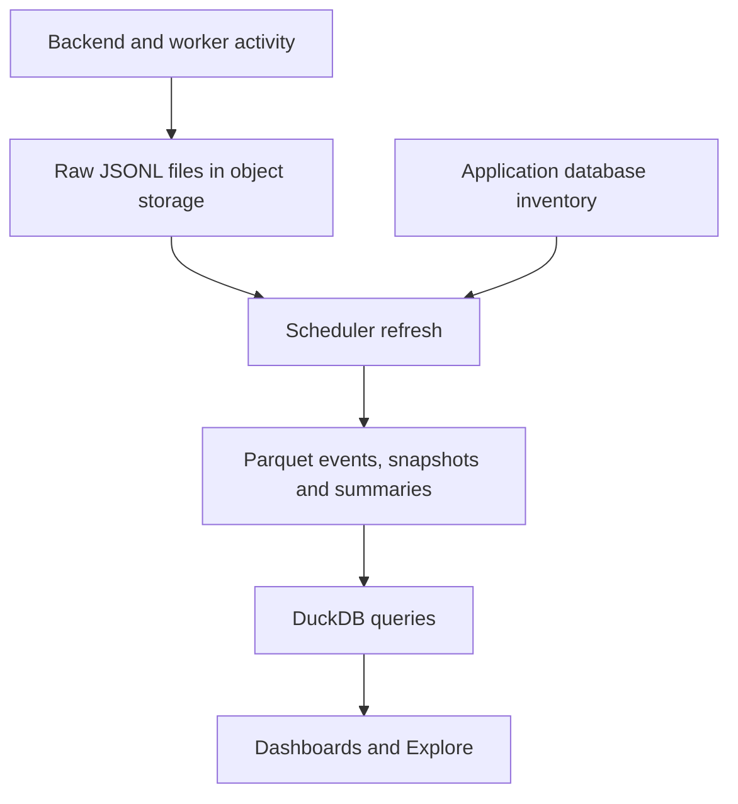

import { FeatureBadge } from '/snippets/feature-badge.jsx';

<div className="feature-badges"><FeatureBadge label="Beta" /> <FeatureBadge label="Self-hosted" /> <FeatureBadge label="Enterprise" /></div>

Configure object storage and scheduled processing for the [usage analytics project](/workspace-admin/usage-analytics-project) on your self-hosted instance. This page covers deployment setup, monitoring, and recovery; use the feature documentation to create the project, grant access, and use its dashboards.

Use this page to understand [how it works](#how-it-works), [configure the deployment](#configure-the-deployment), [enable processing](#enable-processing), [verify setup](#verify-setup), or [troubleshoot processing](#troubleshooting-processing). For dashboard and metric definitions, see the [product guide](/workspace-admin/usage-analytics-project#build-your-own-analysis).

## How it works

Usage analytics separates event capture, scheduled processing and interactive queries. A working query only verifies the data and storage access needed by that query.

<Frame>



</Frame>

The backend and workers buffer supported events and upload compressed JSONL files under `events/raw/`, partitioned by organization, event stream and UTC date. Capture runs asynchronously and is best-effort: buffered events can be lost if a process stops or uploads exhaust their retries. Creating the analytics project is not required for capture.

The scheduler's `compactUsageEvents` task runs the following stages in order on the `usage-events-compaction` queue:

| Stage | Published data |
| --- | --- |
| `compaction` | Converts raw event files into typed Parquet under `events/compacted/`, then removes the successfully processed raw inputs. |
| `dimensions` | Refreshes inventory snapshots from the application database, including users, content and the People membership snapshot. |
| `users` | Builds daily per-user activity summaries from compacted events for the **User activity** Explore. |

The refresh follows the [data freshness schedule](/workspace-admin/usage-analytics-project#data-freshness-and-history). It processes closed UTC days; today's raw events wait for a subsequent refresh. Inventory snapshots reflect the database when that stage runs.

Publication is separate for each output, not one transaction across the pipeline. A failed refresh can leave some datasets updated and others missing or showing their last complete version. **People** activity charts depend on user summaries; its population and returning/inactive-person charts also use the membership snapshot. Query timing charts can still read available query-event files while either People dependency is missing or stale.

For interactive queries, the backend checks the caller's analytics permissions and selects files for the authorized organization. DuckDB reads those Parquet files using short-lived signed URLs and returns results through the normal Explore query flow. It does not query your business warehouse for this data.

## Configure the deployment

1. [Upgrade Lightdash](/self-host/upgrading) and keep the backend, scheduler and workers on the same release.
2. Apply the [enterprise license](/self-host/enterprise-features#apply-the-license-key) to all Lightdash components.
3. Configure [S3-compatible object storage](/self-host/customize-deployment/configure-lightdash-to-use-external-object-storage). Usage storage inherits the base S3 configuration, not the pre-aggregate storage settings. To use a separate bucket or credentials, set the [usage analytics storage variables](/self-host/customize-deployment/environment-variables#usage-analytics-storage). The base S3 configuration is still required.
4. Ensure the backend, scheduler and any query workers can reach the storage endpoint. The capture and refresh processes need to list, read, write and delete usage objects; analytics queries need authenticated reads. Keep the bucket private and configure credentials through your deployment's secret management.
5. Keep the [scheduler](/self-host/customize-deployment/scheduler) running to process captured data and publish inventory snapshots.

Apply configuration consistently to the backend, scheduler and workers, then roll out those components. Do not apply a short-lived query-results cleanup policy to usage data you intend to retain: if your base bucket has a delete lifecycle rule for query results, set `USAGE_EVENTS_S3_BUCKET` to a bucket without one.

<a id="enable-collection" />

## Enable processing

Raw event capture runs on deployments with a license key and working usage storage configuration. The **organization-level** `analytics-project` feature flag controls processing eligibility and analytics access, not raw capture. Ask the Lightdash team to help enable the intended organization. A user-level flag does not enable organization processing.

For a dedicated deployment where you intend to enable every organization, append `analytics-project` to the existing comma-separated [`LIGHTDASH_ENABLE_FEATURE_FLAGS`](/self-host/customize-deployment/environment-variables#feature-flags) setting on all components, preserving other entries. This setting applies to every organization on the instance; use organization-level configuration for a selective rollout.

`USAGE_EVENTS_ENABLED` is not used. [RudderStack telemetry](/self-host/data-flows-and-telemetry) is a separate system: disabling it does not disable usage analytics.

Disabling `analytics-project` prevents subsequent eligible processing and analytics access; it does not stop raw uploads, cancel a run already in progress, or delete stored files. Retain or expire usage objects through your storage policy, including raw files for organizations whose processing is disabled.

## Verify setup

Generate activity in the enabled organization, then allow the scheduled data refresh to complete. Follow [Check a processing run](#check-a-processing-run) to verify the full pipeline. Successful project creation verifies access to storage, but does not prove that events have been collected or processed.

An organization administrator can then [create the analytics project](/workspace-admin/usage-analytics-project#create-your-analytics-project) and run a chart for a closed day with known activity. Check that the user, content and date match that activity. To update installed dashboards after an upgrade, follow [Update models and dashboards](/workspace-admin/usage-analytics-project#update-models-and-dashboards).

For retained database records from before capture began, use [historical backfill](/workspace-admin/usage-analytics-project#historical-backfill).

Usage files can contain user identities and content metadata. Restrict bucket access and choose a retention policy that matches your organization's requirements.

## Troubleshooting processing

Start with scheduler logs for the affected refresh and identify which stage failed or left work pending. Use your deployed release when investigating: available models, log fields and monitoring signals depend on that release.

### Check a processing run

Search scheduler logs for `Usage processing stage started` and `Usage processing stage finished`. Correlate records with the same `runId`. Finished records include `stage`, `durationSeconds` and `outcome`; stage summaries can also include `failed`, `remaining` and `limitReached`.

Check the final record with `stage="pipeline"`, which covers the full sequence:

| Outcome | Meaning |
| --- | --- |
| `success` | All stages completed with no reported failures or known remaining work. |
| `partial` | No failures were reported, but deferred, capped or skipped work remains. |
| `failed` | A stage threw an error or reported failed partitions or snapshots. Other outputs from that run can still be available. |

A successful `compaction` stage is not proof that inventory and user summaries finished. A completed queue job alone is also insufficient: reported compaction failures can mark the pipeline as failed even when the job handler returns normally. A start record without a matching finish can indicate an interrupted or still-running process; check worker health and elapsed time.

After a successful pipeline run, refresh a chart for a closed day with known activity. Pipeline success describes the work discovered by that run; it cannot prove that every event was captured.

### Monitor refresh completion

If you [enable Prometheus metrics](/self-host/customize-deployment/configure-prometheus-metrics-for-self-hosted-lightdash), scrape the scheduler workers and use the full-pipeline success timestamp:

```promql
lightdash_usage_processing_last_finished_timestamp_seconds{
  stage="pipeline",
  outcome="success"
}
```

The value is the completion time, not the scrape time. `lightdash_usage_processing_running` and `lightdash_usage_processing_last_started_timestamp_seconds` show current stage execution. `lightdash_usage_processing_work` reports failed or remaining work and whether a stage reached its work limit. Counts have different units across stages, so do not add them together.

These metrics belong to individual processes and reset when workers are replaced. Use retained scrape history across scheduler replicas, keep deployments separate, and treat an absent success timestamp as unknown rather than healthy. Monitor failed and partial outcomes as well as the age of the last success; a recent success does not clear a later failure. Logs and worker-health checks are still needed for crashes between scrapes.

### Investigate empty People charts while query charts work

Open the affected chart's **Explore from here** action to identify its source. For **User activity**, inspect the `users` stage. For People population and returning/inactive-person metrics, inspect the `dimensions` stage and its membership snapshot errors. Existing event files can serve latency charts even when these outputs are missing or stale.

Also check the chart's date filters and capture coverage. A missing partition is unknown coverage, not proof that nobody was active. For metric definitions and supported historical data, use the [product guide](/workspace-admin/usage-analytics-project#data-freshness-and-history).

### Resolve storage errors

Check the [usage storage configuration](/self-host/customize-deployment/environment-variables#usage-analytics-storage) on every backend, scheduler and worker replica. Confirm the endpoint is reachable and that the configured identity has the required list, read, write and delete access to usage objects. A successful read of an existing event file does not verify permission to publish snapshots or clean up raw inputs.

After fixing credentials, permissions or networking, roll out any changed configuration and follow [Recover a failed or partial run](#recover-a-failed-or-partial-run). Preserve raw files and compaction checkpoints under `events/compaction/`; the pipeline uses them to resume cleanup without publishing the same inputs twice. Events that were never successfully uploaded cannot be recovered by rerunning processing.

### Investigate a missing run

Check that the scheduler is running, can reach the application database and storage, and resolves the organization as eligible for processing. If you use [scheduler task inclusion or exclusion](/self-host/customize-deployment/environment-variables#scheduler), ensure `compactUsageEvents` is allowed. Inspect the scheduler queue and worker logs for a run that is still active before arranging another run.

### Recover a failed or partial run

Fix the reported cause, then check the next serialized run. Nightly jobs make one whole-job attempt; individual storage operations can retry within that attempt. Deferred work queues follow-up history-processing jobs, which have their own retries. The nightly job also reschedules exhausted history-processing jobs.

Nightly processing prioritizes the previous **seven closed UTC dates**, excluding today. Follow-up history jobs process older retained raw files and rebuild user activity summaries from compacted events. This is separate from the [database history backfill](/workspace-admin/usage-analytics-project#historical-backfill). Work limits can leave a run partial, so monitor subsequent outcomes until the backlog clears. Storage retention still determines which files remain available.

If scheduled recovery stops making progress or you need an immediate rerun, contact the Lightdash team with your deployed version, affected UTC dates, `runId`, and sanitized stage errors. Coordinate the rerun through the scheduler's serialized queue; do not run competing standalone compactors or enqueue duplicate jobs while a run is active. Do not include credentials, event payloads, or signed storage URLs in a support report.

For model and dashboard changes, use [Sync content](/workspace-admin/usage-analytics-project#update-models-and-dashboards); it does not rerun this pipeline.
