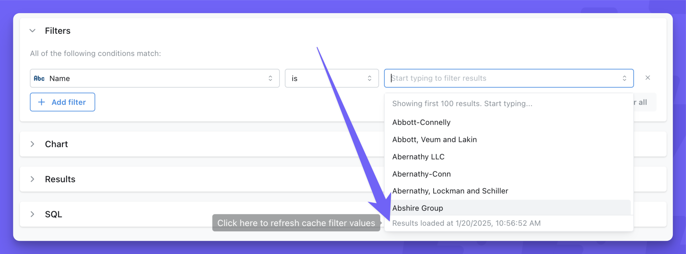
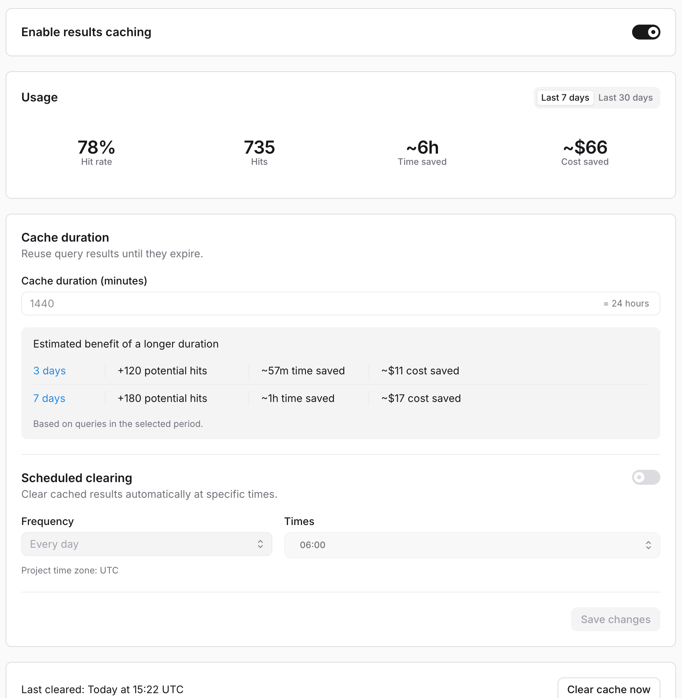
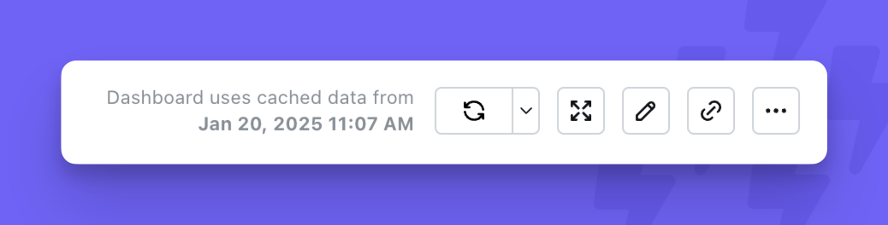

import { FeatureBadge } from '/snippets/feature-badge.jsx';

Caching is available on Lightdash Cloud and on self-hosted instances with a valid Enterprise license. Filter value caching is available on all Cloud plans; results caching requires Enterprise.

Lightdash supports two types of caching:

1. **[Cached Filter values](#filter-value-caching)** - enabled for every cloud user without requiring any configuration.
2. **[Cached results for Charts and Dashboards](#chart-and-dashboard-results-caching)** - available on Enterprise; project admins enable and configure it themselves.

## Filter value caching

This type of caching works without any configuration for cloud users. You'll see a message in your filter values that tells you when the cached filter values were loaded from (usually within the last day). To refresh the values, click **Results loaded at**: Lightdash clears the list and queries your warehouse again, skipping the cache. If a value still looks out of date after a refresh, the warehouse table hasn't changed yet.

<Frame>

</Frame>

If you search filter values by starting to type, Lightdash will also cache those values so the next time you need the same search the values will be shown much faster.

The **Results loaded at** message doesn't appear for dimensions with [`fetch_from_warehouse: false`](/semantic-layer/dimensions#filter-autocomplete), or for dimensions with a static `values` list until you start typing. Static values come from your YAML, so update them there.

## Chart and dashboard results caching

<FeatureBadge label="Enterprise" />

<Info>
  Results caching is off by default. Project admins turn it on and set its [cache duration](#cache-duration-per-project) themselves under **Project settings → Results caching** — there's no need to contact the Lightdash team. A cache timestamp in the dashboard header confirms it is active; if no timestamp appears, it is not enabled.

  The one exception is a self-hosted instance that still sets the deprecated `RESULTS_CACHE_ENABLED` environment variable: it forces caching on or off for every project, the toggle in project settings is locked, and the page tells the admin to contact their instance admin to change it.
</Info>

Popular charts and dashboards will load faster when caching is enabled. The first user to visit a chart or dashboard each day will load fresh results from the warehouse, which get cached. After that, all following visits to the same chart or dashboard will load from the cached results.

Any changes to the chart query or dashboard queries (user attributes, filters, limit, date zoom) will trigger new queries to the warehouse and create a separate cached results entry.

Caching popular charts and dashboards will reduce warehouse costs to the organization by reducing the number of queries; it also improves server performance and makes the user experience much faster in Lightdash.

### Scope of the cache

Each project turns caching on or off, and sets its own **cache duration**, under **Project settings → Results caching** — see [Cache duration per project](#cache-duration-per-project). There is no way to enable or disable caching for an individual dashboard.

These Lightdash features use caching when it's turned on for the project:

- **Saved Charts** are cached based on the last refresh in any context (edit mode, view mode, dashboard refresh, etc.), but queries made while editing are NOT cached or pulled from cache.
- **Dashboard tiles** (internal and embedded) will use the cache from saved charts they reference. If charts only exist on a single dashboard, they will refresh whenever you click the Refresh button on the dashboard. Embedded dashboards have no Refresh button, so embedded viewers see cached results until they expire. To control how fresh embedded data is, set the project's [cache duration](#cache-duration-per-project); a shorter duration sends more queries to the warehouse.
- **SQL runner queries** including saved SQL charts and dashboard SQL chart tiles are cached through the same execution path as metric-based charts. Note that the SQL runner does not have a UI button to force-refresh or invalidate the cache — results remain cached until the cache expires.
- **Metrics Catalog** queries go through the same async query service and are cached like any other query.
- **[Data apps](/data-apps)** run every metric query through the same async query service and are cached like any other query, including live-linked charts. The **Refresh** button in the app header (while building or viewing) invalidates the cache for that app and re-queries the warehouse fresh for the rest of the session, the same way the dashboard refresh button does. Because the cache key is project ID plus generated SQL, apps with lots of interactive filter controls produce more distinct cache entries than an equivalent dashboard — the first hit on each filter combination still goes to the warehouse.

These Lightdash features DO NOT use caching:

- **Scheduled Deliveries** and **Google Sheets syncs** run a fresh warehouse query by default. To reuse unexpired cached results instead, turn on **Use cached results when available** on the delivery or sync. The option isn't offered for data app deliveries.
- **Editing a saved chart** — actions in edit mode (such as changing columns, filters, or other query parameters) explicitly bypass the cache to ensure you always see fresh results while building a query.
- **[External connections](/data-apps/external-connections) in data apps** — requests to third-party HTTP APIs are runtime fetches through the Lightdash proxy and are not covered by results caching.

Results caching doesn't apply to [live data sources](/integrations/live-data-sources#caching).

### Cache Mechanism

The cache is stored in S3 and the cache identifier is based on the project ID and the generated SQL. This means that any change to the selected columns, filters, joins, user attributes, etc. will trigger a new query to the warehouse and add a new cache entry for that query.

[User attribute](/workspace-admin/user-attributes) values in a `sql_filter` are written into the generated SQL, so users with different attribute values never share a cache entry; users with the same values share one, because they see the same rows. Fields a user's `required_attributes` don't allow are checked before any SQL is built, so a query that selects one returns a `Forbidden` error instead of cached results.

### User-level caching

When a project is configured to [require user credentials](/personal-settings/personal-warehouse-connections), cached results are scoped to each individual user. This means:

- Each user's queries are cached separately based on their personal warehouse credentials
- Users cannot access cached results from other users' queries
- This ensures data access controls are maintained at the individual user level

### Filtering with time values and caching

When using filters with datetime values, the specificity of the time component affects caching behavior:

- **Dynamic datetime values with seconds** (e.g., `12:11:25`) will generally not benefit from caching because each query generates a unique timestamp, creating a new cache entry every time.
- **Definite times** (e.g., `12:00:00`) or **dates without time components** will cache effectively because they produce consistent SQL queries that can be reused.

**Best practices for cacheable time filters:**
- Use date-only filters when possible (e.g., `2024-01-15` instead of `2024-01-15 12:11:25`)
- Round times to the nearest hour or fixed interval (e.g., `12:00:00` instead of `12:11:25`)
- Avoid filters that use dynamic "current time" functions with second precision

This ensures your queries can leverage cached results and reduce warehouse load.

### Cache expiry and invalidation

Cached results automatically expire after 24 hours by default. The instance default is set by `CACHE_STALE_TIME_SECONDS` and applies to every project that hasn't set its own duration.

Cache expiry is **rolling, not scheduled**. It's based on the age of each cached result, not a fixed time of day. For example, if a dashboard is first loaded at 2:00 PM, its cache expires at 2:00 PM the next day. This means different dashboards and charts may have different cache ages depending on when they were last refreshed.

#### Cache duration per project

Project admins turn caching on and set the cache duration for a single project under **Project settings → Results caching**. This page is available to any project whose organization has a valid Enterprise license.

1. Turn on **Enable results caching**.
2. Under **Cache duration**, enter a whole number of minutes between `1` and `43200` (30 days) in **Cache duration (minutes)**.
3. Click **Save changes**.

<Frame>

</Frame>

Below the field, **Estimated benefit of a longer duration** shows what a longer cache duration would save. Lightdash calculates it by replaying the project's queries from the selected period with each longer duration and counting the extra cache hits. Click a duration to use it.

On a self-hosted instance that still sets the deprecated `RESULTS_CACHE_ENABLED` environment variable (see [environment variables](/self-host/customize-deployment/environment-variables#cache)), caching is forced on or off for every project and the toggle here is locked — contact your instance admin to change it instead.

<Tip>
If your dashboards report on "yesterday's data" and you want users to always see fresh results in the morning, set a shorter cache duration (for example, 8 hours) so that results cached during the workday expire overnight.
</Tip>

The dashboard header displays the date and time of the chart with the oldest cache. If no time is displayed, then no charts are cached. You can invalidate and refresh cached dashboard results by pressing the dashboard refresh button.

A cached result is served as stored until it expires, even one cached while the underlying table was empty or being rebuilt. If tiles show empty or null values for a filter value while Explore shows the right numbers, press the dashboard refresh button: reloading the browser page serves the same cached result. Running the same query in Explore also replaces the entry, because Explore skips the cache lookup and its fresh result becomes the newest entry for that SQL. If your tables are rebuilt on a schedule, set a [cache duration](#cache-duration-per-project) that fits that schedule.

<Frame>

</Frame>

#### Clear cached results

Project admins can clear cached results for everyone, at the scope that changed. Clearing needs results caching turned on for the project.

| Scope | In Lightdash | Through the API |
| --- | --- | --- |
| Project | **Project settings → Results caching → Clear cache now** | `POST /api/v1/projects/{projectUuid}/results-cache/invalidate` |
| Explore | Explore's **⋯** menu → **Clear cache for everyone** | `POST /api/v1/projects/{projectUuid}/results-cache/invalidate/explores` |
| Dashboard | Dashboard's **⋯** menu → **Clear cache for everyone** | `POST /api/v2/dashboards/{dashboardUuid}/results-cache/invalidate` |
| Saved chart | Chart's **⋯** menu → **Clear cache for everyone** | `POST /api/v2/saved/{chartUuid}/results-cache/invalidate` |

Clearing applies everywhere those results are used, including dashboards and embeds. When clearing an explore, select **Also clear explores that use this table** to also clear every explore that joins this explore's base table or is built on it.

Clearing doesn't rebuild [pre-aggregates](/semantic-layer/pre-aggregates). If queries on a cleared explore are served from a pre-aggregate, refresh the pre-aggregate too, or those queries keep returning the same data.

#### Clear cached results from a data pipeline

Call an invalidation endpoint once a dbt run or load finishes, so the next person to open a chart or dashboard gets fresh results instead of what was cached before the run. Authenticate with a [personal access token](/personal-settings/create-personal-tokens) that belongs to a project admin.

If a load only touches some tables, clear only the explores that read them, and keep everything else cached. List up to 100 explore names in `exploreNames`; set `includeJoinedExplores` to `true` to also clear the explores that join their base tables:

```bash
curl -X POST \
  -H "Authorization: ApiKey $LIGHTDASH_API_KEY" \
  -H "Content-Type: application/json" \
  -d '{"exploreNames": ["orders", "payments"], "includeJoinedExplores": true}' \
  "$LIGHTDASH_URL/api/v1/projects/$PROJECT_UUID/results-cache/invalidate/explores"
```

The response lists every explore that was cleared. An unknown explore name returns a `404` that names it, and nothing is cleared. See the [API reference](/api-reference/v1/introduction) for full request and response details.

#### Clear cached results on a schedule

To clear the whole project at fixed times, for example after a nightly load, use **Scheduled clearing** under **Project settings → Results caching**:

1. Turn on **Scheduled clearing**.
2. Choose a **Frequency**: **Every day** or **Every week**. For a weekly schedule, choose the **Day**.
3. In **Times**, choose one or more hours. Times use the project time zone shown under the fields.
4. Click **Save changes**. The card shows when the **Next clear** runs.

### Monitor cache usage

Project admins see how much the cache saves, and what to change to save more, at the top of **Project settings → Results caching**. Choose **Last 7 days** or **Last 30 days** to set the period; the [cache duration estimates](#cache-duration-per-project) use the same period.

With caching on, the **Usage** card shows:

- **Hit rate** — the share of the period's queries served from the cache.
- **Hits** — the number of queries served from the cache.
- **Time saved** — the warehouse time those queries would have taken.
- **Cost saved** — an estimate of what that warehouse time would have cost, based on list prices for your warehouse type. Hover it to see the assumption.

Queries that skip the cache on purpose, such as queries made while editing a chart, aren't counted.

Some cache misses are avoidable. The **Usage** card totals them, for example "719 avoidable misses · 10.0h of warehouse time". Click **View recommendations** to list the charts and explores whose avoidable misses used the most warehouse time, up to 10, each with the reason and a suggested fix:

| Reason | What happened | Suggested fix |
| --- | --- | --- |
| **Expired** | The cached result was older than the cache duration | Raise the [cache duration](#cache-duration-per-project) |
| **Cleared** | The cached result had been cleared | [Clear](#clear-cached-results) only what changed, such as specific explores |
| **Scheduled refresh** | A scheduled delivery or Google Sheets sync ran a fresh query | Turn on **Use cached results when available** on the delivery or sync |

## Results caching vs pre-aggregates

Lightdash has two independent systems for speeding up queries: **results caching** (documented above) and **pre-aggregates**. They work differently and are designed to be used together, not as replacements for each other.

Both act only on query execution: they shorten or skip the warehouse part of loading a chart or dashboard. Neither changes the time your browser spends loading the dashboard and rendering its tiles, so a dashboard whose every query is served from the cache or a pre-aggregate still takes a moment to open — longer with many tiles or heavy custom visualizations.

### Results caching

Results caching stores the exact result of any query that runs through Lightdash, keyed by a hash of the generated SQL, and serves subsequent identical queries from S3 until the entry expires (24 hours by default, [configurable per project](#cache-duration-per-project)). It covers every query shape — including custom metrics, table calculations, and SQL runner queries — but the first run of each unique query still hits your warehouse, and any change to the query (a different filter, column, limit, or user attribute) produces a new entry and another warehouse query.

### Pre-aggregates

[Pre-aggregates](/semantic-layer/pre-aggregates) are summary tables you define in your dbt YAML. Lightdash materializes them on a schedule (or on compile, or manually) and stores the results in S3. When a user query matches the pre-aggregate's dimensions, metrics, filters, and granularity, Lightdash serves the query from the materialized data using in-memory DuckDB workers. The warehouse is not touched at query time, even on the first query.

A single pre-aggregate can serve many different queries. A daily pre-aggregate with five dimensions can answer day, week, month, quarter, and year queries across any subset of those dimensions and with any narrower filter. Results caching, in contrast, needs one cache entry per unique SQL.

### Key differences

|                              | Results caching                                    | Pre-aggregates                                                         |
| ---------------------------- | -------------------------------------------------- | ---------------------------------------------------------------------- |
| **Configuration**            | Turned on per project in project settings          | Defined in dbt YAML                                                    |
| **Trigger**                  | First query runs against warehouse, then cached    | Materialized on compile, cron, or manual refresh                       |
| **Storage**                  | Query result (row set)                             | Pre-computed summary table                                             |
| **Query execution**          | Exact cached result is returned                    | DuckDB workers re-aggregate at query time                              |
| **Warehouse hit on first query?** | Yes                                           | No — only materialization hits the warehouse, not query-time serving    |
| **Coverage**                 | All metric types, all query shapes                 | Only re-aggregatable metrics (sum, count, min, max, average)           |
| **Scope**                    | One cache entry per unique SQL                     | One pre-aggregate can serve many query shapes                          |
| **Availability**             | <FeatureBadge label="Enterprise" />             | <FeatureBadge label="Enterprise" />; [feature enablement](/semantic-layer/pre-aggregates)      |

### When to use which

**Use pre-aggregates when:**

- You have high-traffic dashboards with predictable query patterns
- You want to reduce warehouse cost or improve latency on the first query, not just repeat visits
- The metrics are re-aggregatable (sum, count, min, max, average)
- You're willing to design and schedule the materializations

**Use results caching when:**

- Query patterns are ad-hoc or unpredictable
- You need features that pre-aggregates don't support, such as `count_distinct` outside an [exact match](/semantic-layer/pre-aggregates#exact-match-queries), [Parameters](/semantic-layer/parameters), or raw SQL table calculations
- You're using the SQL runner
- You don't want upfront configuration work

In most cases, both should be enabled. Pre-aggregates handle your heaviest, most predictable workloads. Results caching is the safety net for everything else.

### Using both together

When both systems are enabled, they act as two layers of caching. A query that matches a pre-aggregate is served from the materialized data by DuckDB workers. The result of that DuckDB query can then be stored in the results cache, so subsequent identical requests skip even the DuckDB step and return the cached result directly. This means pre-aggregates eliminate the warehouse hit, and results caching eliminates repeated computation on top of that.
