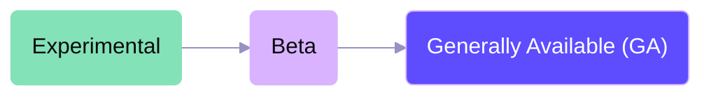

Maturity describes how stable a feature is and what changes to expect. Click an Experimental or Beta badge to read its definition here. [Plan access and deployment requirements](/support/feature-availability) determine whether you can use a feature independently of its maturity.

## Feature lifecycle

<Frame caption="Features progress from Experimental through Beta to generally available">

</Frame>

### Experimental

Experimental features are where we explore new ideas and test out proof of concepts.

- We're still building out core functionality, so things may be incomplete or unstable
- We might make breaking changes without much notice as we iterate
- Access can be limited to our internal team and design partners; the feature's page identifies who can use it
- Our design partners help us figure out what the feature should do and how it should work
- We're in full feedback-driven development mode

### Beta

Beta features are usable, but they might change. We may redesign or rethink them based on what we learn.

- You can use these features, but don't build workflows around them that you can't undo
- Expect breaking changes — the API, behavior, or UX may change as we iterate
- We're actively gathering feedback to shape the final design
- Documentation is available, but may evolve alongside the feature
- Our support team can help, though some rough edges are expected

### Generally available (GA)

GA features are stable. GA is a promise about stability — you can depend on these features in production.

- The API won't break and the UX won't fundamentally change
- We're committed to backward compatibility
- Complete documentation and training materials are available
- Fully supported by our team

## Deprecated

A deprecated feature is still available, but you should use its documented replacement where one exists. Deprecation follows availability; it is not a maturity stage between Experimental, Beta, and GA. The feature's page describes the replacement and any migration steps.

## Using feature maturity levels

These levels help you understand what to expect from each feature's stability, so you can decide what works best for your production environment and risk tolerance.

When you're evaluating features for your use case, we recommend considering the maturity level alongside your requirements for stability, support, and backward compatibility.
