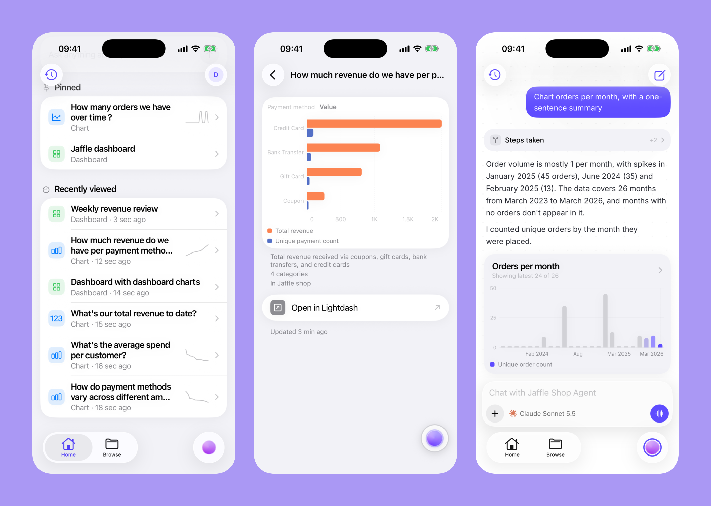
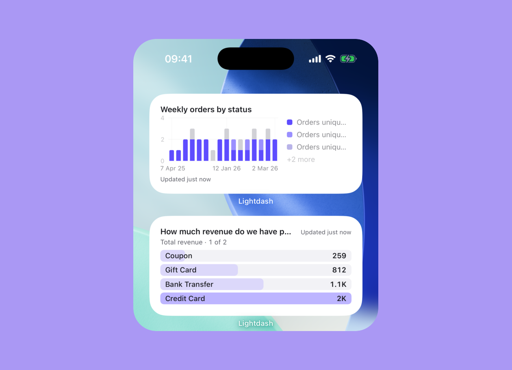

Lightdash Mobile puts your team's Lightdash content and [AI agents](/agents/use-ai-agents) on your phone. The app is called **Lightdash AI** in the stores and **Lightdash** on your phone. Download it from [the App Store](https://apps.apple.com/app/lightdash-ai/id6803089592) or [Google Play](https://play.google.com/store/apps/details?id=com.lightdash.mobile).

The iOS app needs iOS 18 or later and runs on iPhone and iPad. The Android app needs Android 9 or later.

<Frame caption="Home, a saved chart, and an Ask answer. Sample Jaffle Shop data.">
  
</Frame>

## What you can do

- **Home.** See what your project has pinned and what you looked at recently.
- **Browse.** Open spaces, dashboards, and saved charts, or search for them. Charts and dashboards run live queries against your warehouse.
- **Ask.** Chat with your project's AI agents. Charts in an answer appear in the conversation. Past chats stay in the list, and a chat keeps running if you leave it.
- **Home screen widgets.** Keep a saved chart on your home screen, or describe a chart and let Lightdash build it for the widget.
- **Open links in the app.** On Lightdash Cloud, links to charts, dashboards, spaces, and AI agent threads open in the app when it's installed.
- **Read content offline.** Content you've opened stays readable without a connection. Set how much the app keeps in **Profile**.

## Set up the app

<Steps>
  <Step title="Install the app">
    Install **Lightdash AI** from the [App Store](https://apps.apple.com/app/lightdash-ai/id6803089592) or [Google Play](https://play.google.com/store/apps/details?id=com.lightdash.mobile).
  </Step>
  <Step title="Connect to your Lightdash instance">
    Choose **app.lightdash.cloud** for Lightdash Cloud in the US, or **eu1.lightdash.cloud** for the EU. For a dedicated or self-hosted instance, type the address you open in your browser into **Your Lightdash address**, then tap **Connect**.
  </Step>
  <Step title="Sign in">
    The app shows the sign-in methods your instance offers, such as **Continue with work email**, **Continue with Google**, **Continue with Microsoft**, or **Continue with SSO**. Use the same account you use on the web. See [SSO providers](/workspace-admin/sso) for how your organization sets these up.

    On Lightdash Cloud, you can sign in with a QR code instead. In Lightdash on your computer, open your settings, choose **Mobile**, and follow **Sign in on your phone**. Scan the code with your phone's camera, then follow the prompts on your computer and your phone.
  </Step>
  <Step title="Choose a project">
    Pick the project to work in. Ask runs its queries in this project. To change it later, open **Profile**.
  </Step>
  <Step title="Add a widget">
    Add a widget from your phone's widget gallery. See [Add a home screen widget](#add-a-home-screen-widget).
  </Step>
</Steps>

## Add a home screen widget

<Tabs>
  <Tab title="iOS">
    Touch and hold the Home Screen, tap **Edit**, then **Add Widget**, and search for **Lightdash**. Choose one of these widgets:

    - **Lightdash chart** shows a saved chart. Touch and hold the widget and tap **Edit Widget** to choose the chart.
    - **Ask for a chart** builds a chart from a description. Tap the widget, describe the chart, and the app builds it with your AI agent. To change the chart, tap it, then tap **Chat about this**.
    - **Lightdash number** shows one number from a saved chart.

    Each widget keeps its own chart, so two widgets can show different charts.
  </Tab>
  <Tab title="Android">
    Touch and hold the home screen, tap **Widgets**, and drag the **Lightdash** widget onto the home screen. Under **Choose a chart**, pick a saved chart, or choose **Describe a chart** and type what you want to see. Lightdash builds the chart with your AI agent and the widget shows it when it's ready.

    To change a described chart, tap the widget and choose **Refine this widget**.
  </Tab>
</Tabs>

<Frame caption="A widget built from a description, above a saved-chart widget. Sample Jaffle Shop data.">
  
</Frame>

Charts that you describe for a widget belong to that widget. They don't change your team's saved charts.

## AI data sharing

Ask and described-chart widgets send data to an AI model provider. Before the first one runs, the app asks you to allow AI processing on that Lightdash instance. Nothing is sent until you tap **Allow**. The app sends:

- your questions and recent chat history
- the names and descriptions of the project's tables, fields, saved charts, and dashboards
- the results of the queries the agent runs, which can include values from your organization's data
- your name, role, and team names, if your admin turned that on for the agent

The consent screen names the provider. On app.lightdash.cloud and eu1.lightdash.cloud, it's Anthropic or OpenAI, depending on the model your admin chose for the agent. On other instances, it's the provider your admin configured. See [AI settings](/workspace-admin/ai-settings).

To stop sharing, turn off **Allow AI processing** in **Profile**. On iOS, it's under **Profile** → **AI data sharing**.

## Turn off the mobile apps

Mobile sign-in is on for every organization by default. To turn it off:

- **Lightdash Cloud:** contact Lightdash support to turn off the mobile apps for your organization. Mobile sign-ins and existing mobile sessions then stop working.
- **Self-hosted:** set [`AUTH_MOBILE_LOGIN_ENABLED`](/self-host/customize-deployment/environment-variables#feature-toggles) to `false`. This turns off mobile sign-in for the whole instance.

## Microsoft Intune

<Info>
  Intune app protection works on dedicated Lightdash Cloud instances that sign in with Microsoft Entra ID. For other deployments, contact Lightdash support.
</Info>

Both apps include the Intune App SDK. When your organization signs in with Microsoft, **Continue with Microsoft** signs in through the Microsoft broker app, and Intune applies your app protection policy to Lightdash.

An Entra admin and an Intune admin set it up:

1. Grant admin consent to the Lightdash app in Entra. Open this URL as an admin, with your tenant ID in place of `{tenant-id}`. Use the client ID for each platform you support:

   ```text
   https://login.microsoftonline.com/{tenant-id}/adminconsent?client_id={client-id}
   ```

   | Platform | Client ID |
   | --- | --- |
   | iOS | `72aa2627-65e1-448b-a442-825fb40ed916` |
   | Android | `46c93d8c-6ef7-4b15-98c1-fac81bddc38e` |

   You can also grant consent in the Entra admin center under **Enterprise applications** → the Lightdash app → **Permissions** → **Grant admin consent**. Consent must cover both permissions the app requests: Microsoft Graph sign-in, and **Microsoft Mobile Application Management** `DeviceManagementManagedApps.ReadWrite`. With sign-in consent only, people can sign in, but Intune enrollment fails. The app then runs without your policy and shows no error.

2. In the Intune admin center, open **Apps** → **App protection policies** and create or edit a policy for each platform. Under **Apps**, choose **Select custom apps** and add `com.lightdash.mobile`. It's the bundle ID on iOS and the package name on Android.
3. Assign the policy to the people who use the app. Target all device types, or include unmanaged devices. A policy for enrolled devices only doesn't apply to a phone that isn't enrolled in Intune.
4. Optional: to block sign-in until an app protection policy covers the app, add a Conditional Access policy with the **Require app protection policy** grant.

Each person then installs the Microsoft broker app: **Microsoft Authenticator** on iOS, or **Intune Company Portal** on Android. In Lightdash, they enter your instance address and tap **Continue with Microsoft**. On the first sign-in, Intune can restart the app once. Then it asks for a PIN if your policy requires one.

### If the policy doesn't apply

If the app runs without your policy, for example copy and paste still works where the policy blocks it:

1. In the Entra admin center, open **Enterprise applications** → the Lightdash app → **Sign-in logs**, and filter to the person.
2. After the Lightdash sign-in, look for a second sign-in to **Microsoft Mobile Application Management**. Its status and error code say why enrollment failed.
3. If consent is missing, grant it as in step 1. Then have the person sign out of the app and sign in again.
